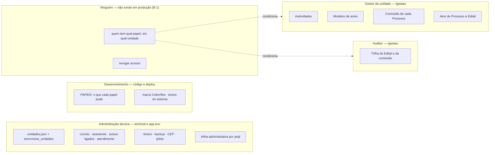

# Auditoria — Administração institucional do GPS

*Auditoria de 30/10/2026, sobre a `main` em `62824816` (depois da `104`). Nada foi implementado nem
migrado, e nenhuma especificação foi aberta. Caminhos de código são relativos a
`backend/processo_seletivo/`, salvo quando começam por `backend/`, `specs/` ou `doc/`. As capturas
estão em [`auditoria-administracao-institucional-2026-10-30/`](auditoria-administracao-institucional-2026-10-30/).*

**A pergunta:** o GPS dispõe dos recursos necessários para a sua administração institucional e
operacional, ou há necessidades administrativas não previstas, incompletas, dispersas ou
dependentes de intervenção técnica?

**Como foi verificado.** Leitura do código, das specs `060`, `066`, `073` e `075`, do guia de
implantação e de três auditorias anteriores:
[configurações, 14/10](auditoria-configuracoes-do-sistema-2026-10-14.md),
[notificações, 09/10](auditoria-notificacoes-aos-candidatos-2026-10-09.md) e
[Retificação, 29/10](auditoria-retificacao-passagem-e-sorteio-2026-10-29.md).

As jornadas foram executadas num banco próprio (`ps_auditoria_admin`, `make preparar` mais
`seed_demo`), com o servidor local na porta 8141 e o seletor de identidade ligado. Nenhuma
comunicação real saiu: o despacho dos avisos rodou contra um servidor de correio inexistente
(`127.0.0.1:1`).

Cada afirmação traz uma marca:

- **[F]** é fato lido no código ou observado na execução;
- **[I]** é inferência fundamentada;
- **[H]** é hipótese ainda não verificada.

### Parecer do usuário, 30/10/2026

O diagnóstico foi aceito. O parecer ajustou a priorização e as decisões arquiteturais, e o
registro abaixo prevalece sobre as §8 e §10 onde elas divergem.

**Sequência adotada:**

| Ordem | Encaminhamento | Forma |
|---|---|---|
| 0 | Correções pontuais de segurança e implantação | PR independente |
| 1 | **Estudo e decisão arquitetural** sobre identidade, papéis e unidades | próximo trabalho principal |
| 2 | Spec de acesso institucional (B-1) | depois da decisão |
| 3 | Trilha administrativa por unidade | spec pequena, só leitura |
| 4 | Diagnóstico de correio e notificações | spec independente e **prioritária** |
| 5 | Retenção/LGPD e ativação multiunidade | trilhas separadas |

**Correções ao relatório:**

- **Autenticação e autorização são decisões distintas.** A Q-1 e a Q-2 não se reduzem a escolher
  LDAP, SUAP ou gov.br. A hipótese inicial é SSO institucional para autenticar e vínculos de
  autorização mantidos no GPS — salvo se o diretório já fornecer esses vínculos com granularidade,
  governança e confiabilidade suficientes. O GPS não deve virar mais um cadastro de usuários e
  senhas.
- **O B-1 não se projeta só para o Cefor.** Mesmo com uma unidade operando, a identidade nasce
  considerando vínculos com várias unidades.
- **A segregação se preserva pela identidade real.** A regra impede que a mesma *pessoa* elabore e
  homologue o próprio ato, ainda que tenha vários papéis, troque de unidade ou de sessão.
- **O correio precisa de alerta que não dependa do próprio SMTP**, além do diagnóstico na tela.
- **O `seed_demo` se corrige já**, com verificação efetiva do ambiente e teste de regressão.
- **A hipótese de uma área administrativa não está encerrada.** Uma interface pequena de vínculos
  pode se justificar depois do B-1, como consequência da arquitetura de autorização escolhida, e
  não como ponto de partida.

O estudo do item 1 está em
[`estudo-identidade-e-acessos-2026-10-30.md`](estudo-identidade-e-acessos-2026-10-30.md).

---

## 1. Resumo executivo

**Diagnóstico.** O GPS tem uma administração **operacional** madura, e uma administração
**institucional** que ainda não existe em produção.

- **Dentro do certame, a administração é bem desenhada.** Comissão e alocação, autoridades
  signatárias, modelos de aviso, atos do Processo, do Edital e da Retificação, interrupção e reenvio
  de aviso: tudo tem tela, permissão própria, idempotência e trilha append-only. Também há
  congelamento do que foi publicado: unidade e autoridade são copiadas para o ato
  (`publicacoes/models.py:63-79`).
- **Fora do certame, quase tudo é implantação.** As unidades vivem num JSON revisado em PR. Os
  papéis são um dicionário no código. A marca "Cefor/Ifes" está escrita em dez arquivos. O canal de
  atendimento é uma variável de ambiente única.

**A lacuna dominante não é um módulo administrativo: é a identidade (B-1).** A gestão não tem
autenticação em produção e responde 503 (`interface/views.py:729-730`). Não existe conta de
servidor, vínculo de pessoa com unidade, atribuição de papel, revogação, nem "primeiro
administrador" (guia, §11.4). Por isso as jornadas 3, 4 e 7 deste relatório não se completam em
produção, por pessoa nenhuma, com ou sem a TI.

Fora do 503, a mesma causa tem dois efeitos:

- no ambiente de demonstração, cada pessoa escolhe os próprios papéis;
- a segregação de funções compara cadeias de texto livres (`publicacoes/application/publish_edital.py:705-710`).

**As outras quatro lacunas verificáveis:**

1. **A trilha administrativa é gravada e não é legível.** Cadastro e encerramento de autoridade,
   registro e alteração de unidade, modelos de aviso e credenciais de candidato vão à
   `RegistroAuditoria`. Nenhuma tela os mostra: a trilha do Edital não os reúne
   (`auditoria/selectors.py:86-107`), e a API está fechada em produção (I-1). O guia manda consultar
   pelo `psql` (`doc/implantacao-em-producao-ubuntu.md:2262-2275`).
2. **O diagnóstico de correio depende do servidor.** Ensaiado: com o servidor de correio fora, o
   aviso fica "pendente, 0 tentativas", e depois de 10 minutos a tela diz "Confira o serviço de
   despacho no servidor". O código de acesso e o comprovante falham em silêncio, só com uma linha de
   log (`identidade/application/mensagem.py:107-109`). E o código de acesso é o único fator de
   autenticação do candidato (I-10).
3. **O sistema é de uma unidade só.** O `unidades.json` tem o Cefor. O escopo do ator é um texto
   único e fixo em `cefor` (`interface/identidade.py:21`, `seguranca/domain.py:5-8`). A marca e o
   atendimento são globais. O desenho por unidade existe no banco, mas nenhuma segunda unidade
   consegue ser operada.
4. **Retenção, descarte e LGPD (B-2) não têm mecanismo.** A única exclusão existente, a dos
   registros do piloto, é um comando sem trilha
   (`duvidas/management/commands/excluir_registros_do_piloto.py:46-47`).

**Recomendação preliminar (§6).** Nem um módulo administrativo genérico, nem o Django Admin. O
caminho é a **alternativa A, com três acréscimos pequenos e uma decisão estrutural**:

- **a decisão:** a forma da autenticação, e se o papel e a unidade vêm do diretório institucional
  ou de um vínculo mantido no GPS. É ela que diz se haverá uma tela de "acesso" e de que tamanho;
- **os acréscimos:**
  1. a leitura da trilha administrativa da unidade;
  2. a situação do correio e do despacho, vista pela gestão;
  3. a guarda contra o `seed_demo` em produção.

O resto já está no mecanismo certo e deve ficar onde está: unidades em arquivo, configuração
técnica no `app.env`, papéis no código.

---

## 2. Mapa da administração existente

### 2.1 O que tem interface

| Capacidade | Rota | Permissão | Escopo | Trilha | Evidência |
|---|---|---|---|---|---|
| Autoridades da unidade (cadastrar, corrigir antes do uso, encerrar) | `/gestao/autoridades` | `autoridade:gerir` (Gestor) | unidade | `CADASTRAR_`, `CORRIGIR_` e `ENCERRAR_AUTORIDADE`, com antes e depois | `interface/urls.py:47`, `interface/views.py:10471-10516`, `unidades/application/autoridades.py:146-325`; [captura 01](auditoria-administracao-institucional-2026-10-30/01-autoridades-da-unidade.jpg) |
| Modelos de aviso (criar, editar, inativar) | `/gestao/modelos-de-aviso` | `aviso:enviar` (Gestor, Publicador) | unidade | `AVISO_MODELO` | `interface/urls.py:564-566`, `avisos/application/modelos.py`; [captura 02](auditoria-administracao-institucional-2026-10-30/02-modelos-de-aviso.jpg) |
| Comissão do Processo (incluir, mudar função, remover; inclusão em lote) | `/gestao/processos/<id>/comissao` | `comissao:gerir` (Gestor) **ou** presidência daquela comissão | Processo | `COMISSAO_*`, `ALOCACAO_*` | `interface/urls.py:287-289`, `comissoes/application/comissao.py:67-285`, `comissoes/domain/autorizacao.py:65-81`; [captura 04](auditoria-administracao-institucional-2026-10-30/04-comissao-identificador-nao-verificado.jpg) |
| Alocação por Etapa | dentro do Processo | o mesmo | Processo | `ALOCACAO_*` | `comissoes/application` |
| Atos do Processo (ativar, encerrar, cancelar) e do Edital (criar, submeter, homologar, devolver, revogar, publicar, encerrar, cancelar) | dentro do Processo e do Edital | uma permissão por ato | unidade | sim | `interface/atos_processo.py:30-59`, `interface/atos.py:51-133` |
| Retificação (elaborar, editar rascunho, submeter, homologar, publicar, cancelar) | dentro do Edital | uma permissão por ato | unidade | sim | `interface/urls.py:172-178` (a `103` fechou o AUD-RET-04) |
| Avisos (compor, confirmar, interromper, reenviar falhas) | `/gestao/editais/<id>/avisos`, `/gestao/avisos/<id>` | `aviso:enviar`; leitura também pela presidência e pelo Auditor | Edital | `AVISO_CONFIRMAR`, `AVISO_INTERROMPER` | `interface/urls.py:554-561`, `avisos/application/comando.py:57-71` |
| Trilha do Edital e da comissão | `/gestao/editais/<id>/auditoria`, `/gestao/processos/<id>/auditoria` | `auditoria:consultar` (Auditor) | Edital, Processo | — | `interface/views.py:5209`, `:9515` |
| Visão Geral, Relatório consolidado e Agenda | `/gestao/visao-geral`, `/gestao/agenda` | `visao:consultar`; Agenda para todos | unidade | — | `interface/navegacao.py:62-78` |

A barra lateral tem **dois** itens administrativos, ambos no grupo "Unidade": Autoridades e Modelos
de aviso (`interface/navegacao.py:62-78`). O resto se alcança dentro de cada Processo.

### 2.2 O que é implantação ou terminal

| Capacidade | Mecanismo | Quem executa | Trilha |
|---|---|---|---|
| Registrar, renomear ou desativar unidade | `unidades/unidades.json` revisado em PR, mais `sincronizar_unidades` | TI, no deploy | `REGISTRAR_` e `ALTERAR_UNIDADE`, sob o ator genérico `implantacao` (`unidades/application/sincronizacao.py:109`) |
| O que cada papel pode | `PAPEIS`, `interface/identidade.py:25-131` | desenvolvimento, por spec | git |
| Quem tem qual papel | **não existe em produção** (B-1); na demonstração, a própria pessoa escolhe | — | **nenhuma** (`views.identificar` não grava evento) |
| Correio, assistente, avisos ligados, atendimento, limites | `app.env` mais reinício (guia §10 e §16) | TI | nenhuma |
| Diagnóstico de configuração e de envio | `ps-manage shell -c`, `get_connection().open()`, `sendtestemail` (guia §10.4, entregue pela `073`) | TI | nenhuma |
| Despacho dos avisos | `ps-avisos.timer`, a cada minuto | sistema | tabelas próprias do aviso |
| Base de CEP | `carregar_ceps` e `situacao_dos_ceps`, mensal | TI | `CargaDeCep` |
| Exclusão dos registros do piloto | `excluir_registros_do_piloto` | equipe | **nenhuma** |
| Backup, restauração, manutenção, alerta | `ps-backup`, `ps-verificar`, `ps-alerta`; nginx (guia §18-24) | TI | `implantacoes.log` |
| Consulta da trilha enquanto o B-1 vigorar | `psql` (guia, `:2262-2275`) | DBA | "não é auditado pela aplicação" |
| Dados de demonstração | `seed_demo`, **sem guarda de produção no código** | qualquer um com `ps-manage` | sim, mas permanente (§5, R-7) |

**O Django Admin não está instalado [F].** Não está em `INSTALLED_APPS`
(`backend/config/settings/base.py:21-25`), não há `admin.py` e não há rota. O `api/v1/admin/` é a API
REST do domínio (`backend/config/urls.py:20-23`), e não o admin do Django. O guia registra que
`createsuperuser` "não serve" (`doc/implantacao-em-producao-ubuntu.md:1302-1303`).

### 2.3 Mapa de responsabilidades, hoje

---

## 3. Matriz de capacidades e lacunas

**Legenda.** Situação: **E** existente, **P** parcial, **A** ausente, **NC** não comprovada.
Prioridade: **C** crítica, **Al** alta, **M** média, **B** baixa.

| # | Domínio | Necessidade | Sit. | Implementação | Evidência | Mecanismo | Problema | Impacto | Recomendação | Pri. |
|---|---|---|---|---|---|---|---|---|---|---|
| M-01 | Usuários | Autenticar servidor na gestão | **A** | seletor de demonstração; produção recusa o seletor | `interface/views.py:729-730`; `config/settings/production.py:92-96`; guia B-1 | — | a gestão inteira responde 503 em produção | operacional, segurança | implementar (decisão do B-1 antes) | **C** |
| M-02 | Usuários | Atribuir papel a uma pessoa | **A** | a pessoa marca os próprios papéis (`views.py:737`) | `interface/identidade.py:179-185` | — | não há quem conceda, nem registro de quem concedeu | segurança, governança | decidir a fonte (diretório × vínculo local) | **C** |
| M-03 | Usuários | Vincular pessoa a unidade; atuar em mais de uma | **A** | `Actor` com um escopo só, fixo em `cefor` | `seguranca/domain.py:5-8`; `interface/identidade.py:21`; `views.py:748` | código | segunda unidade inoperável; não há perfil global | operacional | decidir com o B-1; o `Actor` precisará de escopo plural ou de troca de escopo | **Al** |
| M-04 | Usuários | Revogar acesso de quem saiu da unidade | **P** | remover da comissão, Processo a Processo; papéis inexistentes | `comissoes/application/comissao.py:236-285` | interface | não há lista de "onde esta pessoa atua"; o papel sistêmico não tem revogação | segurança | expor uma consulta por pessoa na unidade (§7) | **Al** |
| M-05 | Usuários | Registrar entrada, saída e papéis da sessão | **A** | `identificar` e `sair` sem `record_event` | `interface/views.py:721-780` | — | não se reconstrói quem detinha qual papel numa data | rastreabilidade | gravar no adaptador do B-1 | **Al** |
| M-06 | Usuários | Conferir o identificador de membro da comissão | **P** | texto livre, com aviso na tela | `comissoes/models.py:38`; [captura 04](auditoria-administracao-institucional-2026-10-30/04-comissao-identificador-nao-verificado.jpg) | interface | erro de digitação cria membro "fantasma" | integridade | validar contra o diretório quando houver | M |
| M-07 | Segregação | Impedir uma pessoa de elaborar, homologar e publicar | **E**, nominal | comparação de `subject` | `publish_edital.py:705-710`; `retificacoes.py:931-935`; `tests/authorization/test_publicacao.py` | domínio | sem diretório, "ana" e "ana2" são duas pessoas | segurança | manter; vira real com o B-1 | **Al** (via M-01) |
| M-08 | Segregação | Elegibilidade de quem julga recurso | **E** | cinco impedimentos, reavaliados na transação | `recursos/domain/elegibilidade.py:42-89`; `recursos/application/julgar.py:99-103` | domínio | — | — | manter | — |
| M-09 | Unidades | Registrar nova unidade | **E**, por implantação | JSON, diff revisado, sincronização com trilha | `unidades/application/sincronizacao.py:94-147`; `specs/060-unidades-e-autoridades/research.md` R-003 | terminal | o ator é `implantacao`, e não a pessoa (a FR-1108 da `060` pede "quem") | rastreabilidade | manter o mecanismo; registrar o autor no commit, e citá-lo no `reason` | B |
| M-10 | Unidades | Renomear ou desativar unidade sem afetar o publicado | **E** | colunas `unidade_*` copiadas para a Publicação; gatilho de código imutável | `publicacoes/models.py:70-79`; `unidades/migrations/0002_nada_se_exclui.py:40-53`; `tests/interface/test_escolha_da_autoridade.py` | terminal | a prévia, a vitrine e o relatório consolidado leem o registro atual [F]; um Edital homologado antes da renomeação sai com o nome novo [I] | integridade | confirmar se é o comportamento desejado (§9) | B |
| M-11 | Unidades | Operar uma segunda unidade | **A** | — | `unidades/unidades.json` (só `cefor`); `doc/pendencias-da-060.md` | — | marca, atendimento e escopo presumem o Cefor | operacional | gatilho: entrada do 2º campus | M |
| M-12 | Autoridades | Trocar o diretor | **E** | encerrar e cadastrar; escolha na publicação; congelamento | `unidades/application/autoridades.py`; `interface/views.py:4178-4214`; `tests/acceptance/test_us_trocar_a_autoridade.py` | interface | ninguém a alcança em produção (M-01) | operacional | manter | — |
| M-13 | Autoridades | Substituto, delegação, afastamento | **P** | texto livre em `ato_de_nomeacao`; vigências podem se sobrepor | `unidades/models.py:53-102`; spec `060`, fora de escopo | interface | nenhuma regra distingue titular de substituto | governança | apenas registrar, até haver norma (§9) | B |
| M-14 | Autoridades | Ver quem cadastrou ou encerrou uma autoridade | **P** | gravado na trilha; a tela não mostra | `unidades/application/autoridades.py:193,259,317`; `interface/views.py:5170-5174` (rótulos sem tela) | banco | só por `psql` | rastreabilidade | expor (§7, item 2) | M |
| M-15 | Autoridades | Vigência de início retroativa | **E** | `cadastrar` aceita; `encerrar` recusa | `autoridades.py:146-201` × `:270-325`; ensaiado | interface | assimetria; sem efeito sobre ato passado, porque a escolha se confere na data do ato [I] | integridade | investigar se a recusa deveria ser simétrica | B |
| M-16 | Configuração | Mudar o canal de atendimento | **E**, por implantação | `PORTAL_ATENDIMENTO` | `backend/config/settings/base.py:305`; guia §16 | `app.env` | — | — | manter; por unidade só com a 2ª unidade | B |
| M-17 | Configuração | Identidade institucional (Ifes, Cefor/Ifes) | **E**, no código | constantes e templates em 10 arquivos | `publicacoes/infrastructure/pdf.py:1092-1095,1153`; `avisos/domain/mensagem.py:31`; templates `base.html` | código | correta para uma unidade | — | manter até a 2ª unidade | B |
| M-18 | Comunicação | Diagnosticar aviso não enviado | **P** | estados por destinatário; alerta de "despacho parado" | `avisos/application/selectors.py:122-125`; `interface/templates/interface/aviso.html:14-17`; ensaiado | interface + servidor | falha de conexão não grava tentativa; a tela não mostra `detalhe_tecnico`; a causa só aparece no log | operacional | expor a situação do despacho (§7, item 3) | **Al** |
| M-19 | Comunicação | Diagnosticar código de acesso e comprovante | **P** | `logger.exception` | `identidade/application/mensagem.py:87-109`; `inscricoes/application/mensagem.py:100-102` | log do servidor | silencioso por desenho (anti-enumeração, FR-083 da `010`); nenhum agregado visível | operacional | contador agregado, sem endereço (§7, item 3) | **Al** |
| M-20 | Comunicação | Testar o envio de forma controlada | **E**, terminal | guia §10.4 (`073`) | `specs/073-configurar-e-verificar-implantacao/verificacao.md` | terminal | pela tela depende de emendar a FR-084 da `010` | — | manter | B |
| M-21 | Comunicação | Reenviar comunicação | **E** | reenvio de falhas (um por aviso) e reenvio justificado | `avisos/application/confirmar.py:329-426` | interface | — | — | manter | — |
| M-22 | Trilha | Consultar a trilha administrativa (unidade, autoridades, modelos, avisos) | **A** na interface | gravada; sem leitor | `auditoria/selectors.py:86-164`; guia `:2262-2275` | `psql` | o acesso direto "não é auditado" | rastreabilidade, governança | expor uma trilha da unidade, só leitura (§7, item 2) | **Al** |
| M-23 | Trilha | Exportar a trilha para fiscalização | **A** | — | `interface/relatorio_trilha.py:57-95` (só contagem) | — | — | governança | investigar a demanda do controle interno (§9) | M |
| M-24 | Diagnóstico | Ver falhas operacionais (sorteio, correio) | **A** | `/metrics` em memória exige `observabilidade:consultar`, que nenhum papel tem | `shared/observability.py:21`; `shared/api/operacional.py:128-133` | log | a falha da fonte do sorteio não grava nada (`sorteios/application/ocorrencia.py:70-85`) | operacional | não criar central; cobrir correio (M-18 e M-19) e deixar o resto ao `ps-alerta` | B |
| M-25 | Dados pessoais | Retenção e descarte | **A** | só a exclusão do piloto, sem trilha | guia B-2; `excluir_registros_do_piloto.py:46-47` | terminal | — | governança, LGPD | decisão institucional antes do código | **Al** (fora desta trilha) |
| M-26 | Implantação | Impedir `seed_demo` em produção | **A** | o guia diz "NUNCA"; o código não recusa | `processos/management/commands/seed_demo.py` (nenhuma referência a ambiente); guia `:1307-1310` | terminal | um engano publica Editais fictícios **imutáveis** | integridade | corrigir: recusa em `production` | **Al** |
| M-27 | Dados de referência | Modalidades, etapas, documentos, recortes | ver §3.1 | — | — | — | — | — | manter como regra de domínio | — |
| M-28 | Configuração | Numerar o Edital | **E**, manual | texto livre de até 50 caracteres, sem formato nem sugestão; único por unidade e ano; imutável depois de criado | `processos/models.py:47-48,118-122`; `editais/application/identificacao.py:21-62` | interface | "089", "89" e "89/2026" são números distintos [I]; um número errado fica gasto, porque o Edital cancelado continua ocupando a unicidade [I]; as listas ordenam como texto (`processos/application/selectors.py:30`), e a fila de trabalho, como número (`interface/trabalho.py:206-211`) | integridade, UX | investigar a regra institucional de numeração (§9, Q-10) antes de mudar algo | M |
| M-29 | Dados de referência | Usar códigos de modalidade que o Registro Acadêmico aceita | **P** | o Edital aceita qualquer código; a exportação aceita só `AC` e `PPI` e **para** com 422 | `editais/models/perfis.py:115-125`; `matriculas/domain/colunas.py:226-242` | código | o desacerto só aparece no fim do certame, e a grafia publicada não se corrige: a saída é mudar a lista no código | operacional | sugerir os códigos do destino na composição, sem impor; a lista do destino deve vir do Registro (Q-11) | M |
| M-30 | Implantação | Atualizar a base de CEP | **P** | timer mensal com `--se-mudou` sobre um `.zip` que alguém precisa repor | `doc/implantacao-em-producao-ubuntu.md:2430-2449`; `requerimentos/management/commands/situacao_dos_ceps.py:29,62-67` | terminal | nenhum documento diz **quem** repõe o arquivo; aos 60 dias o alerta culpa o agendador, quando a causa é o arquivo não trocado | operacional | corrigir no runbook: nomear o responsável e a frase do alerta | B |

### 3.1 Dados de referência e parâmetros, classificados

| Item | Onde | Classe | Comentário |
|---|---|---|---|
| Servidor de correio, remetente, credenciais, banco, HTTPS, chave do Django, assistente | `app.env` | **1. técnica** | Fica na infraestrutura. Credencial nunca vai para o banco. |
| Avisos ligados (`AVISOS_AOS_CANDIDATOS`) | `app.env` | **1. técnica, com ato de governança** | Ligar depende da validação de LGPD, e não de preferência de tela. |
| Unidade (sigla, nome, cabeçalho, local, ativa) | `unidades.json` | **2. institucional**, por implantação | Decisão R-003 da `060`: muda em anos, e o diff revisado é o controle. |
| Autoridades signatárias | banco, tela | **2. institucional**, por unidade | Já administrável. |
| Modelos de aviso | banco, tela | **2. institucional**, por unidade | Já administrável. |
| Canal de atendimento | `app.env` | **2. institucional** | Hoje global. Por unidade só quando houver a segunda. |
| Marca "Ifes", "Cefor/Ifes" e textos das mensagens do sistema | código | **2.**, mas raro | Manter no código enquanto houver uma unidade. |
| O que cada papel pode (`PAPEIS`) | código | **3. regra** | Cada permissão tem justificativa normativa nos comentários. Torná-la editável desfaria a segregação. |
| Prazos recursais, vagas, documentos exigidos, fonte do sorteio, contato da comissão | conteúdo do Edital | **3. norma publicada** | Só muda por Retificação. |
| Validade e limites do código de acesso, imutabilidade, append-only | código e gatilhos | **3. regra** | Segurança e Constituição. |
| Modalidades, tipos de etapa, formas de avaliação, recortes de cota | enums e conteúdo do Edital | **3. regra** | Ampla concorrência tem duas grafias (`NULL` e a declarada), e o sorteio usa o `NULL`: cadastro livre ampliaria o defeito. |
| Base de CEP | tabela, por carga mensal | **1.** | Dado externo, versionado por carga. |
| Seções do Edital (o "modelo de Edital") | catálogo em código, 22 seções (`editais/domain/secoes.py:134-161`) | **3. regra** | Não existe modelo de texto; o reuso é copiar um Edital anterior (`editais/application/reaproveitamento.py`). |
| Modalidade ou natureza do Processo | não existe, por decisão (`processos/models.py:72-75`) | — | A agenda da `101` também a recusou. |
| Feriados e dias úteis | não existem, por decisão: prazo recursal só em dias corridos; o vencimento da convocação é informado por quem convoca (`recursos/domain/janela.py:7-10`, `convocacao/domain/prazo.py:3-6`) | **3. regra** | Um parâmetro de "dias úteis" sem calendário daria prazo errado com aparência de exato. Se vier, é por unidade e congelado por Edital. |
| Códigos de modalidade aceitos pelo Registro Acadêmico (`AC`, `PPI`) | código (`matriculas/domain/colunas.py`) | **2.**, de outro órgão | Hoje fixo; ver M-29. |
| Espaços de nome dos UUIDs (`cefor.ifes.edu.br`) e identificador do algoritmo do sorteio | código (`editais/domain/secoes.py:206`, `sorteios/domain/chave.py:31`) | **3. regra** | Parecem "endereço institucional", mas trocá-los muda identidades publicadas. Nunca devem ir para configuração. |

**Risco transversal.** Os itens da classe 3 são exatamente os que um painel de "configurações
gerais" tenderia a expor. Nenhum deve ganhar tela. O projeto já separa norma de configuração (§1.6
da auditoria de 14/10), e essa separação é um ativo, e não uma lacuna.

---

## 4. Jornadas administrativas

Em cada jornada, **Execução** diz o que foi ensaiado no banco `ps_auditoria_admin`; o resto é
análise estática.

### J-1 — Cadastrar ou ativar uma unidade

- **Ator:** TI, a pedido da Reitoria ou do Cefor. **Pré-condição:** código da unidade definido; ele
  é imutável depois (gatilho `unidade_codigo_imutavel`).
- **Procedimento:**
  1. acrescentar a entrada em `unidades/unidades.json`;
  2. revisar o diff em PR;
  3. fazer o deploy e rodar o `ps-migrar`, que chama o `sincronizar_unidades`;
  4. o comando grava `REGISTRAR_UNIDADE` e cria três modelos de aviso.
- **Execução:** a sincronização rodou no `make preparar` e imprimiu "Unidades: 1 criadas" e
  "Modelos de aviso: 3 criados". A trilha guarda `REGISTRAR_UNIDADE` com o ator `implantacao` [F].
- **Resultado:** a unidade existe, mas **ninguém consegue operá-la**. O escopo de quem entra é
  sempre `cefor` (`interface/views.py:748`); em produção, nem isso (M-01).
- **Dependência técnica:** total, e deliberada (R-003). **Lacuna:** o registro funciona; a operação
  da unidade nova não.

### J-2 — Substituir a autoridade que assina os Editais

- **Ator:** Gestor da unidade (`autoridade:gerir`). **Pré-condição:** portaria de nomeação.
- **Procedimento, em `/gestao/autoridades`:**
  1. cadastrar a nova autoridade, com início no dia seguinte;
  2. encerrar a atual, com fim hoje (o fim é inclusivo);
  3. se a anterior nunca assinou nada, basta corrigir.
- **Execução:** cadastro com início em 31/10 e encerramento com fim em 30/10. As duas operações
  responderam 302 com sucesso. A trilha gravou `CADASTRAR_AUTORIDADE` e `ENCERRAR_AUTORIDADE` sob
  `ana.gestora` e `autoridade:gerir`. Um terceiro cadastro, com início em **01/01/2020**, foi
  aceito (M-15).
- **Efeitos [F, pelos testes]:**
  - **Editais em elaboração e homologados:** não guardam autoridade. A escolha acontece no ato de
    publicar, entre as vigentes no dia (`interface/views.py:4178-4214`).
  - **Publicados:** a autoridade fica congelada em `signatory_*`.
  - **Retificações e Resultados seguintes:** saem com a nova autoridade.
  - **Publicação já aberta na tela quando a autoridade foi encerrada:** é recusada.
- **Lacunas:**
  - substituto e delegação são só texto (M-13);
  - a tela não diz quem cadastrou, e a trilha não tem leitor (M-14);
  - em produção, a tela não abre (M-01).
- **Resposta à questão crítica:** o Gestor da unidade faz a troca, na tela de Autoridades, sem a TI,
  e nada publicado muda. **Mas só depois do B-1.**

### J-3 — Conceder a um servidor acesso a um Processo da unidade

- **Ator:** Gestor (`comissao:gerir`) ou a presidência da comissão.
- **Procedimento:** são duas portas distintas.
  - **Avaliar numa Etapa:** incluir o identificador na Comissão e alocá-lo, pela tela [F].
  - **Elaborar, homologar, publicar ou julgar:** é papel sistêmico, e **não há onde concedê-lo**. A
    tela de recusa manda pedir "a quem administra o sistema no Cefor"
    (`interface/templates/interface/recusa.html:22`). O comentário do próprio template admite que
    "quem administra o sistema não é permissão nem papel do modelo" (`:8-9`); ver a
    [captura 05](auditoria-administracao-institucional-2026-10-30/05-recusa-peca-acesso-a-quem-administra.jpg).
- **Execução:** a tela da Comissão abriu para o Gestor, com o aviso "O identificador não é
  verificado pelo sistema. Não existe diretório institucional integrado"
  ([captura 04](auditoria-administracao-institucional-2026-10-30/04-comissao-identificador-nao-verificado.jpg)).
- **Lacuna:** metade da jornada não tem mecanismo (M-02).

### J-4 — Revogar o acesso de quem mudou de unidade

- **Ator:** Gestor de cada Processo em que a pessoa atua.
- **Procedimento:** "Remover da comissão", Processo a Processo. As alocações caem em cascata
  (`comissoes/application/comissao.py:236-285`).
- **Execução:** `joana.avaliadora` foi removida da comissão do PS-DEMO-2026. A trilha gravou a
  remoção e três `ALOCACAO_REMOVER`, com "causa: saída da comissão". Ao entrar de novo como
  `joana.avaliadora`, "Minhas Etapas" ficou vazia e a tela respondeu "solicite acesso a quem
  administra o sistema no Cefor" [F].
- **Lacunas:**
  - não há tela que liste os Processos em que uma pessoa atua. O seletor
    `identidades_com_trabalho` existe, mas só a página de demonstração o usa
    (`interface/demonstracao.py:51`);
  - o papel sistêmico não tem revogação, porque não tem concessão (M-04).

### J-5 — Diagnosticar uma notificação que não saiu

- **Ator:** quem tem `aviso:enviar` e, para o diagnóstico de fundo, a TI.
- **Execução:**
  1. um aviso de resultado preliminar foi confirmado no Edital 51/2026, para 4 destinatários;
  2. o `despachar_avisos` rodou duas vezes com `EMAIL_HOST=127.0.0.1` e `EMAIL_PORT=1`;
  3. o comando saiu com `CommandError: … a conexão não se abriu. Nada saiu`, e o traceback ficou no
     log em JSON.
- **O que a gestão viu:** "4 — pendente", com 0 tentativas por destinatário
  ([captura 06](auditoria-administracao-institucional-2026-10-30/06-aviso-pendente-com-smtp-fora.jpg)).
  Depois de `AVISOS_ALERTA_DE_PENDENTE_MIN` (10 min), a tela acrescentaria "O despacho pode não estar
  processando… Confira o serviço de despacho no servidor" (`aviso.html:16`).
- **Por quê [F]:**
  - falha ao abrir a conexão não grava tentativa (`avisos/application/despacho.py:263-269`, `R-004`);
  - falha por destinatário grava `detalhe_tecnico`, que a tela não mostra.
- **Código de acesso e comprovante:** nenhum registro além do log (`identidade/application/mensagem.py:107-109`).
  A tela do portal diz "Enviamos um código" mesmo com o envio falho (`portal/views.py:831-834`). É
  intencional (anti-enumeração), mas significa que **um correio quebrado tranca todos os candidatos
  sem nenhum sinal na gestão** [I].
- **Lacunas:** a causa "servidor de correio" e a causa "timer parado" têm o mesmo sintoma, e as duas
  só se distinguem no servidor (M-18, M-19).

### J-6 — Alterar uma configuração institucional legítima sem mudar código

- **Exemplo:** o canal de atendimento ao candidato (`PORTAL_ATENDIMENTO`).
- **Procedimento:** a TI edita o `app.env` com `sudo -e` e reinicia o serviço (guia §16).
- **Efeito [F, pela auditoria de 14/10]:** as telas passam a mostrar o valor novo; o aviso já
  confirmado guarda o antigo; o PDF publicado não o usa.
- **Lacuna:** a dependência técnica é **adequada** à frequência ("raro", H). Não há defeito. O único
  parâmetro institucional que muda em ritmo de operação, os modelos de aviso, já tem tela.

### J-7 — Primeiro acesso em produção (acrescentada)

- **Procedimento:** nenhum. O guia diz que "não há como" criar o primeiro usuário administrativo
  (`:1302-1303`).
- **Consequência:** as autoridades do Cefor precisam estar cadastradas antes da primeira publicação
  (`doc/pendencias-da-060.md`), e a única tela que as cadastra está atrás do 503. **A implantação
  não fecha.**

### J-8 — Saber quem alterou uma autoridade ou uma unidade (acrescentada)

- **Execução:** a consulta ao banco mostrou `CADASTRAR_AUTORIDADE` (`ana.gestora`), `ENCERRAR_AUTORIDADE`,
  `REGISTRAR_UNIDADE` (`implantacao`) e `AVISO_MODELO` (`implantacao`, 3). Pela interface, o
  Auditor abriu a trilha do Edital, e ela tem **zero** ocorrências de "autoridade". A trilha da
  comissão tem só os eventos da comissão.
- **Resultado:** o registro existe e só a TI o lê, por `psql`. É o oposto do que a trilha deveria
  permitir: o fiscal depende do administrador de banco, e esse acesso não é auditado (M-22).

### J-9 — Exclusão dos registros do piloto e demais descartes (acrescentada)

- **Procedimento:** a equipe roda `excluir_registros_do_piloto --relatorio-final-em`, 90 dias
  depois do relatório final.
- **Lacuna:** o comando apaga e só imprime a contagem; nenhum evento vai à trilha. Para os demais
  dados pessoais, não há procedimento (B-2).

---

## 5. Problemas estruturais e riscos

| # | Risco | Evidência | Por que importa |
|---|---|---|---|
| R-1 | **Identidade inexistente em produção** | M-01 a M-05 | Bloqueia a implantação. Todas as garantias de segregação e de trilha pressupõem que `subject` identifica uma pessoa. |
| R-2 | **Autoconcessão na demonstração** | `views.py:737` | Aceitável fora de produção, que recusa o seletor. Mas o hábito da equipe, de entrar com todos os papéis, não prepara a operação real. A §A.3 do manual (`doc/manual/00-arquitetura-do-manual.md:214-288`) não é imposta por nada. |
| R-3 | **O Gestor concentra capacidades** | `PAPEIS["gestor"]`: 14 permissões, inclusive `autoridade:gerir`, `comissao:gerir`, `inscricao:consultar`, `aviso:enviar` e `visao:consultar` | Pode incluir a si mesmo como presidente (`comissao.py:77-104` não compara o incluído com o ator), e então ganha a base da presidência. Hoje é coerente com equipes de 2 a 3 pessoas, e um papel de Diretoria está registrado como pendente na `040`. Não há violação, mas o mapa precisa ser relido quando houver diretório. |
| R-4 | **Trilha sem leitor** | M-22, J-8 | Uma trilha append-only que só o DBA lê transfere a fiscalização para quem tem acesso irrestrito ao banco. |
| R-5 | **Silêncio do correio** | M-18, M-19 | O correio é o único fator do candidato (I-10), e a falha só aparece no journal do servidor. |
| R-6 | **Retenção indefinida** | B-2 | Dado pessoal cresce sem prazo, também nos backups. |
| R-7 | **`seed_demo` sem guarda** | M-26 | Como nada se exclui, um engano de terminal em produção deixaria Editais fictícios publicados para sempre. |
| R-8 | **Eventos com escopo vazio** | `identidade/application/credenciais.py:177-197` (`institution_scope=""`, D-012) | A troca de credencial do candidato fica gravada, mas nenhuma consulta por unidade a alcança. Aceito por decisão, e registrado aqui porque reforça o R-4. |

**Inconsistências entre documentação e código:**

1. O guia cita `interface/views.py:606-610` e `production.py:87-91` no B-1. Hoje são `:729-730` e
   `:92-96`.
2. A lista de comandos do B-2 (guia `:2789-2790`) omite `avaliar_assistente`,
   `excluir_registros_do_piloto` e `verificar_servico_de_inferencia`.
3. A auditoria de 14/10 cita a rota de autoridades em `interface/urls.py:17`; hoje é `:47`.
4. `doc/pendencias-da-060.md` diz que a vitrine mostra "Unidade: CEFOR". Desde a `072`, ela lê a
   sigla atual do registro (`portal/views.py:365-377`).
5. O `tasks.md` da `060` (T007) e o `research.md` citam um seletor `unidade_ativa`. O que existe é
   `exigir_unidade(..., ativa=True)` (`unidades/application/selectors.py:15-35`).
6. A FR-1108 da `060` pede "quem" fez cada alteração de unidade, e a trilha grava `implantacao`.
7. Recusa sem permissão: `/gestao/autoridades` responde **403**, e `/gestao/modelos-de-aviso`,
   **404** (ensaiado com Auditor e Elaborador). Pode ser intencional, já que as recusas do módulo de
   avisos são `DomainError` (`interface/avisos.py:5`). **[H]**: não verificado contra o inventário
   de negativas da `033`.
8. `doc/pendencias-da-060.md` lista os pontos fixos em "Cefor", mas não lista os que vieram
   depois: `interface/templates/interface/base_de_acesso.html` e `sem_autenticacao.html` (`075`), o
   aviso de validação que cita "todos os Editais do Cefor" (`editais/domain/validation.py:3012-3013`)
   e o assunto inicial dos avisos (`avisos/domain/modelos_iniciais.py:13`).

---

## 6. Avaliação arquitetural

| Critério | **A** — manter e corrigir | **B** — Django Admin | **C** — área administrativa própria | **D** — híbrido enxuto |
|---|---|---|---|---|
| Segurança | boa: tudo passa pelos commands do domínio | **fraca**: o admin escreve no ORM sem `record_event`, sem idempotência e sem as recusas do domínio; exige `auth.User`, uma segunda identidade paralela ao `Actor` | boa, se cada tela chamar o command | boa |
| Respeito às garantias (append-only, nada se exclui) | total | o admin oferece "excluir" por padrão; os gatilhos recusariam, com erro cru | total | total |
| Manutenção para equipe pequena | mínima | baixa no início; alta para tirar as ações perigosas e auditar | alta | baixa a média |
| Custo e esforço | baixo | baixo para instalar, médio para tornar seguro | alto | médio, em peças independentes |
| Experiência do administrador | boa no que existe; nula em acesso e diagnóstico | genérica, em inglês por padrão, fora do shell da gestão (`076`) | a melhor | boa onde importa |
| Rastreabilidade | já existe na escrita; falta a leitura | **regride**: alteração sem trilha | completa | completa |
| Adequação institucional | depende do B-1 | contraria o Princípio "negar por padrão" e a separação norma × configuração | risco de expor a classe 3 da §3.1 | adequada |

**Leitura.**

- **B é descartável.** Ele resolveria o que já está resolvido (cadastros) e pioraria o que é forte:
  a trilha e as recusas do domínio. A única coisa que ele daria de graça, a lista de usuários,
  depende de um modelo de usuário que o projeto deliberadamente não tem.
- **C não tem necessidade demonstrada.** Os cadastros institucionais genuínos são poucos: duas telas
  já existem, e as unidades mudam em anos.
- **A e D convergem.** As lacunas verificadas são três leituras (trilha, correio, pessoa) e uma
  decisão (acesso). Nenhuma justifica uma área nova com navegação própria. As duas telas
  administrativas que existem já moram no grupo "Unidade" da barra. Basta que os acréscimos entrem
  ali.

**Recomendação:** **A, com os acréscimos da §7 no grupo "Unidade" que já existe.** Isso é,
tecnicamente, um D mínimo, sem área nova. A forma do acesso (§7, item 1) fica condicionada à
decisão institucional (§9, Q-1).

### 6.1 Os três níveis de responsabilidade

| Nível | Existe hoje? | Quem seria | O que deve caber a ele |
|---|---|---|---|
| **Global** | não | a Reitoria ou o Cefor, como gestor do sistema [H] | unidades (pelo JSON, R-003); conceder o papel de gestor de cada unidade; ler a trilha de todas as unidades |
| **Por unidade** | sim: o Gestor, com escopo `cefor` | Gestor de cada campus | autoridades, modelos de aviso, comissões; ver quem atua nos Processos da unidade; **não** conceder papel a si mesmo |
| **Técnica** | sim: a TI, pelo terminal | TI | `app.env`, credenciais, timers, backup, CEP, deploy das unidades |

**As permissões atuais conseguem representar isso?** Por unidade, sim, com uma linha a mais por
permissão nova. Global, não: o `Actor` tem um escopo só (`seguranca/domain.py:7`). Um "global" exige
escopo plural ou um valor reservado, e isso é decisão de desenho que pertence à spec do B-1, não a
esta auditoria.

Uma regra deve valer para qualquer forma escolhida: **quem concede papel não deve poder concedê-lo a
si mesmo**, e a concessão deve ir à trilha.

---

## 7. Proposta de escopo mínimo

Cada item resolve uma lacuna verificada. Nada aqui contorna homologação, publicação ou segregação:
os itens 2 e 3 são **só leitura**.

| # | Capacidade | Âmbito | Resolve | Mínimo proposto | Dispensaria implementação se… |
|---|---|---|---|---|---|
| 1 | **Acesso à gestão** | global e por unidade | M-01 a M-05, J-3, J-4, J-7 | o adaptador institucional do B-1, com rotação de sessão, evento de entrada e saída, e papéis e unidade vindos da fonte decidida em Q-1; e uma consulta "quem atua nesta unidade", por pessoa, com Processos e papéis | …o diretório entregar papel **e** unidade por grupo: aí o GPS só lê, e a tela fica uma consulta |
| 2 | **Trilha da unidade** | por unidade (Auditor); global se houver o nível | M-14, M-22, J-8 | uma página só de leitura, paginada, com os eventos dos agregados `Unidade`, `AutoridadeHabilitada`, `ModeloDeAviso` e `Aviso` do escopo, usando o `consultar` que já existe (`auditoria/selectors.py`) e os rótulos já escritos (`interface/views.py:5170-5174`) | …a instituição aceitar o `psql` auditado fora do sistema (guia `:2262-2275`) |
| 3 | **Situação do correio** | por unidade, para quem tem `aviso:enviar`; global para a TI | M-18, M-19, J-5 | na tela do aviso, mostrar o horário e a classificação de cada tentativa (o `detalhe_tecnico` já existe e já é sem o texto do servidor); um registro **agregado** da última falha de conexão do despacho, sem destinatário, para distinguir "correio fora" de "timer parado"; contagem diária, sem endereço, de falhas de código de acesso | …o `ps-alerta` por e-mail bastar. Mas ele usa o mesmo correio que falhou [I] |
| 4 | **Guarda do `seed_demo`** | técnica | M-26 | recusa quando `DJANGO_SETTINGS_MODULE` é `production` | — (é correção, não capacidade) |

### 7.1 As oportunidades em detalhe

| | 1. Acesso | 2. Trilha da unidade | 3. Situação do correio | 4. Guarda do `seed_demo` |
|---|---|---|---|---|
| **Usuários beneficiados** | todos os servidores; o gestor de cada unidade | Auditor, controle interno, Gestor | Publicador, Gestor e, indiretamente, todo candidato | TI |
| **Dependências** | provedor de identidade; Q-1 a Q-3 | o grupo 1, para ser aberta em produção | emenda à `R-004` da `066` | — |
| **Riscos de segurança e governança** | autoconcessão; acúmulo de papéis; uma conta a mais para revogar. Mitigação: concessão nunca para si mesmo, e sempre com trilha | expor dado pessoal da trilha: as credenciais de candidato têm escopo vazio e ficam fora por construção | o contador do código de acesso não pode revelar endereço (FR-083 da `010`): só agregado diário | nenhum |
| **Complexidade** | alta | baixa | média | baixa |
| **Valor operacional** | destrava a implantação | tira o fiscal da dependência do DBA | o correio é o único fator do candidato; o silêncio é o pior modo de falha | evita poluição permanente de atos |
| **Prioridade** | crítica | alta | alta | alta, por custo quase zero |

**Backend já pronto, sem interface**, que as oportunidades reaproveitam:

- `auditoria/selectors.consultar(actor, aggregate_ids, …)`, já paginado, e os rótulos de unidade e
  autoridade em `interface/views.py:5170-5174`, que hoje não têm tela;
- `comissoes/application/selectors.identidades_com_trabalho(escopo)`, que já responde "quem atua
  em quê", mas só serve à página de demonstração;
- `ResultadoDaTentativa.detalhe_tecnico`, já classificado por fase SMTP e já sem o texto do servidor
  (`avisos/domain/resposta.py:13-15,61-99`);
- a API `GET /api/v1/admin/auditoria` (`auditoria/api.py:34-50`), fechada até o I-1.

**Testes que comprovam as regras citadas:**

| Regra | Testes |
|---|---|
| Segregação na publicação | `tests/authorization/test_publicacao.py`, `tests/unit/interface/test_atos_da_retificacao.py` |
| Elegibilidade no julgamento de recurso | `tests/authorization/test_julgamento_de_recurso.py` |
| Autoridades | `tests/authorization/test_gerir_autoridades.py`, `tests/unidades/test_manter_autoridades.py`, `tests/unidades/test_vigencia.py`, `tests/acceptance/test_us_trocar_a_autoridade.py` |
| Unidades e congelamento | `tests/unidades/test_sincronizacao.py`, `tests/unidades/test_registro.py` (só PostgreSQL), `tests/interface/test_escolha_da_autoridade.py` |
| Comissão | `tests/authorization/test_gestao_da_comissao.py` |
| Situações de envio de mensagem | `tests/test_situacoes_de_mensagem.py`, que fixa os quatro módulos que enviam |
| Produção recusa demonstração | `tests/test_configuracao_producao.py` |

**Fora do escopo mínimo, de propósito:**

- tela de unidades (R-003 continua válida);
- tela de configuração técnica (a `073` fechou a parte de terminal; a página "Configuração e
  diagnóstico" da auditoria de 14/10 continua condicionada ao B-1);
- edição de `PAPEIS`;
- cadastro de modalidades, etapas ou recortes;
- central de monitoramento;
- exportação da trilha, até haver demanda (Q-6).

---

## 8. Backlog preliminar priorizado

Agrupamentos coesos, sem especificação.

| Ordem | Grupo | Conteúdo | Depende de | Tamanho |
|---|---|---|---|---|
| 0 | **Correções pontuais**, sem spec nova | `seed_demo` recusa em produção (M-26); `excluir_registros_do_piloto` grava evento (J-9); responsável e frase do alerta da base de CEP (M-30); referências vencidas do guia e da `060` (§5, itens 1 a 6 e 8) | — | baixo |
| 1 | **Acesso institucional (B-1)** | adaptador, sessão, eventos de entrada e saída, papel e unidade pela fonte decidida, consulta "quem atua" | **Q-1, Q-2, Q-3** | alto; é a spec que destrava a implantação |
| 2 | **Trilha da unidade** | página de leitura dos agregados administrativos | nada no código; abre de verdade só depois do grupo 1 | baixo a médio |
| 3 | **Situação do correio** | tentativas visíveis no aviso, falha de conexão registrada, contador agregado do código de acesso | emenda à decisão `R-004` da `066` (registrar a falha de conexão) | médio |
| 4 | **Segunda unidade** | marca e atendimento por unidade, escopo plural ou troca de escopo | grupo 1 e a entrada real de um campus | médio |
| 5 | **Retenção e descarte (B-2)** | política, depois rotina | decisão institucional e encarregado de dados | médio a alto |

---

## 9. Questões institucionais pendentes

| # | Questão | Por que bloqueia | Saídas possíveis |
|---|---|---|---|
| **Q-1** | De onde vêm o papel e a unidade de cada servidor? | Decide se o GPS administra acesso ou só o lê (§7, item 1) | (a) grupos do diretório institucional (LDAP/AD, SUAP), com o GPS só lendo; (b) o diretório só autentica, e o GPS mantém o vínculo pessoa × papel × unidade, com trilha; (c) misto: o gestor da unidade vem do diretório e os demais papéis, do GPS |
| **Q-2** | Qual é o provedor de autenticação (gov.br, SUAP, LDAP/AD, SSO do Ifes)? | Pré-requisito técnico do B-1 | — |
| **Q-3** | Existe administração global, e quem a exerce? | §6.1 | Reitoria (PROEN?), Cefor, ninguém (cada campus autônomo) |
| Q-4 | Como se representa o substituto e a delegação de assinatura? | M-13 | manter em texto (hoje); qualificar titular e substituto; exigir norma de delegação |
| Q-5 | Um Edital homologado antes de a unidade mudar de nome deve sair com o nome novo? | M-10 | aceitar (o cabeçalho é dado da unidade, não da norma); exigir nova homologação |
| Q-6 | O controle interno ou a CGU pede trilha exportável? | M-23 | — |
| Q-7 | Política de retenção dos dados de candidatos e de servidores | B-2 | — |
| Q-8 | Quem responde pelo correio institucional, e com que alerta? | M-18 | — |
| Q-9 | Quando entra a segunda unidade? | gatilho do grupo 4 | — |
| Q-10 | A numeração dos Editais é por unidade ou da Reitoria, e qual é o formato? | M-28 | manter o texto livre; validar um formato; sugerir o próximo número |
| Q-11 | Quem mantém a lista de códigos de modalidade aceitos pelo Registro Acadêmico? | M-29 | — |

As Q-1 a Q-3 são do mesmo interlocutor (a governança de TI do Ifes), e convém levá-las juntas.

---

## 10. Encaminhamento SDD

**Múltiplas especificações pequenas, mais correções pontuais.** Não uma especificação única.

- **Agora, sem spec:** o grupo 0. Cabem num PR, com teste para o `seed_demo`.
- **A próxima spec é a do acesso institucional (grupo 1), e só depois das respostas a Q-1, Q-2 e
  Q-3.** Escrevê-la antes forçaria a escolher entre (a) e (b) por inferência, o que é governança e
  não técnica.
- **A trilha da unidade (grupo 2) pode ser especificada já.** É só leitura, reaproveita o seletor e
  os rótulos, e não depende de nenhuma decisão. Mas não tem quem a abra antes do grupo 1.
- **A situação do correio (grupo 3)** pede uma spec curta, que emende a `066` explicitamente.
- **Os grupos 4 e 5** esperam os seus gatilhos.

---

## A pergunta central

*Se o GPS fosse disponibilizado amanhã para operação contínua, o que os responsáveis fariam com
autonomia, segurança e rastreabilidade, e o que ainda dependeria indevidamente de um desenvolvedor
ou administrador de infraestrutura?*

**Com autonomia, segurança e trilha, uma vez que a pessoa estivesse dentro:**

- conduzir Processos, Editais e Retificações;
- constituir comissões e alocar Etapas;
- trocar a autoridade signatária;
- manter os modelos de aviso;
- avisar candidatos, interromper e reenviar falhas;
- julgar recursos com a elegibilidade conferida;
- ler a trilha do Edital e da comissão.

**Mas ninguém entraria.** A gestão responde 503 em produção, e não há primeiro usuário (B-1).
**Hoje, portanto, 100% da administração institucional depende de um desenvolvedor**: não por falta
de telas, mas por falta da porta.

**Depois do B-1, ainda dependeriam indevidamente da TI:**

- saber quem alterou uma autoridade, uma unidade ou um modelo (trilha só por `psql`);
- distinguir "o correio caiu" de "o timer parou", e saber que os códigos de acesso não estão saindo;
- conceder e revogar papéis, se a resposta a Q-1 for (b) ou (c) e nada for construído.

**Dependem da TI, e devem continuar assim:** unidades (R-003), correio e credenciais, avisos ligados,
assistente, CEP, backup e o descarte do piloto.

**Há necessidade de uma área administrativa?** Não como módulo novo. O escopo mínimo justificável é:

1. a porta (B-1), com a consulta de quem atua;
2. a leitura da trilha da unidade;
3. a situação do correio.

Os itens 2 e 3 entram no grupo "Unidade" da barra que já existe.
