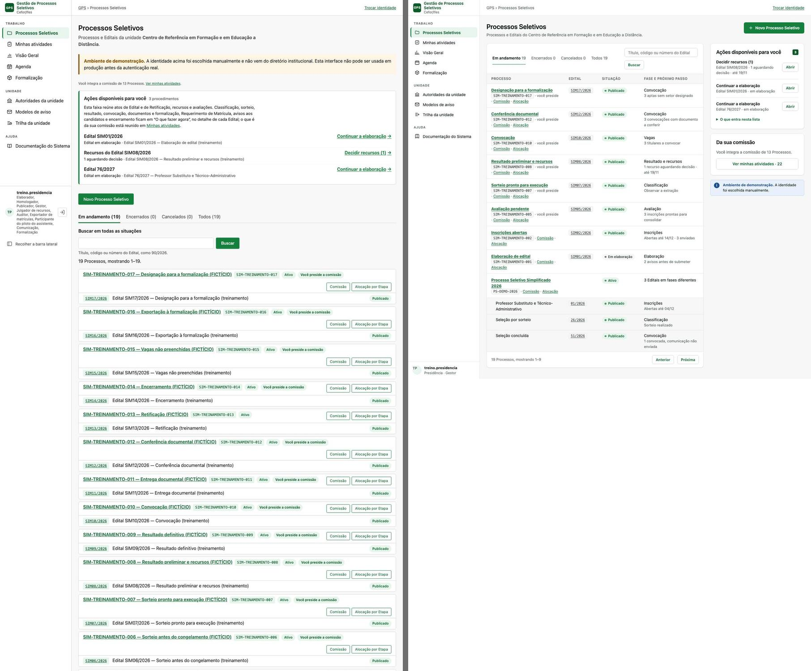
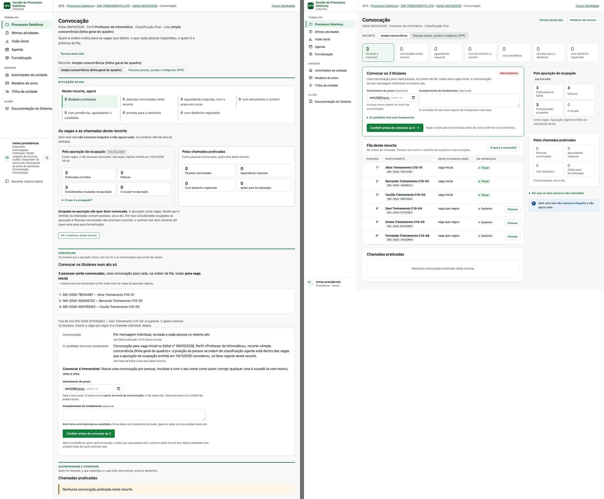
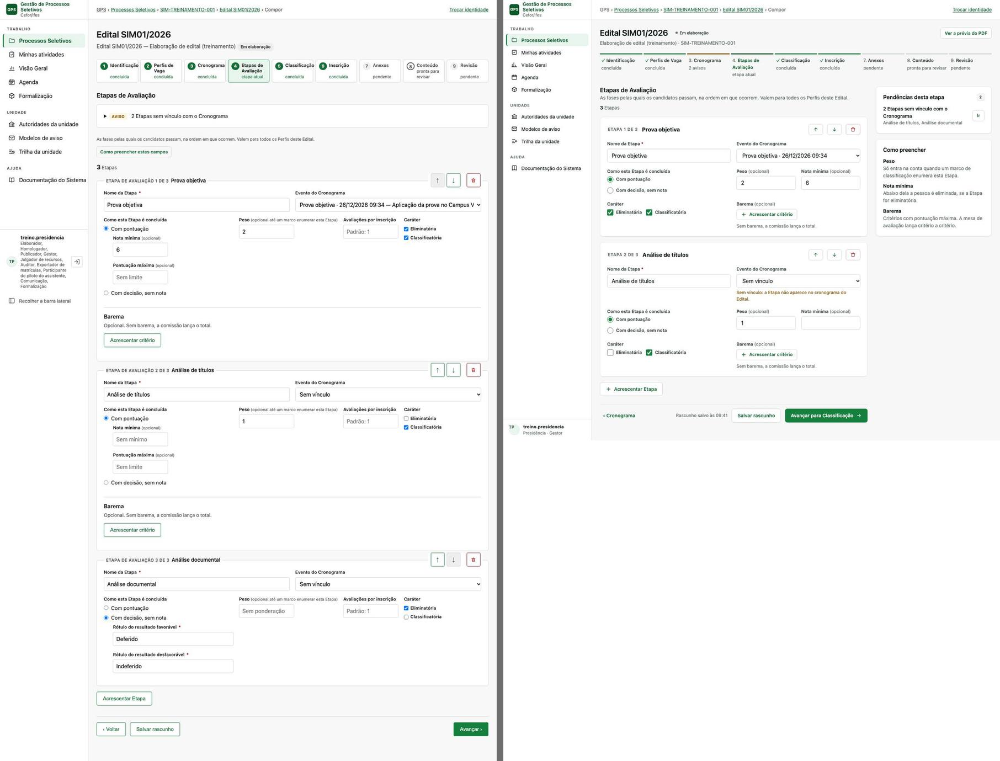
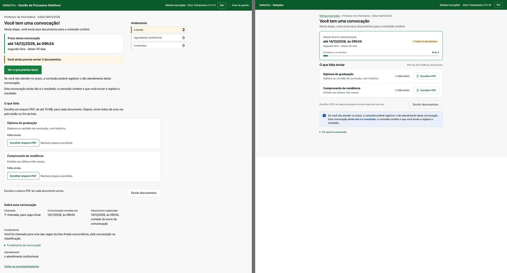

# E. Protótipos comparativos

*Quatro telas, uma por arquétipo, refeitas sobre a mesma folha de proposta. São páginas HTML
estáticas, isoladas do produto, com os dados fictícios dos cenários de treinamento. Nenhuma tela real
foi alterada.*

**Para abrir:** [`prototipos/index.html`](prototipos/index.html) no navegador. Não precisam de
servidor. A [folha de componentes](prototipos/componentes.html) mostra cada peça isolada.

## Por que estas quatro

A escolha saiu da auditoria, e não da lista de candidatas do pedido:

| Tela | Arquétipo | Por que ela |
|---|---|---|
| Lista de Processos Seletivos | central de trabalho e lista | é a porta de entrada de todo perfil; tem a maior distância entre o que mostra e a altura que ocupa (E2) |
| Convocação | operação com etapas | é a tela de operação mais complexa: 30 caixas, três níveis de borda (E3) |
| Compor · Etapas de Avaliação | formulário de configuração | representa as nove etapas do assistente e os 14 formulários |
| Convocação do candidato | jornada do candidato | é o momento de maior consequência para quem está de fora, e mostra o defeito de alinhamento do portal (S2) |

O **Centro de Controle** ficou de fora de propósito. É a melhor referência interna, e a proposta
para ele é só trocar os tokens: redesenhá-lo seria alterar o que funciona.

## O que os protótipos são, e o que não são

- São fiéis em proporção, tipografia, cor e componente, e respondem de 375 a 1920 px.
- **Não** são o produto: os links não levam a lugar nenhum, os formulários não enviam, e a barra
  lateral é uma cópia simplificada da real.
- Os textos foram encurtados onde a proposta move a explicação para o trilho ou para um recolhido.
  **Cada texto de tela do GPS foi decidido em spec.** O que o protótipo corta é sugestão de
  composição, e a redação final é de quem escreve a spec da tela.
- As medidas "depois" foram tiradas dos protótipos com o mesmo instrumento das telas reais
  ([`medicoes/metricas.js`](medicoes/metricas.js) e [`medicoes/largura.js`](medicoes/largura.js)).

## 1. Lista de Processos Seletivos



*Hoje à esquerda, proposta à direita, as duas a 1440 px.* Arquivos:
[hoje](capturas/g-lista.jpg) · [proposta](prototipos/lista-de-processos.html) ·
[a 1920 px](capturas/proposta-lista-de-processos-1920.jpg) ·
[a 375 px](capturas/proposta-lista-de-processos-375.jpg)

**Diagnóstico.** Cada Processo é um cartão com outro cartão dentro para o Edital, e repete os
botões "Comissão" e "Alocação por Etapa". A ação de criar fica abaixo de um painel com 50 palavras
de explicação. O aviso de demonstração ocupa a largura toda acima do trabalho.

**Proposta.**

- Cabeçalho de página com "Novo Processo Seletivo" à direita do título.
- Uma tabela dentro de um cartão: o Processo é a linha, o Edital é a linha filha quando há mais de
  um. Abas e busca ficam no topo do cartão.
- "Ações disponíveis para você" vai para o trilho e fica visível enquanto se rola a lista.
- A explicação da faixa vira um recolhido; o aviso de demonstração vira aviso em linha no trilho.

| Medida | Hoje | Proposta |
|---|---:|---:|
| Altura por Processo de um Edital | cerca de 135 px | cerca de 60 px |
| Altura para os 19 Processos | 3.210 px | cerca de 1.600 px (estimativa pela altura de linha) |
| Metade direita ocupada, a 1440 e a 1920 px | 32% e 26% | 61% e 64% |
| Botões cheios | 2 | 1 |
| Alvos menores que 24 px | 22 | 1 |

**Componentes envolvidos:** cabeçalho de página, cartão sem recuo, abas, barra de filtros, tabela com
linha filha, situação, código, lista de itens, aviso em linha, paginação.

**Risco e dependência.** A coluna "Fase e próximo passo" é **informação nova** na lista: hoje ela só
existe na Página do Processo. Depende de derivar a fase de cada Edital na listagem, e a lista tem
orçamento de consulta provado por teste. Sem ela a proposta continua de pé, com três colunas. É
decisão de produto, e não de design.

## 2. Convocação



Arquivos: [hoje](capturas/g-convocacao.jpg) · [proposta](prototipos/convocacao.html) ·
[a 1920 px](capturas/proposta-convocacao-1920.jpg) ·
[a 375 px](capturas/proposta-convocacao-375.jpg)

**Diagnóstico.** A tela tem três desenhos de indicador, seções marcadas por filete verde que não
existem em outra tela, e a seção do gesto principal ("Convocar") só começa a cerca de 1.200 px do
topo, depois do contexto. Tudo fica na metade esquerda.

**Proposta.**

- O recorte vira segmentos logo abaixo do cabeçalho.
- Os sete números de "Neste recorte, agora" viram uma fileira de indicadores: o que pede ação fica
  ativo, e os zeros esmaecem.
- O gesto principal sobe para um cartão de destaque, com os dois campos e o botão, e leva a marca
  "Irreversível".
- A fila vira tabela, com "Chamar" na linha do suplente.
- As duas contagens de vagas (pela apuração, pelas chamadas) vão para o trilho, e a frase que
  explica a diferença fica junto delas.

| Medida | Hoje | Proposta |
|---|---:|---:|
| Altura da tela | 4.325 px | 1.396 px |
| Onde começa o bloco do gesto principal | cerca de 1.200 px do topo | cerca de 350 px |
| Níveis de caixa dentro de caixa | 3 | 2 |
| Assinaturas de botão (altura e fonte) | 5 | 2 |
| Metade direita ocupada, a 1440 e a 1920 px | 16% e 12% | 49% e 47% |

**A comparação de altura pede cuidado.** O protótipo cobre o estado "titulares a convocar, nenhuma
chamada praticada", e resume em um cartão as seções "Acompanhar e conferir" e "Fila, suplentes e
regularização". Com chamadas praticadas, a tela real cresce e a proposta também. O que a medida
mostra é a direção, e não o número final.

**Componentes envolvidos:** segmentos, indicadores (padrão e compacto), cartão de destaque, cartão
calculado, marca, tabela, aviso em linha, recolhido.

**Risco.** É a tela com mais regra de domínio do produto. Mover bloco muda a ordem de leitura que
várias specs fixaram (o candidato lê o fundamento, quem fica de fora, a conferência antes do ato). A
implementação pede spec própria, e não cabe no piloto.

## 3. Compor · Etapas de Avaliação



Arquivos: [hoje](capturas/g-compor-etapas.jpg) · [proposta](prototipos/compor-etapas.html) ·
[a 1920 px](capturas/proposta-compor-etapas-1920.jpg) ·
[a 375 px](capturas/proposta-compor-etapas-375.jpg)

**Diagnóstico.** O assistente é uma das partes mais maduras do produto, e o que falta é pouco. Os
nove passos são nove caixas com borda, que competem com o formulário. Os campos se distribuem pela
largura toda, com o rótulo longe do vizinho. "Como preencher estes campos" é um recolhido no meio da
coluna. A barra de ações fica no fim da página.

**Proposta.**

- Os passos viram uma linha de traços: feito, atual, com aviso, pendente.
- O formulário usa a grade de doze colunas dentro da coluna principal.
- "Pendências desta etapa" e "Como preencher" vão para o trilho, à vista durante o preenchimento.
- A barra de ações fica fixa ao pé: voltar à esquerda, "Salvar rascunho" e "Avançar" à direita, e a
  hora do último rascunho ao lado.
- Subir, descer e remover usam os ícones do conjunto da barra lateral.

| Medida | Hoje | Proposta |
|---|---:|---:|
| Metade direita ocupada, a 1440 e a 1920 px | 40% e 32% | 58% e 61% |
| Caixas com borda nos passos | 9 | 0 |
| Alvos menores que 24 px | 14 | 9 |
| Ajuda de preenchimento à vista | não (recolhida) | sim, no trilho |

*A altura não se compara: a captura de hoje tem três Etapas, e o protótipo, duas.* Os alvos
restantes são as caixas de seleção e os rádios, de 18 px, com o rótulo clicável.

**Componentes envolvidos:** cabeçalho de página com situação, passos, grade de campos, escolha,
cartão, lista de itens, barra de ações.

**Risco.** Baixo. A estrutura do formulário e os nomes dos campos não mudam; o assistente tem a
maior cobertura de teste de tela do projeto, e vários guardiões leem os templates dele.

## 4. Convocação do candidato



Arquivos: [hoje](capturas/p-convocacao.jpg) · [proposta](prototipos/candidato-convocacao.html) ·
[a 1920 px](capturas/proposta-candidato-convocacao-1920.jpg) ·
[a 375 px](capturas/proposta-candidato-convocacao-375.jpg)

**Diagnóstico.** O conteúdo é bom: o prazo vem primeiro, e a tela diz o que falta. A composição é
que falha no monitor: tudo encostado à esquerda, com o quadro "Andamento" solto ao lado, e a 1920 px
sobram 216 px de um lado e mais de 1.000 do outro. "Enviar documentos" é o botão menos visível da
tela.

**Proposta.**

- Página centrada em 44rem, em qualquer largura.
- Um cartão de prazo: data, quanto falta, situação e a barra de andamento, no lugar do quadro
  lateral.
- Os documentos numa lista só, cada um com a situação e o botão de escolher o arquivo.
- "Enviar documentos" grande, ao fim da lista. Fica desabilitado até haver arquivo escolhido, com a
  frase que explica ao lado.
- O que hoje são dois parágrafos de consequência vira um aviso de informação.

| Medida | Hoje | Proposta |
|---|---:|---:|
| Altura da tela a 1440 px | 1.566 px | 900 px |
| Margens a 1920 px | 216 px à esquerda, mais de 1.000 à direita | iguais |
| Botão de envio | contornado, igual aos de escolher arquivo | cheio assim que há arquivo escolhido |

**Componentes envolvidos:** página centrada, cartão de destaque, situação, barra de andamento, lista
de documentos, envio de arquivo, botão grande, aviso de informação.

**Risco.** Médio. O envio de vários documentos tem script próprio (`portal/envio.js`) e estados que
o protótipo não mostra: arquivo escolhido, enviado, recusado, substituído. A proposta precisa ser
conferida contra cada um antes de virar spec.

## O que os quatro mostram juntos

| | Lista | Convocação | Compor | Candidato |
|---|---|---|---|---|
| Mesma folha, sem regra própria de tela | sim | sim | sim | sim |
| Tamanhos de fonte em uso | 4 | 5 | 6 | 6 |
| Transbordo a 375 px | não | não | não | não |
| Trechos abaixo do contraste | 0 | 0 | 0 | 0 |

Quatro arquétipos diferentes saíram de **uma folha de cerca de 260 linhas**, sem classe criada para uma tela.
É a demonstração do argumento central: a consistência vem de poucos componentes usados sempre, e não
de mais estilo.

## Como reproduzir

```bash
cd backend
uv sync --extra dev --extra navegador && uv run playwright install chromium
# as telas de hoje: o servidor "auditoria-visual" do .claude/launch.json, no banco ps_auditoria_visual
uv run python ../doc/auditoria-design-system-2026-11-14/medicoes/rastrear.py <pasta de trabalho> treino.presidencia <papéis> /gestao/ 900 3
# os protótipos
python ../doc/auditoria-design-system-2026-11-14/medicoes/gerar_prototipos.py ../doc/auditoria-design-system-2026-11-14
uv run python ../doc/auditoria-design-system-2026-11-14/medicoes/fotografar.py ../doc/auditoria-design-system-2026-11-14 <pasta de saída> lista-de-processos convocacao compor-etapas candidato-convocacao
```

Os scripts esperam `metricas.js` e `largura.js` na pasta de trabalho, e o servidor em
`localhost:8165`. O gerador de protótipos pede Python 3.12 ou mais novo.
