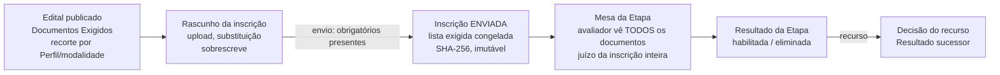
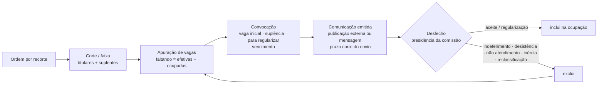
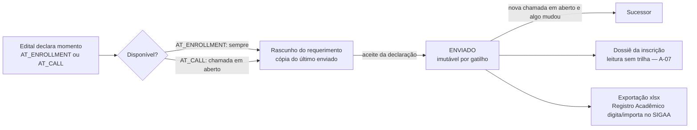
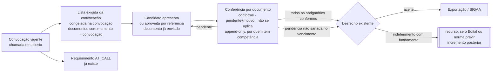

# Auditoria — Requerimento de matrícula e dossiê documental no GPS — 03/11/2026

*Auditoria funcional, arquitetural, normativa e de UX, feita em 03/11/2026 sobre a `main` em
`6137f1c4` (depois do #365, que fechou a `114`). Pergunta examinada: o GPS deve ganhar um domínio de
matrículas, em que convocados requerem matrícula, apresentam documentos e são analisados por
secretarias, formando um dossiê eletrônico? A hipótese foi tratada como hipótese. Nada do código,
das specs nem da documentação anterior foi alterado; nenhuma spec, migration ou PR de implementação
foi criado. Caminhos relativos a `backend/processo_seletivo/`, salvo quando começam por `backend/`,
`doc/` ou `specs/`.*

> **Complementada em 03/11/2026** por
> [Documentos e conferência na convocação, para além da matrícula](auditoria-matricula-e-dossie-documental-2026-11-03-complemento.md),
> que generaliza a recomendação para Editais de bolsistas e colaboradores. Onde os dois divergem,
> vale o complemento.

Marcas, em todo o documento:

- **[F]** fato lido no código, com `arquivo:linha`;
- **[S]** dito em spec ou documento do repositório, sem conferência no código;
- **[N]** regra verificada no texto oficial da norma (URL no Anexo I);
- **[E]** cláusula lida num Edital real da amostra;
- **[P]** prática operacional informada em documento anterior;
- **[I]** inferência fundamentada;
- **[H]** hipótese a validar com a área competente.

Regra encontrada no código não é regra normativa, e cláusula de Edital não é norma: as marcas
existem para que nenhuma dessas coisas passe pela outra.

**Como foi feito.** Cinco frentes, em paralelo, sobre a mesma árvore: inscrição e documentos;
Requerimento de Matrícula (`029`) e exportação (`031`); classificação, ocupação, convocação,
avaliação e recurso; unidades, identidade, autorização, arquivos, LGPD e notificações; normas e
Editais reais. As afirmações que sustentam as conclusões foram reconferidas pela coordenação no
código, linha a linha. Não houve execução da suíte nem de cenário no navegador. Esta é uma auditoria
de leitura; os limites estão no Anexo II.

---

## Resumo executivo

**1. A premissa do problema está metade certa.** Ela supõe que o GPS precisa de um domínio de
matrícula, quando **a maior parte do ciclo pós-classificação já existe, como código, testes e
telas**:

- a **convocação** (`019`, `050`, `097`): espécies, vencimento, chamadas sucessivas, sucessão e
  fila de suplentes com reclassificado e reabilitado;
- **sete desfechos** com efeito na ocupação, entre eles *indeferimento*, *regularização*,
  *desistência* e *cancelamento por inércia*;
- o **Requerimento de Matrícula estruturado** (`029`), que o Edital pode abrir **na convocação** e
  não na inscrição;
- a **exportação para o Registro Acadêmico** (`031`);
- a **tela da convocação no portal** (`059`).

Quem conduz o certame já convoca, prazo corre, a pessoa declara os dados de matrícula sem papel, o
desfecho é registrado com fundamento e a vaga é reapurada.

**2. O que falta é estreito e tem uma causa escrita.** O GPS **não sabe pedir documento depois da
inscrição.**

- [F] `DocumentoExigido` não tem momento nem finalidade (`editais/models/documentos.py:21-79`), e
  a seção do Edital se chama *"Documentos Exigidos para a Inscrição"*
  (`editais/domain/secoes.py:96-98`).
- [F] O documento só é recebido enquanto a inscrição é rascunho, e fica imutável depois do envio
  (`inscricoes/models.py:329-389`, `inscricoes/migrations/0007_imutabilidade_da_enviada.py`).
- [S] A `029` fixou a regra: *"documento específico de matrícula continua sendo Documento Exigido
  do Edital"* (`specs/029-requerimento-de-matricula/spec.md:646-648`, `FR-402`).

Somados, esses três fatos fazem o **dado** de matrícula poder esperar a convocação, mas não o
**documento**. É exatamente a prática que o problema descreve: os Editais 77, 57, 28 e 76/2026 [E]
pedem identidade, certidão, quitação eleitoral, diploma, documento militar e o próprio Anexo II na
inscrição. Isso **não é escolha das secretarias contra o sistema: é o único caminho que o sistema
oferece.**

**3. Não falta "um módulo". Faltam quatro peças**, todas encaixáveis nas fronteiras que já existem:

1. **documento exigível na convocação**, além da inscrição;
2. **conferência por documento**, com *conforme*, *pendente com motivo* e *não se aplica*;
3. **complementação** do documento pendente dentro do prazo da chamada;
4. um **ator de secretaria** com competência por unidade.

Há ainda duas que dependem de norma: **recurso contra o indeferimento de matrícula** e **política de
retenção**.

**4. Recomendação: completar a convocação, e não criar um domínio paralelo** (§C, Alternativa
A′).

- **Um módulo de matrícula com estados próprios** (*em análise → deferido → recurso → homologado*)
  seria **uma segunda fonte de verdade sobre a mesma vaga**. A descoberta da `029` já recusou isso
  por escrito (`doc/descoberta-029-requerimento-de-matricula.md:103-105`), e o código o confirma: o
  indeferimento é desfecho da convocação, com efeito na ocupação (`convocacao/domain/nomes.py:73-97`).
- **O que a Alternativa B tem de bom é a área de trabalho, não o domínio**: uma fila da secretaria
  por pendência e prazo. Ela cabe sobre a convocação.
- **A Alternativa C** (serviço separado) não tem justificativa técnica nem institucional
  identificada.

**5. O GPS pode ser o ambiente operacional de custódia, mas não o arquivo do aluno, e não deve se
apresentar como tal.**

- [N] A tabela de temporalidade das IFES (Portaria AN 92/2011) dá aos *assentamentos individuais
  dos alunos* um prazo total de **100 anos** (classe 456.43, e equivalentes em 125 e 144).
- [N] Inscrições de não matriculados ficam *até a homologação + 1 ano* e depois são eliminadas
  (456.112). Recursos e resultados são de **guarda permanente** (456.115, 456.116).
- [N] Pelo Decreto 10.278/2020, o PDF enviado pelo candidato é **cópia simples**, sem os requisitos
  de digitalização com valor de original.
- [F] O GPS não tem política nem mecanismo de retenção, e não é SIGAD.

Daí a posição recomendada: o GPS **conduz e guarda durante o certame e o prazo recursal**, e
**entrega** ao sistema acadêmico (SIGAA) ou ao acervo institucional. **Quem custodia depois é decisão
da gestão documental, não do produto.**

**6. A maior simplificação disponível não é de software.** Parte da lista documental dos Editais da
amostra pode não ser exigível:

- [N] a Lei 13.726/2018 (art. 3º) dispensa certidão de nascimento quando há documento de identidade,
  restringe o título de eleitor ao ato de votar e veda exigir do cidadão documento de outro órgão do
  mesmo Poder;
- [N] a Lei 14.129/2021 (art. 3º, XIII) veda exigir prova de fato já comprovado;
- [N] o Decreto 9.094/2017 (art. 2º) manda obter de base oficial o que lá estiver.

[H] A aplicação ao caso concreto é da Procuradoria. Se confirmada, **cada documento retirado da lista
é um documento a menos para coletar, conferir, guardar e descartar**, em qualquer das alternativas.

**7. Há um risco normativo nos Editais, e não no código.**

- [N] O Guia da ANPD para o Poder Público (v2.0, 2023) usa como **exemplo** a matrícula em
  universidade pública: o consentimento exigido para concluí-la *"será nulo"*, porque a base legal é
  a execução de política pública (LGPD, art. 7º, III; art. 11, II, b).
- [E] Os Editais 57 (Anexo VI), 28 e 77 (Anexo III) trazem termo de consentimento. O 77 (6.8) impõe
  na inscrição a cessão *definitiva e gratuita* de imagem e voz.

Isso deve ser corrigido no texto dos Editais e no aviso de privacidade, que o portal não tem (A-33
da auditoria de 31/10).

**MVP proposto** (§F): para Editais de **unidade única**, documentos de matrícula **pedidos na
convocação**, **conferidos um a um** por quem tem competência na unidade, com **pendência visível
ao candidato** e **complementação até o vencimento da chamada**. A decisão continua sendo o desfecho
que já existe. Ele depende de **quatro decisões institucionais** (§G, QI-1 a QI-4) e de **um
pré-requisito técnico já registrado**: a trilha de leitura do dossiê, A-07 da auditoria de 31/10.

**O que não construir:**

- estados de matrícula paralelos aos desfechos;
- um segundo acervo de documentos;
- construtor de formulário;
- integração com o SIGAA no MVP;
- automação de perda de vaga, nova chamada ou eliminação de documento;
- qualquer pretensão de arquivo permanente.

---

## A. Diagnóstico do estado atual

Classificação:

- **R** existente e reutilizável;
- **A** existente, mas precisa de adaptação;
- **P** parcial;
- **X** ausente;
- **I** dependente de decisão institucional.

### A.1 Inscrição e documentos

| Capacidade | Evidência | Classe |
|---|---|---|
| Campos pessoais da inscrição: nome, CPF, e-mail e telefone, fixos, sem construtor de formulário | [F] `inscricoes/models.py:37-43`; [S] `specs/009-inscricao-simples-documentos/spec.md:476-478` (`FR-036`), `:124` (P-008) | R |
| Campo extra do Edital: só `FatoDeclarado` (DATA ou INTEIRO), que alimenta o desempate | [F] `editais/models/perfis.py:197-224` | R para seleção; **não** serve à matrícula (§1.5 da descoberta `029`) |
| Documento Exigido por Edital, recortável por Perfil, por modalidade ou por código de modalidade transversal (`044`) | [F] `editais/models/documentos.py:21-79`; `editais/domain/documentos.py:69-150` | A |
| **Finalidade do documento** (participar, pontuar, ação afirmativa, matrícula) | [F] nenhum campo em `editais/models/documentos.py` | X |
| **Momento do documento** (inscrição, convocação) | [F] idem; a única coleta é no rascunho (`inscricoes/application/rascunho.py:436-451`) | X |
| Recorte por curso, turno, polo ou unidade ofertante | [F] o polo é `PerfilVaga.locality`, texto (`editais/models/perfis.py:26`) | X |
| Condição sobre a pessoa (idade, sexo, escolaridade) | [S] decidido como "facultativo com instrução" (`doc/decisao-recorte-documental.md:75-106`) | P |
| Aplicabilidade por inscrição (obrigatório, facultativo, não se aplica), congelada no envio | [F] `ItemDaListaExigida`, append-only (`inscricoes/models.py:201-326`; `inscricoes/application/lista_exigida.py:38-69`) | R; o mesmo padrão serve à lista da convocação |
| Bloqueio do envio sem documento obrigatório, no servidor | [F] `inscricoes/application/submissao.py:160-170,218-226` | R |
| Armazenamento privado, sem URL e fora da árvore em produção | [F] `inscricoes/storage.py:27-61`; `backend/config/settings/production.py:130-139` | R |
| Nome físico imprevisível (`inscricoes/<id>/<uuid4>.pdf`); o nome original não toca o disco | [F] `inscricoes/storage.py:64-72` | R |
| Validação: só PDF, por *magic bytes* e extensão, até 10 MB, com recusa que orienta quem mandou foto | [F] `shared/arquivos.py:56-93`; `backend/config/settings/base.py:361-366` | R |
| SHA-256 no envio, reconferido a cada entrega na gestão; divergência vira evento `INTEGRIDADE` | [F] `shared/arquivos.py:96-108`; `interface/views.py:5766-5838` | R |
| **Antivírus ou saneamento de PDF** | [F] fora por decisão declarada (`shared/arquivos.py:3-5`) | X (decisão a reavaliar, §E MAT-08) |
| Substituição antes do envio: sobrescreve, um arquivo por requisito, sem versões | [F] `inscricoes/models.py:357-364`; `rascunho.py:454-520` | A (para pendência é preciso versão) |
| Imutabilidade depois do envio: modelo, 409 e gatilho | [F] `inscricoes/models.py:369-389`; migration `0007` (o A-03 de 31/10 foi resolvido no #357) | R |
| **Complementação a pedido de quem analisa** | [F] ausente; [S] a `009` a exclui (`spec.md:787-788`) | X |
| Retenção e descarte de arquivos | [F] ausente; [S] "portão de implantação" (`specs/009…/spec.md:79-81`) | X + I |

### A.2 Requerimento de Matrícula (`029`) e exportação (`031`)

| Capacidade | Evidência | Classe |
|---|---|---|
| Dados de matrícula estruturados, com campos fixos e sem JSON: nascimento, filiação, RG, título eleitoral, cor/raça, estado civil, necessidade específica, renda em faixa, endereço com CEP→IBGE | [F] `requerimentos/models.py:77-173` | R |
| Momento declarado pelo Edital, na inscrição (`AT_ENROLLMENT`) ou na convocação (`AT_CALL`) | [F] `requerimentos/domain/nomes.py:25-27`; `requerimentos/domain/disponibilidade.py:111-130` | **R: é o molde exato do que falta aos documentos** |
| Na convocação, abre se e somente se houver chamada em aberto (convocação vigente sem desfecho) | [F] `disponibilidade.py:124-130`; `convocacao/application/selectors.py:65-87` | R |
| Rascunho → enviado; o enviado é imutável por gatilho condicional | [F] `requerimentos/models.py:222-246`; `requerimentos/migrations/0002_imutabilidade_do_enviado.py:34-42` | R |
| Correção por **sucessão**, só sob chamada em aberto; o anterior continua legível | [F] `requerimentos/models.py:62-69,186-196`; `requerimentos/application/preencher.py:506-598` | R |
| Aceite da declaração com hash do texto e versão consolidada | [F] `preencher.py:417-452` | R |
| Cópia do último requerimento enviado da mesma pessoa, em qualquer Edital | [F] `preencher.py:165-204` (`FR-377`) | R |
| **Anexo no requerimento** | [F] nenhum; [S] proibido pela `FR-402`; um teste trava isso (`backend/tests/integration/requerimentos/test_convivencia_com_o_anexo.py:104-125`) | X, por decisão |
| Comprovante ou PDF do requerimento | [F] ausente; só tela HTML | X |
| **Conferência, parecer ou deferimento do requerimento** | [F] estados só `RASCUNHO`/`ENVIADO`; o vocabulário "deferido/homologado" é vedado nas telas (`requerimentos/application/selectors.py:45-49`) | X, por desenho: a decisão é o desfecho |
| Reabertura pela secretaria | [S] questão aberta Q-5 (`specs/029…/spec.md:900-902`) | X + I |
| Leitura na gestão, no dossiê da inscrição, sob `inscricao:consultar` e sem listagem própria | [F] `inscricoes/application/consulta.py:463-481`; [S] `FR-400` | A |
| **Trilha da leitura do dossiê** | [F] `inscricao_recebida` não grava evento (`interface/views.py:5757`) | X (A-07, aberto) |
| Exportação `.xlsx` no formato `Import_ModeloCefor`, com prévia, relatório de lacunas e registro append-only, sem guardar o arquivo | [F] `matriculas/models.py:27-62`; `matriculas/application/exportar.py:187-302`; `matriculas/domain/colunas.py:565-597` | R para o Cefor; A para outras unidades |
| População da exportação: convocados sem desfecho de exclusão, só com requerimento enviado | [F] `matriculas/application/populacao.py:203-316` | R |
| Papel próprio "Exportador de matrículas" (`matricula:exportar`), não concedido por padrão | [F] `interface/identidade.py:113-127` | R |
| "Matrícula efetivada" e retorno do sistema acadêmico | [F] ausente; [S] fora da `019` (`specs/019…/spec.md:775-783`) | X (integração futura) |

### A.3 Classificação, ocupação e convocação

| Capacidade | Evidência | Classe |
|---|---|---|
| Recorte `(edital, perfil, marco, lista)`; `NULL` = ampla concorrência | [F] `convocacao/models.py:105-108`; `classificacao/models.py:32-36` | R |
| Ordem e faixa (corte), com suplentes alcançados | [F] `classificacao/models.py:125-143,217-279` | R |
| Suplente como posição derivada, e não como coluna | [F] `convocacao/domain/fila.py:1-41` | R |
| Apuração de vagas: publicadas, efetivas, ocupadas e faltando; reversão de cota | [F] `ocupacao/models.py:25-77`; `ocupacao/domain/apuracao.py:257-330`; `ocupacao/domain/reversao.py:18-65` | R |
| `Convocacao` própria, append-only, com três espécies: vaga inicial, suplência, para regularizar | [F] `convocacao/models.py:84-217`; espécie derivada da posição (`convocacao/domain/especie.py:16-33`) | R |
| Vencimento por convocação (digitado ou fim de Evento); o prazo só corre do envio da comunicação | [F] `convocacao/models.py:121`; `convocacao/domain/prazo.py:38-76` | R |
| Contador de chamada por pessoa e recorte; lote de titulares por gesto | [F] `convocacao/models.py:136-148`; `convocacao/application/fluxo.py:197-257` | P (não há "2ª chamada" como ato coletivo) |
| Convocação acima do número de vagas | [F] recusada: só se convoca enquanto `faltando` > chamadas em aberto (`convocacao/application/convocar.py:295-343`) | P (§H, situação 3) |
| Sete desfechos com efeito declarado na ocupação, e sucessão (aceite → inércia) | [F] `convocacao/models.py:220-346`; `convocacao/domain/nomes.py:34-97` | R |
| Guardas: não atendimento só depois do vencimento; inércia só com atestado; regularização só com Resultado sucessor | [F] `convocacao/application/desfechar.py:363-421`; `convocacao/models.py:324-333` | R |
| Comunicação emitida (publicação externa ou mensagem individual), registrada como o que foi **enviado** | [F] `convocacao/models.py:349-425` | R |
| **Convocação como ato oficial publicado pelo GPS** | [F] o GPS registra só a *referência* à publicação externa (`convocacao/models.py:374-382`) | P |
| **Quem registra o desfecho**: a presidência da comissão do Processo, ou quem tem a permissão sistêmica de gerir comissão | [F] `convocacao/application/desfechar.py:69-72` → `comissoes/application/__init__.py:76-93` → `comissoes/domain/autorizacao.py:65-81` | **I** (§E MAT-03) |
| Distinção explícita entre classificado, convocado e autorizado a requerer | [F] "autorizado" = "convocado com chamada em aberto" (`requerimentos/domain/disponibilidade.py:124-130`) | R (é derivada, e basta) |
| Tela do candidato: "não há convocação" × "você não foi chamado", com o cartão do requerimento | [F] `portal/views.py:2334-2374` | R |
| Recurso contra a convocação ou contra o desfecho | [S] fora, por decisão (`specs/019…/spec.md:795-797`, `D-010`) | X + I |
| Validade do Edital, dias úteis, cascata entre recortes | [S] fora (`specs/019…/spec.md:770-800`) | X |

### A.4 Avaliação e recurso

| Capacidade | Evidência | Classe |
|---|---|---|
| Avaliação por par Inscrição × Etapa, por membro alocado e atribuído | [F] `avaliacoes/models.py:36-71`; `avaliacoes/domain/autorizacao.py:42-73` | R para seleção; **acoplada** à Etapa |
| Conclusão pontuada ou decisória, com parecer obrigatório no desfavorável e reabertura pela presidência com motivo | [F] `avaliacoes/models.py:77-231`; `avaliacoes/application/avaliacao.py:255-277,505-592` | R |
| Mesa: lista dos requisitos congelada no envio, com instrução e "não se aplica", e registro de qual documento foi aberto | [F] `avaliacoes/application/mesa.py:46-57,117-221`; `interface/views.py:6930-6990` | R |
| **Juízo por documento** (conforme, pendente, recusado) | [F] ausente; o juízo é da inscrição inteira ([S] `doc/conferencia-envio-e-analise-documental.md:101-112`) | X |
| **Escopo de documento por Etapa** | [F] a Etapa não declara documentos; o avaliador de qualquer Etapa vê a lista inteira (`avaliacoes/application/mesa.py:128-136`) | X (§E MAT-07) |
| Resultado da Etapa (habilitada ou eliminada), com sucessão por recurso e por regularização | [F] `resultados/models.py:42-166` | R |
| Recurso contra `PublicacaoResultado` ou `ResultadoEtapa`, por decisão, e não contra "recorrível" genérico | [F] `recursos/models.py:10-16,58-109` | A (um terceiro objeto é aditivo; o efeito não é) |
| Janela por marco, em dias corridos | [F] `recursos/domain/janela.py:1-37` | A |
| Instrução por referência ao documento, sem cópia | [F] `recursos/models.py:314-371` | **R: é o padrão de reaproveitamento sem duplicar** |

### A.5 Unidades, identidade e autorização

| Capacidade | Evidência | Classe |
|---|---|---|
| Unidade plana: código, sigla, nome, cabeçalho e local; sem pai, tipo nem campus responsável | [F] `unidades/models.py:25-55`; [S] `specs/060…/spec.md:328-330` | A |
| Processo e Edital levam `institution_scope` imutável; uma unidade por Edital | [F] `processos/models.py:14,46`; `processos/migrations/0005_escopo_imutavel.py` | R |
| Perfil vinculado a unidade ofertante | [F] ausente; o polo é texto | X (§I) |
| Pessoa, `Vinculo(pessoa, escopo, papel)` append-only, revogação, suspensão e recusa de autoconcessão | [F] `seguranca/models.py:61-134`; `seguranca/application/acessos.py:181-263` | R |
| Unidade ativa na sessão; Actor recalculado por requisição; um escopo por vez | [F] `interface/identidade.py:204-254,491-522` | R |
| Catálogo de papéis operacionais (elaborador, homologador, publicador, gestor, julgador, auditor, exportador, comunicação…) | [F] `interface/identidade.py:31-144` | A (falta o de secretaria) |
| **Papel de secretaria acadêmica** | [F] nenhuma ocorrência; o Registro Acadêmico é só destino da exportação | X + I |
| Isolamento: escopo alheio = 404 (verificado em execução por 75 acessos na auditoria de 31/10) | [F] `seguranca/application/authorization.py:117-146` | R |
| Titularidade do candidato, indistinguível de inexistente | [F] `inscricoes/domain/titularidade.py:15-21`; `portal/arquivos.py:27-34` | R |
| SSO institucional | [S] contrato pronto, provedor pendente (`doc/ativacao-do-sso-institucional.md:16-20`) | P + I |

### A.6 Trilha, notificação e privacidade

| Capacidade | Evidência | Classe |
|---|---|---|
| `RegistroAuditoria` append-only em três camadas | [F] `auditoria/models.py:6-40`; `auditoria/migrations/0001_initial.py:9-33`; `seguranca/papeis.py:35-159` | R |
| Evento de consulta a documento (gestão e Mesa), sem nome de arquivo | [F] `interface/views.py:5810`, `:6968` | R |
| FR-084: exatamente quatro situações de mensagem (confirmação, credencial, convocação e aviso complementar), por gesto humano; o aviso não substitui a publicação | [S] `specs/010-area-do-candidato/spec.md:572-602`; guardião [F] `backend/tests/test_situacoes_de_mensagem.py` | R (e limita o MVP, §E MAT-13) |
| Despacho de avisos fora da requisição, com retentativa | [F] `avisos/application/despacho.py:146-313` | R |
| E-mail da convocação e da confirmação dentro da requisição | [F] `convocacao/application/comunicar.py`; [S] A-04 de 31/10 | A |
| Aviso de privacidade e base legal no portal | [S] ausente (A-33 de 31/10) | X + I |
| Backup cifrado com retenção própria; "descarte na produção não descarta nos backups" | [S] `doc/implantacao-em-producao-ubuntu.md:2001,2120-2126` | I |

---

## B. Fluxos

### B.1 Inscrição e documentos (hoje)

**A fronteira que falta:** todo documento entra pela porta da esquerda, inclusive o que só a
matrícula usa. Depois de "ENVIADA", nada entra.

### B.2 Classificação e convocação (hoje)

### B.3 Requerimento de Matrícula (hoje)

O requerimento **não** conhece documento, **não** tem análise e **não** decide nada. Quem decide é o
desfecho da B.2.

### B.4 Fluxo conceitual proposto (Alternativa A′)

**O que muda de dono:** nada. A convocação continua respondendo *quem pode ocupar e até quando*; o
requerimento, *quais dados*; a nova conferência, *quais documentos estão em ordem*; o desfecho,
*o que se decidiu*. Cada pergunta continua com um dono só.

### B.5 Os três modelos reais e onde cada um cabe

| Modelo | Editais | Documentos | Análise | No GPS hoje |
|---|---|---|---|---|
| **1. Tudo na inscrição; "análise documental" como etapa da seleção** | 77, 57, 28, 76 [E] | todos na inscrição, inclusive o Anexo II | comissão, com resultado preliminar e recurso (57: 6.4 e 9.1; 28: 9.1) | **Coberto**: Etapa decisória governada pelo corte ([S] `specs/014…/spec.md:150-172`) + recurso da `018`. Falta só o juízo por documento |
| **2. Seleção sem documento; matrícula presencial na convocação** | 69 [E] (6.1: *"comparecer pessoalmente… para apresentação dos documentos de matrícula"*) | na convocação | Cefor, no balcão | **Parcial**: o requerimento na convocação existe; o documento, não. O não comparecimento vira reclassificação (69, 6.3), desfecho que já existe |
| **3. Requerimento ao campus após o resultado final** | 46 [E] (item 10); carta de serviços do Ifes [N] (*requerer → homologar pelo campus*) | segundo o campus | campus | **Parcial** pelo mesmo motivo, e mais o multicampi (§I) |

**Leitura:** o problema operacional é o modelo 1 **usado para documentos que pertencem aos modelos
2 e 3**, porque só o modelo 1 existe no sistema. O MVP é dar ao modelo 2 o documento que lhe falta;
o 3 vem com o multicampi (§I).

### B.6 As dez etapas conceituais, e o que cada uma é no GPS

Nem todo Edital passa por todas, e a ordem varia: no 57 e no 28 [E], a "análise da documentação"
tem resultado preliminar e recurso **antes** do resultado final, e a homologação das matrículas vem
depois. No 69, não há análise documental na seleção.

| # | Etapa | No GPS | Dono |
|---|---|---|---|
| 1 | Inscrição | [F] `Inscricao`, enviada e imutável | `inscricoes` |
| 2 | Habilitação / requisitos seletivos | [F] Etapa decisória → `ResultadoEtapa` habilitada/eliminada | `avaliacoes`, `resultados` |
| 3 | Classificação | [F] `AtoDeOrdenacao`, `Corte`, publicação do resultado | `classificacao`, `publicacoes` |
| 4 | Convocação | [F] `Convocacao` + `ComunicacaoEmitida` | `convocacao` |
| 5 | Requerimento de matrícula | [F] `RequerimentoDeMatricula` (dados); **documentos: ausente** | `requerimentos` |
| 6 | Análise documental | [F] só como Etapa da seleção (modelo 1); **na convocação: ausente** | — (MVP) |
| 7 | Resultado preliminar | [F] existe no modelo 1 (Resultado da Etapa); na convocação, não existe e **não deve ser presumido** (§C.3, item 3) | — |
| 8 | Recurso | [F] contra Resultado/Publicação; **contra desfecho: ausente** | `recursos` |
| 9 | Decisão definitiva | [F] `DesfechoDaConvocacao` | `convocacao` |
| 10 | Homologação e registro acadêmico | [F] ausente; [N] é do campus e do SIGAA | fora do GPS; exportação pela `matriculas` |

A ação afirmativa (autodeclaração, laudo, renda) é comprovação **da seleção**, mesmo quando ocorre
depois da classificação: ela decide em que recorte a pessoa concorre e, portanto, a ocupação. [N] A
PN MEC 18/2012 põe a comprovação de renda *após a confirmação da classificação* (art. 8º, §1º, I).
No GPS, isso é a Etapa governada pelo corte, que já existe, e não matrícula. [N] A mesma Portaria
exclui do seu alcance a seleção de portadores de diploma superior (art. 2º, I): nos Editais de pós
(57, 28), a reserva é política institucional, e o rito dela é o do Edital.

---

## C. Análise de alternativas

### C.1 As três alternativas pedidas, e uma quarta que a evidência sugere

- **A — Extensão do fluxo atual.** Aproveitar a inscrição e a Mesa: o documento de matrícula
  continua na inscrição, e a análise vira Etapa. **É o que já existe** (modelo 1) e é a causa do
  problema: não resolve coleta excessiva nem documento de quem nunca é convocado.
- **B — Módulo funcional integrado.** Área própria de matrículas, com regras e estados próprios
  (*requerimento → análise → resultado preliminar → recurso → decisão definitiva → homologação*),
  sobre identidade, arquivos e cadastros comuns.
- **C — Aplicação ou serviço separado.**
- **A′ — Completar a convocação (recomendada).** O domínio de matrícula **já existe**, repartido em
  três apps com fronteiras escritas: `convocacao` (quem e até quando, e o desfecho), `requerimentos`
  (os dados) e `matriculas` (a saída). Acrescentam-se as quatro peças ausentes **dentro dessas
  fronteiras**, mais uma **fila de trabalho** da secretaria como área de interface. Do B fica a
  área de trabalho; do A, o domínio único.

### C.2 Comparação

| Critério | A (estender a inscrição) | B (módulo com estados próprios) | **A′ (completar a convocação)** | C (serviço separado) |
|---|---|---|---|---|
| Coesão | baixa: dado de matrícula pela porta da seleção, que é o que a `029` desfez | alta dentro do módulo, mas **duplica** o desfecho, que já é a decisão sobre a vaga | alta: cada pergunta tem um dono, e os donos já existem | alta internamente; a fronteira é de rede |
| Acoplamento | alto: Mesa e Etapa carregam matrícula | médio, e circular: o módulo decide, a ocupação precisa saber, e o desfecho teria de espelhar o estado do módulo | baixo: a conferência lê a convocação, o desfecho lê a conferência, e um sentido só em cada aresta | alto, e por contrato remoto: identidade, convocação e arquivos teriam de ser replicados |
| Reutilização | máxima e errada | alta da infraestrutura, nula do domínio | **máxima**: convocação, requerimento, exportação, lista congelada, armazenamento, trilha, titularidade e referência sem cópia | baixa |
| Complexidade | baixa de código, alta de operação | alta: nova máquina de estados, conciliação com a ocupação e telas novas inteiras | **média**: três agregados pequenos (lista da convocação, documento apresentado e conferência), uma guarda no desfecho e uma fila | muito alta |
| Segurança | piora: avaliador de seleção vê documento de matrícula (MAT-07) | boa, se o módulo tiver escopo próprio | boa: a conferência tem capacidade própria; o avaliador de Etapa não vê documento de convocação | boa no papel, mas com segunda superfície de autenticação e de arquivos |
| LGPD (minimização) | **ruim**: coleta de todos os inscritos | boa | **boa**: coleta só de convocados, que é o desenho da `029` (cenário D da descoberta) | boa |
| Manutenibilidade | piora a Mesa | duas fontes de verdade a manter coerentes | uma fonte, com guardiões que o projeto já usa | dois deploys, duas suítes, contrato versionado |
| Esforço relativo | P | G | **M** | GG |
| UX candidato | tudo de uma vez na inscrição | boa, mas "duas áreas" para a mesma vaga | boa: a tela de convocação já existe (`portal/views.py:2334`) e ganha a lista de documentos | ruim: troca de sistema |
| UX secretaria | nenhuma (não é ator) | boa | boa: a fila é a parte boa do B | boa |
| Compatibilidade arquitetural | total | média: contraria a decisão 1 da descoberta `029` e o `D-010` da `019` | **total**: repete o molde `AT_CALL` da `029` e a lista congelada da `044` | baixa: a Constituição (V) exige necessidade demonstrável para serviço separado |
| Multiunidade | herda a unidade do Edital | idem, mas tentaria resolver o multicampi dentro de si | herda a unidade do Edital; o multicampi é pré-requisito comum a todas (§I) | teria de reimplementar o escopo |
| Evolução | bloqueia | exige reconciliar tudo o que vier na convocação | recurso contra desfecho, exportação por unidade e retorno do SIGAA entram como incrementos | — |

### C.3 Por que não B, dito sem rodeio

1. **O desfecho já é a decisão.** `INDEFERIMENTO`, `ACEITE`, `REGULARIZACAO` e `INERCIA` já estão no
   código, com fundamento obrigatório, efeito na ocupação e reapuração automática
   (`convocacao/application/desfechar.py:184-245`). Um módulo com "deferido/indeferido" próprios
   teria de: (a) chamar o desfecho, e então o estado do módulo é cópia; ou (b) não chamar, e então a
   ocupação não sabe que a vaga abriu. Não há terceira opção.
2. **A "homologação" e o "registro acadêmico" não são do GPS.** [N] A carta de serviços do Ifes põe a
   homologação no campus; [E] o 77 (8.1 a) põe a efetivação *"pelo Sistema Acadêmico"*. Um módulo
   que os modele como estados próprios afirmaria um fato que acontece em outro sistema.
3. **Resultado preliminar e recurso de matrícula dependem de norma que não foi localizada.** [N] O
   ROD do Ifes não foi verificado (Anexo I). Construir o estado antes de saber se ele existe
   contraria a Constituição, IV: estados devem ser definidos nas especificações, e a regra precisa
   de fundamento.

### C.4 Por que não C

Não há requisito de escala, de equipe separada, de ciclo de liberação próprio nem de segregação de
rede que um módulo no mesmo monólito não atenda. O SIGAA já é "o outro sistema". Um terceiro, entre
o GPS e o SIGAA, criaria o problema de integração duas vezes.

### C.5 O que não deve ser construído

| Não construir | Por quê |
|---|---|
| Estados de matrícula paralelos aos desfechos | segunda fonte de verdade sobre a vaga (§C.3) |
| Segundo acervo de documentos, como upload em pasta própria do requerimento | `FR-402`; o documento de convocação é **o mesmo catálogo** (`DocumentoExigido`) com outro momento, no mesmo armazenamento |
| Construtor de formulário | decisão vigente da `009` e da `029`; diferença pequena entre Editais não justifica |
| Cópia de arquivo entre etapas | o padrão de referência sem cópia já existe (`recursos/models.py:314-371`) |
| Deferimento em lote | a Constituição, IV, exige alcance explícito, e conferir documento é juízo individual; no máximo, o lote dos já conformes, com a lista exposta |
| Perda de vaga, nova chamada ou indeferimento automáticos pelo vencimento | o próprio GPS já recusa: *o decurso nunca produz desfecho sozinho* (`convocacao/domain/prazo.py:59-76`) |
| Eliminação automática de documentos | depende de tabela de temporalidade, de comissão de avaliação e de autorização arquivística ([N] Lei 8.159, art. 9º) |
| Integração por API com o SIGAA no MVP | a exportação da `031` existe e o importador do RA é o canal atual |
| "Arquivo permanente" ou "dossiê oficial do aluno" | o GPS não é SIGAD (e-ARQ Brasil, Res. CONARQ 50/2022) nem RDC-Arq (Res. 51/2023) |

---

## D. Matriz de requisitos documentais

### D.1 Os três eixos

Um documento exigido precisa responder a três perguntas que hoje são uma só: *é exigido?*

| Eixo | Valores | Hoje |
|---|---|---|
| **Finalidade**: para que o ato o usa | `PARTICIPAR` (requisito de inscrição) · `PONTUAR` (título, experiência) · `ACAO_AFIRMATIVA` (autodeclaração, laudo, renda) · `MATRICULAR` (vínculo acadêmico) | ausente; inferível só pelo nome |
| **Momento**: quando é pedido | `INSCRICAO` · `CONVOCACAO` (o mesmo par da `029`) · *etapa específica* (já existe: a Etapa decisória governada pelo corte) | só `INSCRICAO` |
| **Competência**: quem confere | comissão da Etapa · comissão de verificação (heteroidentificação/PcD) · secretaria da unidade | só "quem avalia a Etapa", e vê tudo |

**A finalidade não precisa virar campo para resolver o problema; o momento precisa.** Com o momento,
a finalidade "matricular" passa a ser expressa por `CONVOCACAO`, e as outras continuam na inscrição
ou na Etapa. A finalidade como campo serviria a duas coisas que valem uma decisão própria: o título
da seção no PDF ("para a inscrição" × "para a matrícula") e o escopo de quem vê (MAT-07). [I]

### D.2 Matriz de referência

| Documento típico | Finalidade | Momento recomendado | Competência | Depende do Edital? | Observação |
|---|---|---|---|---|---|
| Identidade | participar + matricular | inscrição (identificação); **reaproveitado por referência** na convocação | comissão; secretaria | não | [I] o mesmo arquivo serve às duas, e a referência preserva a finalidade de cada uso |
| CPF / comprovante de situação | — | **não pedir** | — | — | [N] Lei 14.129, art. 28 (CPF basta); [H] Dec. 9.094, art. 2º (obter da base) |
| Certidão de nascimento ou casamento | matricular | convocação, **se mantida** | secretaria | sim | [N] Lei 13.726, art. 3º, IV, permite substituir; [H] Procuradoria |
| Quitação eleitoral | matricular | convocação, **se mantida** | secretaria | sim | [N] Código Eleitoral, art. 7º, §1º, VI, veda só *renovar* matrícula; [H] base para exigir na primeira |
| Documento militar | matricular | convocação, se mantido | secretaria | sim | [N] Lei 4.375, art. 74, d: a partir do ano dos **19** anos; os Editais pedem a partir de 17/18 [E] |
| Histórico, diploma ou declaração de conclusão (pré-requisito) | participar **ou** matricular | depende do Edital: inscrição, quando o requisito elimina; convocação, quando só comprova | comissão ou secretaria | **sim** | o 46 [E] exige *"no ato do requerimento de matrícula"*; o 77 (5.14) [E] aceita depois do início do curso |
| Título, experiência (pontuação) | pontuar | inscrição | comissão da Etapa | sim | é seleção |
| Autodeclaração étnico-racial | ação afirmativa | inscrição | comissão de verificação | sim | é seleção: decide o recorte |
| Laudo PcD | ação afirmativa | inscrição (o 46 [E] analisa só se a pessoa não alcançar pela ampla) | comissão de verificação | sim | dado sensível: escopo restrito |
| Comprovação de renda (cota) | ação afirmativa | **após a classificação, antes da ocupação** | comissão | sim | [N] PN MEC 18/2012, art. 8º, §1º, I: *"após a confirmação de sua classificação"*; art. 8º-A: CadÚnico direto. Cabe como Etapa governada pelo corte, não como matrícula |
| Requerimento de Matrícula (Anexo II em PDF) | matricular | **não pedir como PDF**: é o requerimento estruturado `AT_CALL` | secretaria | sim (`FR-395`) | a substituição já existe |
| Foto, tipo sanguíneo, profissão etc. | — | **não pedir** | — | — | [S] `FR-382` da `029`: finalidade não demonstrada |
| Termo de consentimento LGPD | — | **não pedir** | — | — | [N] Guia ANPD v2.0, exemplo 1: consentimento nulo na matrícula pública |
| Comprovante de residência | matricular | convocação, se mantido | secretaria | sim | [E] 69, Anexo I; o requerimento já coleta endereço estruturado |
| Procuração (matrícula por terceiro) | matricular | convocação | secretaria | sim | [E] 69 (6.2) e 76 (Anexo II) |

### D.3 Reaproveitamento sem duplicar

- **Por referência, nunca por cópia.** O padrão já existe: o ato de instrução do recurso aponta o
  `DocumentoSubmetido` (`recursos/models.py:314-371`) e a entrega reconfere o hash. Um documento da
  inscrição aproveitado na convocação é **um vínculo novo** (*este requisito da convocação é
  atendido por aquele arquivo*), com autor, instante e finalidade próprios. O arquivo é um só; os
  usos são dois.
- **O que a referência preserva:** integridade (o hash é o do envio); finalidade (cada vínculo diz a
  que requisito atende); permissão (quem confere a matrícula lê pelo vínculo, e não pela Mesa da
  Etapa); retenção (o arquivo vive enquanto viver o uso de prazo mais longo, e esse é o ponto que
  depende da QI-4).
- **O que ela não preserva sozinha:** a validade temporal. Um laudo de 12 meses [E 57, 5.4 i] ou uma
  declaração de matrícula anterior pode ter vencido entre a inscrição e a convocação. Quem confere
  decide; o sistema mostra a data do envio.
- **Entre Editais:** o requerimento já copia para a frente (`preencher.py:165-204`). Para
  documentos, [I] não recomendar no MVP: inscrições distintas são atos distintos, e a referência
  entre Editais junta retenções de prazos diferentes.

### D.4 O que é comum e o que é do Edital

- **Comum** (institucional, sem configuração): os três eixos, os estados da conferência, a regra de
  referência, a regra de que obrigatório pendente no vencimento não vira desfecho sozinho, e a trilha.
- **Do Edital** (já é assim): a lista, o recorte, a obrigatoriedade, o momento, o prazo da chamada e
  o texto da instrução.
- **Da unidade** [H]: o formato de exportação (`Import_ModeloCefor` é do Cefor) e, talvez, a lista
  padrão de documentos de matrícula por tipo de curso.

---

## E. Riscos e lacunas

Severidade: **Alta** (impede o objetivo ou gera ato juridicamente frágil) · **Média** (degrada
operação, segurança ou conformidade) · **Baixa**. Dependência: **T** técnica · **A** administrativa
· **N** normativa. "Confirmado" quer dizer lido no código ou no texto; hipótese está marcada como
tal.

| ID | Descrição | Evidência | Consequência | Sev. | Recomendação | Dep. |
|---|---|---|---|---|---|---|
| **MAT-01** | Documento só pode ser pedido na inscrição; não há momento nem finalidade | [F] `editais/models/documentos.py:21-79`; `editais/domain/secoes.py:96-98`; [S] `FR-402` | Documentos de matrícula de todos os inscritos, inclusive dos que nunca serão convocados; é a causa do problema | **Alta** | Acrescentar o momento ao Documento Exigido, no molde do `AT_CALL` da `029`; revisitar a leitura da `FR-402` (o catálogo continua um só) | T + A (governança da `FR-402`) |
| **MAT-02** | Não há juízo por documento, pendência nem complementação | [F] `avaliacoes/application/mesa.py`; `inscricoes/application/rascunho.py:436-451`; [S] `doc/conferencia-envio-e-analise-documental.md:101-112` | O "por quê" do indeferimento fica em prosa; a pessoa não sabe o que corrigir; a correção é por e-mail, fora do sistema [E 77, 5.14] | **Alta** | Conferência por documento, append-only; complementação até o vencimento da chamada | T + N (QI-5) |
| **MAT-03** | O desfecho (aceite ou indeferimento) é ato da presidência da comissão do Processo; a secretaria não é ator | [F] `comissoes/domain/autorizacao.py:65-81`; nenhuma ocorrência de "secretaria" no código | Ou a secretaria vira membro da comissão de seleção (mistura competências), ou continua fora do sistema (o problema persiste) | **Alta** | Decidir quem confere e quem decide (QI-1); então um papel de unidade com capacidade própria (`matricula:conferir`?), sem nova hierarquia de administração | **A** |
| **MAT-04** | Sem política de retenção nem mecanismo de destinação; dois Editais dizem "5 anos e eliminação" para todos | [F] nenhum comando; [E] 69 e 76 (7.8); [N] TTD 456.112, 456.115, 456.116, 456.43; [N] PN 18, art. 8º, §1º, IV (*mínimo* de 5 anos, só renda) | Eliminação indevida de dossiê de 100 anos ou de recurso permanente; ou guarda indefinida de documento de não matriculado | **Alta** | Não automatizar; decidir custódia e destinação com a gestão documental (QI-4); corrigir a cláusula dos Editais | **N + A** |
| **MAT-05** | O GPS não é SIGAD/RDC-Arq; o arquivo enviado é cópia simples | [N] Dec. 10.278/2020, art. 5º; Res. CONARQ 50/2022 e 51/2023; [F] metadados de arquivo: nome, tamanho, hash e instante | Risco de o "dossiê do GPS" ser tratado como o assentamento oficial do aluno | Média | Nomear o GPS como ambiente operacional; destinação ao SIGAA ou ao acervo acadêmico (Portaria MEC 360/2022 para o superior) | N + A |
| **MAT-06** | Leitura do dossiê com o requerimento integral não gera trilha | [F] `interface/views.py:5757`; [S] A-07 de 31/10 | "Quem leu meus dados de matrícula?" sem resposta; piora com documentos de matrícula | Média | Pré-requisito do MVP: registrar a consulta (correção mínima já descrita no A-07) | T |
| **MAT-07** | O avaliador de qualquer Etapa vê todos os documentos da inscrição | [F] `avaliacoes/application/mesa.py:128-136`; `editais/models/etapas.py` sem relação com documento | Hoje, quem pontua títulos vê certidão, laudo e requerimento em PDF; minimização de acesso falha | Média | O MAT-01 o reduz: o que for para a convocação sai da Mesa. O resto (laudo × banca de títulos) pede escopo por Etapa, decisão à parte | T + A |
| **MAT-08** | Nenhuma varredura de malware nem saneamento de PDF | [F] `shared/arquivos.py:3-5` | A secretaria passa a abrir PDFs de terceiros como rotina; a superfície cresce com a convocação | Média | Reavaliar a decisão com a TI: varredura no envio (ClamAV ou similar) ou visualização rasterizada no servidor | T + A |
| **MAT-09** | Unidade plana; Perfil sem unidade ofertante; polo como texto | [F] `unidades/models.py:25-55`; `editais/models/perfis.py:26` | Edital multicampi (46) não permite que cada secretaria veja só seus cursos; EaD com polo não tem campus responsável modelado | Média | MVP restrito a Edital de unidade única; o multicampi como incremento próprio (Perfil → unidade ofertante), que também serve à exportação por unidade | T + A (QI-8) |
| **MAT-10** | Sem recurso contra o indeferimento de matrícula | [S] `D-010` da `019` (`specs/019…/spec.md:795-797`); [F] `recursos/models.py:58-71` | Se a norma o prevê, o indeferimento no GPS sai sem rito recursal; hoje o recurso existe só no modelo 1 (como Etapa) | Média | Confirmar a norma (QI-6); se existir, terceiro objeto atacável no recurso, que é aditivo, com efeito sobre o desfecho, que não é | **N** |
| **MAT-11** | Termos de consentimento e cessão compulsória de imagem nos Editais | [E] 77 (6.8, Anexo III); 57 (Anexo VI); 28; [N] Guia ANPD v2.0 | Base legal mal declarada; consentimento nulo; dado de imagem sem finalidade | Média | Base legal no aviso de privacidade (LGPD, art. 23, I), sem termo de consentimento para o que é obrigatório; o portal também precisa do aviso (A-33) | **N + A** (Encarregado) |
| **MAT-12** | Documentos possivelmente não exigíveis | [N] Lei 13.726, art. 3º; Lei 14.129, art. 3º, XIII e art. 28; Dec. 9.094, art. 2º; [H] aplicação | Coleta, conferência e guarda sem necessidade | Média | Revisão da lista pela Procuradoria antes do MVP (QI-3); é a simplificação de maior retorno | **N** |
| **MAT-13** | Avisar pendência por e-mail seria uma quinta situação da FR-084 | [S] `specs/010…/spec.md:572-602` (*"acrescentar uma quinta situação exige revisar esta regra"*); [F] guardião `backend/tests/test_situacoes_de_mensagem.py` | Sem aviso, a pessoa precisa voltar ao portal para descobrir a pendência; com aviso fora da regra, o guardião reprova | Média | O MVP funciona só pelo portal; o aviso de pendência é decisão (QI-7) e, se aprovado, revisão da FR-084; e-mail síncrono (A-04) antes de escalar | A + T |
| **MAT-14** | Reabertura do requerimento só por chamada em aberto | [S] Q-5 da `029` (`spec.md:900-902`); [F] `requerimentos/models.py:186-196` | A secretaria que encontra erro no requerimento depois do desfecho não tem como pedir correção | Baixa | O MVP mantém: a correção acontece com a chamada em aberto, que é quando a conferência ocorre | A |
| **MAT-15** | "Aceite" pode ser lido como "matriculado" | [F] não há registro de efetivação; [S] `FR-2576` da `100` já aponta "ausência de matrícula no GPS" | Relatório que conte aceites como matrículas afirma fato de outro sistema | Baixa | Manter o vocabulário (a `029` já veda "matrícula efetivada"); a contagem oficial é do SIGAA | A |
| **MAT-16** | `DocumentoSubmetido` aponta a Inscrição com `CASCADE`, enquanto as tabelas irmãs usam `PROTECT` | [F] `inscricoes/models.py:341` | Hoje contido pelos gatilhos da enviada (migration `0007`); vira risco se houver documento ligado a outra coisa, como a convocação | Baixa | Ao modelar o documento da convocação, usar `PROTECT` e não copiar o padrão | T |
| **MAT-17** | Convocação não é ato publicado pelo GPS; a "lista de convocados" sai fora | [F] `convocacao/models.py:374-382` | A chamada oficial e o registro do GPS podem divergir sem que o sistema perceba | Baixa (para o MVP) | Manter a referência à publicação externa; um "ato de chamada" publicado é incremento à parte, que também serve à convocação para etapas (`doc/registro-convocacao-para-etapas-2026-10-09.md`) | A |

**Achados anteriores que não se reabrem aqui, mas pesam:** A-04 (e-mail síncrono), A-07 (=
MAT-06), A-33 (aviso de privacidade), B-2 (retenção) e o SSO pendente, que impede a operação real
da gestão em produção. **O A-03**, que a auditoria de 31/10 deu como aberto, **está resolvido** pela
migration `inscricoes/0007_imutabilidade_da_enviada` (#357).

---

## F. Proposta de evolução

Complexidade relativa: **P** (dias), **M** (uma spec de porte médio, como a `029`), **G** (várias
specs). Estimativas de ordem, e não compromisso.

### F.0 Pré-requisitos

| Item | Natureza | Por quê | Porte |
|---|---|---|---|
| QI-1, QI-2, QI-3 e QI-4 respondidas (§G) | institucional | sem elas, o MVP decide competência, coleta e guarda por conta própria | — |
| Trilha da leitura do dossiê (A-07) | técnico | o dossiê vai concentrar mais dado sensível | P |
| Papel de unidade para quem confere, no catálogo existente | técnico, depois da QI-1 | `Vinculo(pessoa, escopo, papel)` já sustenta; nenhuma hierarquia nova | P |
| Decisão sobre varredura de PDF (MAT-08) | técnico + TI | antes de a secretaria abrir PDFs como rotina | P–M |
| Revisão da `FR-402` (o catálogo continua um só; muda o momento) | governança de spec | a regra vigente proíbe, por leitura literal, o que o MVP faz | — |

### F.1 MVP: documentos de matrícula na convocação

**Problema que resolve:** coleta excessiva, documento de quem nunca é convocado, transferência
manual e download para pastas compartilhadas, para Editais de **unidade única** (o Cefor primeiro).

1. **Momento do Documento Exigido**: `INSCRICAO` (o padrão, para não mudar nenhum Edital) ou
   `CONVOCACAO`, declarado na elaboração e publicado. O PDF ganha a seção *"Documentos para a
   matrícula"*, derivada dos dados, como manda a Constituição, II. O contrato de mutabilidade (`026`)
   classifica o campo.
2. **Lista exigida da convocação**, congelada na convocação, no molde de `ItemDaListaExigida`
   (`044`). A Retificação posterior não reescreve o que já foi pedido.
3. **Apresentação no portal**, na tela da convocação que já existe, enquanto a chamada estiver em
   aberto. A entrega usa o mesmo armazenamento, validação e hash. O documento apresentado é
   append-only, com versões (a vigente é a última) e `PROTECT`. **Aproveitar** um documento da
   inscrição é um vínculo por referência, nunca uma cópia.
4. **Conferência por documento**: *conforme*, *pendente* (motivo obrigatório, visível ao
   candidato) e *não se aplica* (motivo obrigatório). É append-only, com autor e instante, e cabe a
   quem tem a capacidade na unidade do Edital.
5. **Complementação**: o item pendente reabre o envio daquele item até o vencimento da chamada. Não
   cria prazo novo; prazo novo é ato (QI-5).
6. **Guarda no desfecho existente**: `ACEITE` exige todos os obrigatórios *conformes*.
   `INDEFERIMENTO` continua exigindo fundamento, e a tela o oferece pré-redigido a partir das
   pendências. Quem registra o desfecho é quem a QI-1 disser; o código já separa "quem confere" de
   "quem decide" se a capacidade for distinta.
7. **Fila da secretaria**, por Edital e chamada. Ordem: vencimento mais próximo, depois estado
   (*nova apresentação* → *pendência respondida* → *pronto para decidir* → *decidido*). Sem
   deferimento em lote; a ação em lote, se houver, é só sobre os itens já conformes, com a lista
   exposta (Constituição, IV).
8. **Trilha**: apresentação, conferência, consulta ao documento e consulta ao dossiê.
9. **Consulta sem download como padrão**: visualização inline e no-store, que já existe
   (`portal/arquivos.py:27-51`). O download individual (`?baixar=1`) fica registrado; o lote, por
   capacidade própria, como a exportação (`FR-455` da `031`).

**Porte: M.** É da ordem da `029`: três agregados pequenos, uma guarda, telas no portal e na gestão,
e a fila.

**Fora do MVP, de propósito:** recurso contra o indeferimento, multicampi, aviso por e-mail da
pendência, exportação do dossiê, retenção automatizada e integração com o SIGAA.

### F.2 Complementares, nesta ordem de dependência

| Item | Depende de | Porte |
|---|---|---|
| Aviso de pendência por e-mail (revisão da FR-084) | QI-7; A-04 | P–M |
| Recurso contra indeferimento de matrícula (terceiro objeto do recurso; janela própria; efeito sobre o desfecho) | QI-6 | M |
| Perfil → unidade ofertante; secretaria por unidade em Edital multicampi; exportação por unidade | QI-8 | M–G |
| Ato de chamada publicado (lista de convocados como publicação), compartilhado com a convocação para etapas | decisão de produto | M |
| Escopo de documento por Etapa (MAT-07) | decisão de minimização | M |
| Relatório da chamada: convocados, requerimentos enviados, pendências abertas, decididos, tempo de análise e vagas ainda faltando, todos "estado do GPS" e não número oficial | MVP | P |
| Destinação dos documentos, por listagem de eliminação **aprovada** e transferência ao acervo | QI-4 | M |

### F.3 Integrações futuras

- **SIGAA**: hoje a exportação `.xlsx` (`031`); depois, importação direta e **retorno** de
  "matrícula efetivada", o que permite fechar o relatório sem afirmar fato de outro sistema.
- **Base do CPF e CadÚnico** ([N] Dec. 9.094, art. 2º; PN 18, art. 8º-A): obter em vez de pedir.
- **SIPAC/acervo acadêmico digital** ([N] Portaria MEC 360/2022, para o superior): destinação do
  dossiê de quem se matricula.
- **gov.br** como provedor do candidato ([E] o 57 já inscreve por gov.br, 5.2.1).

### F.4 Relatórios: o que é oficial

| Número | Fonte no GPS | Natureza |
|---|---|---|
| Classificados, suplentes, resultado | `PublicacaoResultado` (`017`) | **oficial**: ato publicado |
| Convocados e vencimentos | `Convocacao` + `ComunicacaoEmitida` | ato registrado com fundamento; oficial **se** a chamada foi publicada (a referência está no registro) |
| Requerimentos iniciados e enviados, pendências, tempo de análise | `RequerimentoDeMatricula` + conferência | **operacional** |
| Aceites, indeferimentos, desistências | `DesfechoDaConvocacao` | ato registrado; não publicado pelo GPS |
| Vagas preenchidas e ainda faltando | `ApuracaoDeOcupacao` (`016`) | derivado dos desfechos; operacional até ser publicado |
| Matrículas efetivadas | — | **só o SIGAA**; a `100` já trata a ausência como ponto de atenção (`FR-2576`) |
| Necessidade de nova chamada | `faltando` > 0 sem chamada em aberto | **sinal**, nunca ato automático |

---

## G. Questões para validação institucional

Priorizadas pelo quanto mudam o produto. Destinatários entre parênteses.

1. **QI-1 — Quem confere e quem decide a matrícula?** A comissão do processo seletivo, a
   secretaria/registro acadêmico da unidade, ou uma em sequência da outra? Quem homologa? *(Seleção,
   secretarias, direção de ensino.)* Muda o papel, a capacidade e quem registra o desfecho.
2. **QI-2 — Em quais tipos de curso a documentação de matrícula pode passar para a convocação?** E a
   instituição aceita que o candidato não convocado nunca envie documento de matrícula? *(Seleção,
   secretarias.)* Muda o padrão do momento e o alcance do MVP.
3. **QI-3 — Quais documentos são realmente exigíveis?** Certidão de nascimento, quitação eleitoral,
   comprovante de CPF, documento militar, foto e termo de consentimento, à luz da Lei 13.726/2018, da
   Lei 14.129/2021 e do Decreto 9.094/2017. *(Procuradoria, Encarregado de dados.)* Muda a lista
   inteira e reduz o problema na origem.
4. **QI-4 — Até quando o GPS guarda, e para onde vai o documento depois?** Quem custodia o
   assentamento de 100 anos (TTD 456.43)? O GPS transfere ao SIGAA ou ao acervo acadêmico? Quem
   aprova a eliminação dos documentos de não matriculados (456.112)? *(Gestão documental, CPAD,
   TI.)* Muda o desenho da custódia e da destinação.
5. **QI-5 — Pendência documental: diligência admitida?** Quantas vezes, dentro do prazo da chamada ou
   com prazo próprio, e quem fixa esse prazo? *(Seleção, Procuradoria.)* Muda a complementação.
6. **QI-6 — Cabe recurso contra o indeferimento de matrícula, e por qual norma?** O ROD vigente não
   foi localizado nesta auditoria. *(Pró-reitoria de ensino, Procuradoria.)* Muda o rito pós-desfecho.
7. **QI-7 — O aviso de pendência pode ir por e-mail?** Seria a quinta situação da FR-084: aviso sem
   efeito, ou exigência que faz prazo correr? *(Seleção, Encarregado.)*
8. **QI-8 — Em Editais da Reitoria com vários campi, as secretarias de campus vão operar no GPS?** Ou
   o primeiro alcance é só o Cefor? *(Reitoria, campi.)* Decide se o multicampi entra antes ou
   depois do MVP.

---

## H. Situações críticas

"Hoje" é o comportamento lido no código; "Esperado" é o que se recomenda, e não regra normativa.

| # | Situação | Hoje | Esperado | Lacuna / risco |
|---|---|---|---|---|
| 1 | Classificado não convocado tenta requerer matrícula | [F] `AT_CALL` não abre sem chamada em aberto; a tela diz "você não foi chamado" (`portal/views.py:2342-2363`) | igual; documento de convocação idem | nenhuma |
| 2 | Convocação publicada com prazo delimitado | [F] vencimento por convocação; o prazo corre do envio; ler não move o relógio | igual; a lista exigida e a complementação respeitam o mesmo vencimento | a referência à publicação é texto (MAT-17) |
| 3 | Convocação ampliada acima das vagas | [F] recusada: só se convoca o que falta, descontadas as chamadas em aberto (`convocar.py:295-343`) | depende do Edital; [E] o 77 (6.10) *analisa* até 30 suplentes, o que é faixa (`014`), e não convocação | se algum Edital convocar excedentes para matrícula condicional, é regra nova; não automatizar |
| 4 | Convocado não envia o requerimento | [F] nada acontece sozinho; depois do vencimento, `NAO_ATENDIMENTO` por gesto (`desfechar.py:363-395`; lote em `fluxo.py:59`) | igual | nenhuma; o lote de vencidos já expõe o alcance |
| 5 | Documentação incompleta | [F] na inscrição, o envio é bloqueado; na convocação, não existe | o envio do requerimento não depende do documento (`FR-395`); a conferência marca o que falta; o desfecho espera o vencimento | MAT-01, MAT-02 |
| 6 | Documento rejeitado, mas substituível | [F] impossível depois do envio da inscrição | pendente com motivo → nova versão até o vencimento | MAT-02, QI-5 |
| 7 | Indeferimento preliminar com prazo de recurso | [F] existe só no modelo 1, como Resultado da Etapa + recurso da `018` | se a norma o prevê na matrícula: indeferimento → janela → decisão | MAT-10, QI-6 |
| 8 | Recurso deferido ou indeferido | [F] na Etapa: Resultado sucessor; o reabilitado vai ao topo da fila (`convocacao/domain/fila.py:64-66`) | na matrícula: o recurso deferido sucede o desfecho | efeito sobre o desfecho ainda não modelado |
| 9 | Indeferimento definitivo por pré-requisito | [F] `INDEFERIMENTO` com fundamento; a vaga reabre e a apuração segue | igual, com o fundamento a partir das pendências | nenhuma no domínio |
| 10 | Desistência | [F] `DESISTENCIA_EXPRESSA` por gesto; a pessoa não desiste pelo portal | [H] a desistência pelo portal, com confirmação e efeito, é questão de produto | aceitar desistência pelo candidato é ato com efeito: decisão |
| 11 | Reclassificação | [F] `RECLASSIFICACAO` leva ao fim da fila; a nova chamada é outra convocação (`chamada` +1) | igual ([E] 69, 6.3) | nenhuma |
| 12 | Nova convocação de suplente | [F] espécie `SUPLENCIA`, derivada da posição; o requerimento abre pelo mesmo caminho | igual; os documentos idem | nenhuma |
| 13 | Retificação de chamada, prazo ou exigência | [F] a convocação se corrige por sucessão com motivo; a lista exigida congela | a exigência documental retificada vale para as **próximas** chamadas; a chamada em aberto mantém a lista congelada, salvo ato que a reabra | regra a escrever na spec |
| 14 | Candidato com duas inscrições | [F] requerimento por inscrição, com cópia do último enviado; convocação por inscrição | documento: um vínculo por inscrição; [I] não reaproveitar entre Editais no MVP | A-06 (dois "Edital 01/2026") afeta a tela |
| 15 | Documento aproveitável de outra etapa | [F] não existe; [F] o padrão de referência existe no recurso | vínculo por referência, com hash conferido | MAT-01; validade temporal é juízo de quem confere |
| 16 | Requerimento aprovado, registro acadêmico pendente | [F] `ACEITE` ≠ matrícula efetivada; a exportação lê os aceitos | igual; o retorno do SIGAA é integração futura | MAT-15 |
| 17 | Falha no e-mail | [F] na convocação, `ComunicacaoEmitida.resultado` grava a falha e o prazo não corre sem envio (`prazo.py:38-56`); na confirmação, só log | igual; a pendência é visível no portal, independentemente do e-mail | A-04; MAT-13 |
| 18 | Servidor sem competência na unidade | [F] 404, indistinguível de inexistente | igual, com capacidade própria de conferência | sem lacuna em unidade única; no multicampi, MAT-09 |
| 19 | Requerimento com análise por comissões diferentes | [F] na seleção, Etapas distintas; na matrícula, um só ator | o PcD/heteroidentificação continua Etapa da seleção (decide recorte); a secretaria confere documento de vínculo | [I] não juntar as duas no mesmo ato |
| 20 | Processo encerrado consultável para auditoria | [F] atos append-only; encerramento seguro (`113`) | igual; o documento de matrícula sob a mesma garantia até a destinação | MAT-04, QI-4 |

**Eventos oficiais × notificações.** [F] O GPS já separa os dois na estrutura: a convocação é o ato
e faz o prazo correr; a `ComunicacaoEmitida` registra o envio, e não a leitura; o aviso complementar
diz no rodapé que não substitui a publicação (`avisos/domain/mensagem.py:29-32`). O MVP mantém isso:
**a pendência é estado visível no portal, e não mensagem**; o e-mail, se aprovado, só aponta para
ele.

---

## I. Secretaria acadêmica e multiunidade

- **Unidade única (MVP).** O Edital pertence a uma unidade; o papel de conferência é um `Vinculo`
  naquela unidade; o servidor de duas unidades troca a unidade ativa, como qualquer outro papel
  (`interface/identidade.py:491-522`). A substituição de servidor é revogar e conceder
  (`seguranca/application/acessos.py:191-263`). **Nenhuma hierarquia nova é necessária.**
- **EaD com polos.** [F] O polo é texto e o Edital é do Cefor. [I] Para o MVP isso basta: quem
  confere é a secretaria do Cefor, campus responsável. Se o polo conferir documento, é o caso
  multicampi.
- **Edital multicampi (46) e curso de outra unidade.** [F] Impossível hoje: o escopo é do Edital, e
  um Edital tem uma unidade. Exige **Perfil → unidade ofertante** e uma regra de autorização que
  combine *escopo do Edital* com *unidade do Perfil* para a conferência. Isso muda a doutrina "um
  ator, um escopo" e é decisão arquitetural própria (QI-8).
- **Comissão transversal.** [F] A comissão é por Processo, e o membro é texto livre de identidade
  (`comissoes/models.py:31-45`). A comissão de verificação de cotas da Reitoria (CPVA, [E] 57, 6.4)
  atuando em Editais de várias unidades é o mesmo problema do multicampi, e não do MVP.
- **SSO.** Nada do MVP depende do provedor: o papel novo é `Vinculo`, e o `Vinculo` já é o que o SSO
  alimentará.

## J. Dossiê documental: a questão central

**O GPS pode ser o ambiente operacional de custódia e consulta dos documentos da matrícula, sem
substituir o sistema acadêmico nem o arquivo?** Sim, com três condições:

1. **Delimitar no tempo.** O GPS guarda enquanto o certame é operável: chamada, desfecho e prazo
   recursal. Daí a destinação: ao SIGAA ou ao acervo, para quem se matriculou; eliminação aprovada,
   para quem não se matriculou ([N] TTD 456.112: *até a homologação + 1 ano*). O prazo concreto é da
   QI-4.
2. **Dizer o que o arquivo é.** Cópia simples enviada pelo interessado, com hash do recebimento, e
   não documento digitalizado com valor de original ([N] Dec. 10.278, art. 5º). A conferência
   registra *"conforme ao exigido"*, e não *"autêntico"*.
3. **Não prometer o que é do SIGAD.** Classificação arquivística, plano de destinação e preservação
   de longo prazo (e-ARQ Brasil, RDC-Arq) não são deste sistema. Os metadados que o GPS já grava
   (hash, instante, tamanho, requisito, ator) são os que a transferência precisa levar ([N] Dec.
   10.278, Anexo II, lista hash, classe, destinação e prazo; o GPS tem o primeiro).

**O que o GPS já faz bem e deve continuar fazendo:** integridade (SHA-256 reconferido),
armazenamento privado sem URL, nome imprevisível, entrega mediada sem cache, trilha de abertura,
imutabilidade pós-envio e titularidade indistinguível de inexistência. O que falta para a operação
(conferência, versões e trilha do dossiê) está no MVP. O que falta para o arquivo **não é do GPS**.

## K. Segurança e LGPD, ponto a ponto

| Ponto | Estado | Comentário |
|---|---|---|
| Minimização | [I] o MVP é, antes de tudo, uma medida de minimização: coleta só de convocados | e a QI-3 reduz a lista |
| Finalidade e base legal | [N] LGPD, art. 7º, III; art. 11, II, b; art. 23, I | declarar no aviso; não usar consentimento (MAT-11) |
| Dados sensíveis | [F] cor/raça, necessidade específica, laudo e renda | a conferência de matrícula não precisa ver laudo PcD: escopo por finalidade |
| Autorização no backend, por objeto e unidade | [F] escopo na consulta, 404 | a capacidade de conferência entra no mesmo padrão |
| Documento de outro candidato | [F] titularidade + hash + escopo | o vínculo por referência deve passar pela mesma verificação |
| URL pública ou previsível | [F] não há | manter |
| Upload | [F] PDF, magic bytes, 10 MB | MAT-08 |
| Rastreio de visualização e download | [F] documento sim; dossiê não (A-07) | pré-requisito |
| Integridade e substituição | [F] hash; substituição só no rascunho | versão append-only na convocação |
| Logs e mensagens | [S] A-15: e-mail pode ir ao log por traceback | não colocar motivo de pendência em log nem em e-mail |
| Backups | [S] restic cifrado; o descarte não alcança o backup | a destinação (QI-4) precisa dizer isso |
| Retenção e descarte | [F] ausente | não automatizar (MAT-04) |
| Segregação de funções | [F] quem gere acesso não conduz; exportar é papel próprio | quem confere ≠ quem decide, se a QI-1 assim disser |
| Reduzir o download | [F] a visualização inline já é o padrão | o MVP mantém a visualização como padrão, registra o download individual e põe o lote sob capacidade própria; o download excepcional fica justificado na trilha |

## L. Experiência dos usuários

**Candidato.** A tela de convocação já responde a três das dez perguntas: *para qual Perfil e
chamada*, *qual o prazo* e *se o requerimento foi enviado*. O MVP acrescenta, na mesma tela, a lista
de documentos com quatro estados por item: *a enviar*, *recebido em…*, *pendente, porque…, até…* e
*conforme*. Acrescenta também a decisão, pelo desfecho que já existe. Recurso, só quando houver
norma. Princípios, todos já praticados no portal:

- dizer o que falta antes da tentativa, e não depois;
- não pedir de novo o que o sistema tem, com o aproveitamento à vista ("usar o documento enviado na
  inscrição");
- a recusa que ensina (a foto de celular recusada com orientação, `shared/arquivos.py`);
- linguagem simples (`069`).

**Secretaria.** Uma **fila por pendência e prazo** é melhor do que a lista de candidatos, porque o
trabalho é por item e o risco é o vencimento. Ordem padrão: vencimento mais próximo; dentro dele,
*nova apresentação* antes de *pendência respondida* antes de *pronto para decidir*. O desfecho só é
oferecido quando todos os obrigatórios estão conferidos, e o indeferimento traz o fundamento
pré-redigido a partir das pendências. **Avaliação em massa sem conferência é o risco a evitar**: não
há "deferir todos"; o próprio padrão da Mesa ("1 de 2 abertos por você") deve aparecer na fila, e
`ACEITE` sem nenhum documento aberto merece, no mínimo, aviso.

**Gestão.** Os números da §F.4, com a natureza de cada um escrita ao lado, no padrão da `099` e da
`100`, que já dizem "situação no GPS" e não "fato".

---

## Anexo I — Fontes normativas e Editais

Status: **verificado** (texto oficial lido) · **secundário** · **não verificado**.

| Norma | O que importa aqui | Status | Fonte |
|---|---|---|---|
| Lei 13.709/2018 (LGPD) | arts. 6º I–III, 7º III, 11 II b, 15, 16 I, 23 I, 26, 46 | verificado | planalto.gov.br/ccivil_03/_ato2015-2018/2018/lei/l13709.htm |
| Guia ANPD — Poder Público v2.0 (2023) | consentimento inadequado no cumprimento de atribuição legal; exemplo 1: matrícula pública | verificado | gov.br/anpd (guia-poder-publico-anpd-versao-final.pdf) |
| Lei 14.129/2021 (Governo Digital) | art. 3º IX, XII, XIII, XIV; arts. 7º, 11, 24 IV–VI, 26, 28 | verificado | planalto.gov.br/ccivil_03/_ato2019-2022/2021/lei/l14129.htm |
| Lei 13.726/2018 | art. 3º I–V, §1º, §3º | verificado | planalto.gov.br/ccivil_03/_ato2015-2018/2018/lei/l13726.htm |
| Decreto 9.094/2017 (red. Dec. 10.279/2020) | art. 2º (obter da base oficial); art. 9º | verificado | planalto.gov.br/ccivil_03/_ato2015-2018/2017/decreto/d9094.htm |
| Código Eleitoral (Lei 4.737/1965) | art. 7º §1º VI (renovar matrícula) | verificado | planalto.gov.br/ccivil_03/leis/l4737compilado.htm |
| Lei 4.375/1964 (Serviço Militar) | art. 74 d (a partir dos 19 anos); regulamento não lido | verificado (lei) | planalto.gov.br/ccivil_03/leis/l4375.htm |
| Lei 12.711/2012 (red. Lei 14.723/2023) | renda per capita; quilombolas; ordem de concorrência; não trata de heteroidentificação | verificado | planalto.gov.br/ccivil_03/_ato2011-2014/2012/lei/l12711.htm |
| Portaria Normativa MEC 18/2012, consolidada até a Portaria 704/2025 | art. 2º I (exclui seleção de portadores de diploma superior); art. 8º §1º I e IV; art. 8º-A; art. 9º | verificado | gov.br/mec (PORTARIA-NORMATIVA-N-18-11102012-v3.pdf) |
| Lei 8.159/1991 | arts. 1º, 9º, 10, 25 | verificado | planalto.gov.br/ccivil_03/leis/l8159.htm |
| Decreto 10.278/2020 | arts. 2º, 5º, 7º, 9º, 12; Anexos I e II | verificado | planalto.gov.br/ccivil_03/_ato2019-2022/2020/decreto/d10278.htm |
| Portaria AN 92/2011 (TTD das IFES) | 456.112, 456.115, 456.116, 456.21, 456.43; 125.x e 144.x análogos; 343/345 | verificado em cópia institucional (UFAM); versão posterior do AN não conferida | edoc.ufam.edu.br/…/portaria_n0922011_tabela_de_temporalidade |
| Portaria MEC 360/2022 (e 315/2018) | acervo acadêmico digital das IES do sistema federal; documentos de matrícula | 360 verificada (reprodução ABMES); 315 só por remissão | abmes.org.br/…/Portaria-mec-360-2022-05-18.pdf |
| Res. CONARQ 50/2022 (e-ARQ v2), 51/2023 (RDC-Arq v2), 48/2021 | requisitos de SIGAD, repositório e digitalização | existência verificada; textos não lidos na íntegra | gov.br/conarq |
| Res. CS Ifes 61/2019 (heteroidentificação, CPVA) | — | **não verificado**: só citado nos Editais | — |
| ROD do Ifes (matrícula, recurso) | — | **não verificado**: PDF inacessível | — |
| Res. CS Ifes 55/2019 (processos eletrônicos, SIPAC) | — | só o título | sitepadrao.ifes.edu.br |
| Carta de serviços Ifes — matrícula técnica | *requerer* e depois *homologar* pelo campus; online ou na CRA | verificado | gov.br/pt-br/servicos/matricular-se-em-curso-de-educacao-profissional-… |
| Sistema acadêmico do Ifes | SIGAA | verificado por fonte primária (Edital 76, 4.1) | — |

**Editais lidos** (em `~/Downloads`, fora do repositório, pela convenção do projeto): 77, 57, 28,
76, 69 e 46/2026 (com matrícula); 14/2026, 173/2025 e 73/2026 (bolsistas, sem matrícula; servem de
contraste, porque a ficha de cadastramento do 14, em 12.3, só é entregue na vinculação). As
cláusulas citadas estão no corpo do texto. Duas inconsistências de texto, só registradas: 28/2026
data o resultado dos recursos em "12/06/2025"; 76/2026 pede como Anexo II uma procuração "para
efetivar a matrícula" sem descrever etapa presencial.

## Anexo II — Limites desta auditoria

- **Leitura, não execução.** Nenhum cenário foi percorrido no navegador e nenhum teste foi rodado.
  As afirmações [F] são de código lido; as de comportamento em execução vêm de auditorias anteriores
  e estão citadas como [S].
- **Prática operacional** foi tomada dos documentos do repositório (a descoberta da `029`, com a
  planilha e os comentários do Registro Acadêmico), e não de entrevista. Como as secretarias
  conferem hoje, quanto tempo levam e onde guardam é informação que esta auditoria **não tem**, e
  ela é a melhor medida do valor do MVP. Uma observação de uma chamada real, antes da spec, é
  recomendável.
- **Normas do Ifes** (ROD, Res. CS 61/2019) não foram lidas. As QI-1, QI-5 e QI-6 dependem delas.
- **Interpretação jurídica** (Lei 13.726, Código Eleitoral, Lei do Serviço Militar, escopo da
  Portaria 360 para cursos técnicos e FIC) está marcada [H] e é da Procuradoria.
- **Estimativas** de porte são relativas, de ordem de grandeza, pela comparação com specs já
  entregues.
