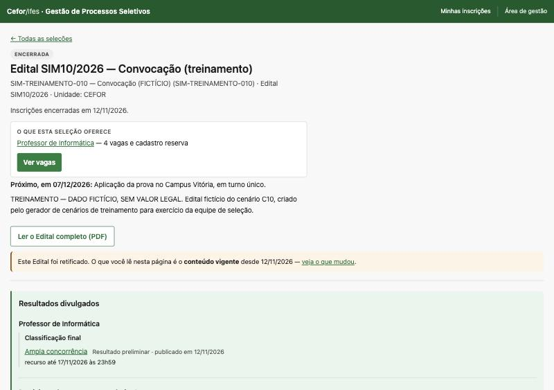
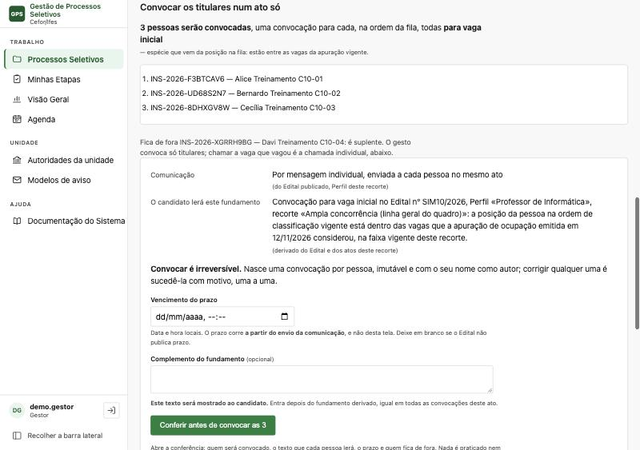
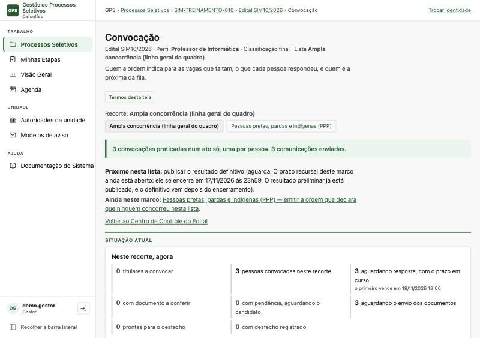
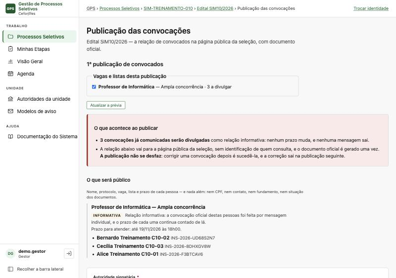
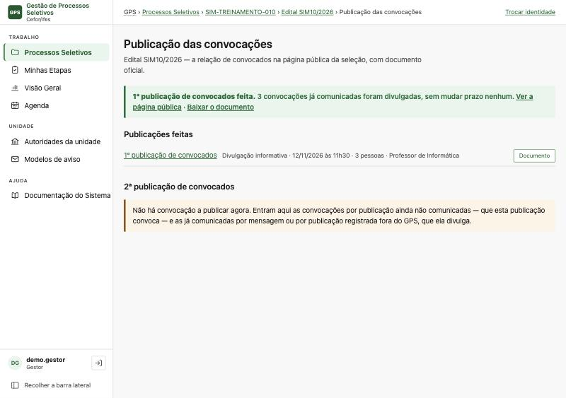
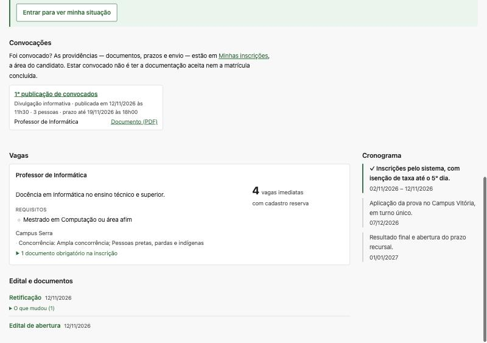
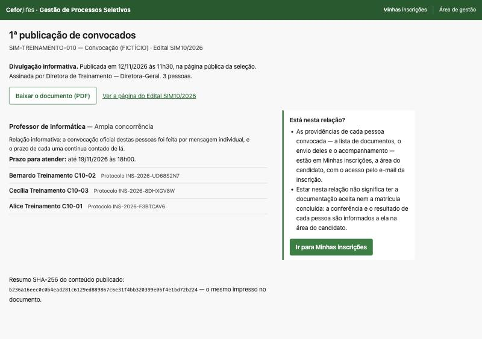
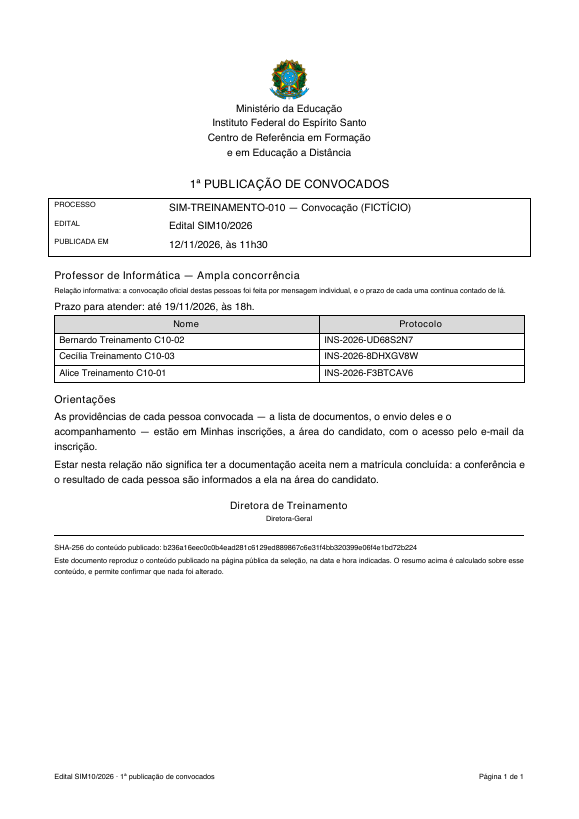

# Demonstração: a lista de convocados na área pública (12/11/2026)

**Pergunta.** Na homologação, a comissão convocou os titulares do Edital SIM10R2/2026 (cenário de
treinamento C10) e a lista não apareceu na página pública da seleção. A publicação de convocados da
`149` funciona?

**Resposta curta.** Funciona, mas **não é automática** e, no caso do C10, **a tela não leva até
ela**. Convocar grava as convocações e envia as mensagens; a lista só vai para a página pública
quando alguém publica, na página *Publicação das convocações* do Edital. Para um Perfil que convoca
por **mensagem individual** — o caso do C10 —, nenhuma tela tem o caminho para essa página: só o
endereço direto. Três achados no fim.

## Como foi feito

- Código: a `main` em `fe86f6d0` (12/11/2026), a mesma linha que a homologação recebe.
- Banco local novo (`ps149treino`), com o cenário **C10** carregado pelo gerador de treinamento — o
  mesmo da homologação: `carregar_cenarios_de_treinamento --cenario C10`.
- Tudo pela interface, com cliques, entrando como **Gestor** pelo seletor de demonstração.

## Os passos

### 0. A página pública antes



Resultado preliminar divulgado; **nenhuma seção *Convocações***.

### 1. Convocar os titulares (Centro de Controle → *Convocar 3 titulares*)



Três titulares; comunicação **por mensagem individual, enviada a cada pessoa no mesmo ato**.
Vencimento informado: 19/11/2026 18:00. *Conferir antes de convocar as 3* → *Convocar as 3 e enviar
3 mensagens*.

### 2. A convocação praticada



*"3 convocações praticadas num ato só, uma por pessoa. 3 comunicações enviadas."* — a mesma tela
da homologação.

Conferido no DOM, nesta tela e no Centro de Controle: **nenhum link para a publicação**. A página
pública continua **sem** a seção *Convocações*. É exatamente o que a homologação mostrou.

### 3. A página de publicação, pelo endereço direto

`/gestao/editais/<id do Edital>/convocacoes/publicacao`



A prévia: *"3 a divulgar"*, **relação informativa** — a convocação oficial foi por mensagem, e
*"nenhum prazo muda, e nenhuma mensagem sai"*. O que será público: nome, protocolo, vaga, lista e
prazo. A declaração do veículo não é pedida, porque esta publicação não convoca ninguém.

### 4. Publicar

Autoridade escolhida → *Publicar a 1ª publicação de convocados — 3 pessoas*.



*"1ª publicação de convocados feita. 3 convocações já comunicadas foram divulgadas, sem mudar prazo
nenhum."*

### 5. A página pública depois



A seção **Convocações** aparece, com a 1ª publicação: *Divulgação informativa · 3 pessoas · prazo
até 19/11/2026 às 18h00*, a relação e o documento.



A relação, com a orientação ao lado. O documento oficial tem as mesmas pessoas, data, prazo e resumo
SHA-256:



**Sem login**, por `curl` (que não tem sessão): a página da seleção, a relação e o PDF respondem
`200`.

## Achados

1. **Não há caminho na tela para publicar quando o Perfil convoca por mensagem.** O botão
   *"Publicar no GPS"* fica na seção das comunicações pendentes, que só aparece na convocação *por
   publicação*. Com mensagem enviada não há pendência, e o Centro de Controle também não tem o link.
   A comissão só chega à página pelo endereço. **Foi o que aconteceu na homologação.**
2. **A ordem das pessoas na relação não segue a spec.** A FR-5714 manda *"na ordem em que foram
   convocadas, com o protocolo desempatando"*; as três do mesmo gesto nascem no mesmo instante, e o
   desempate saiu pelo identificador interno (Bernardo, Cecília, Alice), e não pelo protocolo. O mais
   natural para quem lê seria a ordem de classificação (Alice C10-01, Bernardo, Cecília) — o que
   pede decidir se a spec muda.
3. **Publicar não é automático, e isso é de propósito** (FR-5708): a publicação é ato com
   autoridade, prévia e confirmação, e não efeito colateral de convocar. Se a expectativa da equipe
   é que convocar já publique, isso é decisão de produto, e não defeito.

## Para reproduzir

De `backend/`, num banco novo, com `CENARIOS_DE_TREINAMENTO=true`, `ARQUIVOS_CANDIDATOS_RAIZ` e uma
autoridade vigente no Cefor (ver o quickstart da `134`):

```bash
uv run python manage.py carregar_cenarios_de_treinamento --banco ps149treino --cenario C10 --autoridade <id>
```

Servido em `127.0.0.1`, e não em `localhost`, quando houver outro `runserver` local: o cookie de
sessão é por host, e outro servidor em `localhost` derrubava a sessão da gestão no meio do percurso.
