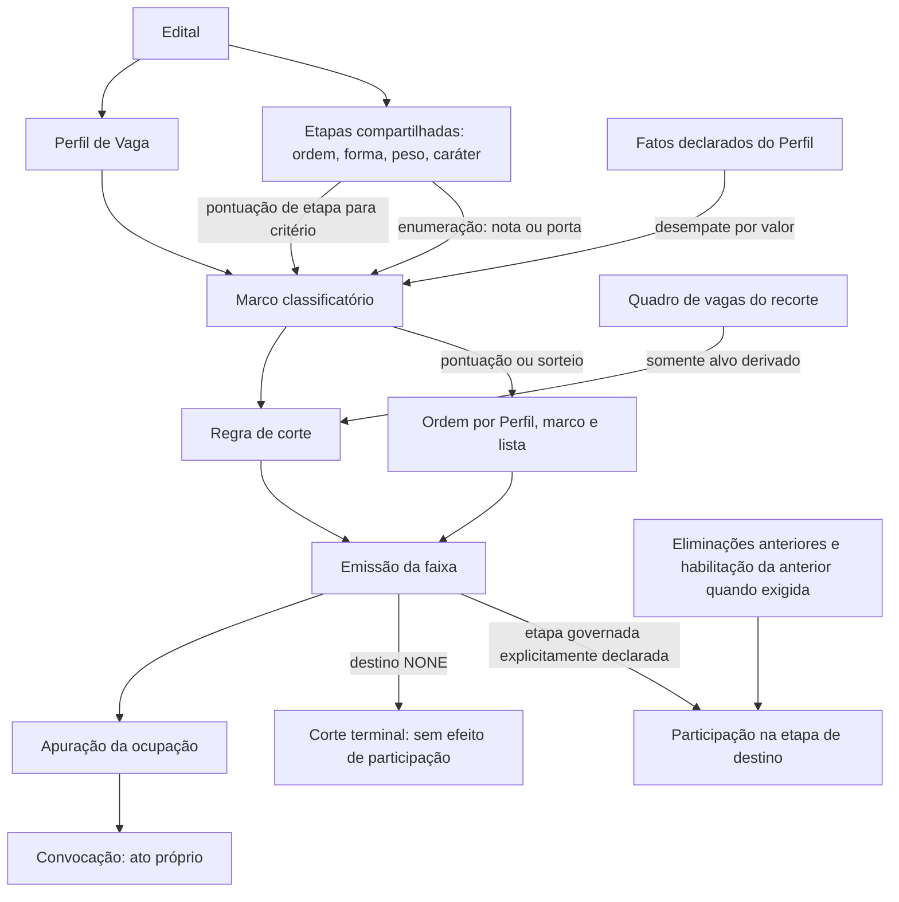
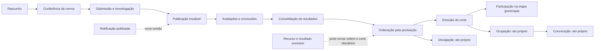
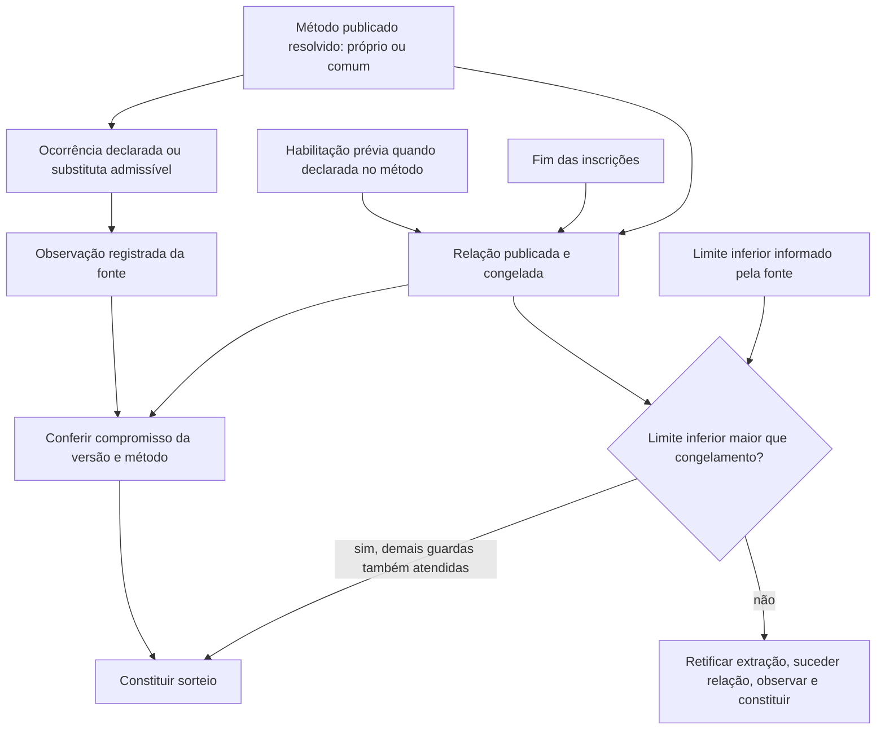

# Dependências reais: três mapas, três semânticas

Os mapas são projeções de leitura sobre o modelo existente. Uma seta não autoriza editar relações livres ou criar um novo tipo de regra.

## Relações classificatórias e participação



`classificatory` é a condição para a **enumeração**; não é o corte nem a consequência eliminatória. Peso pertence à etapa e não é copiado para cada marco. Porta decisória não soma número. As pontuações necessárias ao desempate vêm do universo preparado; mostrar um alvo existente não prova que há valor disponível para ele no contexto calculado.

### Exemplo complexo configurado neste estudo

| Origem | Marco / Perfil | Combinação | Corte e destino |
|---|---|---|---|
| E1 Objetiva | PRE / DOC-INFO | Uma etapa, média derivada | Alvo fixo 12; sem suplentes; admite empatados; alimenta E2 Títulos |
| E1 Objetiva + E2 Títulos | POS-TIT / DOC-INFO | Média ponderada; pesos 2 e 1 | Alvo fixo 6 + 2 suplentes; admite empatados; alimenta E3 Documental |
| E1 + E2 + E3 Documental + E4 Didática | FINAL / DOC-INFO | Média de três notas (2,1,3); E3 é porta | Alvo derivado do quadro por recorte; sem suplentes; admite empatados; nenhuma etapa governada |
| E1 + E2 | RESERVA / TEC-LAB | Soma ponderada; pesos 2 e 1 | Alvo fixo 3; sem suplentes; admite empatados; nenhuma etapa governada |

As quatro etapas são as do mesmo Edital; a existência de E3/E4 também tem efeitos de progressão no Perfil TEC-LAB, mesmo que seu marco não as enumere. A maquete não cria jornadas de avaliação distintas por perfil. No produto atual, somente os **usos classificatórios** diferem entre perfis.

No ensaio real, os marcos não tinham critérios de desempate na preparação inicial. O protótipo acrescenta **maior pontuação em didática** a FINAL para demonstrar o desempate da dupla fictícia. Isso é uma extensão sintética com operador existente, não transcrição de configuração salva. Os dados da dupla foram conferidos pela função oficial; o exemplo não simula a seleção dos participantes de todas as etapas.

### Limites topológicos

- Ordem de Etapas existe. Ordem independente de marcos não foi encontrada: a projeção da jornada coloca cada marco depois da última etapa que enumera; sem etapa, coloca no início.
- Múltiplas entradas e reutilização são suportadas. Não há gateways BPMN, condição livre por candidato ou ligação arbitrária entre marcos.
- Um marco pontuado não pode governar uma de suas próprias etapas de entrada. Não inferir uma proibição geral de destino anterior a partir dessa guarda: ela confere circularidade direta, não uma regra universal de calendário.
- Dois marcos do mesmo perfil não podem governar a mesma etapa. Perfis distintos podem ter regras próprias para a etapa compartilhada.
- Sem regra de corte, não há faixa desse marco; a progressão do resultado continua existindo. `NONE` é declaração de corte sem etapa governada, diferente de destino ainda não declarado.
- Continuação é sucessão/avanço da faixa conforme política; não é ciclo de avaliação livre.

Fontes: `editais/domain/validation.py::_regra_de_corte_do_marco`, `_corte_em_dois_marcos`; `classificacao/domain/jornada.py::jornada`; `resultados/domain/progressao.py`; `resultados/application/prontidao.py`.

## Dependências operacionais



São dependências conceituais, não um workflow exaustivo com todos os estados. Autorização e escopo incidem **em cada operação**. Uma tela de revisão não pode certificar uma autorização futura. Atos obsoletos são preservados e sucedidos; não recalcular silenciosamente o passado. A prontidão precisa nomear **a operação e o recorte**, por exemplo “emitir o corte de POS-TIT na PPP”, em lugar de “o processo está pronto”.

## Dependências temporais e compromisso do sorteio



A comparação efetiva é:

```text
ocorrencia.ocorrida_nao_antes_de > relacao.publicada_em
```

Igualdade é recusada. A hora da **observação** não substitui o limite da **ocorrência**. Fonte que só informa data situa o limite em 00h00 daquela data, no fuso institucional. Assim, relação congelada em 28/10 às 09h15 e extração datada 28/10 não são compatíveis, ainda que o edital anuncie 20h05. Com fonte que realmente informa hora posterior, o mesmo dia pode ser compatível.

A previsão anterior ao ato só cobre a fonte que publica data. Na publicação compara esse limite com o fim das inscrições; na tela, com `max(agora, fim das inscrições)`; para relação congelada usa o compromisso dela. A previsão não comprova disponibilidade da extração nem inclui automaticamente o término de uma habilitação prévia. A constituição usa a resposta efetiva da fonte, sem depender dessa previsão.

**Representação indicada:** três marcos temporais com os valores que a comparação realmente usa, mais lista de condições independentes. Um gráfico de etapas de avaliação não deve tentar representar essa relação criptográfica/temporal.
