# Estudo — a experiência da convocação: portal, e-mail e acesso

**Data**: 05/11/2026 · **Base**: `main` em `337a0d81` · **Natureza**: só estudo. Nada de código,
spec ou requisito mudou. Onde a proposta esbarra num requisito escrito, a justificativa está aqui, e
**a decisão é do usuário**. As decisões estão fechadas desde o parecer de 05/11 (seção 11).

> **De onde vem.** O usuário percorreu a jornada do convocado na `main` e registrou o achado
> [`doc/achado-comunicacao-ao-convocado-2026-11-05.md`](../achado-comunicacao-ao-convocado-2026-11-05.md).
> Faltam duas coisas: a X3 da `118`, porque a mensagem não diz que há documentos, e a
> QI-7 da `115`, porque a pendência não gera aviso. Este estudo junta as duas com o pedido de mudança
> de perspectiva. A convocação tem de ler como **comunicação institucional importante**, com prazo,
> consequência e uma ação principal, e não como tela de administrar documentos.

> **Versão 2, consolidada depois do parecer do usuário (05/11).** O diagnóstico e a direção estão
> aprovados, e as decisões D-1 a D-10 estão fechadas (seção 11). As maquetes foram refeitas em seis
> pontos:
>
> - **o dia da semana**: 10/11/2026 é terça-feira e 12/11/2026 é quinta, e a versão 1 dizia segunda
>   e quarta;
> - **a primeira tela**, reorganizada pela ordem e não por encolhimento;
> - **o botão**, que passa a representar todas as obrigações;
> - **a correção**, dita dentro do cartão do prazo;
> - **o e-mail da correção**, agora como modelo próprio;
> - **o retorno depois do envio**, com o foco na confirmação.
>
> O que mudou, e por quê, está no registro da seção 11. A comparação entre as versões está na
> seção 2.

## Sumário

1. [Diagnóstico](#1-diagnóstico)
2. [Hierarquia proposta para a página](#2-hierarquia-proposta-para-a-página)
3. [Vocabulário por tipo de seleção](#3-vocabulário-por-tipo-de-seleção)
4. [Modelo de e-mail](#4-modelo-de-e-mail)
5. [Acesso: três alternativas](#5-acesso-três-alternativas)
6. [Percurso no navegador, caso a caso](#6-percurso-no-navegador-caso-a-caso)
7. [Pendências (QI-7): política de avisos complementares](#7-pendências-qi-7-política-de-avisos-complementares)
8. [Maquetes e viabilidade técnica](#8-maquetes-e-viabilidade-técnica)
9. [Plano de teste com pessoas reais](#9-plano-de-teste-com-pessoas-reais)
10. [Impactos nas specs e MVP](#10-impactos-nas-specs-e-mvp)
11. [Decisões e registro](#11-decisões-e-registro)
12. [Como reproduzir](#12-como-reproduzir)

### Como as capturas foram feitas

As capturas são de cinco bancos de demonstração, um por cenário, montados pelas fixtures da `118`:
`tests/fixtures/jornada_do_convocado.py`, com `montar(letra, Montagem(...))`. Os bancos são
`ps_estudo_conv_c1`, `_f`, `_g`, `_i1` e `_corr`, todos copiados de um `ps_estudo_conv_base`
preparado por `make preparar`. Cada um subiu num runserver próprio, das portas 8131 a 8135, e foi
percorrido por um Chromium (Playwright) a 1280 × 900 e a 375 × 812.

| Cenário | O que é |
|---|---|
| C1 | documentos e Requerimento, nada enviado |
| F | um documento pendente e um a enviar, Requerimento enviado |
| G | prazo vencido sem desfecho |
| I1 | vaga aceita |
| corr | cenário A corrigido pela `120`: sucessora com prazo novo e mensagem reenviada |

O acesso foi feito de verdade em C1: o e-mail, o código lido no terminal do servidor, a lista e um
PDF enviado. O roteiro está em [`roteiro/`](roteiro/).

**Artefatos da demonstração, e não defeitos.** Quatro coisas nas capturas vêm da montagem, e não do
produto:

- "Área de gestão" no cabeçalho: o seletor de identidade estava ligado.
- O Perfil chamado "Perfil": é o nome que a fixture dá.
- O fundamento citando o "Edital 77/2026" num Edital 72: é o texto da fixture.
- O canal `selecao@exemplo.test`, que é o `PORTAL_ATENDIMENTO` do `.env`.

---

## 1. Diagnóstico

### 1.1 O e-mail de hoje

Capturado no terminal ao comunicar a convocação de C1. O corpo é o `CORPO` de
`convocacao/application/comunicar.py:48`, enviado por `send_mail` em texto puro.

```text
Subject: Convocação — Edital 72/2026

Você foi convocada(o) no Edital 72/2026.

Prazo para atender: até 10/11/2026 às 10:23, contado do envio desta mensagem.

O que fazer: acesse a sua área e siga as instruções da convocação em
https://‹host›/selecoes/inscricoes/

Em caso de dúvida, fale com selecao@exemplo.test.

Cefor/Ifes — Seleções
Esta mensagem é automática; não responda.
```

| # | Achado | Peso |
|---|---|---|
| E1 | **Não diz que há documentos a enviar** (a X3 da `118`). Quem lê não sabe que precisa juntar certidão, histórico e comprovante antes de o prazo vencer. | alto |
| E2 | **O assunto não diz a ação nem a instituição por extenso.** "Convocação — Edital 72/2026" não traz "Ifes" para quem não conhece o "Cefor", nem diz o que fazer ou até quando. Na lista do celular, ele é a única coisa lida. | médio |
| E3 | **O link leva à lista**, e não à convocação. Sem sessão, a lista manda ao acesso **sem destino**: depois do código, a pessoa cai em "Minhas inscrições" e precisa achar "Ver convocação" (1.3). | médio |
| E4 | **A mensagem da correção é idêntica à original, salvo o prazo.** No banco `corr` saíram duas mensagens, uma com "até 10/11/2026" e outra com "até 12/11/2026", e nenhuma diz qual vale. É o que a própria `120` registra em `_FRASE_DA_COMUNICACAO` (`fluxo.py:405`): *"Ela não diz que corrige a anterior."* | alto |
| E5 | **Não há orientação de segurança.** Uma mensagem institucional que pede ação com prazo e manda clicar num link é exatamente o formato do *phishing*. Nada diz o que o Ifes nunca pede. | médio |
| E6 | **Há formatação a acertar.** "às 10:23" no e-mail contra "às 10h23" no portal: a `118` unificou a tela (FR-3747) e o e-mail ficou de fora. A recaída "a área do candidato, no endereço do certame" aparece quando `endereco_do_portal` vem vazio, como nas fixtures; pela gestão ele vem preenchido. | baixo |

O que **está certo**, e se preserva:

- não traz CPF, telefone, posição na ordem nem link que autentica (FR-290 da `019`; FR-084a da
  `010`);
- não promete a vaga (FR-292c);
- diz que o prazo corre do envio (FR-269a);
- o envio é idempotente, com a chave reservada antes do SMTP, e auditado como "enviada", e nunca
  "recebida" (`comunicar.py`, docstrings de `comunicar` e de `_concluir`).

### 1.2 A página da convocação de hoje

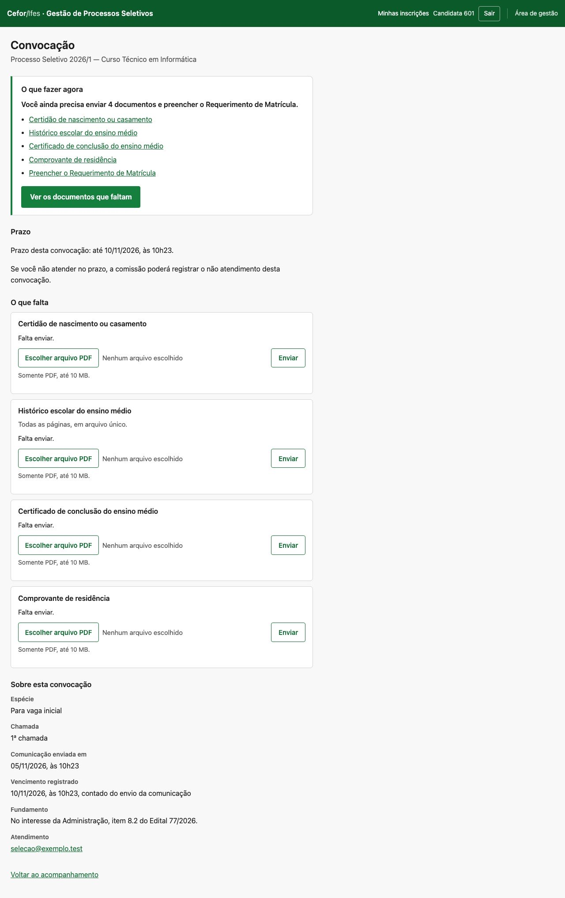

| Primeira tela a 375 px (C1) | Página inteira a 375 px (C1) |
|---|---|
| 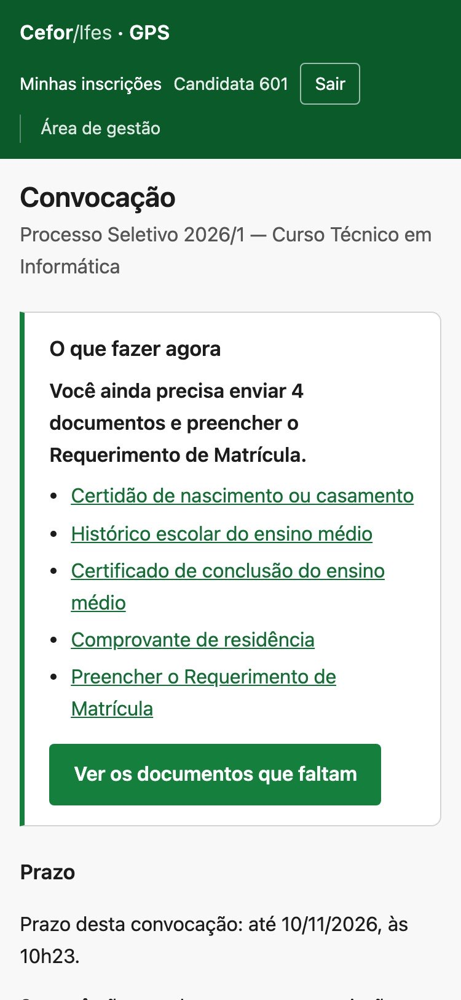 | 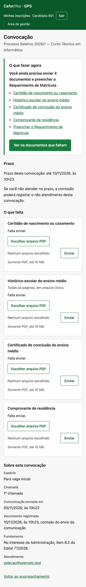 |

A `118` resolveu bem o que lhe cabia: o "O que fazer agora" vem primeiro, os selos são palavra, e a
ação cabe na primeira tela a 375 px (SC-1119). O que falta é **o significado**.

| # | Achado | Peso |
|---|---|---|
| T1 | **A página não diz o que aconteceu.** O título é só "Convocação", e com documento na chamada não há "Você foi convocada(o)". Essa frase só existe no ramo sem documento, em `convocacao.html:48`. Quem chega pelo e-mail lê "O que fazer agora" sem que nada confirme que foi chamado, para quê, nem que isso é uma boa notícia. | alto |
| T2 | **Nada diz o que a convocação não é.** A pergunta "a vaga está garantida?" não tem resposta na tela aberta. A frase "Este registro não é matrícula, bolsa nem contrato" só aparece **depois** do aceite (I1). | alto |
| T3 | **O prazo é uma linha de texto entre outras**, com o mesmo peso da frase de consequência, e sem o dia da semana nem quanto falta. A 375 px ele fica no fim da primeira tela. | médio |
| T4 | **Não há visão de progresso.** A frase "Você ainda precisa enviar 4 documentos e preencher o Requerimento" diz o que falta, mas não o que já está com a comissão ou conferido, que só se vê descendo. | médio |
| T5 | **O vocabulário do ato aparece cru.** Os dados mostram "Espécie: Para vaga inicial" e "Vencimento registrado"; o rótulo "Espécie" é do modelo de dados (`Convocacao.especie`). | baixo |
| T6 | **A sucessora não diz que substitui** (cenário `corr`). A página mostra "1ª chamada" com o prazo novo, 12/11, e nada diz que havia outra, com outro prazo, na mensagem que a pessoa guardou. | alto |
| T7 | **Depois do envio, a confirmação fica fora da tela** (1.4). | médio |

Os estados encerrados estão corretos e não pedem mudança de regra, só de título:

- **G, prazo vencido**: *"O prazo terminou em 05/11/2026, às 10h24. O fim do prazo não decide nada
  sozinho: quem registra o resultado é a comissão."*
- **I1, vaga aceita**: "Resultado registrado / Vaga aceita", com a ressalva do aceite.

Ver [`g-convocacao-375`](capturas/hoje/g-convocacao-375.jpg) e
[`i1-convocacao-375`](capturas/hoje/i1-convocacao-375.jpg).

### 1.3 O acesso de hoje

| Link direto, sem sessão | Link da mensagem, sem sessão | Código | Depois do código |
|---|---|---|---|
| 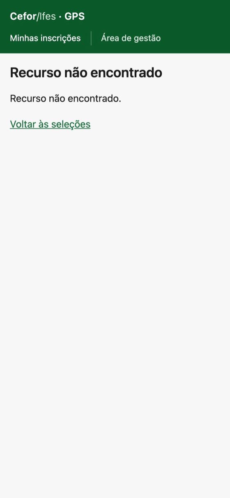 | 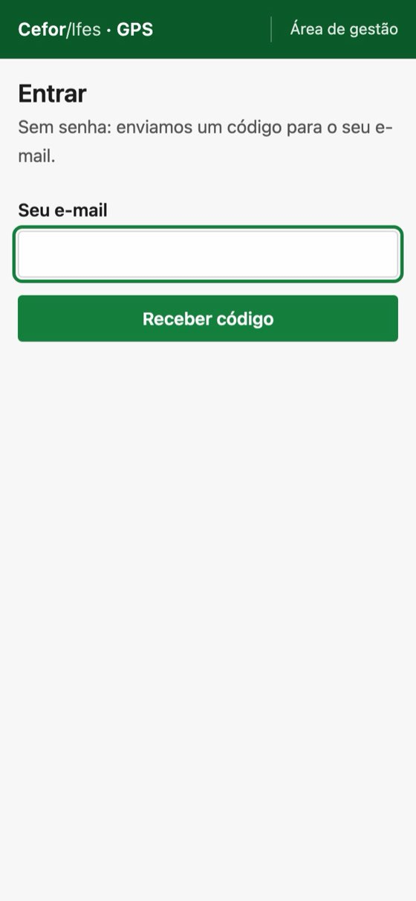 | 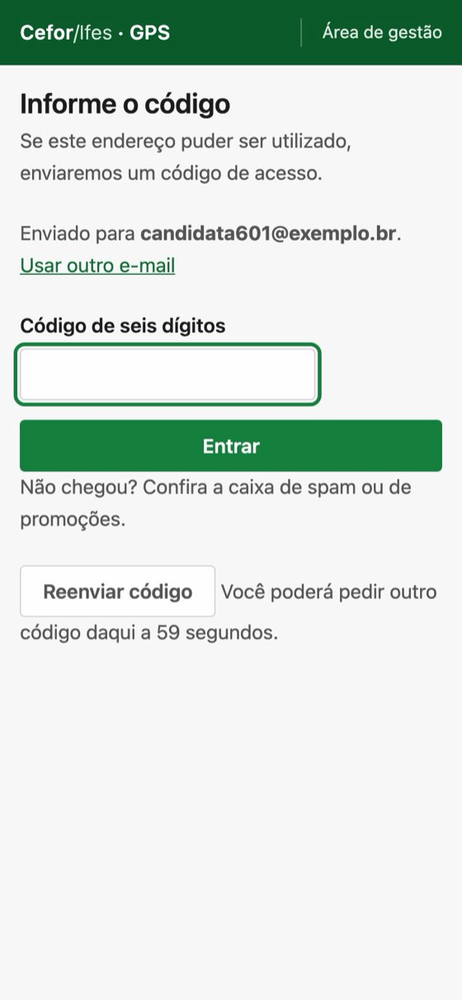 | 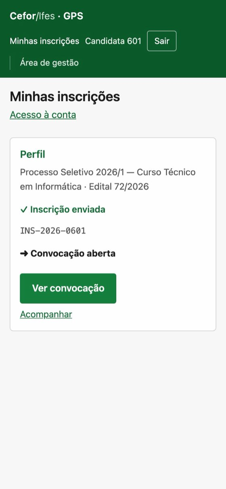 |

| # | Achado | Peso |
|---|---|---|
| A1 | **O endereço da convocação, aberto sem sessão, responde 404**: *"Recurso não encontrado"*, com "Voltar às seleções". A causa está em `_inscricao_do_titular` (`views.py:2702`), que confere a titularidade com identidade `None` e recusa como inexistente. É correto contra quem não é titular (FR-1101 da `059`), mas **também alcança o próprio titular com a sessão expirada**. Hoje isso não aparece porque a mensagem aponta para a lista. Qualquer link direto, inclusive um favorito ou a aba que ficou aberta, cai nesse 404. | alto |
| A2 | **O destino existe, mas não alcança a convocação.** `acesso` guarda o `?destino=` na sessão (`views.py:834`), `abrir_sessao` o preserva no `cycle_key`, e `_entrar` (`views.py:1059`) o lê. O problema está em `_de_volta_a_vaga` (`views.py:1087`): ela só devolve a página da vaga ou a do Edital, e manda **qualquer outra rota para a lista**. A restrição é deliberada contra **praticar ato** a partir de endereço compartilhado. A convocação é GET e não pratica ato nenhum, como a página do Edital que a `062` admitiu. | médio |
| A3 | **A tela de acesso não diz para onde se vai.** "Entrar" e "Informe o código" são genéricos. A `072` já faz isso para a vaga (`_vaga_do_destino`), e não para a convocação. | baixo |
| A4 | **A duração da sessão não está declarada.** `config/settings/` não define `SESSION_COOKIE_AGE`, de modo que vale o padrão do Django: **14 dias**, sem expirar ao fechar o navegador. A `010` diz só que a sessão expirada exige novo desafio (FR-036) e que não há "lembrar de mim" (FR-037). Num computador compartilhado de polo, 14 dias é muito; para o convocado que volta no 4º dia, ajuda. **É verificação a fazer, e não defeito.** | verificar |

Hoje, com sessão válida, o caminho é: e-mail → lista → "Ver convocação" → convocação, com um clique
a mais. Sem sessão: e-mail → "Entrar" → e-mail digitado → código → lista → "Ver convocação" →
convocação.

### 1.4 Depois do envio

| Primeira tela depois do envio (375 px) | Página inteira |
|---|---|
| 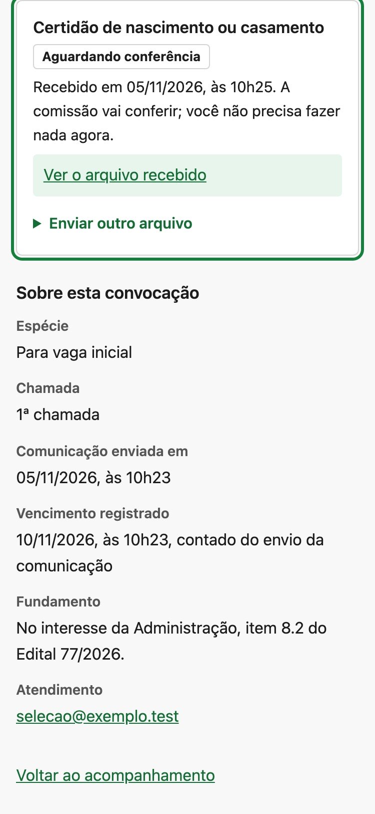 | 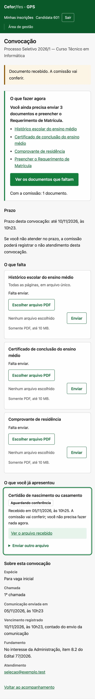 |

O envio volta a `#item-‹id›` (`views.py:2574`). O cartão enviado **já desceu** para "O que você já
apresentou", e a âncora rola a página até lá, quase no rodapé. A confirmação *"Documento recebido. A
comissão vai conferir."* é renderizada no topo, logo abaixo do título, e fica **fora da tela**. Os
três documentos que ainda faltam ficam **acima** da posição de rolagem. Quem envia o primeiro de
quatro documentos vê o cartão verde com "Aguardando conferência" e os dados do ato, e precisa subir
para continuar. O cartão diz "Recebido em…", e por isso não há perda de informação, mas o próximo
passo some.

**Achado da consolidação: a tela da convocação não carrega script nenhum.** A inscrição carrega
três (`inscricao.html:119–122`), e a convocação nenhum, conferido no navegador
(`document.scripts` vazio no cenário F):

- `arquivo.js`: escolhido o PDF, o cartão **continua dizendo "Nenhum arquivo escolhido"**, e o
  botão "Enviar" não muda de estado. Um texto que contradiz o que a pessoa acabou de fazer é o
  inverso da confirmação perceptível que o parecer pede.
- `envio.js`: o envio de até 10 MB numa rede móvel acontece sem a barra de progresso nem o aviso de
  não fechar a página, que o cartão já traz escondidos.
- `recusa.js`: uma recusa, como arquivo que não é PDF ou prazo encerrado, aparece no topo com
  `role="alert"`, mas sem foco. O próprio `recusa.js` explica que `role=alert` não anuncia o que já
  vem no HTML, e para quem usa leitor de tela o envio simplesmente não acontece.

É a mesma família da T7, e entra no incremento 1 (seção 10). **Não foi corrigido aqui**: o estudo
não altera código.

**Achado de passagem, do portal inteiro: `body{font-size:16px}`** (`portal.css:17`). Quem aumenta a
fonte padrão do navegador vê crescer os títulos, que estão em `rem`, mas não o texto corrido. O
zoom funciona normalmente. Não é da convocação, e fica como registro para decisão própria, fora
deste estudo.

---

## 2. Hierarquia proposta para a página

Na mesma página, sem *wizard*, sem página nova e sem rota nova. As maquetes são:

- [`convocacao.html`](maquetes/convocacao.html): C1, nada enviado;
- [`convocacao-apos-envio.html`](maquetes/convocacao-apos-envio.html);
- [`convocacao-pendencia.html`](maquetes/convocacao-pendencia.html): F;
- [`convocacao-sucessora.html`](maquetes/convocacao-sucessora.html): a correção.

| Desktop | Primeira tela a 375 px |
|---|---|
| 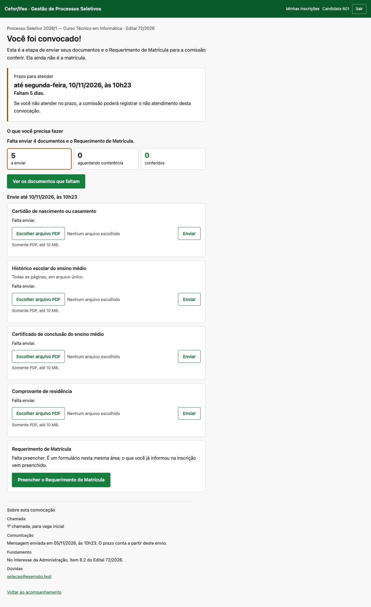 |  |

### 2.1 A primeira parte: a chamada

A primeira parte diz cinco coisas, nesta ordem, e termina na ação:

1. **O que aconteceu.** O contexto curto, "Curso Técnico em Informática · Edital 72/2026", e o título
   **"Você foi convocado!"** (D-1). Nunca "aprovado", "vaga garantida", "matriculado" ou "bolsa
   concedida" sem o ato que os registre (FR-3751 da `118`; UX-155 a UX-158 da `063`).
2. **Para qual etapa e o que ela pede.** *"Nesta etapa, você envia seus documentos e o Requerimento
   de Matrícula para a comissão conferir."* A frase descreve **as obrigações da chamada**, e por isso
   sai da lista gravada no ato e da política do Requerimento, e não do estado. O parecer sugeria *"Para
   continuar nesta seleção, apresente seus documentos e o Requerimento de Matrícula."* No imperativo,
   ela continuaria pedindo o Requerimento a quem já o enviou, como no cenário F. Na forma descritiva,
   vale em todos os estados, e quem diz o que falta é o item 4.
3. **O prazo exato.** É um cartão baixo, com a data como a maior coisa da tela ("10/11/2026, às
   10h23") e, abaixo, o dia da semana e a contagem: *"terça-feira · faltam 5 dias"*. As regras da
   contagem estão em 2.3.
4. **O resumo do que falta.** *"Você ainda precisa enviar 4 documentos e o Requerimento de
   Matrícula."*, que é a frase da `118`, sem mudança.
5. **A ação principal.** **"Ver o que preciso fazer"** leva à **primeira obrigação que exige
   atenção**: a pendente antes da que falta, e o Requerimento quando ele for a única. As demais
   continuam logo abaixo.
   - O rótulo anterior, "Ver os documentos que faltam", fazia o Requerimento parecer opcional.
   - "Ver minhas tarefas da convocação", a outra opção do parecer, fica longa a 320 px.
   - O rótulo não começa por "Enviar", porque o link só navega (FR-3730 da `118`).

**Logo depois da ação, ainda perto do prazo**, vêm a frase de consequência fixa da FR-1177 da `063`,
*"Se você não atender no prazo, a comissão poderá registrar o não atendimento desta convocação."*, e
a ressalva *"Esta convocação ainda não é a matrícula: a comissão confere o que você enviar e
registra o resultado."*

- As duas estão em texto corrido e sem moldura: aparecem, mas não disputam a primeira tela com o
  prazo.
- A consequência não ganha acréscimo nenhum. A FR-1177 proíbe outra frase de consequência, e
  *"o próximo suplente será convocado"* só pode aparecer quando o Edital declarar essa consequência
  em forma estruturada (L-4).

**Depois da ação vêm o andamento, os formulários e os dados do ato.**

- **O andamento** traz três contagens em palavra e número: *a enviar*, *aguardando conferência* e
  *conferidos*. **Sem barra**: "100 % enviado" leria como "100 % aprovado", que é a falsa conclusão
  que a FR-3728 da `118` proíbe.
- **Os formulários** são os cartões da `118` como estão, com o Requerimento como último cartão a
  fazer, e depois "O que você já enviou".
- **Os dados do ato** ficam por último: Processo, chamada (*"1ª chamada, para vaga inicial"*, no
  lugar de "Espécie: Para vaga inicial"), comunicação e origem do prazo, fundamento e atendimento.

**Por que não *wizard*.** Os documentos são independentes, chegam em dias diferentes, e a pessoa
volta várias vezes até o prazo. No cenário F, dois são conferidos antes de os outros chegarem. Um
passo a passo esconderia o que já foi feito e obrigaria a refazer o caminho a cada volta. A vantagem
que ele daria, uma coisa de cada vez, a ação principal já dá, sem tirar a visão do todo.

### 2.2 Versão 1 e versão 2, a 375 px

| | Normal (C1) | Com pendência (F) | Depois do envio | Corrigida |
|---|---|---|---|---|
| **Versão 1** | 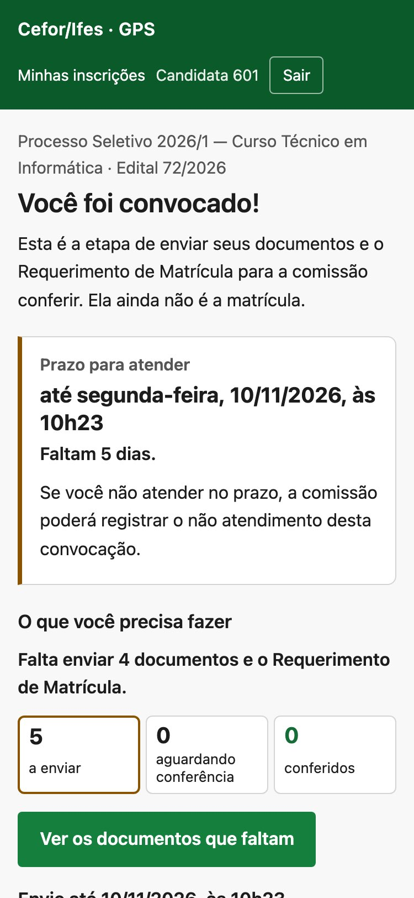 |  |  | 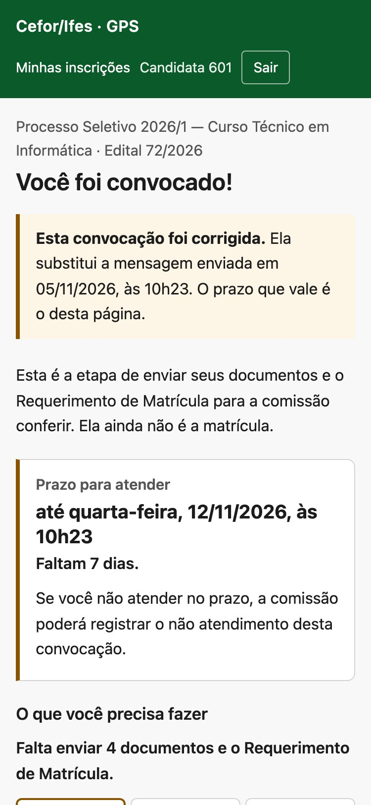 |
| **Versão 2** |  | 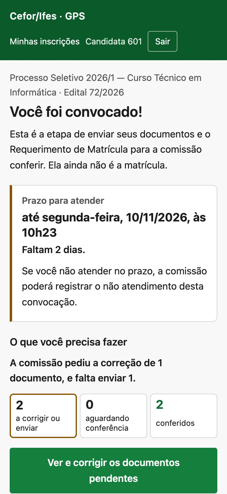 | 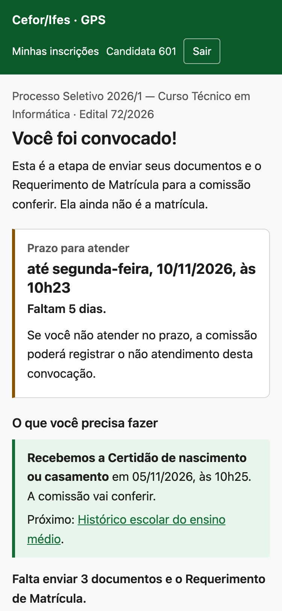 | 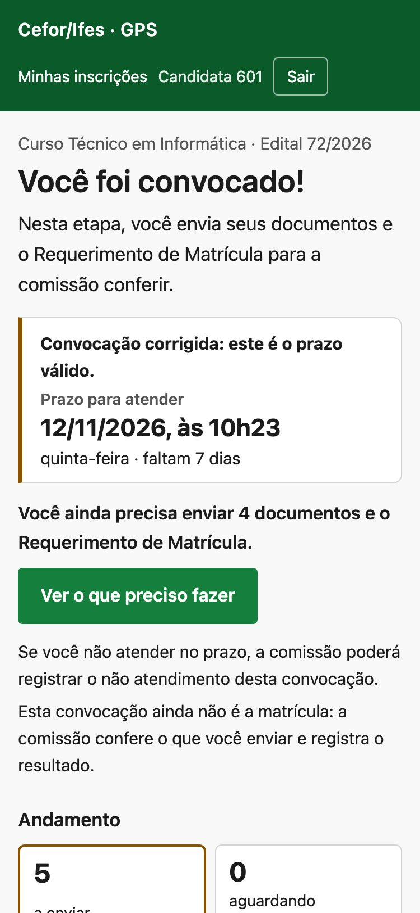 |

A versão 1 só fazia a ação caber **encolhendo** a tela a 375 px: título, data, espaçamento e
contagens diminuíam. Mesmo assim, ela ficava a 1 px do fim na pendência e fora da tela na
corrigida. A versão 2 tirou todo o encolhimento de `maquetes.css` e usa a tipografia da folha real.
O que mudou foi **o que vem antes da ação**: as contagens, a origem do prazo e a ressalva longa
desceram.

Medido por [`roteiro/medir.py`](roteiro/medir.py): é a posição do fim da ação principal, a partir do
topo da página.

| Maquete | 375 × 812, v1 | 375 × 812, v2 | 320 × 568 | 375, fonte 125 % | 375, fonte 150 % | zoom 200 % (640 × 450) |
|---|---|---|---|---|---|---|
| Normal | 784 | **504** | 553 ✓ | 646 ✓ | 901 ✗ | 459 ✗ |
| Pendência | 811 | **504** | 528 ✓ | 646 ✓ | 901 ✗ | 459 ✗ |
| Corrigida | 942 ✗ | **555** | 604 ✗ | 710 ✓ | 978 ✗ | 486 ✗ |
| Depois do envio | — | 560 na tela, a partir da confirmação | — | — | — | — |

Na legenda, ✓ quer dizer dentro da primeira tela, e ✗ fora dela. **Nenhuma** das 24 combinações
medidas tem rolagem horizontal, e em **todas** a ação vem antes do andamento na ordem do documento.

**O que isso quer dizer, e o critério proposto.** A ação não cabe na primeira tela com fonte a
150 %, com zoom de 200 %, e na corrigida a 320 × 568. **Isso é esperado, e não é defeito.** Com
zoom de 200 %, a tela de 450 px de altura não comporta título, prazo e resumo antes de qualquer
botão, nem deve: encolher para caber é o que o parecer vetou.

Por isso o critério de aceite não pode ser um número de pixels. São três condições:

1. **Ordem.** A ação é o primeiro controle do conteúdo, depois do título, da etapa, do prazo e do
   resumo, e vem antes do andamento, dos formulários e dos dados.
2. **Sem rolagem horizontal** a 320 px, com fonte a 150 % e com zoom de 200 % (WCAG 1.4.10, reflow).
3. **Primeira tela a 375 × 812, com a fonte padrão.** A ação está nela, **com folga de pelo menos
   uma linha de texto**, e não por 1 px. Hoje a folga é de 308 px no cenário normal e de 257 px na
   corrigida.

A SC-1119 da `118` se reescreve assim (seção 10).

**A corrigida a 320 px** fica 36 px abaixo da primeira tela, porque o aviso de correção ocupa duas
linhas. O aviso fica, porque é a informação que mudou.

### 2.3 O prazo: dia da semana, contagem e fuso

A versão 1 errou o dia da semana porque ele foi **digitado à mão** na maquete, ao lado de uma data
que não o determinava. Na implementação, o dia da semana, a contagem e a data **saem do mesmo
instante, por uma função só**, no fuso da instalação (`TIME_ZONE = "America/Sao_Paulo"`), e com o
`LANGUAGE_CODE = "pt-br"` para o nome do dia. Nada é digitado. Nas maquetes, que são texto,
[`roteiro/conferir_datas.py`](roteiro/conferir_datas.py) confere cada dia da semana contra a data ao
lado: acusa os dois erros da versão 1 e passa a versão 2, com doze dias conferidos.

As regras da contagem, para a spec:

| Situação, no fuso local | O que a tela diz |
|---|---|
| Vencimento em outro dia, 2 ou mais dias corridos depois | *"‹dia da semana› · faltam N dias"*, com N em **dias de calendário** entre hoje e o dia do vencimento, e não em blocos de 24 horas |
| Vencimento amanhã | *"‹dia da semana› · termina amanhã"* |
| Vencimento hoje, ainda não passado | *"termina hoje, às 10h23"* |
| Vencimento passado | nenhuma contagem: é o estado "prazo terminou" (FR-3748 da `118`) |
| Comunicação não enviada | nenhuma data de prazo: *"O prazo ainda não começou a correr…"* |
| Sem vencimento registrado | *"O prazo para atender é o que o Edital publica."*, como hoje |

**Os testes, no plano da spec:**

- O dia da semana confere com a data para **todos os dias de um ano**, contra o calendário da
  biblioteca padrão, e não contra uma tabela escrita à mão.
- Um vencimento às **23h30 locais** é 02h30 UTC do dia seguinte: o dia da semana, a data e a
  contagem são os do dia local. Esse é o caso que já deu errado uma vez, no `strftime` sobre UTC
  que `comunicar.py` corrigiu.
- A contagem é medida nos dois lados da meia-noite local, a 23h59 e a 00h01, e a uma hora do
  vencimento.
- O prazo sai em **um formato só**, no portal e no e-mail: "às 10h23", e nunca "às 10:23" (E6).
- O fuso é fixado no teste, sem depender da máquina, e há um caso com outro fuso de servidor para
  provar que a instalação é que manda.
- A contagem nunca arredonda para cima: com 2 horas restantes, não diz "falta 1 dia".

### 2.4 Os outros estados

Os outros estados têm a mesma estrutura. A partir do item 4, valem as frases que já existem hoje:

| Estado | Título (h1) | Cartão do prazo |
|---|---|---|
| Prazo correndo | Você foi convocado! | data, dia, contagem |
| Comunicação não enviada (K) | Você foi convocado! | *"O prazo ainda não começou a correr: ele conta a partir do envio da comunicação."* |
| Prazo vencido sem desfecho (G) | O prazo desta convocação terminou | o núcleo do vencido da FR-3748 |
| Desfecho registrado (I1, I2) | Resultado da sua convocação | o rótulo do desfecho e a frase do aceite, sem prazo |
| Corrigida (`corr`) | Você foi convocado! | **"Convocação corrigida: este é o prazo válido."** no próprio cartão, acima da data; a mensagem substituída, com o prazo antigo por extenso, nos dados do ato; o motivo não aparece (120, linhas 486–487) |

### 2.5 Depois do envio

O envio volta a **`#confirmacao`**, e não ao cartão (`views.py:2574`). A confirmação é o primeiro
elemento da chamada e tem `tabindex="-1"`, e por isso **o próprio navegador põe o foco nela** ao
seguir a âncora, sem script. Ela diz:

- **qual documento** foi recebido e quando;
- que ele **aguarda a conferência da comissão**;
- a **próxima tarefa**, como link.

Logo abaixo ficam o prazo, o resumo atualizado ("3 documentos e o Requerimento") e a ação. Medido a
375 × 812, a confirmação ocupa de 0 a 157 px, a ação termina em 560 px, e o foco está na
confirmação.

**Duas tentativas falharam, e foram medidas.** Voltar a uma âncora da seção inteira punha o foco na
seção, e o leitor de tela anunciaria o título dela, "Você foi convocado!", e não o envio. Um script
que movesse o foco perdia para a âncora, que o navegador segue depois dele.

**O que a confirmação não pode dizer:**

| Caso | Frase |
|---|---|
| Envio novo | *"Recebemos: ‹documento›, em ‹data›, às ‹hora›. Ela aguarda a conferência da comissão."* Nunca "aceito", "aprovado" ou "conferido" |
| O mesmo arquivo de novo | *"Este arquivo já tinha sido recebido."*, a frase de hoje, sem próxima tarefa nova |
| Último item enviado | a frase da FR-3728 da `118`: *"Você não tem mais documentos para enviar agora. A comissão ainda vai concluir a análise."* |
| Recusa (não é PDF, prazo encerrado) | a recusa fica **no cartão do item**, com o foco nela (`recusa.js`, que a convocação passa a carregar), e não no topo; nenhuma confirmação |
| Vários envios seguidos | cada envio é um POST, e cada volta mostra só o seu; a contagem do andamento mostra o acumulado |

A tela passa a carregar `arquivo.js`, `envio.js` e `recusa.js` (1.4), sem script novo além deles.

---

## 3. Vocabulário por tipo de seleção

**O domínio não tem tipo de certame.** A L-6 da `063`, o princípio 6 da mesma spec e a D-010 da
`040` o registram. As famílias da `119` (FIC, Libras, UAB/bolsista, Aperfeiçoamento, TMD, Internos)
existem só na identidade visual da divulgação. A `063` proíbe de propósito `if curso / else
servidor` no texto. Então o vocabulário abaixo **não se implementa adivinhando o tipo**. Ou ele
vem de algo declarado, ou o texto fica no núcleo neutro.

**O núcleo neutro** vale para todo Edital e já é implementável:

- "Você foi convocado!";
- "a comissão confere";
- "o resultado desta convocação";
- "Esta convocação ainda não é ‹o ato final›".

A ressalva já existe no aceite: *"não é matrícula, bolsa nem contrato"*.

**O que varia**, se houver dado declarado para isso:

| Seleção | O ato real da convocação | Diga | Nunca diga antes do ato |
|---|---|---|---|
| Curso técnico (integrado, concomitante, subsequente), FIC, Libras | chamada para **matrícula**: entrega de documentos e Requerimento; a matrícula se efetiva depois, pelo registro acadêmico | "Você foi convocado para a matrícula." · "Envie os documentos e o Requerimento de Matrícula." | "matriculado", "aprovado", "sua vaga" |
| Graduação e pós (lato sensu, Aperfeiçoamento) | o mesmo, com homologação da matrícula conforme o Edital | "Você foi convocado para a matrícula no curso." | "aluno do curso", "matrícula efetivada" |
| Bolsista (UAB, tutor, apoio) | chamada para **cadastramento**: ficha, termo de compromisso, documentos; a bolsa depende de vinculação no programa | "Você foi convocado para o cadastramento como bolsista." · "Envie a Ficha de Cadastramento e o Termo de Compromisso." | "bolsa concedida", "contratado", "vinculado" |
| Professor formador ou colaborador | chamada para **entrega de documentos e assinatura do termo** | "Você foi convocado para apresentar os documentos e assinar o termo." | "contratado", "nomeado", "empossado" |
| Convocação para regularizar (`PARA_REGULARIZAR`) | chamada para **regularizar** o que levou ao indeferimento, quando o Edital o admite | "Você foi chamado para regularizar a sua situação nesta seleção." | "nova chance garantida", "indeferimento revertido" |
| Vaga que vagou (`SUPLENCIA`) | chamada para vaga que ficou disponível | "Uma vaga ficou disponível, e você foi convocado." | "você subiu na lista", "lista de espera" (UX-155 da `063`) |

**De onde viria o dado.** Há duas fontes, e as duas são decisão:

1. **A espécie, que já existe** (`VAGA_INICIAL`, `SUPLENCIA`, `PARA_REGULARIZAR`). Ela decide as duas
   últimas linhas da tabela, e **isso já é implementável**: é ato gravado, e não inferência. Hoje ela
   só aparece crua nos dados do ato.
2. **A finalidade da convocação, que não existe**: um campo fechado, declarado no Perfil (*matrícula*,
   *cadastramento de bolsista*, *apresentação de documentos e termo*), que escolhe a frase da etapa
   e a do e-mail. É requisito novo, na `019` ou numa spec própria, e cruza com a L-4 da `063`, a
   "ação e consequência estruturadas da convocação". Sem ele, a frase da etapa diz *"envia seus
   documentos"*, e a palavra "Matrícula" só aparece quando o Requerimento de Matrícula está pedido,
   o que já é dado (`requirement` da `029`).

---

## 4. Modelo de e-mail

São três arquivos:

- [`maquetes/email.html`](maquetes/email.html): a mensagem inicial;
- [`maquetes/email-correcao.html`](maquetes/email-correcao.html): a da correção, **como modelo
  próprio**, e não como variante silenciosa;
- [`maquetes/email.txt`](maquetes/email.txt): a alternativa completa em texto puro das duas, mais a
  tabela de assunto e frase por obrigação.

| Inicial, 720 px | Inicial, 375 px | Modo escuro | Correção, 375 px |
|---|---|---|---|
| 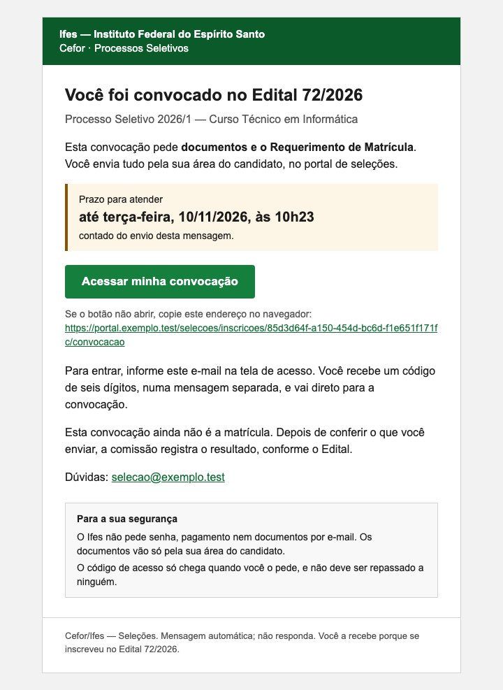 | 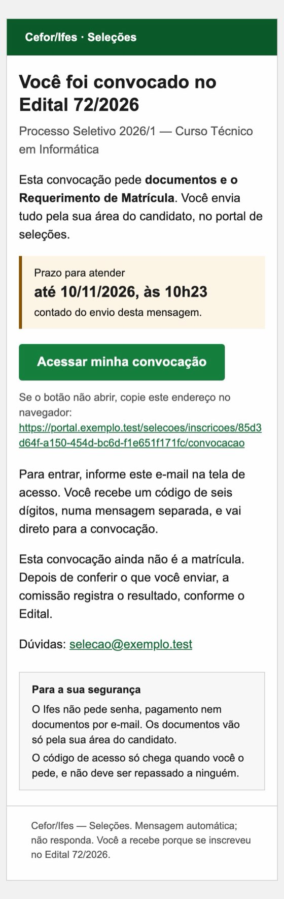 | 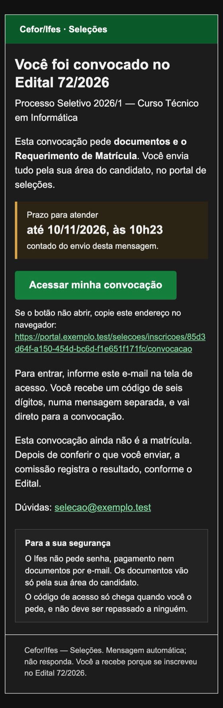 | 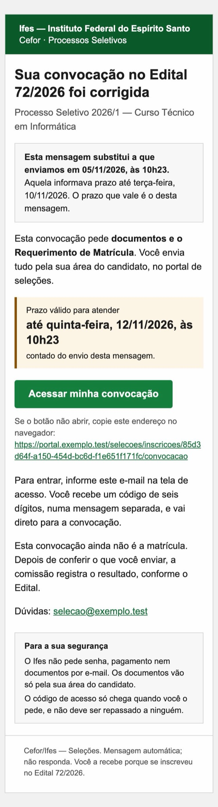 |

**A identificação institucional vai por extenso.** O cabeçalho em texto diz *"Ifes — Instituto
Federal do Espírito Santo"* e, abaixo, *"Cefor · Processos Seletivos"*. Quem não conhece a sigla
"Cefor" reconhece o Ifes.

Isso **não é autenticação do remetente**. Qualquer um escreve "Ifes" num e-mail. O que prova a
origem é o SPF, o DKIM e o DMARC (D-8), e o que protege a pessoa é a orientação de segurança e o
fato de que o link não autentica.

**O assunto e a frase seguem o que a chamada pede de fato.** Os dois são lidos da lista gravada no
ato de convocar e da política do Requerimento. As variantes completas estão no fim de `email.txt`:

| A chamada pede | Assunto | Frase do corpo |
|---|---|---|
| documentos e Requerimento | `Ifes · Convocação no Edital 72/2026: envie seus documentos até 10/11` | *"Esta convocação pede documentos e o Requerimento de Matrícula."* |
| só documentos | o mesmo | *"Esta convocação pede documentos, que você envia pela sua área do candidato."* |
| só o Requerimento | `…: preencha o Requerimento até 10/11` | *"Esta convocação pede o Requerimento de Matrícula…"* |
| nenhum dos dois | `…: prazo até 10/11` | *"Siga as instruções do Edital dentro do prazo…"* |
| sem vencimento registrado | `Ifes · Convocação no Edital 72/2026` | o prazo é *"o que o Edital publica"* |
| **correção (120)** | `Ifes · Convocação corrigida no Edital 72/2026: prazo válido até 12/11` | a mesma, conforme o que a sucessora pede |

Os primeiros ~45 caracteres, que são o que a lista do celular mostra, trazem a instituição, a
palavra "Convocação" e o Edital. O texto de pré-visualização repete a ação e o prazo com o dia da
semana.

**A correção diz o que substitui, e não por quê.** O título é *"Sua convocação no Edital 72/2026 foi
corrigida"*. Logo abaixo vem um quadro: *"Esta mensagem substitui a que enviamos em 05/11/2026, às
10h23. Aquela informava prazo até terça-feira, 10/11/2026. O prazo que vale é o desta mensagem."*
O cartão do prazo se chama *"Prazo válido para atender"*.

- O prazo antigo aparece por extenso porque é ele que a pessoa tem na outra mensagem: é por ele que
  ela reconhece qual das duas deixou de valer.
- O motivo da correção não vai (120, linhas 486–487).
- A sucessora pode **antecipar** o prazo (FR-3844 da `120`), e por isso o texto diz *"prazo
  válido"*, e não *"novo prazo"* nem *"prorrogação"*. A FR-3856 proíbe chamar o ato de prorrogação.

**O corpo, de cima para baixo**:

- o título e o Processo;
- **a frase dos documentos**, que é a X3: *"Esta convocação pede documentos e o Requerimento de
  Matrícula. Você envia tudo pela sua área do candidato."*;
- o prazo em destaque, com o dia da semana, *"contado do envio desta mensagem"* (FR-269a);
- o botão **"Acessar minha convocação"**, com o endereço por extenso abaixo;
- como entrar, por e-mail e código, "numa mensagem separada";
- a ressalva *"ainda não é a matrícula"*;
- o canal de atendimento da unidade;
- o quadro "Para a sua segurança";
- o rodapé.

**O que não vai**: CPF, nome do documento, motivo de pendência, modalidade de reserva, número de
inscrição, anexo, imagem, fonte externa, pixel de rastreio e parâmetro de campanha no link.

- **Nem o número de documentos.** "4 documentos" parece inofensivo, mas a lista da chamada pode
  variar com a modalidade (um laudo, uma declaração de renda), e a contagem passaria a dizer algo
  sobre a cota de quem a lê. "Pede documentos" basta para a X3.
- **O nome da pessoa ficou de fora**, e é decisão (D-6). Uma saudação nominal é sinal de mensagem
  legítima contra *phishing*. Mas é dado pessoal, viaja no encaminhamento, e a FR-290 limita a
  mensagem ao "necessário para identificar a chamada".

**Compatibilidade, avaliada no desenho**: nenhuma afirmação abaixo foi testada num cliente real, e o
teste está na seção 10.

| Cliente ou condição | Como o modelo responde | Risco que fica |
|---|---|---|
| Gmail (web e app) | estilo em linha em tudo; o `<style>` é só acréscimo | o app com conta de outro provedor descarta `<style>`: perde o modo escuro próprio e a quebra de largura, e a mensagem continua legível a 600 px com zoom |
| Outlook de mesa (motor do Word) | botão como célula com `bgcolor`, e não fundo em `<a>`; tabelas de largura fixa; sem `max-width` decisivo | cantos retos no botão; o `border-left` do prazo pode sumir, e o texto "Prazo para atender" continua |
| Outlook.com e app | estilo em linha | inversão parcial no modo escuro |
| Celular | uma coluna; o `@media` alarga para 100 %; fonte de 16 px no corpo, 17 px no botão, alvo ≥ 44 px | sem o `@media` (Gmail com outra conta), a mensagem fica em escala reduzida |
| Imagens bloqueadas | não há imagem: a marca é texto | nenhum |
| Modo escuro | `color-scheme` e `@media (prefers-color-scheme: dark)` para Apple Mail e Outlook.com; capturado no Chromium | a inversão **forçada** do Gmail no celular reescreve as cores sem consultar o `<style>`; o verde do botão e o amarelo do prazo foram escolhidos por manterem contraste invertidos, **mas isso não foi verificado** |
| Leitor de tela | `lang="pt-BR"`, tabelas com `role="presentation"`, um `h1`, link com texto próprio ("Acessar minha convocação"), informação nunca só em cor | o endereço por extenso é lido caractere a caractere: fica depois do botão, para quem não precisa dele |
| Texto puro | `email.txt` diz tudo o que o HTML diz, com o endereço completo | nenhum |
| Tamanho | ~6 kB | longe do corte de 102 kB do Gmail |

**O teste em clientes reais ainda não foi feito, e não cabe neste estudo.** Ele exige mandar
mensagem de verdade para caixas de teste, a partir do SMTP de homologação. Fica como critério de
aceite do incremento 1, com uma captura por linha:

| Cliente | Aparelho | Claro | Escuro | Imagens bloqueadas | Leitor de tela |
|---|---|---|---|---|---|
| Gmail (web) | desktop | ☐ | ☐ | ☐ | — |
| Gmail (app), conta Gmail **e** conta de outro provedor | Android e iOS | ☐ | ☐ (inversão forçada) | ☐ | TalkBack / VoiceOver ☐ |
| Outlook de mesa (Windows) | desktop | ☐ | ☐ | ☐ | NVDA ☐ |
| Outlook.com e app Outlook | desktop e celular | ☐ | ☐ | ☐ | — |
| Apple Mail | iOS e macOS | ☐ | ☐ | ☐ | VoiceOver ☐ |
| Caixa institucional do Ifes (o webmail que os servidores usam) | desktop | ☐ | — | ☐ | — |

Em cada linha se conferem cinco coisas:

- o assunto e a pré-visualização na lista;
- o botão clicável e o endereço por extenso;
- o contraste do prazo e do botão (≥ 4,5:1);
- a ordem de leitura;
- a mensagem da correção ao lado da inicial, no mesmo cliente.

**SPF, DKIM e DMARC: verificação a fazer, e não premissa.** Nada no repositório os configura, e não
deve: eles moram no DNS do domínio do remetente e no servidor de correio que envia. Antes de produção:

1. Saber de qual domínio sai o `DEFAULT_FROM_EMAIL`.
2. Conferir que o SPF desse domínio inclui o relé SMTP que a aplicação usa.
3. Conferir que o relé assina com DKIM no mesmo domínio do `From:`, que é o alinhamento.
4. Conferir que o DMARC do domínio existe, com `p=quarantine` ou `p=reject`.

Sem os três, um e-mail com botão e prazo é exatamente o que os filtros mandam para o spam. O texto
"Confira a caixa de spam" da tela do código é um remendo para isso. É pergunta para a equipe de TI
do Ifes, e está na seção 11 (D-8).

**O que se preserva na implementação.** `enviar_mensagem_de_convocacao` passa a chamar
`send_mail(..., message=texto, html_message=html)`, com os dois corpos renderizados de templates.
Nada mais muda:

- **auditoria**: a mesma trilha, "enviada em", e nunca "recebida";
- **idempotência**: a reserva da chave antes do SMTP continua igual, e a repetição concluída não envia;
- **prazo**: ele continua correndo do `enviado_em` gravado, e não do texto;
- **situações de mensagem**: nenhuma nova; a FR-084 da `010` continua com quatro, e o guardião
  `tests/test_situacoes_de_mensagem.py` não muda;
- **forma de convocar**: a convocação **por publicação** continua sem e-mail nenhum (D-001 da `066`).
  O modelo é só da mensagem individual, e a página do portal mostra, nos dados do ato, *"Publicada em
  ‹referência›"* no lugar de "Mensagem enviada em".

Um acréscimo para decidir (D-7): gravar em `ComunicacaoEmitida` **qual versão do modelo** saiu. Hoje
o texto se reconstrói do código mais os dados, e com dois corpos e variantes essa reconstrução fica
mais frágil.

---

## 5. Acesso: três alternativas

O ponto de partida é a P-001 da `010`: *"Não há link que autentica"*. O link viaja no histórico do
navegador, no encaminhamento da mensagem e no cabeçalho de origem, e por isso o código é digitado.

### A — o link aponta para a convocação, e o destino sobrevive ao código

O link da mensagem passa a ser `/selecoes/inscricoes/‹inscrição›/convocacao`. São três mudanças,
todas pequenas:

1. Numa rota do titular aberta **sem sessão**, como a convocação ou o acompanhamento, redirecionar
   para `acesso?destino=‹caminho›` **antes de qualquer leitura do identificador**, em vez do 404 de
   hoje. Fazer isso antes da consulta é o que não abre oráculo de existência: o mesmo redirecionamento
   vale para um identificador real e para um inventado. Para quem tem sessão e não é titular, a
   recusa continua 404 (FR-1101 da `059`).
2. `_de_volta_a_vaga` passa a aceitar a rota da convocação, que é GET e não pratica ato, como a página
   do Edital desde a `062`.
3. As telas de acesso dizem *"Depois do código, você vai direto para a convocação"*, **sem dizer de
   quem nem de qual Edital**. Antes do código, ler o identificador para nomear o Edital revelaria a
   quem tem o link encaminhado que ali existe uma inscrição.

O destino já sobrevive ao `cycle_key` e à reconciliação, que também termina em `_entrar`.

**Variante A′.** O link aponta para `/selecoes/convocacao`, uma rota sem identificador. Depois do
código, ela leva à única convocação em aberto, ou à lista se houver mais de uma. O e-mail fica sem
identificador nenhum, ao custo de uma rota nova e da regra da escolha.

| Acesso, com destino | Código, com destino |
|---|---|
| 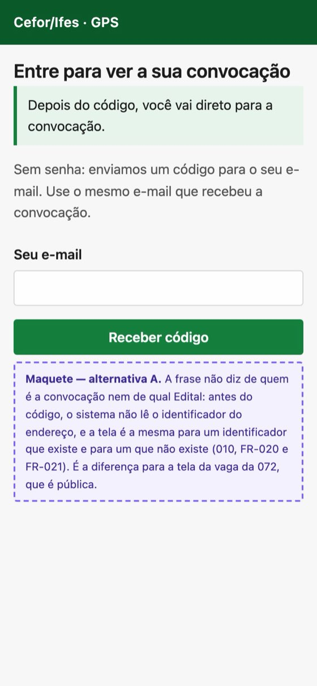 | 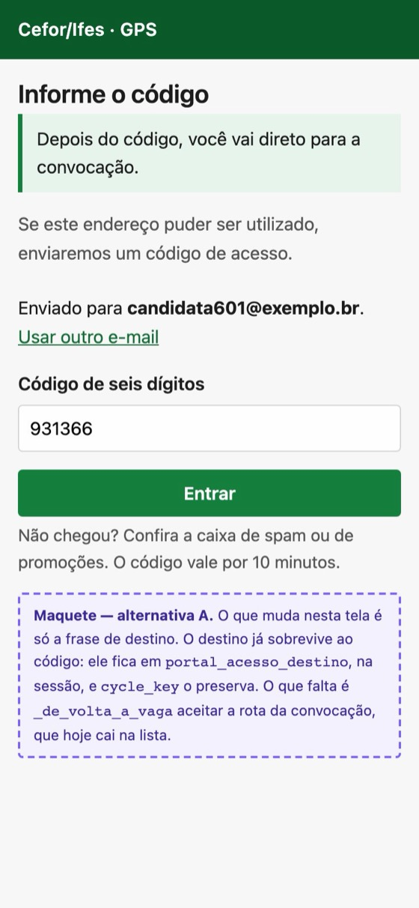 |

#### O que a spec de A precisa garantir

| # | Garantia | Como, sobre o que já existe |
|---|---|---|
| S1 | **Sem sessão, o pedido vai para a autenticação sem revelar existência nem titularidade.** | O redirecionamento acontece **antes** de qualquer consulta pelo identificador, e é idêntico, inclusive na resposta e no tempo, para inscrição real, inventada ou de outra pessoa. A tela de acesso não nomeia o Edital (item 3 acima). |
| S2 | **O destino é validado pelo servidor, sem redirecionamento aberto.** | São quatro camadas: `_destino_seguro` (`views.py:485`), que já recusa outro host e outro esquema; `_rota_do_destino`, que resolve o caminho contra as rotas do portal; uma **lista fechada** das rotas que podem ser destino, a vaga, o Edital e a convocação, porque o que não está nela volta para a lista, como hoje; e só o caminho, sem consulta nem fragmento vindos de fora. |
| S3 | **A autenticação continua por e-mail e código.** | Nada muda na P-001 nem nas FR-022 a FR-031c da `010`. |
| S4 | **A titularidade é conferida depois do login, a cada requisição.** | É o `_inscricao_do_titular` de hoje. O destino guardado não carrega autorização: ele é só um caminho, conferido de novo quando é aberto. |
| S5 | **Recurso alheio ou inexistente recebe recusa indistinguível.** | Com sessão, as duas recebem o mesmo 404 de hoje (FR-1101 da `059`). Sem sessão, as duas recebem o mesmo redirecionamento (S1). |
| S6 | **Com sessão válida, a convocação abre direto.** | Já é assim. A mudança é só o endereço da mensagem. |
| S7 | **A convocação corrigida abre a vigente e diz que substituiu.** | O link é da **Inscrição**, e não da convocação, e por isso a primeira mensagem também abre a sucessora (`vigentes_por_inscricao`). A página diz *"Convocação corrigida: este é o prazo válido."* (2.4). |
| S8 | **Nenhuma escrita por GET.** | O destino só navega. Apresentar documento, abrir rascunho e enviar Requerimento continuam POST com CSRF, e abrir a convocação não move prazo (FR-288b da `019`). |

**O identificador na URL não é credencial nem garantia de anonimato.** O UUID da Inscrição no e-mail
não autoriza nada (S4), mas também não é segredo. Quem lê a mensagem encaminhada sabe que aquela
inscrição existe, e o endereço fica no histórico do navegador e no registro do servidor.

- Nenhuma decisão de acesso pode depender de ele ser difícil de adivinhar.
- Ele não substitui a conferência de titularidade.
- Ele não vai a lugar nenhum além do link: nem ao assunto, nem ao texto, nem a parâmetro de
  campanha.
- Se a instituição preferir que o e-mail não leve identificador nenhum, a variante A′ resolve, com
  uma rota a mais.

**A duração da sessão e o computador compartilhado ficam para a TI** (D-9). Com 14 dias e sem
expirar ao fechar o navegador, quem entra num laboratório de polo e não clica em "Sair" deixa a
área aberta para a pessoa seguinte, com certidão, histórico e comprovante de residência. A
alternativa A não muda isso, mas também não o agrava: o código continua obrigatório para quem não
tem sessão.

### B — identificação facilitada, sem redigitar o e-mail

O link leva um identificador opaco e aleatório, de 128 bits, gravado no servidor e apontando para a
credencial. A tela mostra *"Enviar código para c•••••••1@exemplo.br"* e um botão **"Enviar código"**,
sem campo para digitar.

- O identificador sozinho **não dá acesso**: o código continua obrigatório.
- O código só sai num **POST**, e nunca ao abrir a página. Senão, o *scanner* de segurança que abre o
  link dispararia o código e consumiria o limite de pedidos.
- O identificador expira com a convocação e não carrega dado pessoal.

### C — link mágico de uso único e prazo curto

O link da convocação **não pode ser** o link mágico. Um link válido até o vencimento, de cinco dias
ou mais, é uma credencial ao portador circulando numa caixa postal. Por isso C tem duas etapas:

1. A convocação leva à tela de acesso, como em A.
2. A tela oferece *"Receber um link de entrada"*, que manda uma **segunda** mensagem com um link de
   uso único que vale 10 minutos, o mesmo prazo do código.

O link abre uma página com o botão **"Entrar"**, e o consumo acontece no POST, nunca no GET. Depois
do consumo, o token sai do endereço por redirecionamento, com `Referrer-Policy: no-referrer`, e nunca
vai a log. Opcionalmente, o link só vale no navegador que o pediu, amarrado por cookie.

### Modelo de ameaças

| Ameaça | A (destino) | B (identificação facilitada) | C (link mágico) |
|---|---|---|---|
| **E-mail encaminhado** | quem recebe não entra: o código vai para a caixa da titular | quem recebe pode **disparar** códigos para a caixa da titular (incômodo, com limite) e vê o endereço mascarado, que já tinha | se o link mágico for encaminhado dentro dos 10 minutos, **quem recebe entra**; com amarração ao navegador, não |
| **Caixa postal comprometida** | quem a controla pede o código e entra, **como hoje** | igual a hoje | igual a hoje, e mais fácil: um clique |
| **Scanner que abre o link** (Safe Links, Mimecast) | inofensivo: GET sem estado | inofensivo **se** o código só sair no POST | **consome** o token se o consumo for no GET; por isso o POST é obrigatório, mas há *scanners* que submetem formulários |
| **Token em log ou histórico** | não há token: o endereço tem o identificador da Inscrição, que não autoriza nada (princípio do identificador público, constituição) e não é dado pessoal (FR-1102 da `059`; FR-401 da `029`) | o identificador opaco fica no histórico; sozinho, não entra | o token fica no histórico **até ser consumido**; depois, inútil |
| **Reutilização** | nada a reutilizar | o identificador dispara código quantas vezes o limite deixar (FR-030 da `010`) | uso único (como a FR-025 para o código) |
| **Outro dispositivo** | funciona: e-mail e código em qualquer aparelho | funciona | sem amarração, funciona e é o risco do encaminhamento; com amarração, **falha** justamente no caso mais comum: o app do Gmail abre o link num navegador interno, com outro pote de cookies, e não no navegador onde o pedido foi feito |
| **Documentos sensíveis** | o acesso continua pedindo sessão autenticada por código; nada muda | nada muda | a autenticação fica um grau mais fraca (um clique em vez de algo digitado), sobre a mesma área que guarda certidão, comprovante de renda e laudo |

### Custo e ganho

| | Muda requisito | Muda dado | Esforço | Ganho |
|---|---|---|---|---|
| **A** | FR-1104 da `059` (o endereço da mensagem); a US1 da `010` diz "chegar direto ao que é meu", e o destino só estende isso | nenhum | pequeno: um redirecionamento, uma condição em `_de_volta_a_vaga`, uma frase em duas telas | tira o passo da lista e o 404 da sessão expirada; é a maior parte do ganho |
| **B** | P-001 não; FR-020/021 da `010` (resposta neutra) pedem cuidado com o endereço mascarado | tabela nova (identificador → credencial, com expiração) | médio | poupa digitar o e-mail, que o navegador já preenche sozinho (`autocomplete="email"`) |
| **C** | **P-001 da `010`, revista**, e decisão institucional de segurança | tabela nova de token; segunda mensagem, que é uma situação nova da FR-084 ou uma variante da do código | alto | poupa digitar seis dígitos, mas falha entre aplicativos no celular se for amarrado, e enfraquece a autenticação se não for |

**Recomendação: A.** É a menor mudança com ganho real. Ela remove o único passo que não serve a
ninguém, a lista entre o e-mail e a convocação, e o único **erro**, o 404 do titular com a sessão
vencida. Não toca na P-001.

B ganha pouco onde o navegador já preenche o e-mail. C só vale se o teste com pessoas (seção 9)
mostrar que **o código** é onde elas desistem, e não o que vem antes dele. Mesmo então, a amarração
ao navegador precisa ser testada no app do Gmail e do Outlook antes de qualquer decisão.

---

## 6. Percurso no navegador, caso a caso

*Hoje* foi percorrido nos bancos de demonstração; *Com A* é o desenho, sobre o mesmo código.

| Caso | Hoje | Com A e a página proposta |
|---|---|---|
| **Sessão válida** | e-mail → lista ([captura](capturas/hoje/c1-lista-375.jpg)) → "Ver convocação" → convocação | e-mail → convocação |
| **Sessão expirada** (ou outro aparelho) | link da mensagem → "Entrar", sem destino → código → lista → "Ver convocação"; um link direto daria **404** ([captura](capturas/hoje/sem-sessao-link-direto-404-375.jpg)) | link → "Entre para ver a sua convocação" → código → convocação |
| **Primeiro acesso** (convocado que nunca entrou pelo e-mail, ou inscrição antiga a reconciliar) | o mesmo da sessão expirada; a reconciliação termina em `_entrar` e cai na lista | o mesmo, com o destino honrado também depois da reconciliação; a mensagem *"Pronto: sua participação anterior está aqui."* aparece na convocação |
| **Link antigo depois de uma correção** (`corr`) | a lista leva à sucessora, com o prazo novo e **sem dizer** que substitui ([captura](capturas/hoje/corr-convocacao-375.jpg)) | o link da primeira mensagem é o da Inscrição, e abre **a vigente**, com *"Convocação corrigida: este é o prazo válido."* no cartão do prazo; a mensagem da correção tem assunto e título próprios (4) |
| **Documento pendente** (F) | o cartão sobe com "Precisa de correção" e o motivo; a pessoa só sabe se voltar | o mesmo cartão, e o resumo da chamada diz *"A comissão pediu a correção de 1 documento"*, com a ação levando ao cartão pendente; o aviso por e-mail fica para a seção 7 |
| **Requerimento e documentos juntos** (C1) | o Requerimento é a 5ª tarefa da lista | a etapa e o resumo nomeiam os dois; "Ver o que preciso fazer" não sugere só documentos; o Requerimento é o último cartão a fazer, com o próprio botão |
| **Envio** | âncora no cartão que desceu; confirmação fora da tela (1.4) | volta a `#confirmacao`, com o foco nela, o documento recebido, "aguarda a conferência" e a próxima tarefa (2.5) |
| **Confirmação e acompanhamento** | o acompanhamento diz o que falta ([captura](capturas/hoje/c1-acompanhamento-375.jpg)); não muda | não muda; "Voltar ao acompanhamento" fica nos dados do ato |
| **Prazo vencido** (G) | "O prazo terminou", com o resumo do que ficou; nenhum formulário | o mesmo conteúdo, com o título "O prazo desta convocação terminou" |
| **Convocação já decidida** (I1) | "Resultado registrado / Vaga aceita", com a ressalva do aceite | o mesmo, com o título "Resultado da sua convocação" |

---

## 7. Pendências (QI-7): política de avisos complementares

**Proposta à parte. Não se ativa nada.** Ela depende da revisão da FR-084 da `010`, que seria a
quinta situação, e da mesma validação de LGPD que mantém `AVISOS_AOS_CANDIDATOS` desligada em
produção. A recomendação da `118` (linhas 1180–1202) é a base, e este estudo só a fecha em regras:

1. **Por gesto humano, por lote.** Quem confere decide *"Avisar as pessoas com pendência nesta
   chamada"*. O sistema não dispara ao registrar uma pendência, nem por "vencimento próximo": isso
   seria o lembrete que a FR-084 exclui pelo nome.
2. **No máximo um aviso por pessoa por chamada por dia**, e **nenhum**:
   - depois do vencimento;
   - com desfecho registrado;
   - para item que a pessoa já reenviou depois da pendência ("complementado, aguardando
     conferência").
3. **Sem motivo e sem nome de documento.** O texto diz *"Há documento da sua convocação no Edital
   72/2026 que precisa de atenção. O prazo continua sendo até ‹vencimento›."* e aponta a convocação
   pelo mesmo link de A. O motivo fica no portal (FR-3584 da `115`), porque ele pode revelar saúde,
   renda ou cota.
4. **Distinto da convocação.** O assunto é `Ifes · Edital 72/2026: há documento da sua convocação
   para revisar`, que não começa por "Convocação". O rodapé é fixo, no molde da FR-1257 da `066`:
   *"Este aviso não é a convocação e não altera o seu prazo."*
5. **Não reinicia prazo e não substitui o ato.** Nada no aviso cria prazo de complementação. Dar mais
   prazo continua sendo corrigir a convocação por sucessão (FR-3618 da `115`; `120`). O aviso não
   grava `ComunicacaoEmitida`.
6. **O mesmo despacho da `066`**: fila, tentativa registrada antes do envio, resultado indeterminado
   que nunca se reenvia sozinho, e limite por minuto. Não sai no clique, porque a conferência é feita
   em lote e o SMTP síncrono travaria a tela.
7. **Também na convocação por publicação?** Ali não há e-mail de convocação, mas a pendência é
   individual e só se vê no portal. **É decisão própria** (D-5). O argumento a favor é que a pessoa
   não tem outro modo de saber. O argumento contra é que seria o único e-mail individual num certame
   que declarou não mandar nenhum.

Os outros avisos imagináveis ficam **fora**, e o motivo é o seguinte:

- "**documento conferido**" e "**resultado registrado**": resultado se publica, não se avisa;
- "**faltam 2 dias**": é lembrete, que a FR-084 exclui.

---

## 8. Maquetes e viabilidade técnica

| Maquete | O que mostra |
|---|---|
| [`convocacao.html`](maquetes/convocacao.html) | a chamada e o resto da página, nada enviado (C1), em desktop, 375 px e 320 px |
| [`convocacao-apos-envio.html`](maquetes/convocacao-apos-envio.html) | aberta em `#confirmacao`: a confirmação com o foco, e o cartão em "O que você já enviou" |
| [`convocacao-pendencia.html`](maquetes/convocacao-pendencia.html) | a pendência à frente, com o motivo só no portal (F) |
| [`convocacao-sucessora.html`](maquetes/convocacao-sucessora.html) | a correção dita no cartão do prazo, a substituída nos dados do ato, sem o motivo |
| [`acesso-1-email.html`](maquetes/acesso-1-email.html), [`acesso-2-codigo.html`](maquetes/acesso-2-codigo.html) | o caminho de A, com a frase de destino |
| [`email.html`](maquetes/email.html), [`email-correcao.html`](maquetes/email-correcao.html), [`email.txt`](maquetes/email.txt) | o e-mail inicial, o da correção e a alternativa em texto das duas |

As capturas estão em [`capturas/maquetes/`](capturas/maquetes/), e as da versão 1, para a
comparação da seção 2.2, em [`capturas/maquetes-v1/`](capturas/maquetes-v1/). Nenhuma tela tem
rolagem horizontal em nenhuma das seis condições de `roteiro/medir.py`. Nenhum dia da semana
diverge da data, conferido por `roteiro/conferir_datas.py`.

**Viabilidade:**

- **Folha real.** As maquetes do portal carregam `shared/tokens.css` e `portal/portal.css` do
  repositório. [`maquetes/maquetes.css`](maquetes/maquetes.css) traz **só** as classes novas:
  `.chamada-da-convocacao`, `.prazo-da-convocacao`, `.resumo-do-que-falta`, `.depois-da-acao`,
  `.confirmacao-do-envio`, `.andamento`, `.contagem-das-obrigacoes`, `.dados-do-ato` e
  `.destino-do-acesso`. Os cartões, os selos, o envio e `.principal` são os de hoje.
  `.nota-da-maquete` é do estudo.
- **Nenhuma regra só para o celular.** A versão 1 tinha um `@media` que encolhia a tela a 375 px, e
  a versão 2 o tirou: a primeira tela cabe pela ordem.
- **CSP.** Nenhuma maquete do portal usa `style=""`, `<style>` ou `<script>`, que a política da
  `091`/`092` recusaria. O e-mail usa estilo em linha porque não é tela do portal e porque cliente
  de e-mail não carrega folha externa.
- **Guardiões que vão cobrar.** O de classe sem regra na folha (`test_acessibilidade`) cobra as
  classes novas em `portal.css`. A varredura de vocabulário cobra as frases novas, inclusive contra
  "aprovado" e similares. A SC-1119 se reescreve pelo critério da seção 2.2.
- **Foco depois do envio sem script.** O envio volta a `#confirmacao`, e o `tabindex="-1"` da
  confirmação basta. A tela passa a carregar os três scripts estáticos que a inscrição já carrega
  (1.4), sem script novo.
- **Dados.** Tudo o que a página proposta mostra **já é lido hoje**:
  - a contagem sai de `obrigacoes.totais`;
  - o "foi corrigida" sai de `convocacao_anterior` e do envio da anterior;
  - o dia da semana e o "faltam N dias" saem do vencimento, no fuso local, por uma função só (2.3);
  - "Pede documentos" no e-mail vem da lista gravada no ato de convocar.

  Nenhuma migration. A exceção é a finalidade da seção 3, que é campo novo e por isso fica fora do MVP.

---

## 9. Plano de teste com pessoas reais

É a X5 da `118`, e a Lei 15.263/2025 (art. 5º, XVIII) prevê o teste com o público. A forma é
**moderada e remota ou presencial**, com protótipo navegável, que pode ser montado a partir das
maquetes. A ordem dos protótipos alterna entre participantes:

- o e-mail e a página de hoje (capturas reais);
- o e-mail e a página propostos.

**Quem participa.** São 6 a 8 pessoas por rodada. Duas rodadas pegam a maior parte dos problemas
graves, e a segunda roda depois dos ajustes. Recrutamento:

- inscritos de curso técnico subsequente (adultos) e de curso técnico integrado, com o responsável;
- um bolsista ou tutor de Edital UAB;
- pelo menos uma pessoa que só usa celular;
- uma de baixa familiaridade digital;
- uma que usa leitor de tela.

**Roteiro.** A pessoa recebe o e-mail numa caixa de teste no próprio celular e é convidada a "fazer
o que faria". Depois responde, sem voltar à tela:

| # | Pergunta | Resposta certa |
|---|---|---|
| P1 | Fui convocado para quê? | enviar documentos e o Requerimento, para a comissão conferir |
| P2 | A vaga está garantida? | não; depende da conferência e do resultado que a comissão registra |
| P3 | O que faço agora? | entrar e enviar os documentos que faltam |
| P4 | Quais documentos faltam? | os da lista, ou "3, e o Requerimento" depois de um envio |
| P5 | Qual é o prazo? | a data e a hora |
| P6 | O que acontece se eu não atender? | a comissão poderá registrar o não atendimento; não é automático |
| P7 | Como sei se foram aceitos? | o selo "Conferido" na página; nada chega por e-mail (ou o aviso da seção 7, se adotado) |
| P8 | Como volto à convocação? | pelo link da mensagem ou por "Minhas inscrições" |

**Métricas:**

- **Entendimento.** É a proporção de respostas certas por pergunta. A meta é ≥ 80 % em todas, e
  **≤ 10 % de "sim" em P2**, que é o erro que mais custa: quem acha que já está matriculado não envia
  nada.
- **Tempo até a ação principal.** Do e-mail aberto até a página da convocação, e até o primeiro
  "Escolher arquivo". As metas são mediana ≤ 60 s para chegar e ≤ 2 min para o primeiro envio, com
  sessão expirada. Ver o código é parte do percurso, e a SC-001 da `010` diz menos de 60 s para
  entrar.
- **Erros.** São quatro: cair na lista e não achar a convocação; enviar arquivo no item errado; não
  ver o Requerimento; e, no caso da sucessora, apontar o prazo antigo como o que vale. A meta é zero
  no último.
- **Desistência no código.** É quantas pessoas pedem o código e não o digitam, e por quê. **É o dado
  que decide se C vale o custo.**
- **Facilidade percebida.** Uma pergunta só no fim (SEQ, de 1 a 7), para comparar hoje e proposta.

A sucessora é tarefa à parte: a pessoa recebe as duas mensagens, a original e a da correção, e
responde P5.

---

## 10. Impactos nas specs e MVP

### Por spec

Legenda: **UX** é melhoria que cabe no requisito como está; **Req.** é revisão de requisito escrito;
**Inst.** é decisão institucional, de segurança, LGPD ou TI.

| Spec | Impacto | Tipo |
|---|---|---|
| `010` | A US1 diz "chegar direto ao que é meu", e o destino da convocação só a estende, como fez a `062`. | UX |
| `010` | A FR-084 não muda em A nem no e-mail novo. | — |
| `010` | A QI-7 é a 5ª situação. | Req. + Inst. |
| `010` | C revê a P-001. | Req. + Inst. |
| `010` | A duração da sessão (14 dias, não declarada) pede uma decisão. | Inst. |
| `019` | A FR-290 ganha "quando a chamada pede documentos, a mensagem o diz" (X3) e a variante da sucessora. | Req. |
| `019` | O HTML com alternativa em texto e o novo assunto cabem no requisito. | UX |
| `019` | A finalidade da convocação (seção 3) seria campo novo. | Req. |
| `029` | Nenhum. O Requerimento vira cartão, com a mesma política e a mesma rota. | UX |
| `059` | **A FR-1104** fixa o endereço da mensagem em "Minhas inscrições" e diz que "o texto da mensagem MUST NOT mudar". A e o e-mail novo a revisam. | Req. |
| `059` | A rota do titular sem sessão deixa de responder 404 e passa a redirecionar ao acesso. A FR-1101 se preserva para quem tem sessão e não é titular. | UX |
| `063` | O título por estado e o prazo em destaque cabem no requisito. A frase de consequência continua a da FR-1177, sem acréscimo. | UX |
| `063` | Consequência declarada pelo Edital, em forma estruturada (L-4). | Req. |
| `066` | Nenhum no MVP. A política da seção 7 reusa o despacho e o rodapé. | Req. (QI-7) |
| `115` | Nenhum no MVP. A QI-7 revê a FR-3614. | Req. (QI-7) |
| `118` | Os blocos da FR-3735 mudam de ordem: a chamada (o que aconteceu, a etapa, o prazo, o que falta e a ação), o andamento, os formulários e os dados. **A SC-1119** troca o número de pixels pelas três condições da seção 2.2. A X3 se resolve; a X5 é a seção 9. | Req. (redação da FR-3735 e da SC-1119) |
| `120` | A frase da sucessora no portal e no e-mail, que a `120` deixou registrada sem desenvolver (linhas 81 e 612–614). O motivo continua fora. | Req. |

### MVP em dois incrementos

**Incremento 1 — a comunicação, e a navegação direta.** Uma spec curta, sem migration, sem rota nova
e sem *wizard*, sobre os serviços que já existem. Ela não muda nenhuma regra de prazo, autorização,
conferência ou desfecho. A sequência é esta:

1. **A página** (`convocacao.html`, `obrigacoes.py`, `portal.css`). Entram a chamada da seção 2.1, o
   título por estado, a correção no cartão do prazo, o envio voltando a `#confirmacao` e os três
   scripts estáticos da 1.4. Critérios de aceite:
   - as oito perguntas da seção 9 se respondem pelo texto da chamada, nos cenários C1, F, G, I1 e
     `corr`;
   - a ação principal é o primeiro controle depois do resumo, e vem antes do andamento;
   - a 375 × 812, com a fonte padrão, a ação está na primeira tela com folga de pelo menos uma linha;
   - não há rolagem horizontal a 320 px, com fonte a 150 % nem com zoom de 200 %;
   - "Ver o que preciso fazer" leva à primeira obrigação que exige atenção: a pendente, depois a que
     falta enviar, e o Requerimento quando ele for a única;
   - nenhum termo da FR-3751;
   - a consequência é só a frase da FR-1177;
   - a corrigida diz *"Convocação corrigida: este é o prazo válido."* no cartão do prazo, e mostra a
     substituída nos dados do ato, sem o motivo;
   - depois do envio, o foco está na confirmação, que diz o documento, "aguarda a conferência" e a
     próxima tarefa, e nunca "aceito" ou "conferido";
   - escolhido o arquivo, o cartão diz o nome dele;
   - uma recusa recebe o foco no cartão do item.
2. **O prazo** (2.3). O dia da semana, a data e a contagem saem de uma função só, no fuso da
   instalação, e os testes são os de 2.3:
   - um ano inteiro de dias da semana contra a biblioteca padrão;
   - o vencimento às 23h30 locais;
   - os dois lados da meia-noite;
   - a contagem sem arredondar para cima;
   - "hoje" e "amanhã";
   - o mesmo formato "às 10h23" no portal e no e-mail.
3. **O acesso A**, com as garantias S1 a S8 da seção 5. Critérios de aceite:
   - o titular com a sessão expirada, pelo link direto, chega à convocação depois do código, **sem
     passar pela lista**, inclusive no primeiro acesso e depois da reconciliação;
   - sem sessão, o redirecionamento é idêntico para identificador real, inventado e alheio;
   - com sessão de outra pessoa, a recusa é o 404 de hoje, igual ao de inexistente;
   - um destino fora da lista fechada, de outro host ou com esquema estranho, volta para a lista;
   - nenhum destino executa ato.
4. **O e-mail**. Entram os templates `.html` e `.txt`, a inicial e a da correção, o assunto e a
   frase conforme as obrigações da chamada (4) e o link de A. Critérios de aceite:
   - o texto puro contém tudo o que o HTML contém;
   - não há nome, CPF, nome de documento, motivo, modalidade, imagem nem recurso externo, com um
     teste que varre o HTML por `src=`, `http` fora do link do portal e o CPF da fixture;
   - a mensagem da sucessora tem o assunto e o título da correção, e diz a data e o prazo da
     substituída;
   - a repetição com a mesma chave continua sem enviar;
   - `test_situacoes_de_mensagem` não muda;
   - a matriz de clientes reais da seção 4 está preenchida, com captura.

   Pré-requisito fora do código: SPF, DKIM e DMARC conferidos com a TI (D-8).
5. **O teste com pessoas** (seção 9), sobre o incremento 1 em homologação.

O incremento 1 pede revisar, com o registro da revisão em cada spec:

- a FR-290 da `019`, que é a X3;
- a FR-1104 da `059`, o endereço e o texto da mensagem;
- a FR-3735 e a SC-1119 da `118`, a ordem da página e o critério da primeira tela;
- o ponto da mensagem da sucessora da `120` (linhas 81 e 612–614).

São redações, e nenhuma regra nova de domínio.

**Incremento 2 — só se o teste o justificar.**

- **2a, o aviso de pendência (QI-7)**, se a instituição o admitir, com a política da seção 7. Pede a
  revisão da FR-084, a validação de LGPD e o gesto na tela de conferência.
- **2b, o link mágico (C)**, **somente** se o teste mostrar desistência no código. Pede a revisão da
  P-001, o teste da amarração ao navegador nos apps de e-mail e um parecer de segurança.

As duas são independentes, e 2a é a de maior valor: a pendência no 4º dia de um prazo de 5 é, para
quem não volta ao portal, um prazo perdido.

---

## 11. Decisões e registro

### As decisões, fechadas pelo usuário em 05/11/2026

| # | Decisão | Fechada como | Recomendação da versão 1 |
|---|---|---|---|
| D-1 | O título da página | **"Você foi convocado!"**, sem afirmar matrícula, contratação, bolsa concedida ou vaga garantida, e com o resto da interface coerente com ele | "convocada(o)" ou a neutra |
| D-2 | O link da mensagem (FR-1104 da `059`) | **A: a convocação específica** | A |
| D-3 | O acesso | **A: e-mail e código, com o destino preservado**, inclusive no primeiro acesso e na reconciliação; **link mágico fora do MVP** | A agora; C só com evidência |
| D-4 | A frase das obrigações e a da correção, no e-mail (X3; FR-290 da `019`; `120`) | **Sim**, sempre condicionada às obrigações que a chamada tem de fato | sim |
| D-5 | O aviso de pendência (QI-7) | **Fora deste incremento**: prioridade funcional posterior, com decisão institucional e de privacidade própria | decidir com a LGPD |
| D-6 | O nome da pessoa no e-mail | **Não incluir no MVP**, e também nada de CPF, modalidade, motivo de pendência ou anexo | sem nome |
| D-7 | A versão do modelo da mensagem | **Manter o versionamento verificável**, e só acrescentar coluna em `ComunicacaoEmitida` se o que já se registra não bastar para a auditoria | sim, se houver variantes |
| D-8 | SPF, DKIM e DMARC | **Verificação necessária antes do uso real**, com a TI. A aparência institucional não autentica o remetente | antes de produção |
| D-9 | A duração da sessão | **Rever com a TI**, sem manter os 14 dias só por serem o padrão do Django, junto com o risco do computador compartilhado (seção 5) | decidir com a TI |
| D-10 | A finalidade da convocação como dado declarado | **Fora do MVP**, sem campo novo agora | registrar |

**Sobre D-7, para a spec.** Hoje a trilha registra a forma, o resultado e o instante, e o texto se
reconstrói do código mais os dados do ato. Com duas mensagens (inicial e correção) e cinco variantes
de obrigação, a pergunta da auditoria — *o que exatamente esta pessoa recebeu?* — passa a depender de
saber qual variante foi escolhida. A spec deve mostrar que a escolha se reconstrói do que já está
gravado: a lista da chamada, a política do Requerimento, a presença de `convocacao_anterior` e o
commit do deploy. Só se não se reconstruir, a coluna entra.

### O que mudou da versão 1 para a 2

| # | O que mudou | Por quê | Onde |
|---|---|---|---|
| R-1 | **O dia da semana**: 10/11/2026 é terça-feira, e 12/11/2026 é quinta-feira | A versão 1 dizia segunda e quarta, porque o dia foi digitado à mão. Na implementação, ele sai da data (2.3), e nas maquetes, `conferir_datas.py` confere | maquetes; 2.3 |
| R-2 | **A primeira tela**, reorganizada em chamada → andamento → formulários → dados | Com o encolhimento da v1, a ação ficava a 784, 811 e 942 px; sem encolhimento nenhum, ela fica a 504, 504 e 555 px | 2.1, 2.2 |
| R-3 | **O critério da primeira tela**: ordem, sem rolagem horizontal, e folga de uma linha a 375 × 812, em vez de um número de pixels | Um botão que cabe por 1 px não é critério. Com fonte a 150 % e zoom de 200 %, ele não cabe, e não deve caber por encolhimento | 2.2; SC-1119 na seção 10 |
| R-4 | **O botão**: "Ver o que preciso fazer", para a primeira obrigação que exige atenção | "Ver os documentos que faltam" escondia o Requerimento | 2.1 |
| R-5 | **A frase da etapa**, descritiva, e não no imperativo | No imperativo, ela pediria o Requerimento a quem já o enviou | 2.1 |
| R-6 | **A correção**, dentro do cartão do prazo, com a substituída nos dados do ato | Ela fica ligada ao que mudou, e ocupa menos altura | 2.4 |
| R-7 | **O e-mail da correção**, como modelo próprio, com assunto, título, quadro de substituição e "prazo válido" | Duas mensagens oficiais com prazos diferentes, sem dizer qual vale, são confusão real | 4 |
| R-8 | **A identificação institucional por extenso** e o dia da semana no e-mail | É pedido do parecer; e a identificação não substitui a autenticação do remetente (D-8) | 4 |
| R-9 | **Depois do envio**: a volta a `#confirmacao`, com o foco nela, sem script | A âncora da seção punha o foco no título, e o script perdia para a âncora; as duas tentativas foram medidas | 2.5 |
| R-10 | **As garantias de segurança de A** (S1–S8), e o UUID dito como não credencial e não anônimo | São pedido do parecer | 5 |
| R-11 | **A matriz de teste em clientes reais**, ainda não executada | Ela exige SMTP e caixas reais, e fica como aceite do incremento 1 | 4 |
| R-12 | **Achado: a convocação não carrega `arquivo.js`, `envio.js` nem `recusa.js`** | Escolhido o PDF, a tela diz "Nenhum arquivo escolhido". Conferido no cenário F | 1.4 |
| R-13 | **Achado de passagem**: `body{font-size:16px}` no portal | O aumento da fonte padrão do navegador não alcança o texto corrido. É do portal inteiro, fica para decisão própria | 1.4 |

---

## 12. Como reproduzir

Em [`roteiro/`](roteiro/):

- **`montar.py`** monta um cenário num banco já preparado, registra a identidade da candidata e
  imprime a chave de uma sessão aberta. Os parâmetros são `LETRA=C1`, `F`, `G`, `I1` ou `A`, e
  `CORRIGIR=1` aplica a correção da `120`. Roda por `manage.py shell`, com o `.env` do backend
  carregado, `DB_NAME` próprio e `ARQUIVOS_CANDIDATOS_RAIZ` próprio.
- **`capturar.py`** tira as capturas reais. Os identificadores e as chaves de sessão no topo são os
  desta execução, e se trocam pelos que `montar.py` imprimir. O modo `acesso1`/`acesso2` faz o
  acesso de verdade, e o código se lê no terminal do runserver.
- **`variantes.py`** gera as três variantes a partir de `maquetes/convocacao.html`, para que fiquem
  idênticas fora do que muda. Ele usa as marcas `CORPO` e `COMUNICACAO` da maquete principal; o resto é copiado.
- **`capturar_maquetes.py`** captura as maquetes por `file://`. A de depois do envio abre em
  `#confirmacao`.
- **`medir.py`** mede as quatro maquetes da convocação em seis condições: 375 × 812, 320 × 568,
  fonte a 125 % e a 150 %, zoom de 200 % e 1280 × 900. Ele mede onde termina a ação, se há rolagem
  horizontal e se a ação vem antes do andamento. Mede também o foco depois do envio. A tabela da
  seção 2.2 é a saída dele.
- **`conferir_datas.py`** confere cada dia da semana escrito nas maquetes contra a data ao lado,
  com `python3 roteiro/conferir_datas.py maquetes`.

```bash
createdb ps_estudo_conv_base && make preparar DB_NAME=ps_estudo_conv_base
```

```bash
createdb -T ps_estudo_conv_base ps_estudo_conv_c1
```

Os bancos `ps_estudo_conv_*` desta execução ficaram no cluster local, e podem ser apagados.
