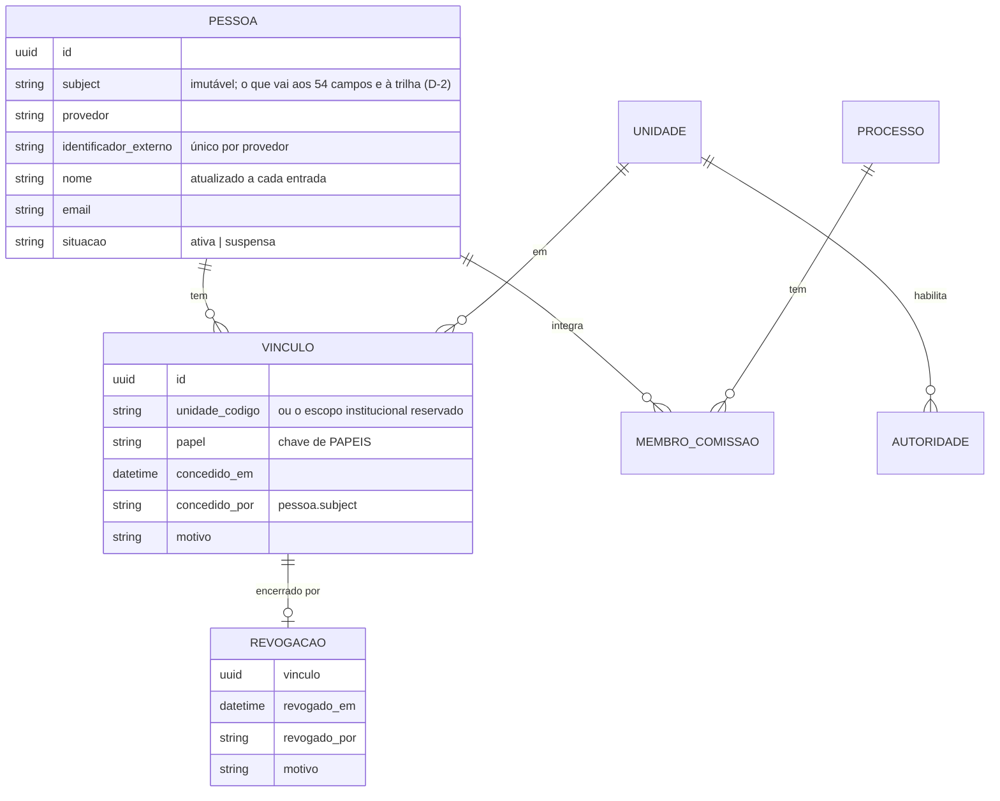

# Estudo pré-SDD — Identidade e administração de acessos (B-1)

*Estudo de 30/10/2026, sobre a `main` em `62824816`, pedido no parecer do usuário à
[auditoria de administração institucional](auditoria-administracao-institucional-2026-10-30.md).
Nada foi implementado e nenhuma spec foi aberta. Caminhos de código são relativos a
`backend/processo_seletivo/`, salvo os que começam por `backend/`, `specs/` ou `doc/`.*

**A pergunta:** qual é a menor arquitetura de identidade e autorização que permite ao GPS operar
em produção — com várias unidades, governança de acessos e segregação de funções efetiva — sem
virar uma plataforma de gestão de identidade?

**Marcas.** **[F]** fato lido no código; **[I]** inferência fundamentada; **[H]** hipótese ou
premissa não confirmada.

---

## Resposta curta

**Três peças, e nenhum framework novo:**

1. **O provedor institucional autentica.** Pode ser SSO por OIDC ou SAML atrás do proxy. O GPS
   não recebe nem guarda senha.
2. **O GPS autoriza.** Ele guarda poucos dados:
   - uma tabela de **Pessoa**: o identificador estável, o nome e a situação;
   - os **vínculos** pessoa × unidade × papel, append-only, com quem concedeu e o motivo;
   - as **revogações**, em tabela própria.
   O catálogo de papéis e permissões continua em código (`PAPEIS`).
3. **A sessão tem uma unidade ativa.** O `Actor` não muda de forma: continua com um escopo e um
   conjunto de permissões. Muda só **quem o produz**. Em produção, ele é recalculado a cada
   requisição, a partir dos vínculos vigentes, e por isso a revogação vale na hora.

**O que torna isso pequeno [F].** A gestão só constrói o `Actor` em **dois** pontos:

- a sessão, em `interface/identidade.py:161-176`;
- a API, em `seguranca/api/authentication.py:22`.

A Decisão 4 da `002` já os desenhou como fronteira: "quando o LDAP for integrado, apenas essa
origem muda" (`specs/002-frontend-administrativo/plan.md:135-139`).

O resto do sistema já sabe autorizar e já grava quem fez o quê:

- 59 chamadas de `ator_da_sessao`;
- 125 usos de `institution_scope` em 52 arquivos;
- `require_permission`, `require_authorization_base` e `Actor.can`.

O que falta é dar a esse "quem" uma identidade verificada.

**O que torna isso delicado [F].**

- **O identificador gravado não se corrige.** 54 campos guardam o identificador da pessoa, todos
  em texto de 255 caracteres, e boa parte em tabelas append-only (`published_by`, `prepared_by`,
  `homologated_by`, `actor_subject` da trilha, `identity_subject` da comissão…). O formato que
  entrar em produção não poderá ser reescrito.
- **A segregação de funções compara esses textos**
  (`publicacoes/application/publish_edital.py:705-710`). Ela só passa a valer de verdade com um
  identificador que **nunca mude** para a mesma pessoa.

**O que depende da instituição:**

- o provedor e o protocolo;
- qual identificador é estável;
- quem exerce a administração global;
- se a segregação deve ficar mais estrita que a FR-021 da `001`.

São onze decisões (§F). Quatro delas bloqueiam a spec: D-1, D-2, D-4 e D-5.

---

## A. Diagnóstico técnico

### A.1 O que se reaproveita

| Componente | Onde | Situação | Reuso |
|---|---|---|---|
| `Actor(subject, institution_scope, permissions)` | `seguranca/domain.py:4-15` | imutável e pequeno | **integral**: a forma não muda |
| Fronteira da sessão da gestão | `interface/identidade.py:154-203`: `CHAVE_SESSAO`, `origem`, `metodos_disponiveis()` | a `075` já previu uma segunda origem ("o diretório institucional será a segunda", `:151-154`) e uma página de acesso que desenha os métodos disponíveis | **integral**: a origem institucional entra ao lado da `demonstracao` |
| Catálogo `PAPEIS` e `DESCRICOES` | `interface/identidade.py:25-150` | cada permissão traz a justificativa normativa; 8 papéis | **integral**: continua em código, como regra (classe 3 da auditoria) |
| `require_permission`, com 403 sem capacidade e 404 com escopo alheio, e `require_authorization_base` | `seguranca/application/authorization.py:117-146` | doutrina da negativa consolidada (`033`) | **integral** |
| Filtro de escopo na própria consulta | por exemplo `publish_edital.py:465-475` | escopo alheio e inexistente são indistinguíveis | **integral** |
| Rotação de sessão no login | `portal/identidade.py:103-111` (`cycle_key`, FR-035) | já existe no portal do candidato | **padrão a copiar** |
| Trilha append-only com ator, permissão, escopo e `reason` | `auditoria/models.py:6-40`, `auditoria/application.py:9-41` | três camadas de proteção | **integral**: concessão, revogação, entrada e saída viram operações |
| Recusa de produção sem autenticação declarada | `backend/config/settings/production.py:92-96,239-268` | a gestão e a API não sobem com mecanismo de desenvolvimento | **integral** |
| Vínculo por objeto: presidência, membro, impedimento | `comissoes/domain/autorizacao.py:65-81` | presidência **não é papel** | **integral**: fica no GPS e não vai para o diretório |
| Seletor de demonstração | `interface/views.py:721-780`, `interface/demonstracao.py` | 1497 chamadas do auxiliar `identificar` em 260 arquivos de teste (`backend/tests/interface/conftest.py:19-35`) | **integral, fora de produção**: os testes não se reescrevem |

### A.2 Limitações

| # | Limitação | Evidência | Consequência para o B-1 |
|---|---|---|---|
| L-1 | Não há autenticação: a pessoa digita quem é | `interface/views.py:737-748` | o problema central |
| L-2 | Os papéis vivem na sessão e foram escolhidos no login | `interface/identidade.py:176,179-185` | revogar só valeria no próximo login; em produção, as permissões têm de vir de fora da sessão |
| L-3 | Há um escopo por ator, fixo em `cefor` | `seguranca/domain.py:7`; `interface/identidade.py:21`; `views.py:748` | quem atua em duas unidades precisa de "unidade ativa" ou de escopo plural (§B.3) |
| L-4 | O `subject` é texto livre, também na comissão | `comissoes/models.py:38`; [captura 04 da auditoria](auditoria-administracao-institucional-2026-10-30/04-comissao-identificador-nao-verificado.jpg) | erro de digitação cria membro fantasma, e a segregação é nominal |
| L-5 | 18 templates da gestão citam campos de autoria e exibem o `subject` cru ("por ana.gestora") | `grep` de `_por`, `_by` e `actor_subject` em `interface/templates` | se o identificador estável for opaco (D-2), a exibição precisa de um nome, por um filtro único |
| L-6 | Entrada, saída e papéis da sessão não vão à trilha | `views.py:721-780`, sem `record_event` | não se reconstrói quem detinha qual papel numa data |
| L-7 | Não há tempo de sessão próprio nem saída por inatividade na gestão | só `SESSION_COOKIE_*` (`production.py:282-284`) | uma pessoa desligada da instituição continuaria na sessão aberta |
| L-8 | A API usa um *token* de desenvolvimento sem assinatura | `seguranca/api/authentication.py:7-23` | fica fechada em produção (I-1); nada da gestão depende dela [F: a interface chama a camada de aplicação] |
| L-9 | Eventos sem escopo ficam fora de toda consulta | `identidade/application/credenciais.py:177-197` (`institution_scope=""`) | a administração global precisa de um escopo próprio para que os eventos dela sejam legíveis |

### A.3 Dependências

- **Provedor institucional** (D-1): sem ele não há B-1. O GPS não deve presumi-lo.
- **Identificador estável** (D-2): precisa estar decidido antes da primeira escrita em produção.
- **Constituição, Princípio III** (`.specify/memory/constitution.md:154-174`): negar por padrão,
  menor privilégio, ato registrando o "responsável pela operação", e auditoria que permita
  "reconstrução histórica". O desenho abaixo cumpre cada item; nenhum precisa de emenda.
- **FR-021 da `001`** (`specs/001-processo-seletivo-editais/spec.md:311-314`): "ao menos uma
  segunda pessoa autorizada DEVE realizar a homologação **ou** a Publicação". Ela permite que quem
  elaborou também homologue. O parecer pede regra mais estrita (§F, D-8): isso é **emenda**, e não
  consequência do B-1.

**[I] Não há migração de dado.** A gestão nunca abriu em produção (B-1), então nenhum ato real
foi gravado com um `subject` de demonstração. A troca é de código e de configuração. Se esta
premissa falhar — se houver banco de produção com atos —, a §H.3 muda.

---

## B. Alternativas arquiteturais

### B.1 Autenticação: como o GPS sabe quem é a pessoa

| | **A1 — OIDC na aplicação** | **A2 — Cabeçalho do proxy** (SAML/OIDC terminados no nginx ou num *gateway*) | **A3 — Bind LDAP** | **A4 — gov.br** |
|---|---|---|---|---|
| O que o GPS faz | troca o código por token e valida o `id_token` (assinatura, `iss`, `aud`, `nonce`) | lê um cabeçalho que o proxy injeta, depois de autenticar | recebe usuário e **senha** e os testa contra o diretório | OIDC, como A1 |
| Código no GPS | um adaptador, mais uma biblioteca cliente [I: Authlib serve sem `auth.User`; `mozilla-django-oidc` é construído sobre `auth.User` e traria um segundo modelo de identidade] | um *middleware* de poucas linhas | adaptador mais tela de senha | como A1 |
| Senha passa pelo GPS | não | não | **sim** | não |
| MFA | do provedor | do provedor | não | do provedor |
| Risco principal | configurar a validação do token errado | **cabeçalho forjado**, se o proxy não o apagar da requisição do cliente e o GPS não aceitar só do proxy | o GPS vira alvo de credenciais | prova a pessoa, **não o vínculo com o Ifes**; toda a autorização seria local |
| Manutenção | a biblioteca e a rotação de chaves (JWKS) | a configuração do proxy, que é da TI | a biblioteca LDAP e a política de bloqueio | como A1 |
| Adequação | **boa**, se o Ifes tiver um provedor OIDC [H] | **boa**, se a TI já opera um SP SAML ou um *gateway* [H] | **ruim**: contraria "não construir gerenciamento de senhas" | complementar, para colaborador sem conta institucional (D-10) |

**Leitura.** A1 e A2 são equivalentes para o domínio, e a escolha entre elas é da TI (D-1). O que
o GPS precisa especificar é o **contrato do adaptador**, e não o protocolo:

> o adaptador entrega `(provedor, identificador_externo, nome, e-mail, grupos?)` de uma
> autenticação concluída e confiável, ou nada.

A3 só entra se for a única opção, e aí com aceite explícito do risco.

### B.2 Autorização: quem decide que alguém é Gestor da unidade X

| | **Z1 — Grupos do diretório** | **Z2 — Vínculos no GPS** | **Z3 — Híbrido**: diretório como portão, GPS com os vínculos |
|---|---|---|---|
| Onde se concede | no diretório, um grupo por papel × unidade (8 × ~26 ≈ 200 grupos) [I] | numa tela do GPS, por quem tem a capacidade | idem Z2; o diretório só diz "pode usar o GPS" (opcional) |
| Quando a mudança vale | no próximo login | na próxima requisição | na próxima requisição |
| Trilha da concessão | **fora do GPS**, no diretório | no GPS, append-only | no GPS |
| Impede autoconcessão | depende do diretório; o GPS não vê | **sim**, por regra do domínio | **sim** |
| Segregação e menor privilégio | o GPS recebe o que vier | o GPS controla | o GPS controla |
| Saída da instituição | o diretório desativa a conta | **a conta some no provedor**, e o login falha; os vínculos ficam órfãos até revogação ou revisão | idem Z2, e o portão já barra |
| Interface no GPS | nenhuma para conceder; só a consulta | **uma tela pequena** por unidade, mais uma global | idem Z2 |
| Custo no GPS | o menor | médio | médio |
| Custo fora do GPS | **alto e contínuo**, para a equipe do diretório | nenhum | um grupo só, se houver portão |
| Granularidade de processo seletivo | ruim: os papéis do GPS são do domínio, e o diretório não os conhece | boa | boa |

**Leitura.** Z1 só vence se o diretório **já** mantiver papéis por unidade com governança. O
parecer pede para não presumir isso, e o código não dá indício nenhum [H]. **Z3 é a hipótese do
parecer, e o código a favorece**:

- os papéis e as permissões são vocabulário do domínio, com justificativa normativa em cada linha;
- a presidência e o membro da comissão já são vínculos locais;
- a trilha já está no GPS.

Z2 e Z3 diferem só no portão, e ele é decisão institucional (D-3).

### B.3 Mais de uma unidade

| | **U1 — Unidade ativa na sessão** | **U2 — Escopo plural no `Actor`** |
|---|---|---|
| Ideia | quem tem vínculo em duas unidades escolhe em qual está atuando; o `Actor` é o daquela unidade | o `Actor` carrega `{unidade: permissões}` |
| Mudança no código | a construção do `Actor` mais um seletor de unidade na barra; **os 73 usos de `actor.institution_scope` ficam como estão** | `can()` passa a receber a unidade; **os 125 usos de escopo e as 44 chamadas de `require_permission` mudam** |
| Visão "de todas as minhas unidades" | não existe; troca-se de unidade | possível |
| Risco | baixo | regressão de autorização em massa |
| Adequação | **boa**: o trabalho da unidade é da unidade, e a Visão Geral já é por escopo | só se a visão multiunidade virar requisito |

**U1.** A escolha é recalculada por requisição, e o vínculo é conferido a cada uma. Trocar de
unidade não carrega permissão de uma para a outra.

### B.4 Administração global

| | **G1 — Papel institucional só de acessos** | **G2 — Superusuário** | **G3 — Sem global**; a TI concede o primeiro gestor de cada unidade |
|---|---|---|---|
| Pode | conceder e revogar a **administração de acessos** de qualquer unidade e ler a trilha de acessos de todas | tudo | — |
| Não pode | nenhum ato de Processo, Edital ou resultado; nada para si mesmo | — | — |
| Elevação | limitada: um global mal-intencionado concede a um cúmplice, e a trilha registra | total | a TI passa a fazer ato institucional |
| Adequação | **boa** | contraria o menor privilégio | mistura administração técnica com institucional, o que o parecer veta |

---

## C. Arquitetura recomendada

**A1 ou A2 (D-1) + Z3 + U1 + G1**, sobre o `Actor`, o `PAPEIS` e a trilha que já existem.

### C.1 Autenticação e resolução da identidade

```mermaid
sequenceDiagram
  participant N as Navegador
  participant G as GPS (/gestao)
  participant P as Provedor institucional
  N->>G: GET /gestao/... (sem sessão)
  G-->>N: 302 /gestao/identificar?proximo=...
  N->>G: "Entrar com a conta institucional"
  G-->>N: 302 para o provedor (OIDC) — ou o proxy intercepta (A2)
  N->>P: autentica (senha, MFA: do provedor)
  P-->>N: 302 de volta com código (A1) / cabeçalho confiável (A2)
  N->>G: retorno
  G->>G: adaptador valida → (provedor, id externo, nome, e-mail, grupos?)
  G->>G: portão? (D-3) — sem ele, recusa sem criar nada
  G->>G: Pessoa: localiza pelo id externo; cria no 1º acesso; atualiza nome/e-mail
  G->>G: Pessoa suspensa? recusa
  G->>G: cycle_key(); sessão = {origem: institucional, pessoa, unidade ativa}
  G->>G: trilha ENTRADA (pessoa, unidade ativa)
  G-->>N: 302 para o destino (destino_seguro, 075)
```

A cada requisição, a construção do `Actor` passa a ser:

```
ator_da_sessao(request):
  origem == demonstracao → como hoje (só fora de produção)
  origem == institucional →
      pessoa ativa?                          senão: encerrar sessão
      sessão dentro do tempo e da inatividade? senão: encerrar sessão   (D-11)
      papéis = vínculos vigentes de (pessoa, unidade ativa)             ← 1 consulta
      Actor(pessoa.subject, unidade ativa, permissoes_de(papéis))
```

**O que isso garante:**

- **revogação imediata:** o vínculo é lido a cada requisição;
- **desligamento:** se o provedor não autentica, não há nova sessão; o limite de tempo encerra a que
  estava aberta;
- **troca de unidade:** recalcula, e não acumula.

### C.2 Atribuição de papéis

| Capacidade nova | Papel que a recebe | Escopo | Regras |
|---|---|---|---|
| `acesso:gerir`: conceder e revogar papéis **operacionais** na unidade | papel novo **"Administrador de acessos da unidade"** (D-5: ou o Gestor) | unidade | nunca a si mesmo; nunca `acesso:gerir` nem `acesso:administrar`; só papéis do `PAPEIS` |
| `acesso:consultar`: ver quem atua na unidade, com papéis e comissões | Administrador de acessos da unidade, Gestor e Auditor [I] | unidade | só leitura |
| `acesso:administrar`: conceder e revogar o **Administrador de acessos** de qualquer unidade e ler a trilha de acessos de todas | papel novo **"Administrador institucional de acessos"** (G1, D-4) | institucional | nunca a si mesmo; **nenhuma** permissão operacional junto |

São três permissões novas e duas linhas no `PAPEIS`. Nenhum mecanismo novo de autorização: são
`Actor.can()` e a doutrina da `033`.

**Regras de concessão.** Todas são recusas do domínio, com trilha e chave de idempotência:

1. **Ninguém concede nem revoga vínculo próprio.** A comparação é por `pessoa`, e não por `subject`
   digitado.
2. Quem concede só concede **na unidade em que tem a capacidade**. Unidade alheia responde 404,
   pela doutrina.
3. O papel concedido existe no `PAPEIS`. Chave fora do mapa é recusada, como o seletor já faz
   (`views.py:737`).
4. Toda concessão e toda revogação levam **motivo** (por exemplo, "Portaria nº …").
5. Há uma **revisão periódica** (D-7): a lista de vínculos vigentes por unidade, com a data da
   concessão, para recertificar.

### C.3 Vínculo com unidade, e várias unidades

- Uma pessoa pode ter vínculos em várias unidades, com papéis diferentes em cada uma.
- A barra mostra a unidade ativa e permite trocá-la, quando há mais de uma.
- **O ato guarda a unidade dele, e não a da pessoa.** O Edital já leva o próprio `institution_scope`.
  Trocar de unidade não muda nada já feito.

### C.4 Revogação

| Situação | Mecanismo | Efeito |
|---|---|---|
| Sai da função na unidade | o Administrador de acessos revoga o vínculo | vale na próxima requisição |
| Muda de unidade | revoga em A, concede em B, e remove das comissões dos Processos de A, com a lista "onde atua" (auditoria, J-4) | os atos já praticados continuam em nome dela, com a unidade de cada ato |
| Sai da instituição | o provedor desativa a conta; o tempo de sessão encerra a aberta; os vínculos órfãos aparecem na revisão periódica | não entra mais; nenhum dado se apaga |
| Suspensão urgente | `Pessoa.situação = suspensa`, por quem tem `acesso:administrar` (D-4), com motivo | recusa na próxima requisição, em todas as unidades |

### C.5 Comissões

- **O `identity_subject` da comissão passa a apontar para uma Pessoa.** Incluir um membro procura a
  Pessoa pelo nome ou pelo identificador; não aceita mais texto livre.
- **Pessoa que nunca entrou** (D-9): o desenho mais simples é pedir que ela entre uma vez. A
  alternativa é o pré-cadastro pelo identificador externo, que continua sem verificação.
- **A presidência continua vínculo do objeto, e não papel.** Nada muda em
  `comissoes/domain/autorizacao.py`.

### C.6 Trilha

| Operação nova | Agregado | Escopo |
|---|---|---|
| `ACESSO_CONCEDER`, `ACESSO_REVOGAR` | Vínculo | a unidade do vínculo |
| `ADMINISTRACAO_CONCEDER`, `ADMINISTRACAO_REVOGAR` | Vínculo | o escopo institucional reservado (L-9) |
| `PESSOA_SUSPENDER`, `PESSOA_REATIVAR` | Pessoa | o escopo institucional reservado |
| `ENTRADA`, `SAIDA`, `TROCA_DE_UNIDADE` | Pessoa | a unidade ativa |

O escopo institucional reservado é um valor que **não** é código de unidade: o formato
`^[a-z0-9]+(-[a-z0-9]+)*$` (`unidades/application/sincronizacao.py`) permite reservar, por
exemplo, `ifes`, contanto que nenhuma unidade o use. Isso é decisão técnica da spec.

A trilha da unidade (grupo 3 do parecer) passa a ter o que mostrar sobre acessos, sem mudar de
forma.

### C.7 API

**Fica fechada em produção, como hoje (I-1).** Nenhuma tela depende dela [F], e abri-la é outro
incremento. Quando houver consumidor, a recusa de `SessionAuthentication`
(`production.py:49-58`) deve ser revista: o motivo dela, "sessão do Django não é identidade do
Ifes", deixa de valer quando a sessão nasce do provedor.

---

## D. Modelo conceitual



| Conceito | Existe hoje? | O que muda |
|---|---|---|
| Permissão | **sim**, texto em `PAPEIS` | mais três: `acesso:gerir`, `acesso:consultar`, `acesso:administrar` |
| Papel | **sim**, `PAPEIS` | mais dois: Administrador de acessos da unidade e Administrador institucional de acessos (D-5 pode fundir o primeiro no Gestor) |
| Escopo | **sim**, `institution_scope` = `Unidade.codigo` | mais um valor reservado institucional |
| Unidade | **sim**, `unidades/models.py:25-50` | nada |
| Ator | **sim**, `Actor` | nada na forma; muda o produtor |
| Pessoa | **não** | tabela nova, mutável no nome e na situação, com as mudanças de situação na trilha |
| Identidade institucional | **não** (seletor) | campos da Pessoa, únicos por provedor. Uma tabela à parte só se a D-2 pedir troca de provedor sem perder a pessoa |
| Vínculo pessoa × unidade × papel | **não** (sessão) | tabela nova, **append-only**, como `TABELAS_APPEND_ONLY` |
| Revogação | **não** | tabela nova, append-only; o vínculo não se altera, se encerra |
| Presidência e membro de comissão | **sim**, vínculo por objeto | `identity_subject` passa a exigir uma Pessoa |
| Autoridade signatária | **sim** | nada. Ela **não** é usuário: assinar (`signatory_*`) e operar (`published_by`) continuam campos distintos (`publicacoes/models.py:63-69`), e a Pessoa não substitui a Autoridade |

**Por que vínculo e revogação append-only, e não um vínculo com `ativo=False`.** O modelo da
comissão sobrescreve `funcao` com UPDATE (`comissoes/application/comissao.py:221-222`), e o
histórico fica só na trilha. Para acesso, a pergunta "quem tinha o papel X na data D" é a pergunta
da fiscalização, e deve ter resposta **na tabela**, não só na trilha.

---

## E. Jornadas de segurança

*Cada linha vira teste de aceitação na spec. As jornadas usam **duas unidades**: `cefor` e
`campus-a` (fictícia).*

| # | Jornada | Passos | Resultado exigido |
|---|---|---|---|
| E-1 | **Primeiro acesso da instalação** | 1) a TI roda o comando de bootstrap com o identificador externo e o motivo (a portaria); 2) a pessoa entra pelo provedor | um vínculo de Administrador institucional, trilha com o ator `implantacao` e o motivo; o comando recusa uma segunda vez sem `--adicional` e motivo. Alternativa D-6: o grupo do diretório |
| E-2 | **Primeiro acesso de uma pessoa comum** | entra pelo provedor, sem vínculo | a Pessoa é criada; a tela diz "sem acesso a nenhuma unidade" e nomeia quem concede (o Administrador de acessos da unidade), em vez de "quem administra o sistema no Cefor" (`interface/templates/interface/recusa.html:22`) |
| E-3 | **Concessão** | o Administrador de acessos do `cefor` concede Elaborador a P | vínculo e `ACESSO_CONCEDER` com motivo; P, na próxima requisição, vê "Processos" com `edital:elaborar` |
| E-4 | **Autoconcessão** | o Administrador de acessos do `cefor` tenta conceder Gestor a si mesmo | **recusa** do domínio (403, frase da `033`); nenhum vínculo; a tentativa fica no log de recusas |
| E-5 | **Unidade alheia** | o Administrador de acessos do `cefor` envia uma concessão para o `campus-a`, editando o POST | **404** (doutrina); nada gravado |
| E-6 | **Escalada lateral** | o Administrador de acessos do `cefor` tenta conceder `acesso:gerir` ou `acesso:administrar` a Q | **recusa**: só papéis operacionais |
| E-7 | **Global sem poder operacional** | o Administrador institucional abre um Edital do `cefor` e tenta homologar | 403: o papel não tem `edital:*` |
| E-8 | **Vários vínculos** | P é Gestora no `cefor` e Elaboradora no `campus-a`; troca a unidade ativa | no `cefor`, cria Processo; no `campus-a`, não cria (403) e elabora; trilha `TROCA_DE_UNIDADE` |
| E-9 | **Segregação por pessoa** | P elabora e homologa o Edital 3/2027 do `campus-a`; sai, entra de novo (sessão nova) e tenta publicar | recusa `segregation_of_duties`: `prepared_by == homologated_by == actor.subject` com o mesmo `subject` estável. Com a D-8 adotada, a recusa já vem na homologação |
| E-10 | **Revogação com sessão aberta** | P está com uma tela aberta; o Administrador revoga o vínculo de Elaboradora; P envia o formulário | 403 no envio; nada gravado |
| E-11 | **Mudança de unidade** | P passa do `cefor` para o `campus-a` | a consulta "onde P atua" no `cefor` lista os vínculos e as comissões; tudo revogado e removido com motivo; os atos antigos continuam em nome de P com `institution_scope=cefor` |
| E-12 | **Desligamento** | a conta de P é desativada no provedor | o login falha; a sessão aberta cai no tempo-limite (D-11); a revisão periódica mostra os vínculos órfãos |
| E-13 | **Suspensão urgente** | o Administrador institucional suspende P | recusa em todas as unidades na próxima requisição; `PESSOA_SUSPENDER` com motivo |
| E-14 | **Comissão** | o Gestor inclui na comissão um identificador que não é Pessoa | recusa (D-9 = a) ou pré-cadastro marcado como "não verificado" (D-9 = b) |
| E-15 | **Cabeçalho forjado** (só A2) | o cliente envia o cabeçalho de identidade direto à aplicação | ignorado: o GPS só o aceita do proxy, e o proxy o apaga da entrada |
| E-16 | **Produção sem método** | o provedor não está configurado | produção recusa subir, como hoje (`production.py`); a página de acesso não oferece nada (`075`, `FR-1691`) |

---

## F. Decisões institucionais pendentes

| # | Decisão | Alternativas | Consequências | Bloqueia a spec? |
|---|---|---|---|---|
| **D-1** | Provedor e protocolo de autenticação | (a) OIDC (Keycloak, ADFS, Entra ID, SUAP com OAuth2 [H]); (b) SAML ou OIDC terminado no proxy, entregando cabeçalho; (c) bind LDAP | (a) adaptador na aplicação; (b) quase nada na aplicação, mais trabalho da TI no proxy; (c) senha passa pelo GPS e não há MFA | **sim** |
| **D-2** | Identificador estável da pessoa (o `subject`) | (a) identificador imutável do provedor (`sub` do OIDC, `objectGUID`); (b) matrícula SIAPE; (c) login institucional | (a) nunca muda, mas é opaco: os 18 templates passam a exibir o nome por um filtro; troca de provedor exige mapear; (b) estável e legível, mas é dado pessoal e não cobre quem não é servidor; (c) legível, mas **muda** com o nome da pessoa, e aí uma mesma pessoa vira duas na segregação | **sim**: o valor vai para tabelas append-only |
| D-3 | Portão do diretório | (a) sem portão: toda conta institucional entra e vê "sem acesso"; (b) um grupo "pode usar o GPS" | (a) zero custo no diretório, e a Pessoa é criada para todo curioso; (b) um grupo a manter, e menos ruído | não |
| **D-4** | Quem é o Administrador institucional de acessos, e por qual ato | Reitoria (qual pró-reitoria?), Cefor, comitê; quantas pessoas | sem ninguém, cada unidade nasce pela TI (G3), o que o parecer veta | **sim** |
| **D-5** | Quem concede papéis na unidade | (a) papel próprio, "Administrador de acessos da unidade"; (b) o próprio Gestor ganha `acesso:gerir` | (a) separa conduzir de dar acesso, e custa mais uma pessoa ou um acúmulo; (b) mais simples para equipe de 2 a 3 pessoas, mas o Gestor concede ao cúmplice que lhe concede de volta; a trilha mostra | **sim** |
| D-6 | Primeiro administrador | (a) comando da TI com motivo (E-1); (b) grupo do diretório | (a) a TI executa ato institucional registrado; (b) nenhum comando, e a governança fica no diretório | não; uma das duas basta |
| D-7 | Vigência e revisão dos vínculos | (a) sem prazo, com revisão semestral; (b) prazo opcional por vínculo; (c) vínculo atrelado ao Processo | (a) simples; (b) expira sozinho; (c) se aproxima da comissão, que já é por Processo | não |
| D-8 | **Segregação mais estrita**: quem elaborou não homologa | (a) manter a FR-021 da `001` (só as três etapas juntas são proibidas); (b) proibir elaborar e homologar a mesma revisão | (b) é **emenda à FR-021** e contraria `homologar_fecharia_a_publicacao` (`publicacoes/application/selectors.py:312-326`), que diz que acumular "é o caso comum" com 2 a 3 pessoas. Com 2 pessoas, (b) ainda fecha: A elabora, B homologa, A publica | não para o B-1; é spec própria |
| D-9 | Membro de comissão que nunca entrou | (a) exigir o primeiro acesso; (b) pré-cadastro pelo identificador externo | (a) simples e verificado; (b) mantém o problema do fantasma | não |
| D-10 | Colaborador sem conta institucional (banca externa, outro órgão) | (a) não participa pelo sistema; (b) gov.br como segundo provedor; (c) conta institucional provisória pela TI | (b) acrescenta um provedor; (c) é processo da TI | não, se (a) |
| D-11 | Tempo de sessão e inatividade | por exemplo, 8 h absolutas e 30 min de inatividade | segurança contra comodidade; impacto no rascunho local (`002`, Decisão 5) | não |

Não estão aqui, porque não são do B-1: a emissão da classificação contra a divulgação do resultado
sem checagem de identidade (manual §A.3), que é a mesma família da D-8 e deve ir junto dela.

---

## G. Proposta de ADR

> **ADR — Identidade e autorização da gestão (B-1)**
>
> **Situação:** proposta. Depende de D-1, D-2, D-4 e D-5.
>
> **Contexto.** A gestão não tem autenticação de produção. O `Actor` já é a fronteira única de
> autorização, construída em dois pontos. O catálogo de papéis é regra de domínio, em código. A
> segregação compara o identificador gravado, e ele fica em tabelas append-only.
>
> **Decisão.**
> 1. A autenticação é delegada a um provedor institucional, por um adaptador com contrato fixo. O
>    GPS não guarda senha nem a recebe.
> 2. O GPS mantém Pessoa, Vínculo e Revogação. As duas últimas são append-only e vão à trilha.
> 3. O `Actor` mantém a forma. Em produção é recalculado por requisição a partir dos vínculos
>    vigentes da unidade ativa.
> 4. A administração de acessos tem dois níveis — unidade e institucional —, sem poder operacional
>    junto e sem autoconcessão.
> 5. O catálogo `PAPEIS` continua em código.
> 6. O seletor de demonstração continua como origem de desenvolvimento e teste, e produção continua
>    a recusá-lo.
>
> **Premissas não confirmadas:**
> - [H] o Ifes oferece um provedor OIDC ou SAML utilizável pelo GPS;
> - [H] existe um identificador imutável por pessoa;
> - [I] não há atos de produção gravados com `subject` de demonstração.
>
> **Consequências.**
> - Positivas: segregação real; revogação imediata; trilha de concessões; várias unidades sem
>   reescrever a autorização; os testes atuais preservados.
> - Negativas: duas telas pequenas de acesso, a da unidade e a institucional; uma tabela de pessoas
>   com nome e e-mail, que é dado pessoal e entra na política de retenção (B-2); um comando de
>   bootstrap.
>
> **Rejeitadas:**
> - Django Admin com `auth.User`: segunda identidade, sem trilha do domínio;
> - grupos do diretório como fonte única: concessão fora da trilha e sem impedimento de
>   autoconcessão;
> - escopo plural no `Actor`: reescreve 125 pontos sem requisito;
> - bind LDAP: senha no GPS;
> - superusuário.

---

## H. Preparação para SDD

### H.1 Fronteira funcional da spec do B-1

**Dentro:**

- adaptador de autenticação, com o contrato da §B.1, e uma implementação conforme a D-1;
- Pessoa, Vínculo e Revogação;
- unidade ativa e troca de unidade;
- construção do `Actor` por requisição;
- tempo de sessão (D-11);
- `cycle_key` no login e saída;
- eventos `ENTRADA`, `SAIDA` e `TROCA_DE_UNIDADE`;
- concessão e revogação, com as telas "Acessos da unidade" e "Administração de acessos", no grupo
  "Unidade" da barra;
- consulta "onde esta pessoa atua";
- suspensão;
- bootstrap (D-6);
- comissão apontando para Pessoa (D-9);
- exibição do nome no lugar do `subject` (D-2 = a);
- a frase de recusa nomeando quem concede;
- os cuidados do `production.py` para o método novo.

**Fora:**

- API (I-1);
- trilha da unidade (grupo 3 do parecer; esta spec só gera os eventos);
- marca e atendimento por unidade (grupo 5);
- emenda da segregação (D-8);
- retenção dos dados da Pessoa (B-2);
- consulta ao diretório para buscar pessoas.

### H.2 Critérios de aceite propostos

São as jornadas E-1 a E-16, mais:

- **CA-1:** nenhum dos testes atuais muda de comportamento. O seletor continua sendo a origem de
  teste.
- **CA-2:** com as settings de produção, o seletor continua recusado, e o método institucional é
  o único oferecido.
- **CA-3:** a forma do `Actor` não muda: nenhum chamador de `require_permission` é alterado.
- **CA-4:** toda concessão, revogação e suspensão aparece na trilha com ator, motivo e escopo
  legíveis por uma consulta de unidade ou institucional (nunca escopo vazio).
- **CA-5:** a construção do `Actor` por requisição custa **uma** consulta. O orçamento de consultas
  das telas existentes, que é cobrado por teste, não cresce mais do que isso.

### H.3 Migração

1. **Código:** a origem institucional entra ao lado da `demonstracao` em `ator_da_sessao`,
   `metodos_disponiveis` e na página de acesso da `075`. O seletor não sai.
2. **Testes:** os 1497 usos do auxiliar `identificar` continuam. Os testes novos usam um adaptador
   falso que entrega o contrato. Não há rede.
3. **Dados:** nenhum, pela premissa [I] da §A.3. Se ela falhar, é preciso um mapa
   `subject antigo → Pessoa`, aplicado só às tabelas mutáveis. As append-only ficam como estão, e a
   trilha registra a correspondência.
4. **Implantação:**
   1. configurar o provedor;
   2. subir;
   3. rodar o bootstrap;
   4. o Administrador institucional concede o Administrador de acessos do Cefor;
   5. esse concede os papéis;
   6. o Gestor cadastra as autoridades. Só então a primeira publicação é possível (J-7 da
      auditoria).

### H.4 Testes

- Unidade:
  - regras de concessão (autoconcessão, unidade alheia, escalada lateral, papel fora do mapa);
  - construção do `Actor` (vínculo vigente, revogado, suspenso, unidade ativa sem vínculo).
- Integração no PostgreSQL:
  - append-only de Vínculo e Revogação, com gatilho e privilégio, entrando em `TABELAS_APPEND_ONLY`
    (o "M" do `N de M` do `provisionar_papeis` sobe);
  - concorrência entre duas revogações (`select_for_update`).
- Interface: E-1 a E-16, com duas unidades, `cefor` e `campus-a`, registradas por fixture.
- Configuração: as recusas de produção com e sem o método.
- Segurança: E-15, se A2; a validação do token (assinatura, `iss`, `aud`, `nonce`, expiração), se
  A1.

---

## Pergunta final

**A menor arquitetura é a da §C:**

- **autenticação delegada** ao provedor institucional, por um adaptador;
- **três tabelas** no GPS: Pessoa, Vínculo e Revogação;
- **três permissões e dois papéis** acrescentados ao `PAPEIS`;
- **unidade ativa** na sessão;
- **duas telas pequenas** de acesso, mais uma consulta;
- **um comando** de bootstrap.

O `Actor`, a doutrina da negativa, a trilha, a comissão e todos os testes atuais ficam como estão.
Ela opera várias unidades sem reescrever a autorização. Ela governa acessos com trilha e sem
autoconcessão. Ela torna a segregação efetiva, por um identificador que não muda.

E não é uma plataforma de identidade: senha, MFA, ciclo de vida da conta e desligamento continuam
no provedor.

**Antes da spec, quatro respostas:**

- **D-1**, o provedor;
- **D-2**, o identificador estável;
- **D-4**, quem é o administrador institucional;
- **D-5**, quem concede na unidade.

As demais podem ser decididas durante a especificação. A **D-8** — elaborar e homologar por pessoas
distintas — é emenda à FR-021 da `001`, e deve ser decidida à parte.
