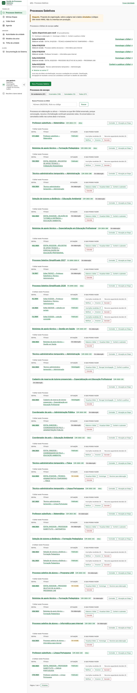
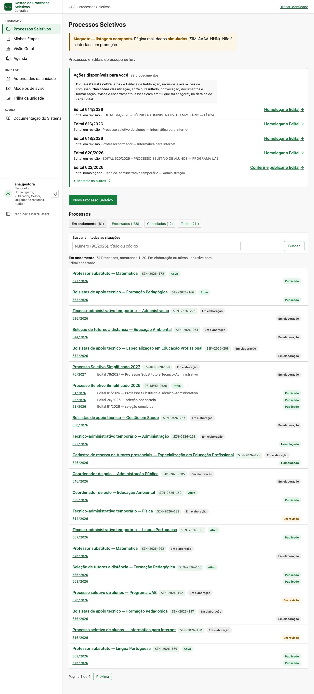
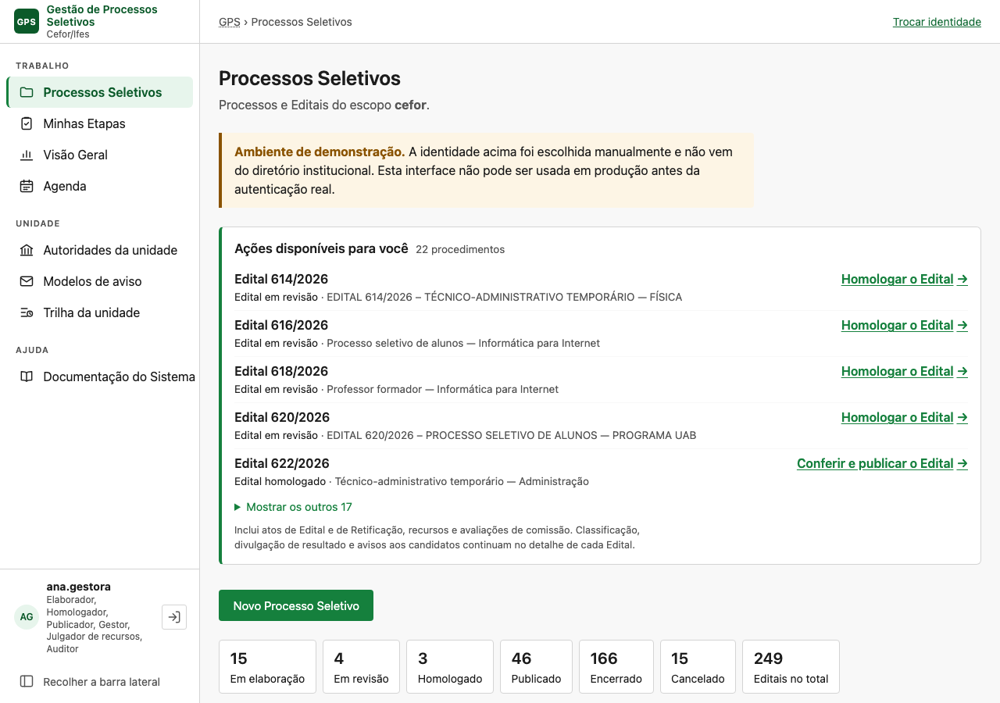
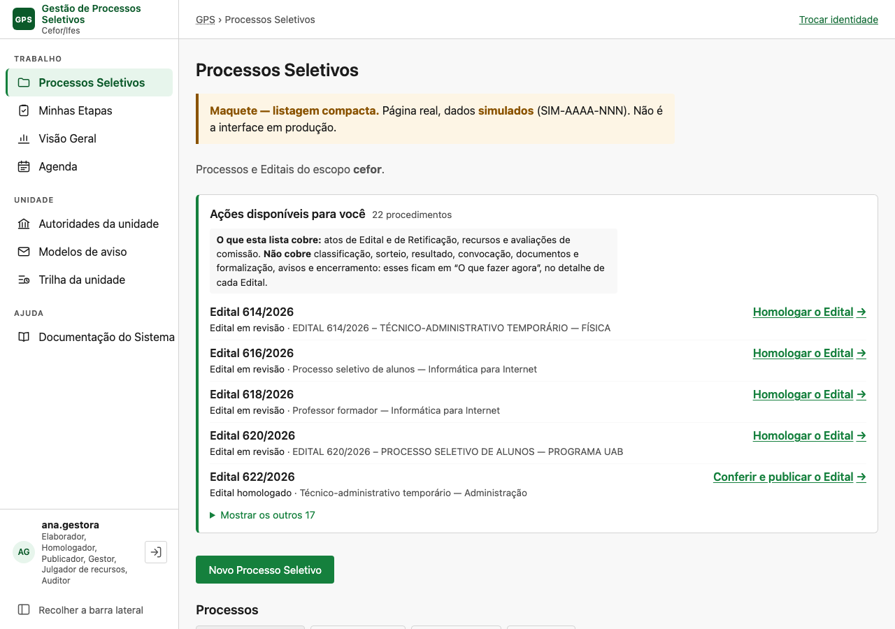
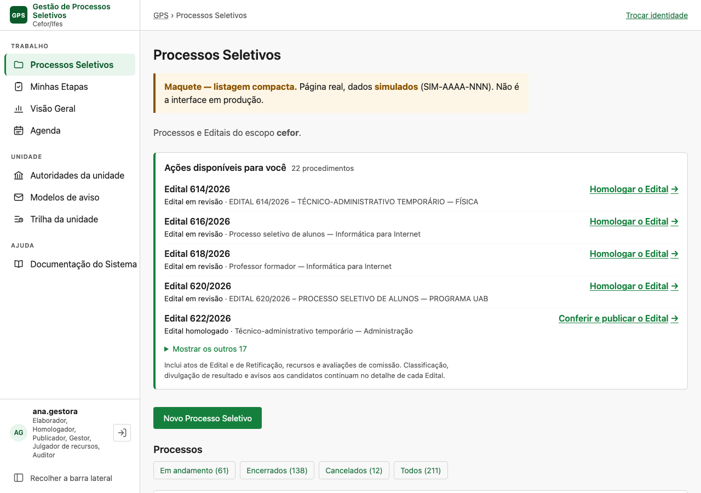
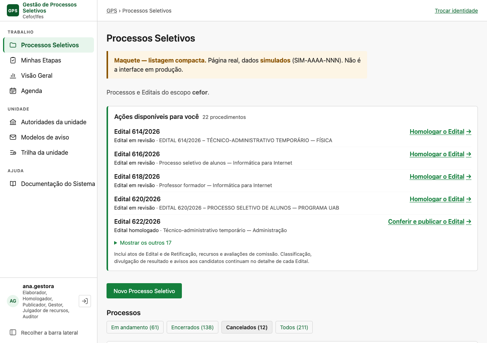

# Revisão — a página de Processos Seletivos: densidade, cobertura e encerramento

**Pedido**: revisão focalizada do [estudo de 06/11/2026](estudo-pagina-processos-seletivos-2026-11-06.md),
pedida no mesmo dia, antes de qualquer spec. **Código**: `main` em `22a722af`, mais o diff dos PRs
então abertos #414 (126) e #415–#417 (127). **Reconciliada** no mesmo dia com a `main` em
`5cf5f179`, que já traz a 126, a 127 e a 128 (seção 7, *Reconciliação com a D-021 da 127*). **Imagens
novas**:
[`estudo-pagina-processos-seletivos-2026-11-06/revisao/`](estudo-pagina-processos-seletivos-2026-11-06/revisao/).

> **Decidido pelo usuário em 06/11**: a D-7 fica com a opção V1 (a coluna de ações sai da lista), e a
> spec da página é a [129](../specs/129-organizacao-da-lista-de-processos/spec.md). A D-10 e os achados
> de domínio A-1 a A-6 ficam fora dela.

> **Registro, e não escopo.** Nada foi implementado. Os protótipos e os testes desta revisão
> rodaram fora do código de produção: num shell sobre um banco local, e num arquivo de teste
> temporário apagado em seguida. As maquetes usam dados **simulados** (`SIM-AAAA-NNN`).

---

## 0. Conclusões

1. **A densidade era o problema maior que o volume.** Cada Processo ocupava ~236 px, por causa da
   tabela, do cabeçalho de colunas e da coluna de ações. Numa listagem compacta, com uma linha por
   Processo e uma por Edital, ele ocupa **82 px**. Com 20 por página, a página padrão do gestor cai
   de 7,2 telas (proposta anterior) para **3,1** (seção 1).
2. **A coluna "O que posso fazer" deveria sair da lista.** É ela que produz o "Nenhuma ação
   disponível" e o "(0)" repetidos, e ela contradiz a separação Trabalho × Consulta. Tirá-la reverte
   requisitos de três specs (057, 104 e a paridade da 007). É a decisão bloqueante desta revisão
   (D-7).
3. **A faixa é uma fila parcial que se apresenta como completa.** O título diz "Ações disponíveis
   para você" e o número diz "22 procedimentos". A nota que limita a cobertura vem por último, em
   cinza, e nomeia três famílias de onze. Basta corrigir o contrato textual, sem ampliar a faixa
   (seção 3).
4. **Encerrar o Processo não confere o trabalho que ainda corre nos Editais dele.** Só se exige que
   os Editais estejam finais (`finalizacao.py:158`). Uma convocação aguardando resposta não impede o
   encerramento, e depois dele o convocado não consegue mais apresentar documento (seção 7). Um
   "pronto para encerrar" **não é derivável com segurança**: a validade do cadastro de reserva é texto
   livre no Edital (`editais/domain/secoes.py:119`), e o sistema não sabe se ainda haverá convocação.
5. **O critério do Processo é seguro, e foi testado.** 20 casos rodaram contra PostgreSQL (seção 7):
   - com o Edital encerrado e o Processo ativo, convocação, documentos, Requerimento, avisos,
     recursos, formalização e exportação são aceitos;
   - com o Processo final, sobra o recurso, que a faixa cobre, além da designação de formalização,
     da exportação e do despacho automático.

   O teste também levantou cinco achados de domínio fora da página (A-1 a A-5). Entre eles, recurso
   julgado com o Processo **cancelado** gera Resultado novo.

   A D-021 da 127 diz que, com o Processo final, nenhuma providência é "sua". Conferido contra
   PostgreSQL, a frase vale para os atos da comissão, e não para o recurso. Faixa e detalhe continuam
   oferecendo "Decidir recursos" ao julgador, coerentes com o domínio, que aceita o ato. A
   divergência é de texto, na 127, e a lista não esconde nada por causa dela (A-6).
6. **A correção das consultas do exportador funciona.** Protótipo medido: **451 → 11** consultas com
   249 Editais, e **1 323 → 11** com 739, com resultado idêntico em todos os Editais (seção 6).
7. **Recomendação: uma spec agora, só para a organização da página** (Frente A). A visão operacional
   completa e o ciclo de encerramento ficam para uma spec posterior (Frente B), que depende da 127.
   A exceção é a advertência no encerramento do Processo, que pode ser antecipada como correção de
   segurança (seção 9).

---

## 1. Densidade visual

### Comparação medida (gestor com seis papéis, 211 Processos simulados, 61 em andamento)

| Apresentação | Por Processo | Altura da página padrão | Telas (900 px) | Celular |
|---|---|---|---|---|
| Atual (tudo, cartões com tabela) | ~236 px | 53 212 px | 59 | 91 367 px (101 telas) |
| Proposta anterior (recorte + 20/página, cartões com tabela) | ~236 px | 6 464 px | 7,2 | 10 649 px (11,8 telas) |
| **Compacta, 20 por página** | **82 px** | **2 829 px** | **3,1** | 4 174 px (4,6 telas) |
| Compacta, 30 por página | 82 px | 3 593 px | 4,0 | — |

### O que a linha compacta mostra

```
Professor substituto — Matemática   SIM-2026-172   [Ativo]          Comissão · Alocação por Etapa
  577/2026                                           [Publicado]
Processo Seletivo Simplificado 2026   PS-DEMO-2026   [Ativo]
  01/2026   Edital 01/2026 — Professor Substituto…   [Publicado]
  26/2026   Edital 26/2026 — seleção por sorteio     [Publicado]   Retificação em revisão · aguarda quem homologa
```

- **Linha do Processo**:
  - título com link para o detalhe, código e selo da situação do Processo;
  - "Você preside/integra a comissão", quando houver;
  - os links Comissão e Alocação por Etapa, para quem gere. Ficam por causa de
    `test_oferta_da_comissao.py:69` e `test_caminho_ate_a_mesa.py:109`: é o caminho do gestor que
    ainda não integra a comissão (`views.py:328-337`).
- **Linha de cada Edital**:
  - número com link para o detalhe;
  - título, só quando difere do título do Processo (na amostra, a maioria é igual);
  - selo da situação do Edital;
  - a marca da Retificação em curso (103), que é fato e não ação.
- **Sem cabeçalho de colunas, sem tabela, sem coluna de ações.** No celular o título do Edital some e
  a linha fica com número, situação e marca. Nada rola de lado.

| Proposta anterior (cartões) — página inteira | Compacta (V1) — página inteira |
|---|---|
|  |  |

**Duas variantes da compacta foram medidas**, com a mesma altura:

- **V1 (recomendada)**: as linhas só têm fatos. O trabalho fica na faixa.
- **V2**: cada Edital ganha à direita o ato da faixa que lhe diz respeito ("Continuar a elaboração
  →"), lido da mesma derivação ([captura](estudo-pagina-processos-seletivos-2026-11-06/revisao/V2-D-gestor-amplo-inteira.png)).

**Por que V1.** Na V2, um Edital publicado sem link **parece não pedir nada**, quando pode ter
convocação vencida ou resultado a divulgar, que a faixa não cobre. A linha passaria a reproduzir a
incompletude da faixa no inventário inteiro: é o risco 1 do pedido, desenhado. Na V1 a linha não
afirma nada sobre trabalho, e o trabalho tem um lugar só.

---

## 2. Ações vazias

**Hoje.**
- O elaborador lê **181** vezes "Nenhuma ação disponível para seus papéis".
- O julgador vê **227** botões "Recursos aguardando decisão (0)".
- O gestor vê "Inscrições recebidas (0)" e "Recursos aguardando decisão (0)" em todo encerrado e
  cancelado.

Os dois casos são **deliberados**:
- a FR-023 da 007 exige que a mensagem de ausência derive do mesmo conjunto das ações;
- a FR-1050 da 057 exige o contador zero esmaecido, "porque nenhuma também é resposta".

**Com a V1 eles somem por construção**: não há coluna, e portanto nem ausência a dizer nem contador.

**O que se perde, e onde fica.**

| Hoje na linha | Na V1 | Onde fica |
|---|---|---|
| Elaborar, Conferir e submeter, Homologar, Conferir e publicar | — | Na faixa (o ato principal), e no detalhe do Edital (todas) |
| Inscrições recebidas (n) | — | No detalhe do Edital: um clique a mais para quem consulta inscrições todo dia |
| Recursos aguardando decisão (n > 0) | — | Na faixa ("Decidir recursos (n)") e no detalhe |
| Retificar, Encerrar, Cancelar | — | No detalhe (são atos de exceção; a 057 já os punha por último) |
| O ato da Retificação (FR-2814 da 104) | — | Na faixa; a marca na linha continua dizendo a situação e de quem ela aguarda |
| "Nenhuma ação disponível para seus papéis" | — | Não se aplica |
| Exportar para matrícula | — | No detalhe (só 2 de 227 Editais simulados pediam) |

**A compreensão das permissões não se perde.** A ausência de botões numa linha que nunca tem
botões não comunica "você não pode"; quem quer saber o que pode fazer num Edital abre o detalhe, onde
o conjunto, os desabilitados e os motivos (FR-024 da 007) continuam intactos. A frase "Sem
permissões", para quem não tem papel nenhum (`lista.html:31`), fica.

**Se a V1 for recusada (D-7)**, a alternativa mínima é manter a coluna e:
- esconder o contador zero, o que revisa a FR-1050;
- trocar "Nenhuma ação disponível para seus papéis" por célula vazia, com o texto só para leitor de
  tela.

A densidade cai menos: a tabela continua.

---

## 3. Cobertura das ações

### O que a faixa cobre e o que não cobre (conferido no código)

| Família | Na faixa? | Onde está hoje | Fonte |
|---|---|---|---|
| Elaborar, homologar e publicar Edital | Sim | — | `trabalho.py:68` |
| Ato da Retificação | Sim, exceto a parada | — | `trabalho.py:128`; `atos_retificacao.py:300-314` |
| Decidir recursos | Sim | — | `trabalho.py:153` |
| Avaliar (mesa da Etapa) | Sim | — | `trabalho.py:176` |
| Distribuir inscrições à comissão e consolidar a Etapa | **Não** | Condução no detalhe; a 127 (#415) os põe em "O que fazer agora" | `andamento.py` (#415), G-04 |
| Classificação: ordem, corte e apuração | **Não** | Condução do marco | `andamento.situacao_da_ordem`, `_do_corte`, `_da_apuracao` (#415) |
| Sorteio: relação, semente e execução | **Não** | Tela do sorteio | `andamento.situacao_do_sorteio` (#415) |
| Divulgar resultado, preliminar ou definitivo | **Não** | Ato de classificação | `RESULTADO_NAO_DIVULGADO` e `DEFINITIVO_NAO_PUBLICADO` (`pendencias_do_edital.py:23`) |
| Reavaliação ou providência determinada em recurso | **Não** | Recursos | `REAVALIACAO_PENDENTE`, `PROVIDENCIA_PENDENTE` |
| Convocar (inclusive o próximo, depois de vencida) e registrar desfecho | **Não** | Convocação | `CONVOCACAO_AGUARDANDO`, `CONVOCACAO_VENCIDA`; `andamento.situacoes_da_convocacao` (#415) |
| Conferir documentos da convocação e a formalização | **Não** | Telas da 115/117 | — |
| Conferir Requerimento de Matrícula e exportar | **Não** | Matrículas | — |
| Avisos aos candidatos | **Não** | Detalhe do Edital | — |
| Encerrar o Edital | **Não** | Detalhe, com os impedimentos da 113 | `pendencias_do_edital.impedimentos` |
| Encerrar o Processo | **Não** | Detalhe do Processo | `atos_processo.py:42` |
| Constituir comissão e alocar | **Não** | Comissão | — |

**A apresentação induz à leitura de completude?** Sim, por três detalhes:
- o número ("22 procedimentos") soa como total;
- a nota de limites vem **depois** dos itens, em 0,8 rem cinza, onde quem já leu os cinco não chega;
- a nota nomeia classificação, resultado e avisos, mas **cala** convocação, sorteio, formalização,
  documentos e encerramento (`trabalho.py:45`, `FORA_DA_FAIXA`).

O operador de convocação do exemplo do pedido lê "Nenhum ato de Edital ou de Retificação, recurso ou
avaliação aguarda você agora" e nada sobre convocação.

### Solução de comunicação, sem ampliar a faixa

1. **A nota sobe para logo abaixo do título**, em tamanho de texto, como na maquete V1. Ela passa a
   nomear tudo o que fica de fora:
   > **O que esta lista cobre:** atos de Edital e de Retificação, recursos e avaliações de comissão.
   > **Não cobre** classificação, sorteio, resultado, convocação, documentos e formalização, avisos e
   > encerramento: esses ficam em "O que fazer agora", no detalhe de cada Edital.
2. **O estado vazio diz o mesmo** (D-012 da 104), com a mesma constante.
3. **O título fica.** "Ações disponíveis para você" está certo para o que a faixa mostra (FR-2811),
   e trocá-lo sem pesquisa com pessoas repetiria o D-007 da 104.
4. **Dependência.** A frase "em 'O que fazer agora', no detalhe de cada Edital" só é verdadeira por
   inteiro depois do merge do #415 (127, B1), que põe nesse cartão as providências por papel de
   sorteio, classificação, resultado e convocação. Antes dele, o cartão diz só o próximo ato do
   Edital. Se a spec da página entrar antes, a frase diz "no detalhe de cada Edital", sem o nome do
   cartão.

Mudança de uma constante e de um template. É a correção do contrato da interface que o pedido chamou
de indispensável.

| Faixa hoje | Faixa com a nota de cobertura (V1) |
|---|---|
|  |  |

**O resumo por tipo de ato** da proposta anterior sai, como o pedido sugeriu. Ele resolvia o "quanto"
com 20 a 50 itens, mas acrescentava uma linha que os cinco primeiros já ilustram, e ninguém pediu.

---

## 4. Encerramento dos Processos

### Como o gestor encerra hoje

1. Abre o detalhe do Processo (`views.py:5501` `processo_detalhe`), onde estão os atos do Processo:
   `atos_processo.ATOS` (`atos_processo.py:29`), ou seja, Ativar, Encerrar e Cancelar.
2. "Encerrar Processo" leva à confirmação (`views.py:5629` `praticar_ato_processo`), que mostra:
   - as consequências (`atos_processo.py:47-56`);
   - os Editais **fora de estado final** (`pending_editais`, com `recusa_certa` quando há algum);
   - o campo de motivo, obrigatório.
3. O comando `close_process` (`processos/application/finalizacao.py:173`) trava o Processo e os
   Editais, exige `processo:encerrar` e Processo ATIVO, e exige que nenhum Edital esteja fora de
   ENCERRADO ou CANCELADO (`_editais_pendentes_travados`, `:158`; regra RC-118 de 28/09). Depois grava
   o `AtoAdministrativo`.

### O que **não** é conferido, e continua depois

O encerramento do **Edital** (113) já advertia o que ficaria pendente: convocação aguardando,
resultado não divulgado e outros (`interface/encerramento.py`, `pendencias_do_edital.py`). O do
**Processo** não advertia nada disso. Mas é ele que corta:

| Depois de encerrar o Processo | O sistema |
|---|---|
| Convocado com prazo correndo apresenta documento | **Recusa** |
| Comissão confere documento | **Recusa** |
| Requerimento de Matrícula na convocação | **Recusa** (decisão de 04/11, `test_processo_em_estado_final.py`) |
| Convocar o próximo do cadastro de reserva | **Recusa** |
| Avisos | Recusa confirmar; o já confirmado ainda é despachado |
| Interpor, admitir e julgar recurso | Aceita (sem guarda de estado) |
| Designar formalização | **Aceita** (só o Edital é conferido) |
| Exportar matrícula | Aceita |

Executado contra PostgreSQL na seção 7. O levantamento só de leitura dizia que a designação era
recusada, e o teste o refutou.

### Dá para derivar "pronto para encerrar"?

**Não com segurança, e o motivo é um só: o sistema não sabe até quando o certame vale.**
- O prazo de validade, que é o que diz se ainda pode haver convocação do cadastro de reserva, é
  **seção textual** do Edital (`editais/domain/secoes.py:119`, `_textual("prazo-de-validade", …)`),
  sem campo estruturado.
- Um Processo com todos os Editais encerrados, nenhuma convocação em aberto e nenhum recurso pode
  estar a três meses de convocar o próximo da reserva.

**O que é derivável** é "**sem providência em aberto conhecida**". Seria a conjunção de:
- todos os Editais finais (`pending_editais` vazio);
- nenhuma convocação vigente sem desfecho (`CONVOCACAO_AGUARDANDO`), nem vencida sem sucessora;
- nenhum recurso aguardando, reavaliação ou providência pendente;
- nenhum prazo recursal em curso;
- nenhuma Retificação homologada presa;
- nenhum aviso confirmado por despachar.

Os tipos já existem em `pendencias_do_edital.py`. O custo, não: `relatorio_do_edital` lê o conteúdo
de cada Edital, e na lista seria por linha. **Isso é Frente B.**

### O que a revisão recomenda

- **Na Frente A, nenhum sinal de encerramento na lista.** A marca "todos os Editais finais" do estudo
  anterior (D-3) **sai**. Com a confirmação do Processo calando as convocações em aberto, ela induziria
  o encerramento justamente no caso em que ele é inseguro.
- **A correção de segurança, se o usuário quiser antecipá-la**: a confirmação de "Encerrar Processo"
  passa a advertir as providências em aberto dos Editais dele, com os mesmos tipos e frases que a
  113 já usa para o Edital (`encerramento.py`, que só redige). É advertência e não impedimento: o
  sistema não sabe se a convocação em aberto ainda importa. **Advertir reduz o risco, mas não o
  elimina**: o gestor que confirma mesmo assim ainda corta o convocado no meio do prazo. Impedir o
  encerramento exigiria outra decisão de domínio, que a D-1 deixa em aberto. É uma tela e um teste,
  e não depende da lista.
- **A lista continua funcionando com muitos ativos parados** pela busca e pela paginação, que não
  dependem do encerramento. O recorte "Em andamento" fica mais longo do que deveria, e isso é
  limitação conhecida, dita no relatório da spec.

---

## 5. Paginação e busca

### Tamanho da página

Com 82 px por Processo (1,1 Edital em média), 20 Processos ocupam ~1 650 px de lista. Somados ao
topo (faixa, botão, abas, busca), dão **3,1 telas** no desktop e 4,6 no celular. Com 30 Processos,
são 4,0 telas, e o "Próxima" fica longe demais da faixa. **20 se mantém**, agora validado pela
densidade e não escolhido.

Processos com muitos Editais esticam a página. O maior da amostra tem 3 Editais, ~120 px. Não se
propõe limite de Editais por Processo.

### Semântica

| Situação | Comportamento |
|---|---|
| Entrada pela barra ou pela trilha | Aba "Em andamento", página 1, sem busca |
| Troca de aba | Volta à página 1; a busca é limpa |
| Busca | **Procura em todas as situações, qualquer que seja a aba.** Nenhuma aba fica marcada, e uma faixa diz: "*N resultados para "X" em todas as situações, e não só em Em andamento. K estão encerrados ou cancelados: a situação de cada um está ao lado do nome.* Limpar a busca e voltar a Em andamento". |
| Ordem dos resultados da busca | Em andamento primeiro, depois encerrados, depois cancelados; dentro de cada grupo, `-created_at, id` |
| Número | "90/2026" casa número **e** ano; "90" casa o número. A busca da Visão Geral (`visao_geral.py:406`) **não** trata a barra; a da lista precisa tratar |
| Página fora do intervalo | `Paginator.get_page`: vai para a última; parâmetro inválido cai no padrão, como o `recorte_de` da Visão Geral |
| Contagem | As abas contam Processos, e a frase diz "61 Processos, mostrando 1–20" |

| Busca a partir de "Em andamento" | Aba Cancelados |
|---|---|
|  |  |

(As imagens da busca são da V2; a frase de explicação é a mesma na V1.)

### Persistência

Aba, busca e página ficam na querystring (`?situacao=&busca=&pagina=`):
- **Voltar do navegador**: devolve exatamente o recorte, a página e a rolagem, porque é um GET
  idempotente.
- **Trilha do detalhe e barra lateral**: levam ao padrão. É o comportamento de toda a gestão: nenhum
  link de detalhe leva querystring de volta (`processo_detalhe.html:4`, `detalhe.html:4`).
- **Não se propõe** memória em sessão. Ela mudaria o padrão em silêncio para quem clica em "Processos
  Seletivos" esperando o começo.
- **Também não se propõe** um parâmetro de volta (`?volta=`) nos detalhes. Ele tocaria dezenas de
  templates de trilha, e é evolução separada se a validação com pessoas pedir.

---

## 6. Desempenho: as consultas do exportador

**Causa.** `acoes._navegacao` decide "Exportar para matrícula" chamando
`_pede_requerimento_de_matricula` (`acoes.py:223`). Essa função lê `effective_version` **por
Edital** publicado, encerrado ou cancelado: são duas consultas por linha, e só para quem tem
`matricula:exportar`. O teste de escala da 104 usa quatro papéis, e nenhum é esse.

**Protótipo, medido sem tocar no código.** A pergunta passa a ser lida para a página inteira com
`versoes_vigentes` (`publicacoes/application/selectors.py:330`), a forma em lote de
`effective_version`, com a mesma regra de desempate. Cada linha consulta um conjunto.

| Banco | Editais com inscrição | Hoje | Em lote | Divergências |
|---|---|---|---|---|
| `ps_diag_lista` | 227 | 451 consultas | 9 + 2 = **11** | 0 |
| `ps_diag_500` | 675 | 1 323 | 9 + 2 = **11** | 0 |

**Com a V1, a lista nem chama mais `acoes.do_edital`**, e a causa sai da página por construção. A
função continua servindo ao detalhe, onde é um Edital só. A correção em lote só é necessária se a
coluna ficar (D-7). **O teste de regressão é necessário nos dois casos**:

- `tests/performance/test_trabalho_em_escala.py` ganha um caso parametrizado por **todos** os papéis de
  `identidade.PAPEIS`, inclusive `exportador`, e pela combinação de todos.
- O caso afirma que o número de consultas da lista é **o mesmo** com 3, 30 e 300 Editais com
  inscrição.
- Os Editais do teste precisam **declarar o Requerimento** em parte deles (`matriculationRequest` no
  conteúdo), senão o ramo nem é exercitado. Os simulados aqui tinham 2 de 227.
- Um segundo caso afirma o mesmo **entre páginas** (página 1 e página 3) e **entre abas**: a faixa lê
  o escopo, e não pode crescer com ele de outro jeito.

---

## 7. Segurança operacional

### O que se executou

Um arquivo de teste **temporário**, com 20 casos, foi escrito sobre os fixtures existentes. Ele reusa
o cenário de convocação de `test_processo_em_estado_final.py` e os de recursos, formalização,
avisos e matrículas. Rodou contra PostgreSQL e foi apagado de `backend/tests`. A cópia está em
[`revisao/test_zz_estudo_pos_encerramento.py.txt`](estudo-pagina-processos-seletivos-2026-11-06/revisao/test_zz_estudo_pos_encerramento.py.txt).

```
LC_ALL=pt_BR.UTF-8 TEST_DB_ENGINE=postgresql DB_USER=$USER DB_RUNTIME_USER=$USER \
  DB_NAME=ps_estudo_pos_encerramento uv run pytest tests/integration/test_zz_estudo_pos_encerramento.py -n 0
→ 20 passed
```

Os testes existentes citados abaixo também rodaram no mesmo ambiente, com **29 passaram**:
- `test_processo_em_estado_final.py` inteiro;
- três casos de `test_documentos_da_convocacao.py`;
- `formalizacao/test_acesso.py::test_edital_sem_publicacao_nao_recebe_designacao`;
- `avisos/test_autorizacao.py::test_processo_em_estado_final_recusa`;
- `test_encerramento_seguro.py` inteiro.

O estado final foi gravado por `update`, como `encerrar_o_processo` já faz na suíte: o que se
prende é o estado, e não o caminho até ele. Foram quatro situações. S3b existe porque
`cancel_process` aceita Edital **encerrado** como estado final.
- **S1**: Edital encerrado, Processo ativo.
- **S2**: Edital e Processo encerrados.
- **S3**: Edital e Processo cancelados.
- **S3b**: Edital encerrado, Processo cancelado.

### Resultado

| Ato | S1 | S2 | S3 | S3b | Guarda |
|---|---|---|---|---|---|
| Convocar mais uma pessoa | **Aceito** | Recusado¹ | Recusado¹ | Recusado¹ | `comissoes/application/__init__.py:91` |
| Apresentar documento da convocação | **Aceito** | Recusado¹ | Recusado¹ | Recusado¹ | `convocacao/application/documentos.py:493` |
| Conferir documento | **Aceito** | Recusado¹ | Recusado¹ | Recusado¹ | `documentos.py:653` |
| Requerimento na convocação (abrir, gravar, enviar) | **Aceito** | Recusado¹ | Recusado¹ | Recusado¹ | `requerimentos/application/preencher.py:221` |
| Confirmar aviso | **Aceito** | Recusado² | Recusado² | Recusado² | `avisos/application/comando.py:93` |
| Despachar aviso confirmado **antes** do encerramento | enviado | **enviado** | **enviado** | **enviado** | nenhuma (`despacho.py:146` não lê o Processo) |
| Interpor recurso | **Aceito** | **Aceito** | **Aceito** | **Aceito** | nenhuma de estado (`interpor.py:282` só trava) |
| Admitir recurso | **Aceito** | **Aceito** | **Aceito** | **Aceito** | nenhuma (`admitir.py`) |
| Julgar recurso, com correção fixada que **cria um Resultado sucessor** | **Aceito** | **Aceito** | **Aceito** | **Aceito** | nenhuma (`julgar.py`) |
| Designar formalização | **Aceito** | **Aceito** | Recusado³ | **Aceito** | só o Edital (`formalizacao/application/designar.py:82`) |
| Exportar matrículas (grava `GeracaoDeArquivo`) | **Aceito** | **Aceito** | **Aceito** | **Aceito** | nenhuma (`matriculas/application/exportar.py`) |

¹ `invalid_state` (409), "O Processo Seletivo está em estado final e não admite alteração de seus
Editais." ² `aviso_processo_em_estado_final` (409). ³ `formalizacao_edital_sem_publicacao` (409): a
recusa vem do **Edital** cancelado, e não do Processo.

**Não exercitados, e por quê.**
- **Convocação "do cadastro de reserva" como espécie própria.** A segunda chamada do cenário saiu
  como vaga inicial. A guarda do Processo vem antes da espécie, e em S1 nada em `convocar` lê o estado
  do Edital, de modo que a espécie não muda o resultado.
- **Aviso da chamada.** Usa a mesma guarda (`comando_de_aviso`), já coberta em
  `avisos/test_autorizacao.py:104`.

### O que isso diz sobre a lista

1. **S1 confirma o achado central do estudo.** Com o Edital encerrado, todo o trabalho da convocação
   continua. Filtrar pelo Edital esconderia esse trabalho, e filtrar pelo Processo, não.
2. **Depois do Processo final, o trabalho que ainda existe é**:
   - o **recurso** (interpor, admitir e julgar), que a faixa cobre: `_dos_recursos` conta
     ENCERRADO e CANCELADO (`acoes.py:71`), e a faixa lê o escopo;
   - a **designação de formalização**, que não está na faixa, mas se alcança pela aba ou pela busca;
   - a **exportação**, que é consulta;
   - o **despacho**, que é automático.

   O critério do Processo, com a faixa sobre o escopo, **não esconde trabalho que só a lista
   alcançaria**. O invariante da seção 9 ("a faixa é idêntica em todas as abas") é o que garante isso,
   e por isso tem teste próprio.
3. **O encerramento do Processo corta o convocado no meio do prazo.** Com convocação aguardando,
   `close_process` aceita (seção 4), e em seguida apresentar documento e enviar o Requerimento são
   recusados (S2). É a razão da D-10.

### Achados de domínio, registrados e fora do escopo da página

Surgiram no teste e não são da lista. Ficam como registro; tratá-los, e quando, é decisão do usuário.

| # | Achado | Evidência |
|---|---|---|
| A-1 | **Recurso admitido e julgado com o Processo cancelado altera Resultado.** Um Edital se cancela com recurso pendente (`test_encerramento_seguro.py:182`), e depois disso a correção fixada cria `ResultadoEtapa` sucessor | S3, S3b |
| A-2 | **Recurso interposto depois do encerramento.** Um Edital sem janela recursal declarada aceita interposição a qualquer tempo (`interpor.py:229-245`, FR-028), mesmo com o Processo encerrado | S2 |
| A-3 | **Designação de formalização com o Processo encerrado ou cancelado.** `designar` só lê o Edital. Com o Processo cancelado, a recusa só vem quando o Edital também foi cancelado, e fala de "publicado" | S2, S3b |
| A-4 | **Aviso confirmado antes do encerramento é despachado depois.** Só a interrupção o para | todas |
| A-5 | **Exportação de matrícula de Processo cancelado** gera arquivo. A FR-3710 justifica a exportação do **encerrado**, não a do cancelado | S3, S3b |

Pode ser que nenhum seja defeito: o recurso contra ato publicado pode ter de seguir mesmo depois do
desfecho. Mas nenhuma spec diz isso, e o domínio é o único lugar do sistema onde o estado final do
Processo **não** fecha a porta. São da Frente B, ou de uma spec de governança própria. A **A-1**
pede atenção primeiro, pelo efeito sobre o Resultado depois do cancelamento.

### Reconciliação com a D-021 da 127

A 127 entrou na `main` depois da primeira versão desta revisão. A
[D-021](../specs/127-andamento-da-selecao/spec.md) dela diz: "Com o Processo encerrado ou cancelado,
nada é 'seu'", porque "todo comando da comissão confere que o Processo aceita mudança". Os testes
acima relatam atos ainda aceitos nesses estados. Era preciso saber se as duas coisas se contradizem,
e se alguma delas esconde trabalho da lista.

**O que o código faz.** A D-021 está em `Alcance.pratica` (`interface/andamento.py:1289`), que devolve
`False` para os quatro papéis quando o Processo é final, e tem um teste unitário
(`test_andamento_situacoes.py:446`). Mas a providência do recurso **não passa por ela**:
- `_providencias_da_104` (`andamento.py:1989`) aproveita o objeto de trabalho da faixa, quando o ator
  o tem;
- `Providencia.do_objeto` (`providencias.py:96`) o marca `sua=True`, porque "a `104` só emite os
  dela";
- e `trabalho._dos_recursos` (`trabalho.py:156`) conta os recursos sem ler o estado do Processo.

**Medido** contra PostgreSQL, com um recurso aguardando decisão e a pessoa que julga. O teste
temporário é
[`revisao/test_zz_estudo_d021.py.txt`](estudo-pagina-processos-seletivos-2026-11-06/revisao/test_zz_estudo_d021.py.txt),
5 passaram, e o resultado está em
[`d021-resultado.jsonl`](estudo-pagina-processos-seletivos-2026-11-06/revisao/d021-resultado.jsonl).

| Situação | Faixa | Detalhe do Edital | `Alcance.pratica(JULGA)` |
|---|---|---|---|
| S0: Edital publicado, Processo ativo | "Decidir recursos (1)" | "Decidir recursos (1)", sua, com link | `True` |
| S1: Edital encerrado, Processo ativo | idem | idem | `True` |
| S2: Edital e Processo encerrados | idem | **idem, sua, com link** | `False` |
| S3: Edital e Processo cancelados | idem | **sem andamento**: a 127 só deriva para Edital publicado ou encerrado | `False` |
| S3b: Edital encerrado, Processo cancelado | idem | **idem, sua, com link** | `False` |

**A conclusão.**
1. **Não há contradição de comportamento.** A D-021 vale para os atos que passam por
   `ensure_processo_accepts_changes`, que a seção 7 viu recusados: convocar, documentos, conferência e
   Requerimento. O recurso não passa por essa guarda, e a 127 continua oferecendo-o ao julgador, como
   o domínio aceita. **A divergência é de texto**: a D-021 fala de "nada", e o teste unitário prende
   `pratica(JULGA) == False`, um ramo que a providência do recurso nunca consulta.
2. **Nenhum trabalho fica escondido pela lista.** O único ato que o domínio aceita com o Processo
   final e que tem providência é o recurso. Ele aparece na faixa em todas as situações, inclusive na
   S3, em que o detalhe não tem andamento. A faixa lê o escopo inteiro, e não a aba. A designação de
   formalização (A-3) não é providência nem da faixa nem da 127: com o Processo final, ela se alcança
   pela aba "Encerrados" ou "Cancelados", ou pela busca. Hoje, numa lista única, é o mesmo caminho, só
   que mais longo.
3. **Se a A-1 ou a A-2 forem resolvidas recusando o recurso no Processo final**, a faixa e o detalhe
   deixam de oferecê-lo, e a D-021 passa a valer ao pé da letra. A lista não muda em nenhum dos dois
   casos, porque ela segue o domínio, e não o contrário.

| # | Achado | Evidência |
|---|---|---|
| A-6 | **A D-021 da 127 não cobre o recurso.** O texto diz que nada é "seu" com o Processo final. O detalhe oferece "Decidir recursos" como do julgador em S2 e S3b, por `do_objeto(sua=True)`. O teste unitário prende um ramo (`pratica(JULGA)`) que o recurso não consulta. Resolver depende da A-1 e da A-2: manter o recurso e corrigir o texto da D-021, ou recusá-lo no domínio e na faixa | tabela acima |

---

## 8. Decisões

Para cada decisão: alternativas, consequência e recomendação. **Bloqueante** quer dizer que a spec
da Frente A não se escreve sem a resposta.

### D-1 — Quando encerrar um Processo, e se a lista deve sugerir isso

- **Alternativas.**
  - (a) Manter o encerramento manual, sem sinal.
  - (b) Marca factual "todos os Editais finais".
  - (c) Sinal derivado "sem providência em aberto conhecida" (seção 4).
  - (d) Estruturar a validade do certame (campo novo no Edital) e derivar dela.
  - (e) Encerramento automático por data.
- **Consequências.**
  - (a) A lista "Em andamento" acumula ativos parados; a busca e a paginação contêm o efeito.
  - (b) Induz o encerramento inseguro enquanto a confirmação do Processo calar as convocações em
    aberto.
  - (c) Seguro, mas custa leitura por Edital e é Frente B.
  - (d) Modelo novo, contra o princípio 8 do pedido.
  - (e) Recusado pelo pedido, e inseguro com cadastro de reserva.
- **Recomendação.** (a) na Frente A. (c) mais a advertência na confirmação do Processo na Frente B,
  com a advertência antecipável como correção de segurança.
- **Não bloqueante.**

### D-2 — Cancelados em aba própria ou junto dos encerrados

- **Alternativas.** (a) Quatro abas: Em andamento, Encerrados, Cancelados e Todos. (b) Três: Em
  andamento, Finalizados e Todos, com o selo distinguindo.
- **Consequências.** (a) Respeita "nunca sinônimos" (`domain/finalizacao.py:1-4`, FR-005 e FR-006 da
  001) e acha o cancelado em um clique. (b) Uma aba a menos, mas mistura conclusão regular e
  interrupção.
- **Recomendação.** (a).
- **Não bloqueante**: a spec pode partir de (a) e o clarify confirmar.

### D-3 — Marca "todos os Editais finais; o Processo continua ativo"

- **Recomendação revista: não entra.** Pelos motivos da D-1 (b). Volta na Frente B, junto com o sinal
  derivado.
- **Resolvida** pela revisão.

### D-4 — Ordem do elaborador: primeiro os Editais que ele editou por último

- **Alternativas.** (a) Manter a ordem da 104. (b) Desempatar "Continuar a elaboração" por
  `last_edited_by == subject`.
- **Consequências.** (b) Muda a ordem decidida nas Clarifications da 104. É barato, porque o campo
  existe, mas mexe na faixa, que a Frente A não deveria tocar além da nota.
- **Recomendação.** Adiar para a Frente B, com a validação da faixa com pessoas.
- **Não bloqueante.**

### D-5 — Processos encerrados antes de 28/09 com Edital ainda PUBLICADO

- **Alternativas.** (a) Conferir em produção e decidir caso a caso. (b) **Regra de recorte que
  dispensa a conferência**: "Em andamento" = Processo fora de `PROCESSO_FINAL` **ou** com algum Edital
  fora de `EDITAL_FINAL`.
- **Consequências.** (b) Põe em "Em andamento" o caso legado, que ainda recebe inscrição. Custa uma
  subconsulta `Exists`. Não esconde nada que o critério puro mostraria.
- **Recomendação.** (b). A regra fica estritamente mais segura, e a pergunta deixa de depender do banco
  de produção.
- **Resolvida** pela revisão.

### D-6 — As consultas do exportador

- **Resolvida** pelo pedido: entra na Frente A, com teste de regressão (seção 6).

### D-7 — A coluna de ações sai da lista? (nova; **bloqueante**)

- **Alternativas.**
  - (a) **V1**: linha compacta sem ações; o trabalho fica na faixa e os atos no detalhe.
  - (b) **V2**: linha compacta com o ato da faixa por Edital.
  - (c) Manter a tabela e a coluna, sem zeros e sem "Nenhuma ação".
- **Consequências.**
  - (a) Densidade de 82 px e a separação Trabalho × Consulta inteira. Revoga a FR-1049 e a FR-1050
    da 057 (a coluna) e a FR-2814 a FR-2816 da 104 (o ato da Retificação e o desabilitado na coluna).
    Redefine `test_listagem_e_detalhe_nao_divergem` (007), que deixa de fazer sentido sem coluna. Um
    clique a mais para Inscrições recebidas.
  - (b) Mesma densidade, mas a linha sem link parece "nada a fazer" onde há convocação: é o risco de
    omissão percebida (seção 1).
  - (c) Menos revogações, porém densidade de ~150 a 236 px, e a tabela continua rolando de lado no
    celular.
- **Recomendação.** (a). A spec precisa dizer explicitamente o que revoga, e por quê.
- **Decidida pelo usuário em 06/11: (a), V1.** A linha mantém a situação, a Retificação em curso e
  os acessos ao detalhe. A [129](../specs/129-organizacao-da-lista-de-processos/spec.md) registra os
  requisitos substituídos da 057 e da 104.

### D-8 — Persistência dos filtros

- **Recomendação.** Querystring e o voltar do navegador; trilha e barra levam ao padrão (seção 5).
- **Não bloqueante.**

### D-9 — Tamanho da página

- **Recomendação.** 20, validado em 3,1 telas (seção 5).
- **Não bloqueante.**

### D-10 — Antecipar a advertência no encerramento do Processo?

- **Alternativas.** (a) Antecipar, numa correção pequena e separada da página. (b) Deixar para a
  Frente B.
- **Consequências.** (a) **Reduz o risco, mas não o elimina.** Diz ao gestor que há convocado no
  prazo antes que ele encerre. Se ele confirmar mesmo assim, o convocado continua sendo recusado em
  seguida (seção 7). É uma tela, uma leitura de `pendencias_do_edital` por Edital do Processo (poucos)
  e um teste. (b) Mantém o risco até a Frente B. **Impedir** o encerramento com providência em aberto
  seria uma terceira alternativa, e outra decisão de domínio: é a D-1, e o sistema não sabe se a
  convocação em aberto ainda importa.
- **Recomendação.** (a). O usuário concordou em 06/11, em separado da 129.
- **Não bloqueante para a página**, mas é a única decisão de segurança desta revisão.

**Resumo.**
- Decidida pelo usuário: **D-7**, opção V1.
- Resolvidas pela revisão: D-3, D-5 e D-6.
- Com padrão recomendado, confirmáveis no clarify: D-2, D-8 e D-9.
- Adiadas para a Frente B: D-1 e D-4.
- Decisão de segurança à parte: D-10.

---

## 9. Proposta revisada, escopo mínimo, testes e a decisão sobre as specs

### Proposta visual revisada

1. Título, subtítulo com o **rótulo** da unidade (e não o código) e avisos obrigatórios.
2. **Trabalho**: a faixa como está, com a nota de cobertura subida e completa.
3. "Novo Processo Seletivo".
4. **Consulta**:
   - "Processos" com as abas (Em andamento, Encerrados, Cancelados e Todos), contando Processos;
   - a busca "em todas as situações";
   - a frase do recorte ou a faixa explicativa da busca;
   - a listagem compacta V1;
   - a paginação de 20.
5. O resumo "Editais por situação" sai: as abas contam no nível certo, e o panorama por Edital é da
   Visão Geral.

| Hoje | Revisada (V1) |
|---|---|
|  |  |
| 59 telas | 3,1 telas |

Outras capturas da V1: [julgador](estudo-pagina-processos-seletivos-2026-11-06/revisao/V1-A-julgador-inteira.png),
[elaborador](estudo-pagina-processos-seletivos-2026-11-06/revisao/V1-B-elaborador-inteira.png),
[gestor no celular](estudo-pagina-processos-seletivos-2026-11-06/revisao/V1-D-gestor-amplo-celular-inteira.png).

### Escopo mínimo da spec (Frente A)

| Entra | Não entra |
|---|---|
| Recorte pelo Processo, com a regra da D-5 (b) | Ampliar a cobertura da faixa |
| Abas com contagem | Sinal de "pronto para encerrar" |
| Busca em todas as situações, com "N/AAAA" e a frase explicativa | Encerramento automático ou arquivamento |
| Paginação de 20, com aba e busca na querystring | Memória do filtro em sessão; `?volta=` nos detalhes |
| Listagem compacta V1 (se a D-7 for aceita) | Mudanças no detalhe do Edital ou do Processo |
| A faixa lendo o **escopo**, independente de aba, busca e página | Reordenar a faixa (D-4) |
| A nota de cobertura completa e no topo da faixa, e o estado vazio | Renomear "Ações disponíveis para você" ou "Minhas Etapas" |
| O subtítulo com o rótulo da unidade | |
| As consultas da lista constantes para todo papel (D-6) | |

**Arquivos**:
- `processos/application/selectors.py`: o recorte, a busca, a contagem por recorte e a ordem estável;
- `interface/views.py`, a view `lista`: lê os parâmetros, pagina, e lê para a faixa os Editais do
  escopo à parte da página;
- `interface/trabalho.py`: a constante de cobertura;
- `lista.html` e `_acoes_disponiveis.html`;
- `telas/lista.css`: as regras da linha compacta, sem estilo inline, por causa da CSP;
- um partial de paginação ou a generalização de `_paginacao_de_inscricoes.html`.

Sem migration, modelo, estado ou permissão.

### Testes necessários

**Comportamento.**
- O padrão mostra EM_ELABORACAO e ATIVO, e esconde ENCERRADO e CANCELADO.
- Processo final com Edital não final aparece em "Em andamento" (D-5).
- Processo ATIVO com todos os Editais encerrados aparece em "Em andamento" (o Edital encerrado ainda
  convoca).
- As abas contam Processos; Todos é a soma.
- A busca acha cancelado e encerrado a partir de "Em andamento", por "N/AAAA", por "N", por título e
  por código.
- A busca não acha outro escopo.
- A frase explicativa aparece quando a busca devolve algo fora da aba de origem.
- A paginação preserva aba e busca; a troca de aba volta à página 1; parâmetro inválido cai no padrão.

**O invariante da segurança.**
- A faixa é **idêntica** em todas as abas, buscas e páginas.
- Recurso aguardando em Edital de **Processo encerrado** aparece na faixa do julgador, a partir de
  qualquer aba.
- Edital em elaboração que está na página 2 aparece na faixa do elaborador da página 1.

**Cobertura.**
- A nota nomeia as famílias fora da faixa.
- O estado vazio usa a mesma constante.
- O guardião de vocabulário (`test_vocabulario_da_composicao.py`) cobre a tela se a lista literal
  dele pedir.

**Custo.**
- Consultas constantes com 3, 30 e 300 Editais para **cada** papel de `PAPEIS`, inclusive
  `exportador` com Editais que declaram Requerimento.
- Constantes também entre páginas e abas.

**Acessibilidade e estilo.**
- Abas como `nav` com `aria-current`.
- Busca com `label`.
- Linha compacta sem rolagem lateral a 375 px.
- Toda classe nova com regra na folha (guardião de acessibilidade).
- Nada inline.

**Atualizados ou revogados (se a D-7 for V1).**
- `test_acoes.py:223` e `:243`, a paridade e o "Cancelar na listagem": a paridade passa a valer entre
  a **faixa** e o detalhe.
- `test_polish_da_057.py:152-181` (T1).
- Os casos da coluna em `test_acoes_disponiveis.py` (FR-2814 a FR-2816).
- `test_lista.py:218` ("Editais no total").
- Os que leem `context["processos"][0].editais.all()[0].acoes`.

### Uma spec ou duas

**Duas, em momentos diferentes:**

- **Spec da Frente A, agora.** É leitura e apresentação, tem escopo fechado e uma decisão bloqueante
  (D-7). Não depende de nada aberto.
- **Frente B, depois da 127, que já está na `main`.** É a cobertura operacional da faixa e o ciclo de
  encerramento.
  - A 127 (#415) criou `interface/andamento.py`, a derivação por Edital das providências
    por papel, com as sete situações (Pendente, Aguarda, Impedido, Depois…). Ela é a base certa para
    ampliar a faixa sem uma segunda regra.
  - Mas ela custa um orçamento de consultas **por Edital** (`test_andamento_em_escala.py` do #415),
    e agregá-la sobre o escopo na primeira tela exige um desenho de leitura em lote que ainda não
    existe.
  - Juntar as frentes amarraria uma correção de página pronta a um problema de arquitetura de leitura
    em aberto.
- **Exceção.** A advertência na confirmação de "Encerrar Processo" (D-10) pode sair antes das duas,
  como correção pequena de segurança operacional. Ela não depende da lista nem da 127.

---

## Apêndice — reprodução

- A listagem compacta e as variantes V1 e V2 são a página real, servida pelo runserver
  `diagnostico-lista` (porta 8040, banco `ps_diag_lista`).
- O DOM foi transformado por Playwright, com uma folha de estilo injetada. A CSP foi contornada só na
  captura: a implementação não pode usar estilo inline.
- O protótipo do exportador troca `acoes._pede_requerimento_de_matricula` por um conjunto lido com
  `versoes_vigentes`, num `manage.py shell`, e compara as respostas Edital a Edital.
