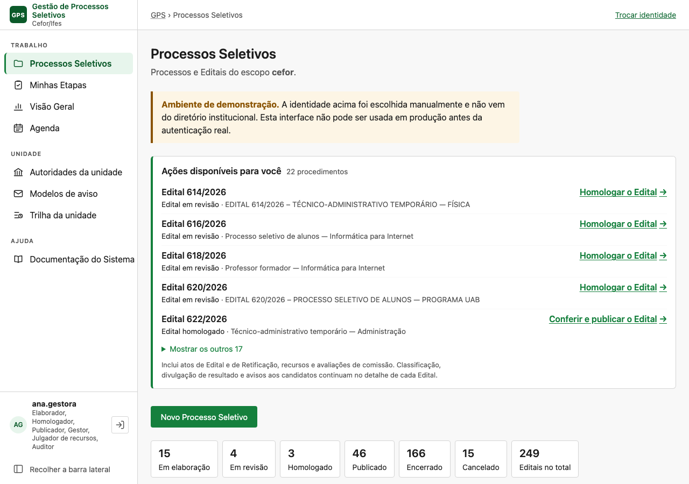
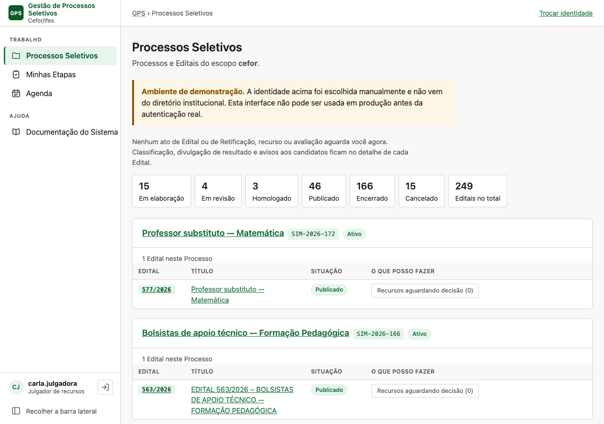
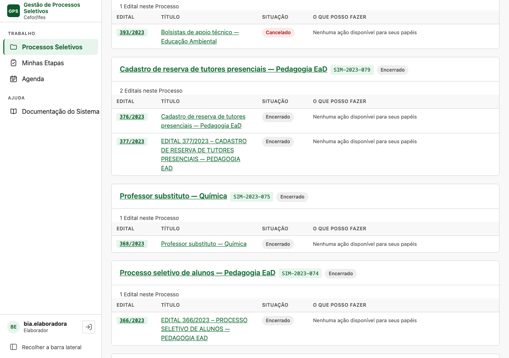
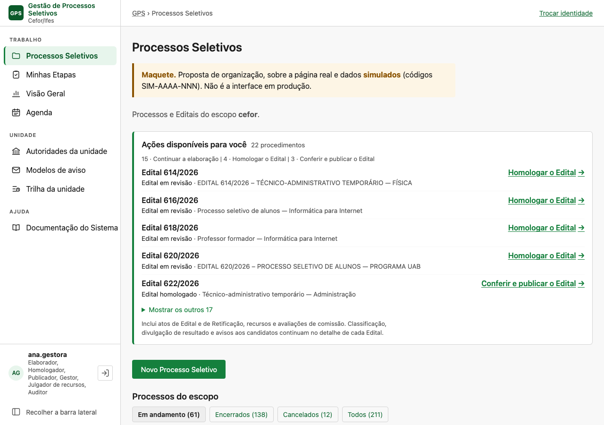
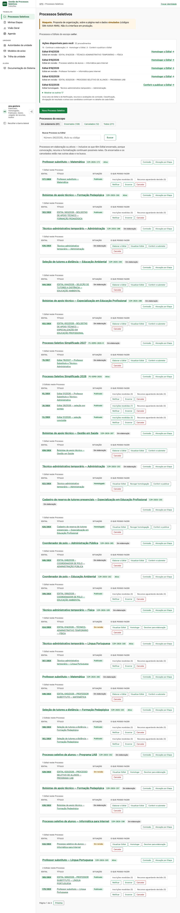
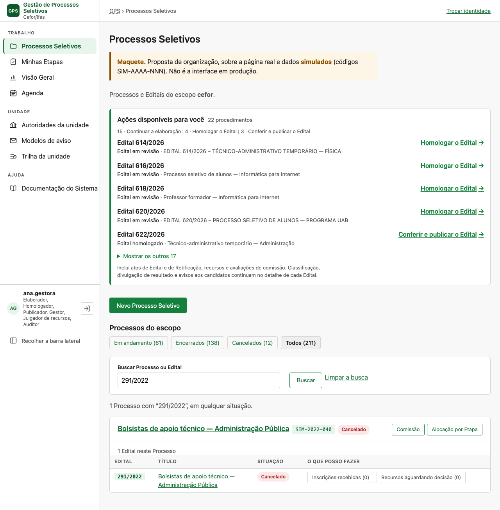
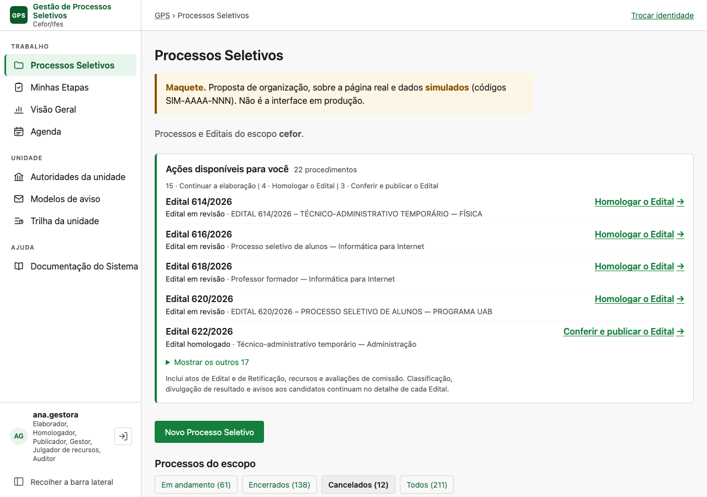

# Estudo — a página de Processos Seletivos com centenas de processos

**Pedido**: diagnóstico e proposta de evolução da página inicial da gestão (`/gestao/`), de 06/11/2026.
**Código lido**: `main` em `22a722af`. Os números de linha são os desse commit. Os PRs abertos em
06/11 (#414 da 126; #415, #416 e #417 da 127) foram conferidos pelo diff. Nenhum toca a view `lista`,
o `lista.html`, a faixa, nem as regras de encerramento, convocação e recurso. O #415 só acrescenta o
campo `quantidade` a `ObjetoDeTrabalho`, o que é compatível com a proposta.
**Evidência visual**: capturas e maquetes em
[`estudo-pagina-processos-seletivos-2026-11-06/`](estudo-pagina-processos-seletivos-2026-11-06/).

> **Revisto no mesmo dia** em [estudo-pagina-processos-seletivos-2026-11-06-revisao.md](estudo-pagina-processos-seletivos-2026-11-06-revisao.md).
> A revisão substitui:
> - a apresentação em cartões, por uma listagem compacta;
> - o resumo por ato na faixa, pela nota de cobertura;
> - a marca de "todos os Editais finais" (D-3), que sai.
>
> Acrescenta os testes de segurança operacional e as decisões D-7 a D-10.

> **Registro, e não escopo.** Nada foi implementado. Nenhuma migration, estado, permissão ou fluxo
> mudou. A única alteração no repositório, além deste documento e das imagens, é uma entrada de
> servidor local no `.claude/launch.json`, usada para as capturas. Decidir o que vira spec é do
> usuário.

> **Dados simulados.** As capturas "em volume" usam 209 Processos **simulados**, gravados direto no
> banco, com código `SIM-AAAA-NNN` e títulos inventados a partir de padrões reais. Eles não têm
> inscrição, recurso, Retificação nem avaliação: medem a **lista**, e não o trabalho dentro de cada
> Edital. As de referência ("atual-seed") são o `seed_demo` puro.

---

## 0. Resposta curta

1. **A página lista tudo.** São todos os Processos do escopo, com todos os Editais, em qualquer
   situação, sem filtro, sem busca, sem paginação e sem limite. A ordem é a de criação do Processo.
   Com 211 Processos simulados, a página mede **50 mil pixels** no desktop (55 telas) e **81 a 91
   mil** no celular (90 a 100 telas).
2. **O banco aguenta, e a tela não.** Para quase todo papel a lista custa **9 a 11 consultas**,
   qualquer que seja o volume: com 629 Processos, 86 a 145 ms e 0,9 a 1,3 MB de HTML. A exceção é o
   **exportador de matrículas**: ele paga duas consultas por Edital publicado, encerrado ou
   cancelado. Foram 451 consultas com 249 Editais e 1323 com 739 (seção D).
3. **"Encerrado" não quer dizer "concluído", e esse é o achado que decide a proposta.** Um Edital
   ENCERRADO ainda admite convocação, inclusive do cadastro de reserva. Admite também recurso,
   formalização, Requerimento de Matrícula e aviso. Esses atos só conferem o estado do
   **Processo**, e nenhum deles aparece na faixa de ações. Esconder Editais encerrados poderia esconder
   o único caminho até esse trabalho.
4. **O estado do Processo é o único critério seguro.** Processo ENCERRADO ou CANCELADO
   (`PROCESSO_FINAL`) recusa quase todo ato posterior. Ficam de fora o recurso, que a faixa já cobre,
   e as exportações, que são consulta e não providência. Os estados finais não voltam atrás.
5. **Recomendação: Trabalho e Consulta na mesma página.** A faixa de ações continua no topo e é
   calculada sobre o escopo inteiro, nunca sobre o filtro. Abaixo dela vem a listagem, com:
   - o recorte **"Em andamento"** (Processo em elaboração ou ativo) como padrão;
   - abas para os encerrados e os cancelados;
   - busca por número, título ou código, que procura em qualquer situação;
   - paginação de 20 Processos por página.

   A proposta não cria modelo, estado nem configuração. Na simulação, a página padrão cai de 55
   telas para 7.
6. **Limite honesto.** A lista só encolhe se os Processos forem **encerrados**, e o encerramento é
   ato manual do gestor. Hoje nada o lembra disso. Quando um Processo deve ser encerrado, por
   exemplo depois da validade do cadastro de reserva, é a principal decisão a validar (seção VIII).

---

## I. Diagnóstico do estado atual

### I.1 Arquitetura e fluxo

| Peça | Onde | O que faz |
|---|---|---|
| Rota | `interface/urls.py:21` | `path("", views.lista, name="lista")`: a raiz de `/gestao/` |
| View | `interface/views.py:271` `lista` | Monta tudo; só GET; sem parâmetro algum de `request.GET` |
| Consulta dos Processos | `processos/application/selectors.py:15` `listar_processos` | `ProcessoSeletivo.objects.filter(institution_scope=actor.institution_scope)`, prefetch dos Editais por `year, number`, `order_by("-created_at")`. **Sem filtro de situação.** |
| Resumo por situação | `selectors.py:33` `contar_por_situacao` | Conta **Editais** por `status` em Python, sobre os já carregados |
| Ações de cada linha | `interface/acoes.py:270` `do_edital` → `:519` `para_a_lista` → `:339` `da_linha` | Uma chamada por Edital, sem consulta nova (contagens em lote: `:484` `contagens_da_lista`) |
| Retificações em curso | `interface/atos_retificacao.py:400` `em_curso_por_edital` | Uma leitura para a página |
| Faixa "Ações disponíveis para você" | `interface/trabalho.py:216` `do_ator`; `Faixa` em `:241` | Derivação de leitura sobre os Editais **que a lista carregou** |
| Vínculos de comissão | `comissoes_selectors.comissoes_da_pessoa` | Para "Você preside/integra" e os links Comissão/Alocação |
| Template | `interface/templates/interface/lista.html` | Avisos → faixa (`_acoes_disponiveis.html`) → "Novo Processo Seletivo" → resumo → um `<article>` por Processo, com tabela de Editais |
| Estilo | `interface/static/interface/telas/lista.css` | A faixa e a coluna de ações |

**Escopo institucional.** O ator tem **um** `institution_scope` por sessão. É a unidade ativa,
resolvida em `interface/identidade.py:216-263`, e a troca se faz pelo seletor "Atuando em"
(`base.html:104-118`, `trocar_unidade` em `identidade.py:503`). A consulta filtra por esse escopo, e
não há visão agregada de várias unidades.

**Permissões.** A página abre para toda identidade da gestão. O que muda por papel é a coluna "O que
posso fazer" (`acoes.do_edital`, por `ator.can(...)`), os links Comissão e Alocação
(`comissao:gerir` ou presidência, `views.py:328-337`) e a faixa. A listagem em si não esconde
Processo nenhum por papel: o auditor e o julgador veem o mesmo inventário que o gestor.

**Paginação, filtro, busca, limite:** não existem. A lista não lê `request.GET`. O único limite da
página é o da faixa: cinco itens visíveis, e os demais num `<details>` (`trabalho.py:41` `MOSTRADOS = 5`).

**Ativos, encerrados e cancelados.** A view não os distingue. O status aparece como selo no
cabeçalho do Processo e na coluna de situação de cada Edital, e `ORDEM_SITUACAO` (`views.py:255`)
só ordena o resumo. Encerrados e cancelados ficam misturados aos ativos, na ordem de criação.

**A listagem e a faixa leem a mesma coisa.** A faixa é derivada de `editais`, isto é, de todos os
Editais do escopo que a view carregou (`views.py:277`, `:348`). Isso importa para a proposta: se a
listagem passar a ser filtrada, a faixa **não pode** herdar o filtro (critério 6).

### I.2 Comportamento visual medido

Capturas feitas com Chromium headless sobre um runserver local, nas larguras de 1280 e 390 px.

| Cenário | Processos | Altura no desktop | Telas de 900 px | Altura no celular |
|---|---|---|---|---|
| `seed_demo` (referência) | 2 | 1 312 px | 1,5 | 2 083 px |
| Simulado, julgador (A) | 211 | 49 754 px | 55 | 81 226 px |
| Simulado, elaborador (B) | 211 | 50 099 px | 56 | 89 422 px |
| Simulado, homologador e publicador (C) | 211 | 50 099 px | 56 | 89 858 px |
| Simulado, gestor com 6 papéis (D) | 211 | 53 212 px | 59 | 91 367 px |

Cada Processo ocupa, em média, **~236 px** no desktop e ~400 px no celular. Por extrapolação linear
(estimativa, e não medida), a página teria ~3 300 px com 10 Processos, ~12 600 px com 50 e ~119 000
px com 500.

A primeira tela é igual para todos: título, avisos, faixa, botão, sete caixas de contagem e o
Processo mais recente.

| Atual, gestor (D) — primeira tela | Atual, julgador (A) — primeira tela |
|---|---|
|  |  |

O meio da lista mostra o custo:

| Elaborador, rolagem em 30 000 px | |
|---|---|
|  | 181 das 249 linhas dizem *"Nenhuma ação disponível para seus papéis"*: todo Edital encerrado ou cancelado, e todo publicado em que ele não retifica. Para o julgador, **227 botões "Recursos aguardando decisão (0)"**, um por Edital publicado, encerrado ou cancelado (`acoes.py:146`, com o zero esmaecido por decisão da 057, FR-1050). |

### I.3 Problemas encontrados

| # | Problema | Evidência |
|---|---|---|
| P1 | A lista cresce sem limite e sem recorte; a página padrão é o acervo inteiro | `selectors.py:15`; tabela I.2 |
| P2 | Não há como **localizar** um Processo ou Edital específico, exceto pelo Ctrl+F do navegador | A view não lê `request.GET`; a busca só existe na Visão Geral, e ela é exclusiva do gestor |
| P3 | Encerrados e cancelados de anos anteriores se misturam aos ativos | A ordem é `-created_at`; não há separação |
| P4 | A coluna de ações repete a mesma resposta vazia centenas de vezes | 181 "Nenhuma ação" (elaborador); 227 contadores em zero (julgador) |
| P5 | O resumo conta **Editais**, a lista agrupa **Processos**, e o resumo não é clicável | `lista.html:46-58`; o "249 Editais no total" convive com 211 Processos |
| P6 | A faixa do elaborador lista **todo** Edital em elaboração do escopo, e não os dele | `trabalho.py:82`: a condição é `status == EM_ELABORACAO and ator.can("edital:elaborar")` |
| P7 | N+1 para quem tem `matricula:exportar` | `acoes.py:223` `_pede_requerimento_de_matricula` chama `effective_version` por Edital: 451 consultas com 249 Editais e 1 323 com 739 |
| P8 | A volta do detalhe para a lista não guarda contexto (rolagem, posição) | `processo_detalhe.html:4` e `detalhe.html:4` apontam para `` puro; com 55 telas, voltar é recomeçar |
| P9 | O subtítulo diz o **código** da unidade ("escopo **cefor**"), e não o nome | `lista.html:7` |

---

## II. Mapa do ciclo de vida

### II.1 Estados persistidos

| Objeto | Campo | Estados | Arquivo |
|---|---|---|---|
| Processo Seletivo | `status` | `EM_ELABORACAO`, `ATIVO`, `ENCERRADO`, `CANCELADO` | `processos/models.py:7` |
| Edital | `status` | `EM_ELABORACAO`, `EM_REVISAO`, `HOMOLOGADO`, `PUBLICADO`, `ENCERRADO`, `CANCELADO` | `processos/models.py:36` |
| Retificação | `status` | `EM_ELABORACAO`, `EM_REVISAO`, `HOMOLOGADA`, `PUBLICADA`, `CANCELADA` | `publicacoes/models_retificacao.py:37` |
| Inscrição | `status` | `RASCUNHO`, `SUBMETIDA` | `inscricoes/models.py:24` |
| Publicação de resultado | `natureza` | `PRELIMINAR`, `DEFINITIVA`, **por marco e lista** | `divulgacao/models.py:28` |

**Não têm estado persistido**: Etapa, classificação, sorteio, resultado e convocação. São cadeias de
atos append-only (`AtoDeOrdenacao`, `ResultadoEtapa`, `Sorteio.executado_em`, `Convocacao`,
`DesfechoDaConvocacao`), e a situação é derivada; por exemplo, `estado_do_marco` em
`classificacao/application/selectors.py:317`.

### II.2 Transições

| Objeto | Transição | Comando | Permissão |
|---|---|---|---|
| Processo | EM_ELABORACAO → ATIVO, **automática** na primeira publicação | `publish_edital.py:891` `_ativar_o_processo_na_primeira_publicacao` | sob `edital:publicar` |
| Processo | EM_ELABORACAO → ATIVO, manual | `processos/application/commands.py:132` `activate_process` | `processo:ativar` |
| Processo | ATIVO → ENCERRADO | `processos/application/finalizacao.py:173` `close_process`; exige todos os Editais finais (`domain/finalizacao.py:33`, decisão de 28/09, RC-118) | `processo:encerrar` |
| Processo | EM_ELABORACAO ou ATIVO → CANCELADO | `finalizacao.py:197` `cancel_process`; mesma exigência | `processo:cancelar` |
| Edital | EM_ELABORACAO → EM_REVISAO → HOMOLOGADO → PUBLICADO | `publish_edital.py:506`, `:588` e `:740`; devolver (`:634`) e revogar (`:690`) andam para trás | `edital:submeter`, `edital:homologar` e `edital:publicar` |
| Edital | PUBLICADO → ENCERRADO | `finalizacao.py:269` `close_edital`, com os impedimentos da 113 | `edital:encerrar` |
| Edital | qualquer não final → CANCELADO | `finalizacao.py:301` `cancel_edital` | `edital:cancelar` |

**Os estados finais não voltam atrás.** O docstring de `domain/finalizacao.py:1-4` diz que eles
"nunca" retornam, e cada `ensure_*` recusa com "estado final não admite nova transição". Não existe
reabertura de Processo nem de Edital.

### II.3 Respostas às perguntas da investigação B

1. **Estados persistidos**: os da tabela II.1.
2. **Situações derivadas**:
   - o período de inscrições: `FUTURO`, `ABERTO`, `ENCERRADO` ou `NAO_DESIGNADO`
     (`inscricoes/domain/periodo.py:18`);
   - o prazo recursal aberto (`pendencias_do_edital._dos_prazos_recursais`);
   - o estado de cada marco de classificação;
   - a convocação aguardando ou vencida (`relatorio_do_edital.py:872-975`);
   - a Retificação "parada" (`atos_retificacao.py:287`);
   - os marcos da Agenda: `POR_VIR`, `EM_CURSO` e `PASSADA` (`agenda.py:62`).
3. **Condição formal de "concluído"**: **não existe para o Edital.** Edital ENCERRADO significa
   *"publicado e encerrado sem impedimentos da 113"*, e não *"sem trabalho pendente"* (II.4). Para o
   Processo, ENCERRADO é a conclusão formal: ela exige todos os Editais finais e bloqueia quase todo
   ato posterior (II.4). Nenhum predicado único combina status e trabalho a jusante.
4. **O fim das inscrições não muda estado nenhum.** É derivado do conteúdo publicado e do relógio.
5. **Sim.** O Edital continua PUBLICADO durante a classificação, o sorteio, o resultado e a
   convocação. "Publicado" cobre do primeiro dia de inscrição à última convocação.
6. **Sim, e é o achado central.** Um Edital ENCERRADO, em Processo ATIVO, ainda aceita:
   - convocar, inclusive do cadastro de reserva (`convocacao/application/convocar.py:38`, que passa só
     por `comando_de_comissao`, e este confere o Processo, em `comissoes/application/__init__.py:91`);
   - interpor e julgar recurso (`recursos/application/interpor.py`, sem guarda de estado);
   - designar formalização (`formalizacao/application/designar.py:73`:
     `ESTADOS_DESIGNAVEIS = {PUBLICADO, ENCERRADO}`);
   - conferir documento e preencher Requerimento de Matrícula;
   - criar e enviar aviso;
   - publicar resultado, consolidar e sortear (via `comando_de_comissao`).

   Já um Processo ENCERRADO ou CANCELADO recusa todos esses atos, exceto recurso (sem guarda de
   estado), despacho de aviso já confirmado e exportações (`ensure_processo_accepts_changes`,
   `domain/finalizacao.py:116`).
7. **Cancelamento.**
   - O Edital deixa de receber inscrições (`ESTADOS_QUE_RECEBEM = {"PUBLICADO"}`, `periodo.py:86`).
   - Sai da vitrine pública (`selecoes_publicas`, `publicacoes/application/selectors.py:378`), mas
     continua acessível pelo endereço.
   - A Retificação em curso **não** é cancelada em cascata: fica "parada" e não entra na faixa
     (`atos_retificacao.py:300-314`).
   - O Processo só se cancela com todos os Editais finais.
8. **Forma segura de tirar da lista inicial**: **o status do Processo em `PROCESSO_FINAL`**
   (`domain/finalizacao.py:10`). O status do Edital não é seguro (item 6).
9. **Nenhuma transição torna relevante de novo um Processo ou Edital final.** Um Processo final ainda
   pode receber **recurso**, porque não há guarda de estado em `interpor`. É o único caso de trabalho
   novo, e a faixa o cobre para o julgador (III), desde que ela continue lendo o escopo inteiro.

### II.4 O que **não** se equivale

| Situação | Muda o estado? | Indica fim do certame? |
|---|---|---|
| Inscrições encerradas | Não; derivado do período | Não. Vêm avaliação, classificação, resultado e convocação |
| Prazo de recursos encerrado | Não; derivado | Não |
| Resultado definitivo publicado | Não; `natureza=DEFINITIVA` por marco e lista | Não. A convocação e o cadastro de reserva continuam |
| Último evento do cronograma passado | Não | Não. A Agenda avisa que data passada não prova conclusão (`agenda.py:149`) |
| Edital ENCERRADO | Sim | **Não.** Ainda há convocação, recurso, formalização e aviso |
| Processo ENCERRADO | Sim | **Sim, formalmente.** Quase todo ato é recusado |

### II.5 Matriz de elegibilidade para o filtro

| Estado do Processo | Editais | Aparece em "Em andamento"? | Por quê |
|---|---|---|---|
| EM_ELABORACAO | quaisquer (inclusive sem Edital) | **Sim** | Trabalho de elaboração |
| ATIVO | algum não final | **Sim** | Certame em curso |
| ATIVO | todos ENCERRADO ou CANCELADO | **Sim**, com marca de que todos os Editais estão finais | Convocação, formalização e aviso continuam possíveis; encerrar o Processo é ato humano |
| ENCERRADO | todos finais (exigido) | Não; aba "Encerrados" e busca | Quase todo ato é recusado. O recurso que ainda chegar aparece na faixa |
| CANCELADO | todos finais (exigido) | Não; aba "Cancelados" e busca | Idem |

**Ambiguidade registrada.** Processos encerrados antes de 28/09/2026 podem ter Edital PUBLICADO: a
exigência de Editais finais é posterior (`selectors.py:76-84`). Num deles, o Edital publicado
continua recebendo inscrição dentro do período. Pelo critério do Processo, ele sairia do recorte
padrão. Quantos existem em produção não foi conferido; o banco de demonstração não tem nenhum
(seção VIII, D-5).

---

## III. Diagnóstico da seção de ações

### III.1 Como é derivada

`trabalho.do_ator` (`trabalho.py:216`) junta quatro fontes. Deduplica por `chave` e ordena por
`_ordem` (`:199`): primeiro os itens com instante de espera (`desde`), do mais antigo para o mais
recente; depois os demais, por ano, número e natureza. **A ordem não é de relevância nem de
urgência**, e a spec 104 decidiu assim de propósito.

| Natureza | Função | Condição | Item | `desde` |
|---|---|---|---|---|
| Edital em elaboração | `_do_edital` `:68` | `EM_ELABORACAO` e `edital:elaborar` | "Continuar a elaboração" → composição | — (vai para o fim) |
| Edital em revisão | `_do_edital` | `homologar` em `atos.disponiveis` | "Homologar o Edital" → detalhe | submissão |
| Edital homologado | `_do_edital` | `publicar` e **sem** segregação (lida em lote) | "Conferir e publicar o Edital" → detalhe | homologação |
| Retificação | `_da_retificacao` `:128` | `resumo["meu_ato"]` (o `proximo_passo` da 103 é desta pessoa) | o ato principal (`ato_na_lista`) | o instante da situação |
| Recursos | `_dos_recursos` `:153` | `recurso:julgar` e peças aguardando decisão > 0 | "Decidir recursos (n)" | — |
| Avaliação | `_das_avaliacoes` `:176` | alocação em Minhas Etapas com pendentes > 0 | "Avaliar (n pendentes)" → mesa | — |

### III.2 Matriz por papel

| Papel (`identidade.PAPEIS`) | O que pode aparecer na faixa | O que **não** aparece, mesmo sendo dele |
|---|---|---|
| Elaborador | todo Edital em elaboração **do escopo**; Retificação em elaboração ou devolvida | Edital em elaboração de outra pessoa não se distingue do seu |
| Homologador | Edital em revisão; Retificação em revisão | — |
| Publicador | Edital homologado (exceto por segregação); Retificação homologada | Divulgação de resultado (D-002 da 104) |
| Gestor | nada próprio | Encerrar ou cancelar Edital ou Processo, constituir comissão, convocação, formalização e avisos |
| Julgador | recursos aguardando decisão, em qualquer Edital publicado, encerrado ou cancelado | — |
| Membro de comissão (vínculo, não papel) | avaliação com pendentes | Classificação, sorteio e convocação, que são de quem conduz |
| Auditor, Exportador, Comunicação, Formalização | nada | Exportação, kit e formalização ficam no detalhe |

**O que a faixa declara não cobrir** (`trabalho.py:45`, D-002 da 104): classificação, divulgação de
resultado e avisos. **O que ela também não cobre, e não declara**: sorteio, convocação (inclusive do
cadastro de reserva), formalização e entrega documental, encerramento do Edital e encerramento do
Processo. Para esses, **a lista é hoje o único caminho**, e por isso o critério do filtro (II.5)
precisa ser o do Processo.

### III.3 As cinco categorias

| Categoria | Tratamento atual |
|---|---|
| Executável agora | É o caso geral: continuar a elaboração, homologar, decidir recursos, avaliar e o ato da Retificação |
| Pendente, mas bloqueada | **Excluída**, e não exibida como bloqueada. A segregação tira o "publicar" (`trabalho.py:110`), e a Retificação parada não tem `meu_ato` (`atos_retificacao.py:300-314`). Na coluna da lista, "Publicar" aparece desabilitado com o motivo (FR-2816) |
| Executável, mas o bloqueio só se descobre no detalhe | "Conferir e publicar" e "Conferir e submeter" (D-004 da 104). A pendência impeditiva só aparece na conferência. O rótulo não promete o que a lista não sabe |
| Futura | Não existe na faixa. A Agenda cobre marcos futuros |
| Atenção sem ato | Não existe na faixa. Na coluna de situação há a marca da Retificação: "aguarda {papel}" e "não pode mais prosseguir" |
| Sem providência | A frase do estado vazio diz o que foi olhado e o que fica no detalhe (D-012) |

**Duplicidade**: um item por objeto (`chave`). O mesmo Edital pode gerar até três itens, um por
objeto (o Edital, a Retificação e os recursos), e isso é deliberado (Edge Cases da 104).

### III.4 Riscos

**Omissão (risco 1).**
- Hoje, baixa dentro da cobertura declarada, e real fora dela. Convocação, formalização e
  encerramento só se encontram pela lista. Esconder Processos ativos esconderia esse trabalho.
- Com a proposta, o risco **não aumenta**, desde que:
  - a faixa continue calculada sobre o escopo inteiro;
  - o recorte padrão use o status do Processo e não o do Edital.

**Poluição (risco 2).**
- **Elaborador**: com 14 Editais em elaboração no escopo, recebe 15 itens "Continuar a elaboração",
  inclusive os de colegas (cenário B).
- **Gestor com seis papéis**: 22 itens (cenário D).
- O `<details>` "Mostrar os outros 17" abre uma lista longa sem agrupamento.
- O formato de cinco itens funciona até ~10. Com 20 a 50 itens, a faixa continua compacta fechada,
  mas aberta vira uma segunda lista sem resumo (D-014 da 104 mediu 25 e 100 objetos só no estado
  fechado).

---

## IV. Volumetria e escalabilidade

### IV.1 Consultas e tempo, medidos

Medição com o `Client` do Django e `CaptureQueriesContext`; o tempo é o mínimo de três GETs, na
máquina local.

| Papel | 249 Editais / 211 Processos | 739 Editais / 629 Processos |
|---|---|---|
| Julgador | 10 consultas · 37 ms · 323 KB | 10 · 100 ms · 948 KB |
| Elaborador | 9 · 33 ms · 306 KB | 9 · 88 ms · 894 KB |
| Homologador + publicador | 9 · 32 ms · 294 KB | 9 · 86 ms · 862 KB |
| Gestor com 6 papéis | 11 · 54 ms · 443 KB | 11 · 145 ms · **1,3 MB** |
| Auditor | 9 · 35 ms · 289 KB | 9 · 88 ms · 845 KB |
| **Exportador** | **451** · 142 ms · 289 KB | **1 323** · 395 ms · 845 KB |

- **Consultas: constantes** para todo papel exceto o exportador, como a 104 garantiu e
  `tests/performance/test_trabalho_em_escala.py` trava. O teste usa homologador, publicador, gestor e
  julgador, e **não** cobre `matricula:exportar` (P7).
- **O que cresce é o HTML e a renderização**: ~1,7 KB por Edital e ~0,2 ms por Edital no template.
  Com 500 Processos o servidor ainda responde em ~0,1 s; o problema é o que se entrega ao navegador
  e à pessoa.

### IV.2 Por cenário de volume

| Processos | Altura estimada no desktop | Leitura |
|---|---|---|
| 10 | ~3 300 px (4 telas) | Navegável |
| 50 | ~12 600 px (14 telas) | Achar um Edital já exige Ctrl+F |
| 200 | ~48 000 px (53 telas, medida: 50 000) | Inviável sem busca; o ativo de 2024 fica abaixo de dezenas de 2026 |
| 500 | ~119 000 px (132 telas) | Inviável; HTML acima de 1 MB |

**Gestor de escopo amplo × operador restrito.** O inventário é o **mesmo** para todos: a lista não
filtra por papel. O operador restrito (auditor, julgador) percorre as mesmas 55 telas, com a coluna de
ações vazia ou zerada em quase todas as linhas. O gestor paga a mesma rolagem, mais uma faixa longa.

---

## V. Alternativas

| | 1. Ocultar só cancelados | 2. Ocultar encerrados e cancelados | 3. Filtros por situação do Edital | 4. Trabalho × Consulta | **5. Recomendada: 4 + recorte pelo Processo + busca + página** |
|---|---|---|---|---|---|
| Clareza | Baixa: o volume continua | Alta, se o critério for certo | Média: "Publicado" cobre da inscrição à convocação; o Processo mistura Editais em situações diferentes | Alta | Alta |
| Carga cognitiva | Quase igual à atual (cancelados ~6%) | Baixa | Média/alta: seis categorias técnicas | Depende de como a consulta é organizada | Baixa: quatro abas e uma busca |
| Risco de omissão | Nenhum novo | **Alto pelo Edital** (II.3-6); **baixo pelo Processo** | Alto se o padrão excluir "Encerrado" do Edital | Baixo, se a faixa ler o escopo | Baixo: faixa sobre o escopo; recorte pelo Processo |
| Consistência com as regras | Sim | Só pelo Processo | Fraca: confunde estado administrativo com etapa | Já é a D-001 da 104 | Sim: usa `PROCESSO_FINAL`, sem estado novo |
| Esforço | Muito baixo | Baixo | Médio | Já existe em parte | Baixo/médio: um seletor, uma view, um template e testes |
| Manutenção | Trivial | Baixa | Média | Baixa | Baixa: reaproveita `.recortes .abas`, `.filtros` e `.paginacao` |
| Escalabilidade | Não resolve | Resolve se os Processos forem encerrados | Resolve parcialmente | Não resolve sozinha | Resolve: busca e paginação independem do encerramento |
| Multiunidade | Indiferente | Indiferente | Indiferente | Indiferente | Indiferente: tudo é por `institution_scope` |

**Por que não a 1.** Os cancelados são poucos; no simulado, 12 de 211 Processos. O ganho é marginal.

**Por que não a 2 pelo Edital.** O Edital ENCERRADO ainda tem convocação, recurso, formalização e
aviso (II.3-6), e nada disso está na faixa. Esconder o Processo esconderia o caminho.

**Por que não a 3 como padrão.** As situações do Edital servem para o panorama, e a Visão Geral já
as oferece ao gestor, com ano, período e busca. Na lista, o objeto é o Processo, e um Processo com
um Edital publicado e outro cancelado não tem "uma" situação de Edital.

**Por que a 5.** A separação Trabalho × Consulta já está na página desde a 104 (D-001). Falta à
Consulta um padrão sensato e um jeito de procurar. O recorte pelo Processo é seguro sozinho, e a
busca e a paginação garantem a escala mesmo que os Processos nunca sejam encerrados.

---

## VI. Proposta de UI/UX

### VI.1 Organização

```
Processos Seletivos
  Processos e Editais da unidade Cefor/Ifes                  ← nome, não código (P9)
  [avisos obrigatórios]
  ┌ Ações disponíveis para você · 22 procedimentos ─────────┐  ← TRABALHO: sobre o escopo inteiro
  │ 15 · Continuar a elaboração | 4 · Homologar | 3 · …      │    (linha de resumo, só acima de 5)
  │ 5 itens                                                   │
  │ ▸ Mostrar os outros 17                                    │
  └───────────────────────────────────────────────────────────┘
  [Novo Processo Seletivo]
  Processos do escopo                                         ← CONSULTA
  [Em andamento (61)] [Encerrados (138)] [Cancelados (12)] [Todos (211)]
  [ Buscar: número (90/2026), título ou código ] [Buscar]
  <article> × 20
  Página 1 de 4 · Próxima
```

| Maquete D, gestor — primeira tela | Maquete D, gestor — página inteira (20 de 61) |
|---|---|
|  |  |

### VI.2 Seção de ações (8.1)

- **Continua antes da listagem.** É a D-001 da 104, e o trabalho vem antes do inventário.
- **Continua com cinco itens e "Mostrar os outros N"** (D-009). O limite não é o problema: fechada, a
  faixa mede o mesmo com 5 ou 100 itens.
- **Acima de cinco itens, uma linha de resumo por ato**, derivada da própria lista, sem consulta:
  "15 · Continuar a elaboração | 4 · Homologar o Edital | 3 · Conferir e publicar o Edital". Ela
  responde "quanto e de que tipo" sem abrir o `<details>`. **Isso responde à pergunta dos 20 ou 50
  itens.**
- **Ordenação**: mantém a da 104 (com `desde` primeiro, e depois Edital). Opcional, e a decidir
  (D-4): entre os "Continuar a elaboração", primeiro os Editais cujo `last_edited_by` é a própria
  pessoa. O campo existe em `Edital` e não custa consulta.
- **Executável × não executável**: manter como está. O bloqueado sai da faixa (segregação,
  Retificação parada), e o que depende de conferência diz "Conferir e…". Pendências não executáveis
  não entram, para não poluir.
- **"Ver todas" em página própria: não.** O `<details>` basta até ~50 itens com a linha de resumo.
  Página nova seria a "central de pendências" que a 104 excluiu.
- **Textos longos**: já truncados em uma linha (D-014).
- **Invariante novo, a escrever em teste**: a faixa é calculada sobre todos os Editais do escopo,
  **qualquer que seja o recorte, a busca ou a página** da listagem.

### VI.3 Listagem (8.2)

| Pergunta | Proposta |
|---|---|
| Filtro padrão | **"Em andamento"**: Processo `EM_ELABORACAO` ou `ATIVO`, isto é, fora de `PROCESSO_FINAL` |
| "Todos" é necessário? | Sim: é o destino da busca e a resposta a "onde está aquele de 2023?" |
| Cancelados | Aba própria. Encerrado e cancelado "nunca são sinônimos" (`domain/finalizacao.py:1-4`, FR-005/006), e juntá-los apagaria a distinção no lugar onde se procura. A juntar numa aba "Finalizados" só se o usuário preferir (D-2) |
| Encerrados | Aba própria, consultáveis com as mesmas ações de consulta de hoje (inscrições, recursos e trilha) |
| Busca | Um campo só, que procura em **todas as situações** e ignora a aba. É o critério 3 ("um cancelado continua localizável"). Mesma lógica da Visão Geral (`visao_geral.py:406` `_editais_do_recorte`: `icontains` em número, título do Edital, título do Processo e código). **A da Visão Geral não reconhece "90/2026"**: o `icontains` procura a frase inteira no número, que é só "90". A lista precisa separar número e ano quando houver barra. A frase do resultado diz "em qualquer situação" |
| Ordenação | Mantém `-created_at`. Mudar a ordem não é necessário depois do recorte: o "Em andamento" é curto, e a busca acha o resto |
| Paginação | 20 Processos por página, com `Paginator` e o padrão de `_paginacao_de_inscricoes.html`, preservando aba e busca. Só aparece com mais de uma página |
| Contexto na volta | A aba, a busca e a página ficam na querystring, de modo que o "voltar" do navegador as devolve. A trilha do detalhe continua levando ao padrão. Não se propõe memória em sessão |
| Estado × etapa | O selo do Processo continua no cabeçalho, e o do Edital na linha. **Não se inventa "etapa operacional"**: ela não é persistida (II.1). Uma marca derivada sem consulta é proposta só para o gestor: "Todos os Editais deste Processo estão encerrados ou cancelados; o Processo continua ativo até ser encerrado" (D-3) |
| Resumo de Editais por situação | Sai da lista: as abas dão as contagens no nível certo (Processos). O panorama por situação de Edital é da Visão Geral. `test_lista.py:218` muda |

| Maquete E — busca por "291/2022" acha o cancelado | Maquete E — aba Cancelados |
|---|---|
|  |  |

### VI.4 Semântica (8.3)

| Rótulo | Conteúdo real | Recomendação |
|---|---|---|
| "Processos Seletivos" | O inventário do escopo, mais a faixa de trabalho | Manter: é o nome da seção na barra e da entrada da gestão |
| "Ações disponíveis para você" | O que a pessoa **pode** fazer agora, e não o que lhe foi atribuído (FR-2811). A nota de cobertura diz o que fica de fora | Manter. "Para você" é preciso com a FR-2811 |
| "Minhas Etapas" | Alocações de avaliação e comissões que a pessoa integra | Manter. A D-007 da 104 já decidiu; renomear depende de pesquisa com pessoas |
| "Processos e Editais do escopo **cefor**" | O código técnico da unidade | Trocar pelo rótulo da unidade (`identificacao_da_gestao.rotulo`), já disponível no `base.html` |
| Novo: "Processos do escopo" + abas | — | Cabeçalho da Consulta. A palavra "escopo" já está na página; "da unidade" é alternativa |

### VI.5 Por papel

O recorte e a busca são os mesmos para todos, e só a faixa e a coluna variam. A proposta não muda
autorização nenhuma, e a recusa continua no servidor.

| Cenário | Atual | Proposta | Maquete |
|---|---|---|---|
| A — julgador, poucas ações, muitos encerrados | 55 telas, 227 contadores zerados | 6 telas, 20 Processos em andamento | [atual](estudo-pagina-processos-seletivos-2026-11-06/atual-volume/A-julgador-dobra.png) · [proposta](estudo-pagina-processos-seletivos-2026-11-06/proposta/A-julgador-dobra.png) |
| B — elaborador, 15 em elaboração | 56 telas; faixa de 15 itens, sem resumo | 7 telas; faixa com resumo por ato | [atual](estudo-pagina-processos-seletivos-2026-11-06/atual-volume/B-elaborador-dobra.png) · [proposta](estudo-pagina-processos-seletivos-2026-11-06/proposta/B-elaborador-dobra.png) · [celular](estudo-pagina-processos-seletivos-2026-11-06/proposta/B-elaborador-celular-dobra.png) |
| C — homologador e publicador | 56 telas; 7 itens | 7 telas; 7 itens com resumo | [atual](estudo-pagina-processos-seletivos-2026-11-06/atual-volume/C-homologador-publicador-dobra.png) · [proposta](estudo-pagina-processos-seletivos-2026-11-06/proposta/C-homologador-publicador-dobra.png) |
| D — gestor, 211 Processos | 59 telas (101 no celular) | 7 telas (12 no celular) | [atual](estudo-pagina-processos-seletivos-2026-11-06/atual-volume/D-gestor-amplo-dobra.png) · [proposta](estudo-pagina-processos-seletivos-2026-11-06/proposta/D-gestor-amplo-dobra.png) · [celular](estudo-pagina-processos-seletivos-2026-11-06/proposta/D-gestor-amplo-celular-dobra.png) |
| E — localizar um cancelado | Ctrl+F em 55 telas | Busca: 1 resultado, com selo "Cancelado"; ou aba Cancelados (12) | [busca](estudo-pagina-processos-seletivos-2026-11-06/proposta/E-busca-cancelado-dobra.png) · [aba](estudo-pagina-processos-seletivos-2026-11-06/proposta/E-aba-cancelados-dobra.png) |

**Sobre as maquetes.**
- São a página real, servida pelo runserver com as folhas de estilo do GPS. O DOM foi transformado
  por script, sem tocar no código.
- As abas usam `.recortes .abas` (`gestao/telas.css:207`), a busca `.filtros` e `.campo`
  (`gestao/formularios.css:75`), e a página `.paginacao` (`gestao/tabelas.css:30`).
- Alguns ajustes de margem foram feitos inline, só na maquete; a implementação não pode usá-los,
  por causa da CSP.
- O selo "Maquete" substitui, na captura, o aviso de ambiente de demonstração.
- **Cada aba das maquetes sai da mesma carga simulada**, em que o Processo ENCERRADO tem todos os
  Editais encerrados. A marca do D-3 aparece nos três Processos ativos com Edital cancelado.

### VI.6 Critérios de qualidade (seção 10 do pedido)

| # | Critério | Como a proposta atende |
|---|---|---|
| 1 | Providências rapidamente identificáveis | Faixa no topo, com linha de resumo por ato |
| 2 | Antigos não sobrecarregam | Recorte padrão "Em andamento" e páginas de 20 |
| 3 | Cancelado localizável | Aba própria, e busca em qualquer situação |
| 4 | Encerrado consultável | Aba própria, e as ações de consulta de hoje na linha |
| 5 | Processo em execução não some por prazo intermediário | O critério é o status persistido do Processo, nunca data ou período |
| 6 | Ação pendente não some pelo filtro | A faixa é calculada sobre o escopo; vira invariante com teste |
| 7 | Consistente entre papéis e unidades | Mesmo recorte para todos; tudo por `institution_scope` |
| 8 | Localizar sem percorrer | Busca por número, título ou código |
| 9 | Mecanismos existentes | `PROCESSO_FINAL`, a busca da Visão Geral, `Paginator` e as classes de recorte, filtro e paginação já definidas |
| 10 | Sem arquivamento manual | Nenhum: o recorte segue o ato de encerramento que já existe |
| 11 | Sem mudar regra de negócio | Nenhuma: só leitura e apresentação |
| 12 | Rastreabilidade e permissões | Nada novo para autorizar; a busca filtra por escopo como a consulta |

---

## VII. Plano de implementação proposto

**Cabe numa spec só**, pequena, de leitura e apresentação. Sugestão de título: *"A lista de Processos
em escala: recorte, busca e página"*.

### VII.1 Arquivos

| Arquivo | Mudança |
|---|---|
| `processos/application/selectors.py` | `listar_processos(actor, *, recorte, busca)`, com o recorte por `status__in` e a busca por `Exists` sobre os Editais (número, título) ou por título e código do Processo. `contar_por_recorte(actor)` numa agregação. A busca pode extrair a condição de `visao_geral._editais_do_recorte` para não haver duas |
| `interface/views.py` `lista` | Lê `recorte`, `busca` e `pagina` de `request.GET`, com saneamento como o `recorte_de` da Visão Geral, e pagina os Processos (`Paginator`, 20). **A faixa deixa de depender da página**: os Editais da faixa passam a ser lidos à parte (abaixo) |
| `interface/trabalho.py` | Uma leitura própria dos Editais que podem gerar trabalho: os em fluxo (`EM_ELABORACAO`, `EM_REVISAO`, `HOMOLOGADO`), os com Retificação em curso e os com recurso aguardando. Ou, mais simples e já medido como barato, **todos os Editais do escopo sem prefetch de nada**, com uma consulta só. A escolha é do plan |
| `interface/templates/interface/lista.html` | `nav.recortes`, `form.filtros`, a frase do resultado da busca, a paginação, o fim do `ul.resumo` e o subtítulo com o rótulo da unidade |
| `interface/templates/interface/_acoes_disponiveis.html` | A linha de resumo por ato, acima de cinco itens |
| `interface/templates/interface/_paginacao_de_inscricoes.html` | Generalizar, ou um irmão para a lista. Ele já recebe `parametro` e `filtro` |
| `interface/static/interface/telas/lista.css` | Só o que as classes existentes não cobrirem. Toda classe nova precisa de regra (guardião de acessibilidade) |
| `interface/acoes.py:223` (**opcional**, P7) | `_pede_requerimento_de_matricula` em lote, via `versoes_vigentes` (já usado na Visão Geral). É correção de custo independente; pode entrar na mesma spec ou ser registrada à parte (D-6) |

Sem migration, modelo, permissão ou estado.

### VII.2 Testes

**Novos.**
- O recorte padrão exclui Processo ENCERRADO e CANCELADO e inclui ATIVO com todos os Editais finais.
- As abas contam Processos e somam o total.
- A busca acha Edital cancelado e encerrado **a partir de qualquer aba**, pelo número em "N/AAAA",
  pelo título e pelo código, e não acha outro escopo.
- **A faixa é idêntica em todas as abas, buscas e páginas**: recurso aguardando em Edital de Processo
  encerrado continua na faixa do julgador, e Edital em elaboração da página 2 continua na faixa do
  elaborador.
- A paginação preserva aba e busca. Parâmetro inválido cai no padrão.
- O vocabulário e as citações de requisito (`test_citacoes_de_requisito.py`) conferem a spec nova.

**Atualizados.**
- `tests/interface/test_lista.py:218`: sai "Editais no total".
- Testes que leem `context["processos"][0]` (`test_acoes_disponiveis.py`, `test_retificar*.py`):
  conferir se algum cria o Processo já final.
- `tests/performance/test_trabalho_em_escala.py`: consultas constantes com recorte e busca. Acrescentar
  `exportador` se P7 entrar.

**Guardiões de folha** (`classe-no-template-exige-regra-na-folha`, `guardioes-leem-a-folha-como-texto`)
e a CSP: nada inline.

### VII.3 Riscos de regressão

- **A faixa herdar o filtro** é o risco principal, e por isso o invariante tem teste próprio.
- A busca por número precisa casar "90/2026", "90" e "090", porque o número é `CharField`. A Visão
  Geral **não** resolve isso: casa "90", e não "90/2026". O saneamento dela (100 caracteres) se
  reaproveita; a separação de número e ano é nova.
- Processo encerrado antes de 28/09 com Edital publicado (II.5) sai do padrão. Se existir em
  produção, aparece na aba Encerrados e na busca (D-5).
- A ordem por `-created_at` com paginação precisa de desempate estável (`-created_at, id`).

---

## VIII. Decisões a validar

Só o que o código e as regras não resolvem.

| # | Decisão | Por que é humana | Recomendação |
|---|---|---|---|
| **D-1** | **Quando um Processo deve ser encerrado?** Por exemplo, depois da validade do cadastro de reserva, ou quando o último Edital é encerrado | O sistema não sabe quando acabou a última convocação possível, e o encerramento é ato de quem conduz. Sem essa prática, o "Em andamento" acumula Processos ativos com todos os Editais finais | Registrar a prática institucional. A marca do D-3 torna o caso visível sem decidir por ninguém. **Não** pôr "Encerrar o Processo" na faixa |
| D-2 | Cancelados numa aba própria, ou junto com os encerrados ("Finalizados")? | É preferência de leitura; as duas são seguras | Abas separadas (FR-005/006: nunca sinônimos) |
| D-3 | Mostrar ao gestor a marca "todos os Editais finais; o Processo continua ativo"? | Ela induz o encerramento, e isso é governança | Sim, como fato e não como ação, só para quem tem `processo:encerrar` |
| D-4 | Na faixa do elaborador, primeiro os Editais que ele editou por último? | Muda a ordem decidida na 104 (Clarifications de 30/10) | Sim, como desempate dentro de "Continuar a elaboração"; não filtrar os de colegas |
| D-5 | Processos encerrados antes de 28/09 com Edital ainda PUBLICADO: existem em produção? | Depende do banco de produção, que não foi lido | Conferir antes do merge; se existirem, decidir se o recorte os trata como "em andamento" |
| D-6 | A correção do N+1 do exportador (P7) entra nesta spec ou fica registrada à parte? | Governança: achado no meio de um trabalho vira registro | Entrar: é custo da mesma página, e o teste de escala é o mesmo |

**Fora desta proposta, registrado.**
- **Contadores em zero nas linhas de Editais finais.** "Recursos aguardando decisão (0)" aparece em
  todo encerrado, e o zero esmaecido foi decisão da 057, FR-1050. O recorte reduz o efeito; rever a
  decisão é outro assunto.
- **Cobertura da faixa.** Convocação, formalização, sorteio e encerramento não aparecem nela. Ampliar
  a cobertura é a pendência D-002 da 104, e não a pergunta deste estudo.
- **Pessoa com vínculo em várias unidades.** Ela só vê a faixa da unidade ativa. É o desenho da 109,
  e uma visão agregada seria feature nova.

---

## Apêndice — como reproduzir

O banco é `ps_diag_lista`: `seed_demo` mais 209 Processos simulados. O `ps_diag_500` tem 629
Processos. A entrada do servidor no `.claude/launch.json` é `diagnostico-lista`, na porta 8040. Os
scripts de carga, captura, maquete e medição ficaram fora do repositório, porque são descartáveis.
Para refazer:

1. Crie o banco, migre e semeie: `semear_unidades` e `seed_demo`.
2. Grave Processos e Editais direto pelo ORM, com `Publicacao` e `VersaoConsolidada`, como
   `tests/performance/test_visao_institucional.py::publicar_direto`.
3. Capture com Playwright, já no grupo opcional `navegador`: identifique-se por POST em
   `/gestao/identificar` e abra `/gestao/`.
4. Meça com `CaptureQueriesContext` num `Client` identificado.
