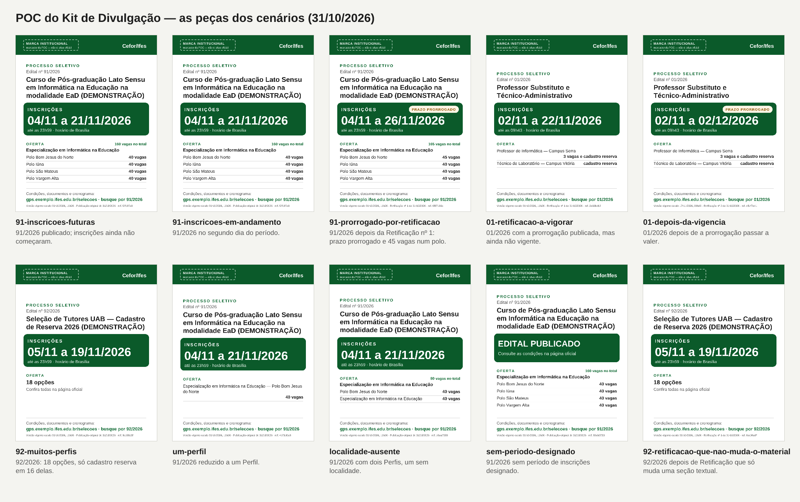

# POC integrada do Kit de Divulgação

**Data:** 2026-10-31 · **Commit de base:** `81ce6e94` (main) · **Natureza:** prova de conceito isolada
e reversível. Nada em `backend/` mudou: nenhuma migration, permissão nem dependência no
`pyproject.toml`, e o fluxo de publicação ficou intocado. Apagar esta pasta desfaz a POC inteira.

Ela continua o [estudo de viabilidade](../estudo-kit-de-divulgacao-2026-10-31.md) e responde à decisão
de produto que veio depois dele. O kit tem **dois produtos complementares**, o textual e o visual, e
os dois derivam de **uma única ficha estruturada**.

> **Não vira escopo por estar escrito aqui.** A abertura da spec espera a decisão do responsável pelo
> produto.

---

## 0. Veredito

**A POC atingiu o critério de sucesso.** Uma ressalva vem antes de tudo: **a qualidade visual
institucional não pode ser julgada sem a marca oficial**, e ela não existe no repositório.

| Critério da POC | Resultado | Evidência |
|---|---|---|
| Ficha textual correta e útil | **Sim** | 11 cenários; a ficha coincide com o cartão da vitrine em situação, período e oferta (`conferencia.json` de cada cenário) |
| O mesmo dado alimenta a peça | **Sim, provado por máquina** | Cada `<text>` do SVG declara o campo da ficha de onde veio, e a conferência recusa qualquer texto que não seja valor da ficha ou frase fixa do template |
| Qualidade visual suficiente para avaliação | **Sim, para avaliação**; não para publicação | [galeria](saidas/galeria.png). A faixa de marca é marcador declarado |
| Retificações e estados sem informação falsa | **Sim** | Prorrogação, Retificação a vigorar, Retificação que não muda o material, sem período, cancelado (§3) |
| Arquitetura proporcional | **Sim** | Uma dependência experimental (`resvg-py`); geração síncrona de ~45 ms por peça; nenhum armazenamento de arquivo |

**Recomendação: uma spec integrada do Kit de Divulgação**, com textos e peça juntos, sustentada pela
ficha (§9). Três condições externas ficam registradas na spec como dependências, e não como motivo
para dividi-la: a marca oficial, o aceite de um template pela comunicação e a decisão sobre o
`resvg-py`.

---

## 1. O que foi construído

```
doc/poc-kit-de-divulgacao-2026-10-31/
├── kit/
│   ├── ficha.py          a ficha estruturada, com proveniência, impressão e "de → para"
│   ├── textos.py         o kit textual: formas fechadas, Markdown e texto simples
│   ├── peca.py           o template SVG 1080 × 1350, medido pela fonte do Edital
│   ├── coerencia.py      as três conferências: peça ⊂ ficha, peça ⊂ textos, vocabulário
│   └── pacote.py         PNG (resvg-py), manifesto e ZIP reproduzível
├── test_poc_kit.py       o roteiro: publica os cenários pelo fluxo real e gera tudo
├── montar_apresentacao.py  galeria e wireframe, a partir do que foi gerado
├── wireframe.html        a tela única (maquete conceitual, autocontida)
└── saidas/<cenário>/     ficha.json, kit.md, kit.txt, textos.json, peça .svg/.png,
                          texto-alternativo.txt, manifesto.json, kit-NN-AAAA.zip, conferencia.json
```

**De onde vêm os dados.**
- Os Editais são os do corpus simulado da `070`: 01/2026, 91/2026 e 92/2026, com as suas
  Retificações reais (`backend/tests/fixtures/corpus_070/`).
- São **republicados pelos comandos reais**: rascunho, submissão, homologação, publicação e cada
  Retificação. A republicação usa `publicar_do_corpus` num banco de teste que nasce e morre com a
  rodada.
- Três variações saem do 91/2026, pelo `mudar` do próprio corpus: um Perfil, localidade ausente e sem
  período designado.
- O cancelado é o `editais_do_piloto.cancelado`, da `071`.
- Nenhum dado de pessoa entra.

**Rodar** (de `backend/`, com o PostgreSQL local):

```bash
DJANGO_SETTINGS_MODULE=config.settings.test TEST_DB_ENGINE=postgresql DB_USER=$USER DB_RUNTIME_USER=$USER DB_NAME=ps_poc_kit uv run --with resvg-py python -m pytest -p tests.conftest -c pyproject.toml --rootdir=. ../doc/poc-kit-de-divulgacao-2026-10-31/test_poc_kit.py -q
```

```bash
cd ../doc/poc-kit-de-divulgacao-2026-10-31 && uv run --no-project --with resvg-py python montar_apresentacao.py
```

`uv run --with` monta um ambiente efêmero, e o `uv.lock` não muda. **As datas das saídas dependem do
dia da rodada.** O corpus é deslocado para que o período caia no futuro próximo, como os testes da
`070` fazem. Esta rodada é de 31/10/2026.

---

## 2. Parte A — A ficha estruturada

Exemplo real: `saidas/91-prorrogado-por-retificacao/ficha.json`, o 91/2026 depois da Retificação
nº 1, no segundo dia do período.

| Campo | Valor |
|---|---|
| `modo` | `com-periodo` (os outros: `neutro` sem período designado, `indisponivel` com desfecho ou período encerrado) |
| `identificacao` | Edital nº 91/2026 |
| `titulo_sem_numero` | Curso de Pós-graduação Lato Sensu em Informática na Educação na modalidade EaD (DEMONSTRAÇÃO) |
| `unidade_sigla` | Cefor, **congelada na publicação** vigente, e não a do registro vivo |
| `situacao_rotulo` / `periodo_estado` | Aberta / aberto, **no instante de referência**, e só para decidir o modo |
| `periodo_curto` / `fim_hora` | 04/11 a 26/11/2026 / 23h59 |
| `prorrogado` / `fim_original_data` | sim / 21/11/2026 |
| `total_de_vagas` | 165, porque todas as opções têm vaga imediata (D-4, opção b) |
| `versao_ato` / `versao_desde_texto` | Retificação nº 1 de 31/10/2026 / 31/10/2026, 11h26 |
| `impressao` | `65f7106c…`: SHA-256 **só dos campos que o material usa** |

**Proveniência, campo a campo.** Vem da `ProvenienciaConteudo` da versão, e não é inferida:

| Campo | Valor | Caminho (004) | Ato |
|---|---|---|---|
| Número e ano | 91/2026 | `/number`, `/year` | Publicação original |
| Início das inscrições | 2026-11-04T09:00-03:00 | `/schedule/id=6e8a…/startAt` | Publicação original |
| **Término das inscrições** | 2026-11-26T23:59-03:00 | `/schedule/id=6e8a…/endAt` | **Retificação nº 1** |
| **Vagas — Polo Bom Jesus do Norte** | 45 | `/profiles/id=1b8b…/immediateVacancies` | **Retificação nº 1** |
| Vagas — Polo Iúna | 40 | `/profiles/id=5697…/immediateVacancies` | Publicação original |
| Unidade | Cefor | `Publicacao.unidade_sigla` | Retificação nº 1 |

**O que a ficha reutiliza, sem copiar regra:**

| Dado | Função existente |
|---|---|
| Versão vigente | `effective_version` (`publicacoes/application/selectors.py:27`) |
| Período | `periodo_de_inscricoes` (`inscricoes/domain/periodo.py:51`) |
| Desfecho | `desfechos` (`processos/application/selectors.py:89`) |
| Situação | `leitura.situacao_publica` (`portal/leitura.py:239`) |
| Quantidade | `leitura.quantidade_da_oferta` (`:571`) |
| Teto | `leitura.os_primeiros` (`:586`) |
| Original × vigente | `_versoes` (`interface/relatorio_do_edital.py:340`) |
| Retificação a vigorar | `retificacoes_a_vigorar` (`interface/agenda.py:701`) |

**Duas dessas são privadas** (`_versoes` e, na conferência, `portal/views._selecao_da_vitrine`).
Na POC isso é deliberado: provar que a ficha lê **o mesmo** que a vitrine valia mais do que
antecipar a refatoração. Na produção elas saem para um módulo nomeado (§8).

**O que a ficha não faz.**
- Não infere curso, campus nem modalidade. "Polo Iúna" é o `locality` literal.
- A frase "em 4 localidades" só aparece quando **toda** opção declara a sua.
- Não lê tabela de elaboração.
- Não aplica versão de vigência futura: só a anuncia.

---

## 3. Parte B e Parte D — Textos, peça e coerência

### Os onze cenários

| Cenário | Modo | Peça | O que ficou provado |
|---|---|---|---|
| `91-inscricoes-futuras` | com período | ✓ | Nenhum "abertas": a peça e o texto dizem o período, e não o estado |
| `91-inscricoes-em-andamento` | com período | ✓ | **Mesmo SVG e mesmo PNG do anterior** (SHA-256 iguais): a norma não muda com o relógio |
| `91-prorrogado-por-retificacao` | com período | ✓ | Selo "PRAZO PRORROGADO"; aviso "término 21/11 → 26/11; Polo Bom Jesus 40 → 45 vagas" |
| `01-retificacao-a-vigorar` | com período | ✓ | Nota: "Há Retificação publicada que passa a valer em 17/11… gere de novo"; o manifesto lista o marco |
| `01-depois-da-vigencia` | com período | ✓ | Desatualização "término 22/11 → 02/12", depois que a vigência chega |
| `92-muitos-perfis` | com período | ✓ | 18 opções viram contagem; o título de 208 caracteres não cabe e a peça usa o **título do Processo**, omissão declarada |
| `92-retificacao-que-nao-muda-o-material` | com período | ✓ | Retificação publicada que só muda uma seção: **impressão igual, nenhum alarme** ("ele continua valendo") |
| `um-perfil` | com período | ✓ | Rótulo longo: a quantidade desce de linha em vez de invadir o texto |
| `localidade-ausente` | com período | ✓ | A linha sem localidade usa o nome; nenhum "não informado" |
| `sem-periodo-designado` | neutro | ✓ | "EDITAL PUBLICADO"; **nenhuma ocorrência de "inscri"** em texto ou peça (conferido) |
| `cancelado` | indisponível | — | "Edital cancelado em 31/10/2026. Não há material…" |

### As conferências, que rodam sobre o material produzido em cada cenário

1. **Peça ⊂ ficha.** Cada `<text>` traz `data-campo`. O conteúdo precisa ser o valor daquele campo,
   e um valor quebrado em linhas precisa ser reconstituído pelas linhas juntas. Frase fixa só passa
   se for uma das 11 do template. Texto sem campo reprova.
2. **Peça ⊂ textos.** Toda data, toda quantidade e o número que a peça mostra aparecem no kit
   textual. Quem usar só os textos não perde dado que a imagem dava.
3. **Vocabulário.**
   - Ficam fora: tempo relativo ("faltam", "hoje", "último dia"), estado do momento ("inscrições
     abertas", "estão abertas"), promessa ("garanta", "última oportunidade") e juízo ("aprovado",
     "resultado final").
   - Fica fora também todo o vocabulário interno (marco, recorte, apuração, homologa).
   - A lista `PROIBIDAS` do portal entra inteira.
   - Sem período designado, nenhuma palavra sobre inscrição.
4. **Coerência com o portal.** Situação, início e oferta da ficha são comparados aos do cartão da
   vitrine (`_selecao_da_vitrine`) no mesmo instante.

**Resultado: zero problemas nos onze cenários.** Os textos de cada cenário estão em `kit.md` e
`kit.txt`. Por exemplo, [`91-prorrogado-por-retificacao/kit.md`](saidas/91-prorrogado-por-retificacao/kit.md)
traz a legenda, o resumo institucional, a chamada para o site, o texto para mensagens, o link oficial,
o link por opção e a ressalva.

### Decisões de redação que a POC tomou, a confirmar na spec

- **"Inscrições de 04/11/2026 a 26/11/2026, até as 23h59 (horário de Brasília)".** É a norma, e
  continua verdadeira enquanto o Edital não mudar.
- **Na legenda, "Acesse gps…/selecoes e busque por 91/2026", e não o link.** Link em legenda de rede
  social não é clicável, e o endereço da seleção é um UUID. A busca pelo número existe hoje e leva à
  mesma página.
- **Ressalva fixa:** "As informações repetem o Edital nº 91/2026, conforme a versão vigente desde
  …. Em caso de divergência, vale o Edital."
- **"O Cefor/Ifes publicou o Edital…".** A sigla "Ifes" é fixa no texto, como na marca do portal
  (`_marca_da_unidade.html`).

---

## 4. Parte C — A peça visual



**Motor:** SVG composto em Python, rasterizado pelo `resvg-py` 0.5.0 com a **Edital Sans** (as fontes
que o Edital embute) e `skip_system_fonts=True`.

**O que foi medido:**

| | Medida |
|---|---|
| Tempo de rasterização | 42–56 ms por peça (Mac arm64, 11 rodadas) |
| Determinismo | SVG idêntico entre duas composições e PNG idêntico entre duas rasterizações, **em todos os cenários** |
| Tamanho | PNG de 100–130 KB; ZIP de ~150 KB |
| Wheels | Existem para Linux x86_64 e aarch64 (manylinux2014 e musllinux), com Python 3.13 resolvido por `uv pip compile --only-binary` |

**O que não foi verificado:**
- PNG idêntico **entre plataformas** (Mac × contêiner Linux);
- a licença do `resvg-py`, que o metadado do PyPI não declara (o resvg é MIT/Apache-2.0);
- a manutenção de longo prazo: há um mantenedor principal e pacotes de nome parecido.

As três ficam para a decisão D-7.

**Regras de composição que a POC testou:**
- Quebra de linha pela **métrica real** da fonte (`MetricaEmbutida`) e pela `_quebrar` do compositor
  do Edital. Uma medida só, para quebrar e para desenhar.
- **O título desce de corpo (52 → 46 → 40 px) e, se não couber, cai para o título do Processo.** Se
  nenhum dos dois couber, sai da peça com a omissão declarada. **Nunca é truncado com reticências.**
- A oferta passa a contagem acima de 4 opções, ou quando os rótulos não distinguem as opções.
- **Caractere sem grafia recusa a peça** e nomeia o caractere, como no Edital.
- O endereço do rodapé é medido e desce até 28 px. Se ainda assim não couber, a peça é recusada.
- O corpo se desloca para dentro do espaço livre, para que peças curtas não pareçam cortadas.
- Texto alternativo em frases, com **o que a peça mostra**. Também vai como `<desc>` no SVG.

**Defeitos que só a inspeção visual pegou**, todos corrigidos antes desta versão:

1. Quatro polos com título de três linhas passavam do rodapé. A recusa funcionou, mas o template não
   comportava o caso comum: foi compactado.
2. O endereço do rodapé ultrapassava a margem direita.
3. "3 vagas e cadastro reserva" invadia o rótulo do Perfil, porque a coluna tinha largura fixa.
4. O 92/2026 ficava sem dizer do que se tratava a seleção.

**Lição:** as conferências automáticas provam *coerência*, e não *legibilidade*. A spec precisa das
duas, com um teste de colisão geométrica (as caixas de texto não se sobrepõem e não saem da área
útil). A POC só tem a recusa por altura.

**Qualidade visual — avaliação honesta:**

| Aspecto | Situação |
|---|---|
| Hierarquia | Boa: identificação → título → período em corpo grande → oferta → destino |
| Legibilidade no celular | Boa a 1080 px. A menor letra útil tem 32 px, e só o selo de versão tem 20 px, de propósito |
| Contraste | Tokens do produto, já aprovados em AA (`tokens.css`) |
| Marca | **Marcador declarado.** É o limite principal da avaliação |
| Tipografia | Liberation Sans (Edital Sans): correta e neutra, sem personalidade de campanha |
| Espaço vazio com pouca oferta | Atenuado; continua visível em 01/2026 |
| Vários formatos | **Só feed 4:5.** Stories não foi feito |

---

## 5. Parte E — A tela

[`wireframe.html`](wireframe.html) é autocontido e abre no navegador. Ele **mostra o material real do
cenário prorrogado**, e não texto redigitado. Está marcado como maquete conceitual no topo.

Uma tela, quatro blocos, e nenhuma escolha que o sistema possa fazer sozinho:

1. **Confira as informações oficiais.**
   - Situação no instante, período com prorrogação, oferta por opção, unidade, versão usada com a
     referência (`ref. 65f7106c`) e página oficial.
   - Acima de tudo, quando for o caso, a faixa **"Material anterior desatualizado. Mudou: término
     das inscrições (21/11/2026 → 26/11/2026)…"**.
2. **Textos para divulgação**, cada um com o seu "Copiar".
3. **Criativo**, com "Baixar PNG", "Baixar SVG" e "Copiar texto alternativo".
4. **Exportar tudo**: o ZIP com textos, peça, ficha e manifesto.

Ao pé, os outros estados da mesma tela: Retificação a vigorar, sem período, título longo e cancelado.

**O que saiu do fluxo e por quê:**
- **Momento de comunicação:** a situação decide.
- **Template:** há um só.
- **Formatos:** o pacote leva tudo.

O operador não escolhe entre texto e imagem: a tela já traz os dois.

---

## 6. Parte F — Rastreabilidade proporcional

**Três instantes, que o manifesto separa e nunca chama de "validade":**

| Instante | Exemplo (`01-retificacao-a-vigorar/manifesto.json`) | O que diz |
|---|---|---|
| `gerado_em` | 31/10/2026, 11h26 | Quando o material foi produzido |
| `versao.vigente_desde` + `ato` | 31/10/2026, 11h26 — Retificação nº 1 | Qual estado publicado ele descreve |
| `proximos_marcos_conhecidos` | 17/11, 09h43, Retificação publicada passa a valer; 22/11, 09h43, término do período | O que **já se sabe** que vai mudar. Uma Retificação de amanhã não está aqui, e o manifesto diz isso |

**A impressão da ficha é o mecanismo, e a POC mostrou por quê:**
- No **92/2026**, a Retificação publicada muda o `content_hash` da versão, mas **a impressão continua
  igual**. O kit diz "continua valendo", e o `content_hash` daria falso alarme.
- No **91/2026**, a impressão muda e o kit nomeia exatamente o que mudou, de → para.

**Proposta para produção, sem implementar agora:**
- Um registro append-only por geração: quem, quando, versão, impressão, ficha serializada.
- Nenhum arquivo guardado. A regeneração é determinística, e o SVG idêntico prova isso.
- Ao abrir o kit, comparar a ficha de agora com a da última geração e mostrar a faixa "de → para".
- Opcionalmente, a mesma linha no detalhe do Edital.
- **Sem aprovação de peça**, sem versionamento de arquivo e sem regeneração automática.

A decisão sobre a tabela, a permissão e o nome fica para a spec, como pedido.

---

## 7. Parte G — Visão evolutiva: a comunicação do ciclo

A ficha admite novos marcos como **novos modos**, sem virar sistema genérico de marketing: cada marco
é um conjunto fechado de campos com fonte publicada. O que existe hoje:

| Marco | Fonte publicada e confiável? | Onde | O que falta |
|---|---|---|---|
| Edital publicado | **Sim** | `Publicacao`, `VersaoConsolidada` | Nada (a POC faz) |
| Inscrições (abertura, período) | **Sim** | `periodo_de_inscricoes` | Nada (a POC faz) |
| Proximidade do encerramento | **Sim**, como data | Mesmo período | Só peça com data absoluta. "Últimos dias" continua proibido, porque é juízo que fica falso |
| Prorrogação | **Sim** | Original × vigente | Nada (a POC faz) |
| Resultado publicado | **Sim, por Perfil × etapa × lista**, preliminar ou definitivo | `PublicacaoResultado` (`divulgacao/models.py:35`); vigente em `divulgacao/application/selectors.py:16` | Regra de agregação: "Resultado preliminar publicado para N opções". O prazo de recurso já existe (`prazos_de_recurso`). **Sem nomes nem posições** (conteúdo nominal) |
| Convocação | **Não** | O GPS não publica convocação (`convocacao/models.py:374-383`) | Uma funcionalidade de **publicação** de convocação, com o seu ato. O kit não pode divulgar o que o sistema não publica |
| Sorteio público | Sim, como ato | `sorteios` | Regra de texto; é conteúdo nominal |
| Próximo Evento do cronograma | Só como **citação** da descrição | `agora_e_proximo` | O tipo é texto livre: o sistema não sabe que um Evento é "resultado". Precisa de tipagem de Evento, que hoje é escopo recusado (`047`, RC-76) |

**A distinção que precisa sobreviver:** resultado publicado é ato por Perfil, etapa e lista, e
convocação é ato individual que o GPS **não** publica. Um "Kit de Resultado" é possível com regra
própria; um "Kit de Convocação" exige antes uma feature que não existe.

---

## 8. Arquitetura proposta para produção

```
VersaoConsolidada vigente ─┐
Publicacao (unidade) ──────┤
desfechos / período ───────┼─► ficha_da_selecao(edital, agora)      ◄── a página da seleção
Retificação a vigorar ─────┘        │  (módulo de leitura, sem gravação)     passa a ler daqui
                                    ├─► textos (formas fechadas) ──► tela / ZIP
                                    ├─► peça SVG (template, métrica) ──► PNG (resvg) ──► tela / ZIP
                                    └─► impressão ──► registro da geração (append-only)
```

| Peça | Situação na POC | Na produção |
|---|---|---|
| Ficha | Lê funções existentes, duas delas privadas | **Extrair** a leitura do cartão e da página (`portal/views._selecao`, `_selecao_da_vitrine`) e `_versoes` para um módulo de leitura nomeado, consumido pelo portal **e** pelo kit. É a refatoração que a POC evitou |
| Textos | Funções puras sobre a ficha | Iguais, com varredura de vocabulário no padrão de `tests/portal/test_vocabulario_das_telas_publicas.py` |
| Peça | Template em Python, medição pela fonte do Edital | Igual. A métrica e o `_quebrar` saem do `pdf.py` para módulo compartilhado **sem mudar os bytes do PDF**, garantido pelas fixtures de contrato |
| Rasterização | `resvg-py` efêmero | Dependência declarada, se a D-7 aprovar. Pillow continua barrado pelo guardião de leitura de documento e não seria necessário |
| Prévia na tela | Imagem embutida no wireframe | Endpoint da própria origem devolvendo `image/png` (a CSP só aceita `'self'`). Se servir SVG, com cabeçalho próprio (`default-src 'none'`) |
| Exportação | `zipfile` com data fixa | Igual, síncrono, no padrão do relatório 099 |
| Endereço | `BASE` fixo na POC | `request.build_absolute_uri`, como os avisos. Não há setting de URL base |
| Rastreio | Impressão no manifesto | Registro append-only + faixa "de → para" |
| Permissão | — | Capacidade própria negada por padrão (D-1) |

**Síncrono basta:** ~45 ms por peça, uma peça por kit.

---

## 9. Recomendação para a spec

**Uma spec integrada, "Kit de Divulgação do Edital",** com textos e peça entregues juntos. A
arquitetura compartilhada torna a divisão artificial:
- a ficha é o núcleo;
- os textos não dependem da peça;
- a peça não acrescenta dado nenhum.

A spec pode ter incrementos internos (ficha e textos → peça → pacote) sem virar duas features.

**Dependências declaradas na spec.** Nenhuma bloqueia o desenvolvimento, e todas bloqueiam a
conclusão:

| # | Dependência | Bloqueia |
|---|---|---|
| D-5 | Ativos oficiais de marca, ou o manual | A versão publicável da peça. A POC prova o resto com marcador |
| D-2 | A comunicação avaliar a peça desta POC e aprovar **um** template | O critério de aceitação visual |
| D-7 | `resvg-py`: licença, manutenção, PNG igual em Linux | A dependência no `pyproject.toml` |
| D-1 | Quem gera (capacidade e papel) | A porta da tela |
| D-3 | Manchete curta: o título do Processo como reserva bastou nos três Editais; o campo digitado continua opção | A regra de título |

**Requisitos que a POC tornou concretos:**
- a ficha lê só a versão vigente e coincide com a vitrine no mesmo instante;
- nenhum tempo relativo nem estado do momento em texto ou peça;
- "inscrição" proibida sem período designado;
- toda peça com `data-campo` por texto e conferência peça ⊂ ficha ⊂ textos;
- recusa, e nunca truncamento;
- impressão por campo, e não `content_hash`;
- três instantes no manifesto, sem promessa de validade;
- texto alternativo do que a peça mostra;
- ZIP e SVG reproduzíveis.

**Critérios objetivos de conclusão:**

1. Os onze cenários desta POC, mais **cancelado** e **período encerrado**, viram casos automatizados
   e passam no `make test-pg`.
2. A página da seleção e o kit leem a mesma ficha extraída, e um teste compara as duas no mesmo
   instante.
3. Peça ⊂ ficha ⊂ textos e a varredura de vocabulário passam em todos os estados.
4. **Teste de colisão geométrica**: nenhum texto fora da área útil e nenhuma sobreposição, em todos
   os cenários e num caso sintético de rótulos e títulos no limite.
5. Uma Retificação de prorrogação produz a faixa "de → para". Uma Retificação que não toca o
   material não a produz.
6. A mesma ficha produz o mesmo SVG e o mesmo ZIP. O PNG é idêntico no ambiente de produção.
7. A comunicação aprova o template **com a marca oficial aplicada**, e confere um Edital real
   montado pela interface sem corrigir dado. É a validação humana.
8. Uma dependência nova, aprovada (`resvg-py`). `make lint check test-pg` verde.

---

## 10. Achados registrados durante a POC (não são escopo)

- **A hora de término do 01/2026 do corpus é 09h43**, herdada do `seed_demo`, que gera instantes com
  segundos. A ficha diz a verdade ("até as 09h43"), mas o caso mostra que um Edital real com término
  fora de hora redonda também sai assim na peça. Não é defeito; é o dado.
- **Duas opções de mesmo nome, uma sem localidade**, produzem uma linha com o nome repetido abaixo do
  cabeçalho com o mesmo nome. É honesto e pouco elegante. A spec pode preferir contagem nesse caso.
- **`_selecao` usa a unidade viva** (`portal/views.py:148`), enquanto a ficha usa a congelada. É o
  achado A-2 do estudo, aqui só confirmado.
